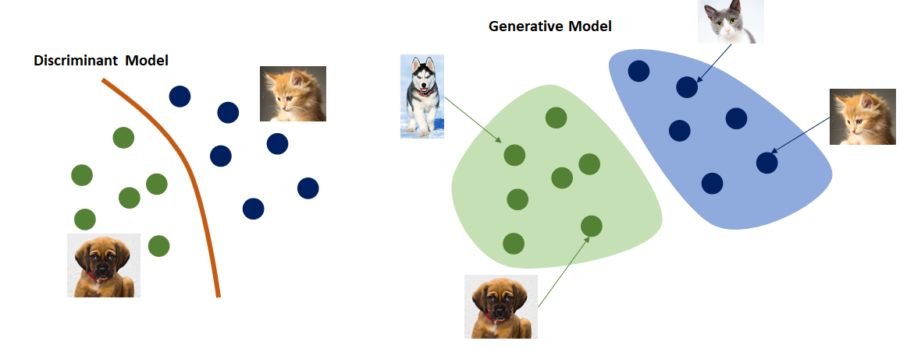
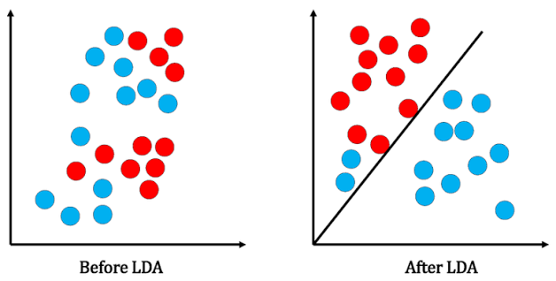
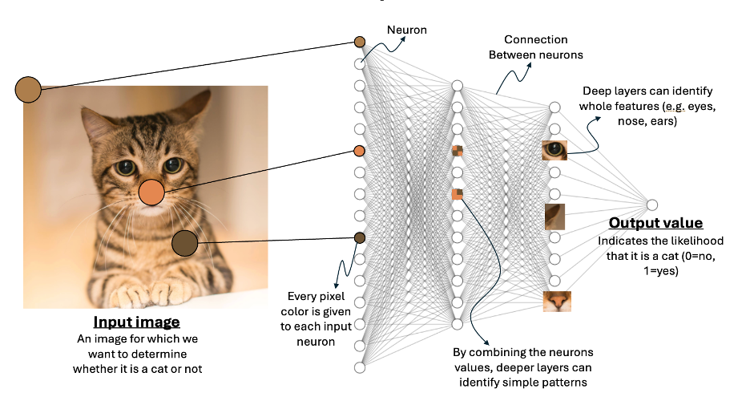

# 02. Generative versus Discriminative Models

## 1. Learning Objectives

After completing this chapter, you should be able to:

- Explain generative and discriminative modeling at a conceptual level.
- Compare generating an email with classifying an email as spam.
- Compare image generation with image classification.
- Distinguish generation, classification, and regression as application tasks.
- Explain why a generative model can also perform classification when given suitable instructions.
- Distinguish a model's learning approach from the task an application asks it to perform.

<br/>

## 2. Generative and Discriminative Modeling

Machine learning models can learn different kinds of patterns from data. Two useful conceptual categories are **generative models** and **discriminative models**.



### 2.1 Discriminative Models

A **discriminative model** learns to distinguish between classes or predict a target from input features.

Examples include:

- Predicting whether an email is spam or not spam.
- Classifying an image as a cat or a dog.
- Predicting whether a transaction is fraudulent.
- Predicting a house's sale price from its features.

A discriminative model often produces a class label, a probability or score, or a numerical prediction.

<br/>

---

### Theory:

A discriminative model focuses entirely on drawing boundaries between different classes of data. Instead of trying to understand *how* the data was created (which is what generative models do), it asks a direct, practical question: "Given this specific input, what is the probability it belongs to a certain category?"

Here is the step-by-step breakdown of how a discriminative model (like Logistic Regression or a Neural Network) uses conditional probability at the backend to learn and make predictions.

<br/>



<br/>

#### Step 1: The Core Objective — $P(Y\vert{}X)$

The entire foundation of a discriminative model rests on **conditional probability**, written mathematically as $P(Y\vert{}X)$.

* **$X$** represents your input data (the features, like pixels in an image or words in an email).
* **$Y$** represents the target label (the category, like "Cat" or "Spam").
* **$P(Y\vert{}X)$** reads as: "The probability of outcome $Y$ *given* the evidence $X$."

The model's sole job is to calculate this exact probability directly.

<br/>

#### Step 2: The Linear Backend (Weights and Biases)

Before the model can calculate a probability, it needs to process the raw input data. It assigns an importance factor (**weight**, $W$) to every feature in $X$, and adds a baseline offset (**bias**, $b$).

Internally, it calculates a raw score (often called $z$ or logits):


$$z = W \cdot X + b$$

At this stage, $z$ is just a raw number that can range from negative infinity to positive infinity. It is not yet a probability.

<br/>

#### Step 3: Squashing into Probabilities (The Activation Function)

To turn the raw score $z$ into a valid conditional probability $P(Y\vert{}X)$—which must be a number strictly between 0 and 1—the model passes $z$ through a mathematical "squashing" function.

For binary classification (two classes, like Spam vs. Not Spam), it uses the **Sigmoid function**:


$$P(Y=1\vert{}X) = \frac{1}{1 + e^{-z}}$$

For multi-class classification (like classifying images of cats, dogs, and birds), it uses the **Softmax function**, which ensures the probabilities of all possible classes add up to exactly 1:


$$P(Y=k\vert{}X) = \frac{e^{z_k}}{\sum_{i} e^{z_i}}$$

<br/>

#### Step 4: Measuring the Error (Cross-Entropy Loss)

During training, the model needs to know if its calculated probabilities are actually correct. It compares its predicted $P(Y\vert{}X)$ against the actual truth.

If an email is actually spam ($Y=1$), the model *should* predict $P(Y=1\vert{}X) \approx 1.0$. If the model predicts $0.1$, it has made a huge error. To quantify this, the backend uses a loss function, typically **Log Loss (Cross-Entropy)**.

For a single data point in binary classification, the backend calculates:


$$Loss = - [y \log(P(Y=1\vert{}X)) + (1 - y) \log(1 - P(Y=1\vert{}X))]$$


This formula heavily penalizes the model if it is highly confident in the wrong answer.

<br/>

#### Step 5: Learning and Adjusting (Maximum Likelihood)

The backend's ultimate goal is **Maximum Likelihood Estimation (MLE)**. It wants to find the exact set of weights ($W$) that makes the known training data as probable as possible.

To do this, it uses an optimization algorithm like **Gradient Descent**. The model calculates the derivative (gradient) of the loss with respect to the weights. It then slightly adjusts the weights in the opposite direction of the gradient to reduce the error:

1. If $P(Y\vert{}X)$ was too low for the correct class, it tweaks $W$ to increase it next time.
2. It repeats this loop across thousands of examples until the probabilities are highly accurate.

<br/>

#### Step 6: Inference (Making the Final Decision)

Once training is complete and the weights are locked, you feed the model a brand new piece of data.

1. It computes $z = W \cdot X + b$.
2. It runs $z$ through Sigmoid/Softmax to get $P(Y\vert{}X)$.
3. **The Decision Rule:** It sets a threshold to make a final choice. If $P(Y=\text{Spam}\vert{}X) > 0.5$, it classifies the email as Spam. The boundary where $P(Y\vert{}X) = 0.5$ is literally the decision boundary separating the classes.

---

<br/>

### 2.2 Generative Models

A **generative model** learns patterns or structure in data and can use what it has learned to generate new examples or content.

Examples include:

- Generating an email from a short instruction.
- Creating an image from a text description.
- Producing speech from written text.
- Generating a continuation of a text sequence.

The output is newly generated content, rather than only a label or numerical prediction.


> **Important:** These categories describe modeling approaches, not an absolute rule about every task a model can perform. A generative model can be prompted to classify, and some generative models can also be used to estimate or score inputs.

<br/>

---
### Theory

While a discriminative model draws a boundary to separate data, a **generative model** tries to understand the underlying blueprint of how the data was created in the first place. Instead of asking, "Given this image, is it a cat or a dog?", it asks, "What are the core characteristics that make an image a cat?"

Here is the step-by-step breakdown of how a generative model (like Naive Bayes, GANs, or Diffusion models) uses joint probability at the backend.

<br/>



<br/>

#### Step 1: The Core Objective — $P(X, Y)$

The foundation of a generative model is **joint probability**, written as $P(X, Y)$.

* **$X$** represents the input features (e.g., the pixels of an image).
* **$Y$** represents the class label (e.g., "Cat").
* **$P(X, Y)$** reads as: "What is the probability of these specific pixels occurring *alongside* the label 'Cat'?"

Instead of just looking at $X$ to predict $Y$, the model wants to map out the entire universe of both $X$ and $Y$ existing together.

<br/>

#### Step 2: Breaking it Down (The Likelihood and Prior)

To calculate the joint probability, the backend splits the problem into two distinct parts using the rules of probability:


$$P(X, Y) = P(X\vert{}Y) \cdot P(Y)$$

1. **The Prior $P(Y)$:** How common is this class overall? (e.g., Are 30% of all our training images cats?)
2. **The Likelihood $P(X\vert{}Y)$:** This is the magic of generative AI. It asks: "Assuming we *know* we are looking at a cat, what is the probability distribution of its pixels?" It learns the typical colors, shapes, and textures associated strictly with cats.

<br/>

#### Step 3: Learning the Distribution (Training)

During training, the generative model doesn't just tweak weights to minimize a classification error. It attempts to mathematically capture the **distribution** of the data.

If the model is learning what a "cat" looks like, it calculates the mean and variance (the average look and how much it varies) of every pixel across all cat images. For complex modern AI like Diffusion models or GANs, this means mapping a massive, high-dimensional probability landscape where realistic cat images exist in "high probability" zones, and random static exists in "low probability" zones.

<br/>

#### Step 4: Making Decisions (Using Bayes' Theorem)

If you want to use a generative model to classify a new image, it calculates the joint probability $P(X, Y)$ for all possible labels.

To make the final classification, it converts those joint probabilities back into a conditional probability $P(Y\vert{}X)$ using **Bayes' Theorem**:


$$P(Y\vert{}X) = \frac{P(X\vert{}Y) \cdot P(Y)}{P(X)}$$


It essentially asks: "Did this image more likely come from my internal mathematical model of a Cat, or my internal model of a Dog?"

<br/>

#### Step 5: The Ultimate Power — Generation

Because the model has mapped the likelihood $P(X\vert{}Y)$, it can do something a discriminative model cannot: **create brand new data**.

If you ask the model to generate a cat, it fixes $Y = \text{"Cat"}$. It then goes to its learned distribution for $P(X\vert{}Y=\text{"Cat"})$ and mathematically samples a random point from the high-probability region of that space. The result is a brand new configuration of features $X$ (an image of a cat) that did not exist in the training data, but perfectly fits the statistical rules of what a cat should look like.

---

<br/>

## 3. Email Example: Generate an Email vs. Classify Spam

Consider two applications that work with email but have different goals.

### 3.1 Generating an Email

**Task:** Write an email asking a manager for a meeting.

- **Input:** “Write a polite email requesting a meeting with my manager next week.”
- **Model behavior:** Generates text that follows the instruction.
- **Output:** An email draft with a greeting, request, and closing.

Example output:

> Subject: Request for a Meeting  
>
> Hello,  
>
> Could we schedule a meeting sometime next week to discuss my current tasks and priorities? Please let me know what time works best for you.  
>
> Best regards

The application needs newly composed content, so generation is required.

<br/>

### 3.2 Classifying an Email as Spam

**Task:** Decide whether an incoming email is spam.

- **Input:** The email's subject, body, sender information, and other permitted features.
- **Model behavior:** Predicts a category such as `spam` or `not_spam`.
- **Output:** A label or score, for example `spam`.

Example:

```text
Input: "Congratulations! Claim your prize now. Click this link."
Prediction: spam
```

The application needs a category, not a newly written email. A conventional discriminative classifier is a natural fit for this task.

<br/>

### 3.3 Comparison

| Aspect | Email generation | Spam classification |
|---|---|---|
| Goal | Compose new text | Assign a category |
| Typical input | Instructions and context | An email and its features |
| Typical output | Email draft | `spam` or `not_spam` |
| Application task | Generation | Classification |
| Suitable approach | Generative model | Often a discriminative classifier |

<br/>

## 4. Image Example: Image Generation vs. Image Classification

### 4.1 Image Generation

**Task:** Create an image of a golden retriever playing in a park.

- **Input:** A text prompt describing the desired scene.
- **Model behavior:** Generates visual content based on the prompt.
- **Output:** A new image.

The application needs new visual content, so image generation is required.

<br/>

### 4.2 Image Classification

**Task:** Determine whether an existing image contains a cat or a dog.

- **Input:** An existing image.
- **Model behavior:** Predicts the image's class.
- **Output:** A label such as `cat` or `dog`.

The application needs a label for existing content, not a new image.

<br/>

### 4.3 Comparison

| Aspect | Image generation | Image classification |
|---|---|---|
| Goal | Create a new image | Identify the class of an image |
| Input | Often a text prompt, sometimes an image too | An existing image |
| Output | Generated image | Class label or scores |
| Application task | Generation | Classification |
| Typical approach | Generative image model | Often a discriminative vision model |

<br/>

## 5. Three Important Application Tasks

Generation, classification, and regression are different task types. The task is defined by the output the application needs.

### 5.1 Generation

**Purpose:** Produce new content.

Examples:

- Write a product description.
- Generate an image from a prompt.
- Summarize a report.
- Convert text into speech.

**Typical output:** Text, image, audio, video, code, or structured content.

<br/>

### 5.2 Classification

**Purpose:** Assign an input to one or more categories.

Examples:

- Spam vs. not spam.
- Cat vs. dog.
- Fraudulent vs. legitimate transaction.
- Customer likely to churn vs. unlikely to churn.

**Typical output:** A class label and sometimes a score or probability.

<br/>

### 5.3 Regression

**Purpose:** Predict a numerical value.

Examples:

- Estimate a house price.
- Predict tomorrow's electricity demand.
- Estimate delivery time in minutes.
- Predict a customer's expected spending.

**Typical output:** A number, such as `₹45,00,000` or `32 minutes`.

<br/>

### 5.4 Task Comparison

| Task | What the application needs | Example output |
|---|---|---|
| Generation | Newly produced content | A drafted email |
| Classification | A category | `spam` |
| Regression | A numerical value | `₹45,00,000` |

**Key distinction:** A task is not determined solely by whether its input is text, an image, or a table. It is determined by the goal and the required output.

<br/>

## 6. Can a Generative Model Perform Classification?

Yes. A generative model can often perform classification when given suitable instructions and the relevant input.

For example, a language model can be asked:

```text
Classify the following email as spam or not_spam.
Return only one label.

Email:
"Congratulations! Claim your prize now. Click this link."
```

A possible response is:

```text
spam
```

The model has generated a short textual response, but the **application task** is classification because the application needs a category.

This reveals an important distinction:

- **Model approach:** How the model learns or represents data and produces outputs.
- **Application task:** What the application asks the model to do and what result it needs.

A generative model can produce a classification label. Conversely, a conventional discriminative classifier is not normally designed to compose a full email or create a new image.

<br/>

### 6.1 Important Practical Considerations

Using a generative model for classification may be useful when labels are described in natural language or when the task needs contextual interpretation. However:

- The model may return an invalid label or extra explanation.
- Its predictions may be inconsistent across requests.
- It may be slower or more expensive than a small classifier.
- Its outputs should be evaluated against labeled examples.
- For a high-volume, narrow classification task, a dedicated classifier may be a better fit.

If an application requires a strict output such as `spam` or `not_spam`, validate the response and handle invalid outputs safely.

<br/>

## 7. Simple Python Examples

The following examples demonstrate the difference in task outputs. They use ordinary Python to illustrate the concepts; they do **not** train machine learning models.

### 7.1 Classification-Style Output

```python
email = "Congratulations! Claim your prize now."

# Illustrative rule only, not a trained ML model
if "claim your prize" in email.lower():
    prediction = "spam"
else:
    prediction = "not_spam"

print(prediction)
```

Possible output:

```text
spam
```

This example assigns a category using a fixed rule. A real ML classifier would learn decision patterns from labeled training data.

<br/>

### 7.2 Regression-Style Output

```python
# Illustrative prediction, not a trained regression model
predicted_house_price = 4_500_000

print(f"Predicted price: ₹{predicted_house_price:,.0f}")
```

Possible output:

```text
Predicted price: ₹4,500,000
```

A real regression model would estimate the value from input features such as area, location, and number of rooms.

<br/>

### 7.3 Generation-Style Output

```python
# Placeholder illustrating the input/output contract.
# A real application would call a generative model.
prompt = "Write a polite email requesting a meeting next week."

generated_email = (
    "Subject: Meeting Request\n\n"
    "Hello,\n"
    "Could we schedule a meeting next week? "
    "Please let me know what time works best.\n\n"
    "Best regards"
)

print(generated_email)
```

This example uses a predefined string to illustrate the shape of generated content. It does not actually call a generative model. A real application would send the prompt to a model API or local model and handle the returned response.

<br/>

## 8. Practice: Categorize Six Tasks

For each scenario, identify the main task and decide whether new content must be generated.

| # | Scenario | Main task | Is new content generation needed? |
|---|---|---|---|
| 1 | Draft a thank-you email after an interview. | Generation | Yes |
| 2 | Determine whether a message is spam. | Classification | No; a label is needed |
| 3 | Estimate the selling price of a used car. | Regression | No; a numerical value is needed |
| 4 | Create an illustration of a city at sunset. | Generation | Yes |
| 5 | Identify whether a photograph shows a cat or a dog. | Classification | No; a label is needed |
| 6 | Predict the number of products a store will sell tomorrow. | Regression | No; a numerical forecast is needed |

These are the primary task types in each scenario. Real applications may combine multiple tasks—for example, classifying customer feedback and then generating a summary.

<br/>

### Practice Questions

1. Why is writing an email different from classifying an email?
2. Why are image generation and image classification different tasks even though both involve images?
3. What kind of output does regression produce?
4. Can a generative model classify an email? Explain.
5. What should an application do if a model returns a label outside the permitted set?

<br/>

## 9. Common Misconceptions

| Misconception | Correct understanding |
|---|---|
| Every generative model can only generate long-form content. | It may produce a short label, structured data, or other outputs. |
| If a language model returns `spam`, the application task must be generation. | The response is generated text, but the application task is classification. |
| Every classifier is a generative model because it produces an output. | Producing an output does not make a model generative in the modeling sense. |
| Classification and regression are the same. | Classification predicts categories; regression predicts numerical values. |
| The input modality determines the task. | The goal and required output determine the task. |
| Generative models are always better than discriminative models. | The appropriate choice depends on requirements, performance, cost, latency, and constraints. |

<br/>

## 10. Chapter Summary

- **Generative models** learn patterns that can be used to produce new content.
- **Discriminative models** commonly learn to distinguish classes or predict targets from input features.
- **Generation** produces content, **classification** assigns categories, and **regression** predicts numerical values.
- Generating an email and classifying an email as spam are different application tasks.
- Generating a new image and classifying an existing image are also different tasks.
- A generative model can perform classification when instructed to return a label.
- The model's learning approach and the application's requested task are related but distinct.
- Model selection should be based on the application's requirements and measured performance, not only on the model category.

<br/>

## 11. Checkpoint

**Question:** How can you distinguish a model's learning approach from the task an application asks it to perform?

**Answer:** The model's learning approach describes how it learns patterns and how it represents or produces outputs. The application task describes the result the application needs. For example, a generative language model can be instructed to classify an email and return `spam`. The model produces a textual response, but the application's task is classification because it needs a category rather than newly composed content.

Before moving on, make sure you can categorize the six practice scenarios and explain why each task requires content generation, a category, or a numerical prediction.

**Next chapter:** 03. Training, Inference, and Generation.
