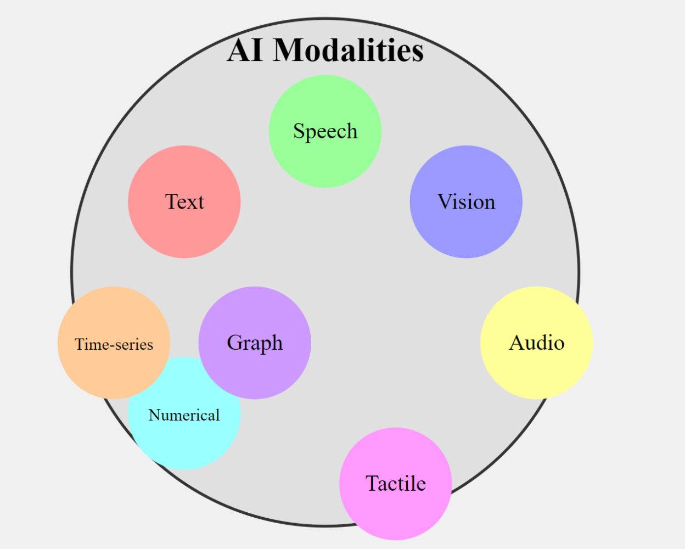

# 04. Modalities and Outputs

## 1. Learning Objectives

After completing this chapter, you should be able to:

- Define a modality and distinguish input modalities from output modalities.
- Identify common text, image, audio, and video generation tasks.
- Recognize image understanding, speech recognition, and video understanding as related capabilities.
- Explain multimodal inputs and outputs using simple examples.
- Understand structured text outputs such as JSON, extracted fields, and code.
- Distinguish understanding or analyzing existing content from generating new content.

<br/>

## 2. What Is a Modality?

A **modality** is a type or form of information that an AI system can receive, process, or produce.




Common modalities include:

- **Text:** Words, sentences, documents, prompts, and code.
- **Image:** Photographs, screenshots, diagrams, and illustrations.
- **Audio:** Speech, music, environmental sounds, and other sound recordings.
- **Video:** Sequences of frames, often accompanied by audio.
- **Structured data:** Information represented in defined fields or formats, such as JSON.

Structured data is a representation format rather than always being treated as a separate sensory modality. It is useful to include here because GenAI applications frequently receive or return structured outputs.

A model or application may support one modality or several modalities. Support varies by model and task.

<br/>

## 3. Input Modalities and Output Modalities

An **input modality** is the form of information supplied to a model or application.

An **output modality** is the form of information the model or application returns.

| Application | Input modality | Output modality |
|---|---|---|
| Text chatbot | Text | Text |
| Text-to-image generator | Text | Image |
| Image question-answering system | Image and text question | Text |
| Speech recognition system | Audio | Text |
| Text-to-speech system | Text | Audio |
| Video summarizer | Video, sometimes audio | Text |
| Text-to-video generator | Text, optionally images | Video |

The input and output modalities do not have to match. For example, a speech recognition system receives audio and returns text.

A model's ability to accept a particular input does not automatically imply that it can generate that modality as an output.

<br/>

## 4. Text Generation

**Text generation** is the production of new text based on a prompt, instructions, and any available context.

Common uses include:

- Drafting emails and reports.
- Summarizing documents.
- Rewriting text in a different tone.
- Answering questions.
- Generating explanations, stories, and code.

### Example

**Input prompt:**

```text
Write a polite two-sentence email asking to reschedule a meeting.
```

**Possible output:**

```text
Hello, would it be possible to reschedule our meeting
to another convenient time? Please let me know what
works best for you.
```

The application supplies text instructions and receives generated text.

**Important:** The model's output should still be checked when factual accuracy, formatting, or tone matters.

### model

| Model name | Company | Link of website |
|---|---|---|
| GPT-6 Astra | OpenAI | https://developers.openai.com/api/docs/models |
| Claude Opus 5.5 | Anthropic | https://platform.claude.com/docs/en/models/overview |
| Claude Sonnet 5.5 | Anthropic | https://platform.claude.com/docs/en/models/overview |
| Gemini models | Google | https://ai.google.dev/gemini-api/docs/models |
| Mistral models | Mistral AI | https://docs.mistral.ai/getting-started/models/ |

<br/>

## 5. Image Generation and Image Understanding

Image-related capabilities include both generating new images and analyzing existing images. These are different tasks.

### 5.1 Image Generation

**Image generation** creates a new image based on a prompt or other conditioning input.

Example:

- **Input:** “Create an illustration of a red bicycle beside a tree in a park.”
- **Output:** A newly generated image.

Common uses include concept art, illustrations, design exploration, and visual content creation.

### model

| Model name | Company | Link of website |
|---|---|---|
| GPT Image | OpenAI | https://developers.openai.com/api/docs/guides/image-generation |
| Nano Banana (Gemini image generation models) | Google | https://ai.google.dev/gemini-api/docs/image-generation |
| Midjourney V8.2 | Midjourney | https://docs.midjourney.com/hc/en-us/articles/32199405667853-Version |
| FLUX.2 | Black Forest Labs | https://bfl.ai/models |
| Stable Diffusion | Stability AI | https://stability.ai/stable-diffusion |

<br/>

### 5.2 Image Understanding

**Image understanding** involves interpreting or extracting information from an existing image.

Examples:

- Describing the objects in a photograph.
- Answering a question about a chart.
- Reading text from a screenshot.
- Identifying items in a picture.
- Summarizing the visible contents of a document image.

Example:

- **Input:** A photograph of a dog, plus the question “What animal is shown?”
- **Output:** “A dog.”

The system analyzes an existing image and returns a response. It has not necessarily generated a new image.

<br/>

### 5.3 Key Distinction

| Aspect | Image generation | Image understanding |
|---|---|---|
| Main goal | Create a new image | Interpret an existing image |
| Typical input | Text prompt, possibly an image | Image, often with a question |
| Typical output | Image | Text, labels, or structured information |
| Example | Create a picture of a mountain | Describe a mountain in a photograph |

**Checkpoint concept:** Understanding an image does not imply that a model can generate images. The two capabilities must be checked separately.

<br/>

## 6. Audio and Speech Capabilities

Audio applications can receive audio, produce audio, or transform audio into another representation.

### 6.1 Speech Recognition

**Speech recognition**, often called automatic speech recognition (ASR), converts spoken language into text.

- **Input:** A recording of a person speaking.
- **Output:** A transcript.

Example:

```text
Audio: "Please schedule a meeting for Monday."
Transcript: "Please schedule a meeting for Monday."
```

Speech recognition analyzes existing audio. It does not generate the original speech recording.

<br/>

### 6.2 Text-to-Speech

**Text-to-speech (TTS)** converts written text into spoken audio.

- **Input:** Text and optional voice or speaking-style settings.
- **Output:** An audio signal or audio file.

Example:

```text
Input text: "Welcome to the course."
Output: An audio clip speaking those words.
```

The system generates audio from text.

### model

| Model name | Company | Link of website |
|---|---|---|
| GPT-4o mini TTS | OpenAI | https://developers.openai.com/api/docs/guides/text-to-speech |
| Eleven v4 | ElevenLabs | https://elevenlabs.io/docs/overview/models |
| Chirp 3: HD voices | Google Cloud | https://docs.cloud.google.com/text-to-speech/docs/chirp3-hd |
| Azure AI Speech text-to-speech | Microsoft | https://learn.microsoft.com/en-us/azure/ai-services/speech-service/text-to-speech |
| Amazon Polly neural voices | Amazon Web Services | https://aws.amazon.com/polly/ |

<br/>

### 6.3 Audio Understanding and Audio Generation

Audio understanding can include identifying sounds, transcribing speech, or answering questions about a recording. Audio generation can include synthesizing speech, music, or sound effects.

These capabilities are related, but they are not interchangeable. A transcription model may not be able to synthesize natural speech, and a speech-generation model may not be designed to transcribe recordings.

### models

| Model name | Company | Link of website |
|---|---|---|
| MusicGen | Meta | https://ai.meta.com/resources/models-and-libraries/audiocraft/ |
| AudioGen | Meta | https://ai.meta.com/resources/models-and-libraries/audiocraft/ |
| Stable Audio | Stability AI | https://stableaudio.com/ |
| ElevenLabs Text to Sound | ElevenLabs | https://elevenlabs.io/docs/overview/models |
| Lyria | Google | https://deepmind.google/technologies/lyria/ |


<br/>

## 7. Video Understanding and Video Generation

Video usually contains a sequence of visual frames and may also contain an audio track.

### 7.1 Video Understanding

**Video understanding** analyzes existing video content.

Examples:

- Summarizing the main events in a clip.
- Identifying actions or objects.
- Answering questions about a scene.
- Creating a transcript or summary from video and audio.

**Input:** A video, possibly with audio and a question.

**Output:** A textual summary, labels, timestamps, or other structured information.

<br/>

### 7.2 Video Generation

**Video generation** creates new video content from a prompt or other conditioning input.

Examples include:

- Generating a short scene from a text description.
- Animating a still image.
- Creating a clip showing a specified action.

**Input:** A text prompt, and optionally an image or other supported conditioning input.

**Output:** A generated video clip.

### model

| Model name | Company | Link of website |
|---|---|---|
| Veo 3.1 | Google DeepMind | https://deepmind.google/technologies/veo/ |
| Runway Gen-4.5 | Runway | https://runwayml.com/ |
| Kling AI video models | Kuaishou | https://klingai.com/ |
| Sora 2 | OpenAI | https://developers.openai.com/api/docs/models |

<br/>

### 7.3 Comparison

| Aspect | Video understanding | Video generation |
|---|---|---|
| Main goal | Analyze existing video | Create new video |
| Typical input | Video and optional question | Text prompt, optionally images |
| Typical output | Summary, labels, or extracted details | Video clip |
| Example | Summarize a football match recording | Generate an animated scene of a football match |

Generating realistic and temporally consistent video can be challenging. A generated clip may contain visual inconsistencies, unnatural movement, or mismatches with the prompt.

<br/>

## 8. Multimodal AI

**Multimodal AI** refers to systems that can process or produce information in more than one modality.

A multimodal application may combine text, images, audio, or video in a single workflow.

### 8.1 Multimodal Input

A system receives two or more kinds of information.

Example: A user uploads a photograph of a damaged bicycle and asks:

```text
What parts of the bicycle appear damaged?
```

- **Inputs:** Image and text.
- **Output:** A textual description of visible damage.

The model combines the visual information with the user's question to produce a response.

<br/>

### 8.2 Multimodal Output

A system produces outputs in more than one modality.

Example: An application creates a short educational video with narration.

- **Input:** A text description of the lesson.
- **Outputs:** Video and audio narration, possibly with captions.

Some applications generate each output using separate specialized models coordinated by ordinary application logic. A multimodal application does not necessarily rely on one model that performs every step.

<br/>

### 8.3 Cross-Modal Tasks

A **cross-modal task** maps information from one modality to another.

| Task | Input | Output |
|---|---|---|
| Speech recognition | Audio | Text |
| Text-to-speech | Text | Audio |
| Text-to-image | Text | Image |
| Image captioning | Image | Text |
| Video summarization | Video, optionally audio | Text |
| Image-to-video | Image and optional text | Video |

The input and output can differ, even when a task is handled by a single model.

<br/>

## 9. Structured Text Outputs

Generative AI applications do not always need a paragraph of natural language. They may require information in a predictable structure.

### 9.1 JSON Output

**JSON (JavaScript Object Notation)** represents data using objects, arrays, strings, numbers, booleans, and null values.

Example:

```json
{
  "name": "Riya",
  "category": "support_request",
  "priority": "high"
}
```

A model might produce this structure when asked to extract information from a support message.

JSON is a text-based data format, not a separate sensory modality. It is included here because it is a common application output format.

<br/>

### 9.2 Extracted Fields

An application may ask a model to identify specific information in a document.

**Input text:**

```text
Invoice number INV-2048 was issued on 10 October 2026.
The total amount due is ₹12,500.
```

**Desired extracted fields:**

```json
{
  "invoice_number": "INV-2048",
  "issue_date": "2026-10-10",
  "amount_due": 12500
}
```

The model transforms unstructured text into a defined structure. The application should validate field types and values before relying on the result.

<br/>

### 9.3 Code Generation

A model may generate source code in languages such as Python, JavaScript, or SQL.

Example prompt:

```text
Write a Python function that returns the square of a number.
```

Possible output:

```python
def square(number: float) -> float:
    return number * number
```

Generated code is still model output. It should be reviewed and tested, particularly before use in production or with sensitive data.

### model

| Model name | Company | Link of website |
|---|---|---|
| GPT Codex models | OpenAI | https://developers.openai.com/api/docs/models |
| Claude models (coding) | Anthropic | https://platform.claude.com/docs/en/models/overview |
| Gemini models (coding) | Google | https://ai.google.dev/gemini-api/docs/models |
| Codestral | Mistral AI | https://mistral.ai/news/codestral |
| Qwen Coder models | Alibaba / Qwen | https://qwenlm.github.io/ |
| GitHub Copilot supported models | GitHub (multiple model providers) | https://docs.github.com/en/copilot/reference/ai-models/supported-models |


<br/>

### 9.4 Why Structured Outputs Matter

Structured outputs can make it easier for applications to:

- Pass model results to other software components.
- Validate required fields.
- Store extracted information in a database.
- Apply business rules.
- Detect malformed or incomplete responses.

However, requesting JSON in a prompt alone does not guarantee valid JSON or semantically correct values. Use schema-constrained generation where available and validate the result in application code.

<br/>

## 10. Understanding Existing Content vs. Generating New Content

A useful first question when analyzing a GenAI use case is:

**Does the application need to understand existing content, create new content, or do both?**

| Application | Understands or analyzes existing content? | Generates new content? |
|---|---|---|
| Image captioning | Yes, analyzes an image | Yes, generates a caption |
| Image generation from text | Not necessarily | Yes, generates an image |
| Speech transcription | Yes, analyzes audio | Produces a text transcript |
| Text-to-speech | Uses supplied text | Yes, generates audio |
| Video summarization | Yes, analyzes video | Generates a summary |
| Email drafting | Uses instructions and context | Yes, generates an email |
| Document extraction | Yes, analyzes a document | Produces extracted fields |

Some tasks combine understanding and generation. For example, image captioning analyzes an existing image and generates a textual description. The fact that an output is newly produced does not mean the application generated a new image, audio recording, or video.

<br/>

## 11. Simple Python Example: Mapping Modalities

The following example uses ordinary Python data structures to document input and output modalities. It does not call or train an AI model.

```python
applications = [
    {
        "name": "Text-to-image",
        "input_modalities": ["text"],
        "output_modalities": ["image"],
    },
    {
        "name": "Speech recognition",
        "input_modalities": ["audio"],
        "output_modalities": ["text"],
    },
    {
        "name": "Image question answering",
        "input_modalities": ["image", "text"],
        "output_modalities": ["text"],
    },
    {
        "name": "Text-to-speech",
        "input_modalities": ["text"],
        "output_modalities": ["audio"],
    },
    {
        "name": "Video summarization",
        "input_modalities": ["video"],
        "output_modalities": ["text"],
    },
]

for app in applications:
    inputs = ", ".join(app["input_modalities"])
    outputs = ", ".join(app["output_modalities"])
    print(f'{app["name"]}: {inputs} -> {outputs}')
```

Possible output:

```text
Text-to-image: text -> image
Speech recognition: audio -> text
Image question answering: image, text -> text
Text-to-speech: text -> audio
Video summarization: video -> text
```

This simple representation can be useful when documenting an application's requirements before choosing a model.

<br/>

## 12. Practice: Map Five Application Scenarios

For each scenario, identify the input modality, output modality, and whether the main task analyzes existing content or generates new content.

| # | Scenario | Input modality | Output modality | Main capability |
|---|---|---|---|---|
| 1 | Generate a poster from a text description | Text | Image | Image generation |
| 2 | Convert a recorded meeting into a transcript | Audio | Text | Speech recognition |
| 3 | Answer a question about an uploaded photograph | Image + text | Text | Image understanding |
| 4 | Read a written announcement aloud | Text | Audio | Speech generation |
| 5 | Summarize the events in a recorded training video | Video, possibly audio | Text | Video understanding and summarization |

<br/>

### Practice Questions

1. Why does text-to-speech have text as input and audio as output?
2. Does a model that answers questions about images necessarily generate images?
3. What is the difference between speech recognition and speech generation?
4. Why is JSON considered a structured output format rather than a separate sensory modality?
5. Give an example of an application that combines understanding existing content with generating new content.

<br/>

## 13. Common Misconceptions

| Misconception | Correct understanding |
|---|---|
| A model that accepts images can necessarily generate images. | Image understanding and image generation are separate capabilities. |
| All multimodal systems use one model for every modality. | An application may combine multiple specialized models and software components. |
| Speech recognition and text-to-speech are the same task. | Speech recognition maps audio to text; text-to-speech maps text to audio. |
| JSON is a sensory modality like audio or images. | JSON is a structured text-based representation format. |
| Every model output must be natural-language text. | Outputs can include images, audio, video, labels, JSON, code, or numerical values. |
| If a model generates a caption, it has generated a new image. | It has generated text describing an existing image. |
| Asking for valid JSON guarantees correctness. | Format and semantic validity must be checked. |

<br/>

## 14. Chapter Summary

- A modality is a form of information that a model or application receives, processes, or produces.
- Input modalities describe what goes into a system; output modalities describe what comes out.
- Text, image, audio, and video generation produce new content in their respective forms.
- Image understanding, speech recognition, and video understanding analyze existing content and may return text or structured information.
- Multimodal applications combine more than one modality, either at input, output, or both.
- JSON, extracted fields, and code are common structured text outputs.
- Understanding existing content and generating new content are distinct capabilities, though one application can perform both.
- Model capabilities should be verified for the exact input and output modalities required by an application.

<br/>

## 15. Revision Questions and Answers

**Q1. What is a modality?**

A modality is a type or form of information that a model or application can receive, process, or produce, such as text, images, audio, or video.

**Q2. What is the difference between input and output modalities?**

Input modalities describe the information supplied to a model or application. Output modalities describe the information returned.

**Q3. What is the difference between image generation and image understanding?**

Image generation creates a new image. Image understanding analyzes an existing image and may return a description, answer, label, or extracted information.

**Q4. What is speech recognition?**

Speech recognition converts spoken audio into text.

**Q5. What is text-to-speech?**

Text-to-speech converts written text into generated audio.

**Q6. What is multimodal AI?**

Multimodal AI refers to systems that can process or produce information in more than one modality.

**Q7. Why are structured outputs useful?**

They let applications handle model results through predictable fields and formats, making validation, storage, and integration easier.

**Q8. Does understanding an image imply that a model can generate images?**

No. Understanding existing images and generating new images are separate capabilities. A model's supported capabilities must be checked independently.

<br/>

## 16. Checkpoint

**Question:** Why does understanding an image not imply that a model can generate images?

**Answer:** Image understanding involves analyzing an existing image and producing information such as a caption, answer, or label. Image generation involves creating new visual content. These tasks have different output requirements and may use different model architectures or training methods. A model or application that supports one capability does not automatically support the other.

**Next chapter:** 05. Foundation Models and Task-Specific Models.
