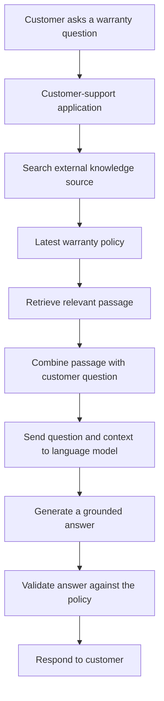

# 05. Foundation Models and Task-Specific Models

## 1. Learning Objectives

After completing this chapter, you should be able to:

- Define foundation models and task-specific models.
- Explain language models, large language models (LLMs), and multimodal foundation models.
- Compare broad model capabilities with narrow task requirements.
- Distinguish base models from instruction-tuned models conceptually.
- Explain prompting, retrieval, and fine-tuning as different ways to adapt application behavior.
- Explain why model size alone does not determine which model is most suitable.
- Compare a broad language model with a specialized classifier for a clearly defined task.

<br/>

## 2. What Is a Foundation Model?

A **foundation model** is a model trained on broad data at scale so that it can support a range of tasks or be adapted for different applications.

Rather than being built for only one narrowly defined task, a foundation model can provide a starting point for multiple uses.

Depending on its training and capabilities, a foundation model may support tasks such as:

- Answering questions.
- Summarizing and rewriting text.
- Extracting information.
- Generating content.
- Processing images, audio, or other modalities.

The term *foundation* highlights that the model can serve as a base for multiple applications. It does not mean the model is automatically reliable for every task or ready for production without additional engineering.

<br/>

## 3. Language Models, LLMs, and Multimodal Foundation Models

### 3.1 Language Models

A **language model** learns patterns in sequences of language and assigns or predicts how tokens may continue in context. Generative language models can use these learned patterns to produce text.

Language models can support tasks such as text completion, summarization, question answering, and drafting.

<br/>

### 3.2 Large Language Models (LLMs)

A **large language model (LLM)** is a language model developed at a large scale, typically using substantial training data and many learned parameters.

LLMs are commonly used for:

- Text generation and rewriting.
- Question answering.
- Summarization.
- Information extraction.
- Code assistance.
- Following natural-language instructions.

The word *large* refers to scale, but size alone does not guarantee accuracy, reasoning ability, safety, or suitability for a particular application.

<br/>

### 3.3 Multimodal Foundation Models

A **multimodal foundation model** can process or produce more than one type of information, depending on its supported capabilities.

For example, a model may accept text and images and answer questions about a photograph. Another system may support audio input or generate audio.

Multimodal capability is not universal. A model that understands images does not necessarily generate images, and a model that processes audio does not necessarily support every audio task.

#### Models

| Model name | Company | Link of website |
|---|---|---|
| Gemini 3.8 Flash | Google | https://ai.google.dev/gemini-api/docs/models |
| GPT-4o | OpenAI | https://developers.openai.com/api/docs/models/gpt-4o |
| GPT-Realtime models | OpenAI | https://developers.openai.com/api/docs/models |
| Claude models with vision capabilities | Anthropic | https://platform.claude.com/docs/en/build-with-claude/vision |
| Llama 4 Scout | Meta | https://ai.meta.com/llama/ |
| Llama 4 Maverick | Meta | https://ai.meta.com/llama/ |
| Qwen3-VL | Alibaba / Qwen | https://qwen.ai/ |

<br/>

## 4. What Is a Task-Specific Model?

A **task-specific model** is designed, trained, or adapted for a more narrowly defined task.

Examples include:

- A classifier that labels support tickets by category.
- A model that predicts whether a transaction is fraudulent.
- An image classifier that distinguishes cats from dogs.
- A model that estimates the price of a used vehicle.
- A sentiment classifier that labels feedback as positive, neutral, or negative.

Task-specific models may be smaller and simpler than broad foundation models, although this is not a universal rule.

They often return a defined output such as a class label, score, or numerical prediction. Their narrow scope can make them easier to evaluate and integrate into a specific workflow.

#### Models

| Model name | Company | Link of website |
|---|---|---|
| BERT | Google Research | https://github.com/google-research/bert |
| RoBERTa | Meta AI | https://huggingface.co/FacebookAI/roberta-base |
| DistilBERT | Hugging Face / DistilBERT contributors | https://huggingface.co/distilbert/distilbert-base-uncased |
| DeBERTa | Microsoft Research | https://huggingface.co/microsoft/deberta-v3-base |
| YOLO | Ultralytics | https://docs.ultralytics.com/ |
| Segment Anything Model (SAM 2) | Meta AI | https://ai.meta.com/sam2/ |
| Whisper | OpenAI | https://github.com/openai/whisper |
| wav2vec 2.0 | Meta AI | https://huggingface.co/facebook/wav2vec2-base-960h |
| NLLB-200 | Meta AI | https://github.com/facebookresearch/fairseq/tree/nllb |
| E5 embedding models | Microsoft Research | https://huggingface.co/intfloat/e5-base-v2 |
| BGE embedding models | BAAI | https://huggingface.co/BAAI/bge-large-en-v1.5 |
| LayoutLMv3 | Microsoft Research | https://huggingface.co/microsoft/layoutlmv3-base |

#### Models by task

| Task | Example model | Typical use |
|---|---|---|
| Text classification | BERT, RoBERTa, DistilBERT, DeBERTa | Sentiment analysis, intent classification, document categorization |
| Object detection | YOLO | Detecting and locating objects in images or video frames |
| Image segmentation | SAM 2 | Identifying object regions or masks in images and video |
| Speech recognition (ASR) | Whisper, wav2vec 2.0 | Converting spoken audio into text |
| Machine translation | NLLB-200 | Translating text across supported languages |
| Text embeddings | E5, BGE | Semantic search, retrieval, clustering, and similarity |
| Document understanding | LayoutLMv3 | Extracting information from documents that combine text and layout |

<br/>

## 5. Foundation Models vs. Task-Specific Models

| Aspect | Foundation model | Task-specific model |
|---|---|---|
| Intended scope | Broad range of tasks or potential adaptations | A clearly defined task or small task family |
| Typical input/output | Depends on model; may support flexible prompts and varied outputs | Often uses a defined input and output format |
| Adaptation | Can be prompted, connected to retrieval, or fine-tuned where supported | May be trained or tuned for its target task |
| Flexibility | Often high across supported tasks | Usually more limited outside its target task |
| Evaluation | May need evaluation across several use cases | Can be evaluated against a focused set of task metrics |
| Operational profile | Depends on model, provider, and deployment | Can be efficient for narrow, high-volume tasks |
| Example | General-purpose language model | Spam classifier |

Neither category is always better. The correct choice depends on what the application needs to do and the evidence gathered during evaluation.

<br/>

## 6. Base Models and Instruction-Tuned Models

Foundation models may be made available in different forms. Two useful concepts are **base models** and **instruction-tuned models**.

### 6.1 Base Model

A **base model** is a model before instruction tuning or other later adaptation stages relevant to the comparison.

A base language model may be trained primarily to predict the next token in text. It can continue or complete text, but it may not reliably follow arbitrary user instructions in the way expected from a chat assistant.

Example prompt:

```text
The main benefits of regular exercise are
```

A base model may continue the passage with text that fits the pattern.

<br/>

### 6.2 Instruction-Tuned Model

An **instruction-tuned model** has undergone additional training on examples intended to teach it to respond to instructions or requests.

It is generally better suited to conversational tasks such as:

- Answering a direct question.
- Following a requested format.
- Summarizing text according to instructions.
- Performing a specified transformation.

Example prompt:

```text
Explain three benefits of regular exercise in a numbered list.
```

An instruction-tuned model is designed to respond to the request rather than merely continue the text, although it can still make mistakes.

<br/>

### 6.3 Comparison

| Aspect | Base model | Instruction-tuned model |
|---|---|---|
| Main behavior emphasized | Learned continuation or prediction objective | Following instructions and responding to requests |
| Typical interaction | Text completion or continuation | Questions, instructions, and assistant-style responses |
| Instruction following | May be less reliable | Usually improved for supported instruction-following tasks |
| Limitations | May not behave like a ready-to-use assistant | Can still be inaccurate, incomplete, or unsafe |

Instruction tuning changes how a model tends to respond; it does not guarantee that every answer is correct.

<br/>

## 7. Adapting Model Behavior: Prompting, Retrieval, and Fine-Tuning

A broad model may need additional guidance or information to work well in a specific application. Three common approaches are prompting, retrieval, and fine-tuning.

### 7.1 Prompting

**Prompting** means providing instructions, examples, constraints, or context with a request.

Example:

```text
Classify this support message as billing, technical, or account access.
Return only one of these labels.
```

Prompting is useful when the model already has sufficient general capability and the task can be expressed clearly.

Prompting does not, by itself, update the model's learned parameters.

<br/>

### 7.2 Retrieval

**Retrieval** means finding relevant information from an external source and supplying it to the model as context.

Example: A customer-support application retrieves the latest warranty policy and includes the relevant passage with a customer's question.

Retrieval can help provide information that is specific to an organization or more current than the model's built-in knowledge. It does not guarantee that the model will interpret or use the retrieved information correctly.

Retrieval is useful when answers need to be grounded in documents, databases, or other knowledge sources that can change over time.



<br/>

### 7.3 Fine-Tuning

**Fine-tuning** is an additional training process that adjusts a pretrained model using a selected dataset.

It may be considered when an application needs more consistent behavior, a specialized response style, or improved performance on a suitable task and enough appropriate training examples are available.

Fine-tuning requires dataset preparation and evaluation. It is not automatically the best solution for adding frequently changing facts; retrieval may be more appropriate for that need.

<br/>

### 7.4 Comparison

| Approach | Changes model weights? | Main purpose | Example |
|---|---|---|---|
| Prompting | No, not by itself | Guide behavior for a request | Ask for a concise, structured answer |
| Retrieval | No, not by itself | Supply relevant external information | Include a current company policy |
| Fine-tuning | Yes, through additional training | Adapt model behavior using training examples | Train on examples of a domain-specific response format |

These approaches can be combined. For example, an application may use an instruction-tuned model, retrieve relevant documents, and provide a carefully designed prompt.

<br/>

## 8. Why Model Size Alone Does Not Determine Suitability

A model with more parameters is not automatically the best choice for every application.

Model selection involves several factors.

### 8.1 Task Requirements

A narrow classification task may not need the broad capabilities of a general-purpose LLM.

For example, a dedicated spam classifier may be sufficient if the only required output is `spam` or `not_spam`.

<br/>

### 8.2 Quality and Reliability

Evaluate how well the model performs on representative examples from the actual use case. A broad model can be flexible but may produce inconsistent labels or extra text unless the output is constrained and validated.

<br/>

### 8.3 Latency and Throughput

A larger model may take longer to respond or require more compute. For an application that processes thousands of simple requests, response time and throughput may matter substantially.


#### Throughput vs. Latency

- Throughput measures volume over time (how many total dishes a kitchen cooks per minute).
- Latency measures time delay per single unit (how long it takes to cook one specific dish).
- The Trade-Off: Increasing batch sizes or concurrent users raises aggregate throughput by utilizing hardware better, but can temporarily increase per-user latency.

<br/>

### 8.4 Cost and Hardware

Hosted models may have usage-based charges. Self-managed models require suitable hardware and operational effort. Larger models often have higher compute and memory requirements, although actual cost depends on architecture, serving setup, quantization, and provider pricing.

<br/>

### 8.5 Privacy and Deployment Constraints

The application may require local processing, restricted data access, or a particular licensing arrangement. These constraints can eliminate otherwise capable candidates.

<br/>

### 8.6 Output Requirements

If the application requires a strict class label or numerical score, a specialized model may provide a simpler output contract. If the task requires flexible explanations or content generation, a foundation model may be more appropriate.

**Practical rule:** Choose the smallest and simplest approach that meets the required quality, reliability, latency, privacy, licensing, and operational constraints, based on evaluation rather than size alone.

<br/>

## 9. Practice: Broad Language Model vs. Specialized Classifier

Consider a company that needs to classify incoming support tickets into three categories:

- `billing`
- `technical`
- `account_access`

The application processes 50,000 tickets per month. It needs a category for routing each ticket to the correct team.

<br/>

### Option A: Broad Language Model

The application sends each ticket to an instruction-tuned language model and asks it to return one of the three categories.

**Potential advantages:**

- Can interpret varied natural-language descriptions.
- Can be adapted with clear instructions and examples.
- May be extended to additional language tasks.

**Potential disadvantages:**

- May return an invalid label or extra text.
- Can have higher latency or cost, depending on the model and deployment.
- Requires validation and evaluation for consistent classification.

<br/>

### Option B: Specialized Classifier

The application uses a classifier trained or adapted for the three ticket categories.

**Potential advantages:**

- Produces a focused prediction.
- May offer lower latency and cost at high volume.
- Can be evaluated with classification metrics such as precision, recall, and F1 score.

**Potential disadvantages:**

- Requires representative labeled data or another suitable training approach.
- May perform poorly on new categories or substantially different inputs.
- May need retraining or updating when ticket patterns change.

<br/>

### Comparison Table

| Criterion | Broad language model | Specialized classifier |
|---|---|---|
| Primary role | General language processing, used here for classification | Ticket classification |
| Output | Must be constrained or validated to the allowed labels | Usually a label and/or class scores |
| Flexibility | Can support other language tasks | Focused on the trained task |
| Evaluation | Classification metrics plus output-validity checks | Classification metrics |
| Cost and latency | Measure for the selected model and deployment | Measure for the selected classifier and deployment |
| Data requirements | Can sometimes work with instructions and examples; performance must be tested | Usually needs labeled examples or another appropriate training method |

<br/>

### Recommended Decision Process

Do not decide solely from the model categories. Create a representative evaluation set and compare both options on:

1. Classification quality, including per-class precision and recall.
2. Invalid or missing outputs.
3. Latency and throughput at the expected volume.
4. Cost per ticket.
5. Performance on ambiguous and unfamiliar tickets.
6. Maintenance effort and privacy requirements.

If the specialized classifier meets the quality target at lower operational cost, the broad LLM may be unnecessary for this narrow task. If the tickets require nuanced interpretation or the workflow also needs summaries and drafted responses, a language model may offer additional value.

<br/>

## 10. Simple Python Example: Compare the Task Interfaces

The following example illustrates the difference between a narrow classifier-style interface and a broad-model prompt. It does not train a classifier or call an LLM.

```python
ticket = "I cannot sign in because the password reset link fails."

# Illustrative rule-based baseline, not a trained classifier
text = ticket.lower()

if "password" in text or "sign in" in text or "login" in text:
    label = "account_access"
elif "invoice" in text or "payment" in text or "billing" in text:
    label = "billing"
else:
    label = "technical"

print(label)
```

Possible output:

```text
account_access
```

This simple rule demonstrates a narrow classification output. It is not a reliable production classifier: real tickets can be ambiguous, and rules can overlap or miss relevant wording.

A broad language model could be given a prompt such as:

```text
Classify this support ticket into exactly one category:
billing, technical, or account_access.

Ticket:
"I cannot sign in because the password reset link fails."

Return only the category.
```

Both approaches aim to solve the same application task. Their performance, latency, cost, and maintenance requirements should be measured before choosing one.

<br/>

## 11. Common Misconceptions

| Misconception | Correct understanding |
|---|---|
| Every foundation model is an LLM. | Foundation models can support different modalities and model families; not all are language-only models. |
| A foundation model is automatically suitable for every task. | Its capabilities and reliability must be evaluated for the target use case. |
| A base model and an instruction-tuned model behave identically. | Instruction tuning is intended to improve responses to instructions and requests. |
| Prompting, retrieval, and fine-tuning are interchangeable. | Prompting guides a request, retrieval supplies external context, and fine-tuning updates parameters through additional training. |
| A larger model is always more accurate. | Suitability depends on task performance and operational constraints, not parameter count alone. |
| A specialized model is always better. | It can be efficient for a narrow task, but may be less flexible or fail on unfamiliar inputs. |
| Fine-tuning is always the best way to add new facts. | Retrieval is often a better fit for information that changes frequently and must be sourced. |

<br/>

## 12. Chapter Summary

- A **foundation model** is trained on broad data and can support a range of tasks or adaptations.
- **Language models** model sequences of language; **LLMs** are language models developed at large scale.
- **Multimodal foundation models** can process or produce more than one modality, depending on their supported capabilities.
- **Task-specific models** target a narrower task, such as spam detection or ticket classification.
- **Base models** and **instruction-tuned models** differ in how they have been trained to respond.
- **Prompting** supplies instructions, **retrieval** supplies external context, and **fine-tuning** adjusts model parameters through additional training.
- Model size alone does not establish suitability. Quality, cost, latency, throughput, privacy, licensing, and maintenance all matter.
- A smaller specialized classifier may be sufficient when the task is narrow, the output is well-defined, and evaluation shows that it meets the application's requirements.

<br/>

## 13. Revision Questions and Answers

**Q1. What is a foundation model?**

A foundation model is trained on broad data at scale and can serve as a starting point for a range of tasks or application adaptations.

**Q2. What is a task-specific model?**

It is a model designed, trained, or adapted for a narrowly defined task, such as spam classification or price prediction.

**Q3. What is the difference between a base model and an instruction-tuned model?**

A base model is trained before the instruction-tuning stage being considered. An instruction-tuned model receives additional training intended to improve its ability to follow instructions and respond to requests.

**Q4. How do prompting, retrieval, and fine-tuning differ?**

Prompting supplies instructions or examples; retrieval supplies relevant external information as context; fine-tuning uses additional training to adjust model parameters.

**Q5. Why is a larger model not always the best choice?**

A larger model may add cost, latency, and compute requirements without providing necessary benefits for a narrow task. The choice should be based on measured performance and operational requirements.

**Q6. When might a smaller specialized classifier be sufficient?**

When the task has a clear and limited set of categories, the required output is well-defined, and the classifier meets the quality, latency, cost, and reliability targets on representative test data.

<br/>

## 14. Checkpoint

**Question:** When may a smaller specialized model be sufficient?

**Answer:** A smaller specialized model may be sufficient when the application has a narrow, well-defined task and needs a predictable output, such as a class label or numerical score. If evaluation shows that the model meets the required quality and reliability targets while offering suitable latency, cost, and deployment characteristics, a larger general-purpose model may be unnecessary.

**Next chapter:** 06. Hosted and Open-Weight Models.
