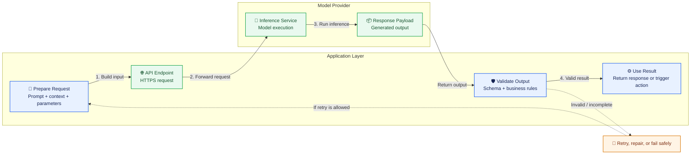

# 06. Hosted and Open-Weight Models

## Learning Objectives

By the end of this chapter, you should be able to:

- Explain hosted inference, downloadable model weights, and local or self-managed inference.
- Distinguish a model's access method from its licensing terms and deployment location.
- Explain why an open-weight model can still be used through a hosted API.
- Compare hosted and self-managed deployment across setup effort, hardware, privacy, control, latency, and cost.
- Identify the documentation and licensing details to check before using or deploying a model.
- Explain why self-hosting does not automatically guarantee privacy or lower costs.

 

## 1. Why This Topic Matters

Choosing a model is not only about its capabilities. You must also decide how the application will access it, where inference will run, and what usage conditions apply.

For example, a prototype may benefit from a hosted API because it can be integrated quickly without managing GPUs. An application handling sensitive information may require stricter control over data flow and deployment, but self-hosting is only one part of that decision.

Keep three questions separate:

1. **Access method:** How does the application call the model?
2. **License and usage rights:** What are you legally permitted to do with the model and its weights?
3. **Deployment location:** Where does inference execute?

These choices are related, but they are not interchangeable.

 

## 2. Hosted Inference

**Hosted inference** means a provider runs the model infrastructure and exposes model functionality through a service, commonly an **API**.

Your application sends an input to the service and receives a response. The provider manages the underlying serving infrastructure, although you still need to manage your application, credentials, usage, and integration.

 

### Typical request flow

1. The application prepares a prompt or other model input.
2. It sends a request to the provider's endpoint.
3. The provider runs inference.
4. The service returns the output.
5. The application validates and uses the result.

 

### Advantages

- Usually quick to set up.
- No need to provision and maintain model-serving hardware.
- Infrastructure scaling and model serving are largely managed by the provider.
- Convenient for prototypes and applications whose demand changes over time.

 

### Trade-offs

- Requires network access to the service.
- Cost may depend on tokens, requests, compute time, or another provider-defined unit.
- The application depends on the provider's availability, limits, API behavior, and policies.
- Data is sent to an external service, so data handling and contractual terms must be reviewed.
- Customization and low-level serving control may be limited.

Hosted does **not** necessarily mean proprietary, and it does not by itself tell you where the provider's infrastructure is located.

 

## 3. Downloadable Model Weights

**Model weights** are learned numerical parameters used by a trained model. Some model providers make these weights available for download under specified terms.

With downloadable weights, a developer or organization can obtain the model files and arrange to run the model using compatible software and hardware, subject to the model's license and technical requirements.

Downloading weights does not automatically provide everything needed for deployment. You may also need:

- A compatible inference runtime or serving framework.
- Suitable CPU, GPU, memory, and storage resources.
- Tokenizers, configuration files, or other model assets.
- Security, monitoring, scaling, and update procedures.
- A plan for handling prompts, outputs, logs, and user data.

#### Model repositories and platforms

| Platform         | Website                                                | Purpose                                                                                                        |
| ---------------- | ------------------------------------------------------ | -------------------------------------------------------------------------------------------------------------- |
| Hugging Face Hub | [huggingface.co/models](https://huggingface.co/models) | Browse and download model weights, tokenizers, and configuration files from many organizations and developers. |
| ModelScope       | [modelscope.cn](https://www.modelscope.cn/)            | Discover and download AI models, including language and multimodal models.                                     |
| Kaggle Models    | [kaggle.com/models](https://www.kaggle.com/models)     | Explore models and use them in notebook-based experiments.                                                     |
| GitHub           | [github.com](https://github.com/)                      | Find official model repositories, download instructions, inference code, and links to model files.             |
| Ollama           | [ollama.com/library](https://ollama.com/library)       | Browse models and run supported models locally through Ollama; it manages model downloads for you.             |

 

### Open-weight models

An **open-weight model** is a model whose trained weights are made available for use under specified terms. The exact rights and restrictions depend on the applicable license or terms of use.

Open weights can support local experimentation, self-managed deployment, or use through a hosted service. The availability of weights does not require you to run the model yourself.

#### Examples of downloadable open-weight models

| Model name           | Organization   | Model download / information                                       |
| -------------------- | -------------- | ------------------------------------------------------------------ |
| GPT-OSS 20B and 120B | OpenAI         | [Official open-model page](https://openai.com/open-models/)        |
| Llama                | Meta           | [Official Llama website](https://www.llama.com/)                   |
| Gemma                | Google         | [Kaggle Models](https://www.kaggle.com/models/google/gemma)        |
| Qwen                 | Alibaba / Qwen | [Hugging Face Qwen models](https://huggingface.co/Qwen)            |
| DeepSeek models      | DeepSeek       | [Hugging Face DeepSeek models](https://huggingface.co/deepseek-ai) |

 

## 4. Local and Self-Managed Inference

**Local inference** means running model inference on a device or computer under your control, such as a development machine or an on-premises server.

**Self-managed inference** means that you or your organization operate the inference environment. It may run locally, in your own data center, or on cloud infrastructure that you manage. It does not necessarily mean the model runs on a personal computer.

 

### Potential benefits

- More control over infrastructure and deployment configuration.
- Ability to limit which systems receive the raw input data.
- Potential for offline or network-restricted operation, if the full setup supports it.
- Greater control over model versions and serving behavior.

 

### Responsibilities and trade-offs

- You must select and configure suitable hardware and software.
- You are responsible for deployment, scaling, reliability, patching, monitoring, and incident response.
- Performance depends on the model, hardware, quantization or other optimizations, workload, and serving setup.
- Capacity planning can be difficult when demand varies.
- Total costs include hardware or cloud compute, engineering time, power, storage, maintenance, and downtime.

Self-managed deployment offers more control, but it also transfers more operational responsibility to your team.

 

## 5. Open Weights, Hosted Services, and Licensing

These terms answer different questions:

| Term | Main question answered | What it does not automatically mean |
|---|---|---|
| Hosted inference | Who operates the serving service? | That the model is closed-weight or proprietary |
| Downloadable weights | Can you obtain the model's weight files? | That all uses or redistribution are permitted |
| Open-weight model | Are trained weights available under stated terms? | That the model is fully open-source |
| Open-source license | What rights and obligations apply to the licensed material? | That every component, dataset, or training detail is open |
| Local inference | Is inference running on a local device or machine? | That the entire application is private or secure |
| Self-managed inference | Who operates the serving environment? | That it must be on-premises or cheaper |

 

### Open weights versus open source

**Open weights and open source are not synonyms.** A model may provide downloadable weights while placing restrictions on commercial use, redistribution, certain user groups, or other activities. The term “open source” also has specific meanings in software licensing and related definitions; it should not be inferred merely because files are downloadable.

Before adopting a model, read its actual license and usage terms. Do not rely on the model's marketing label alone.

 

### Verify rights separately

Check the conditions that apply to your intended use, including:

- Commercial use.
- Redistribution or hosting for other users.
- Modification or fine-tuning.
- Attribution and notice requirements.
- Acceptable-use restrictions.
- Any special conditions based on scale, industry, or use case.
- Rights and obligations for associated code, datasets, tokenizer files, and other assets.

This is a practical review checklist, not legal advice. If the use is business-critical or regulated, obtain appropriate legal review.

 

## 6. Deployment Comparison

| Consideration | Hosted inference | Local or self-managed inference |
|---|---|---|
| **Setup effort** | Often lower at the beginning; integrate an API and configure credentials | Usually higher; select hardware, install runtime, configure serving, and operate it |
| **Hardware** | Provider supplies and manages serving hardware | You select or provision the hardware or cloud compute |
| **Privacy and data handling** | Inputs are sent to the service; evaluate retention, processing, access, and contractual terms | Can reduce external data transfer, but logs, telemetry, access controls, backups, and infrastructure still matter |
| **Control** | Provider controls much of the serving stack; API and model options define your control | More control over infrastructure, model version, configuration, and operational policies |
| **Latency** | Depends on network, provider location, queueing, model speed, and service load | Avoids a provider round trip when truly local, but performance depends on hardware and serving configuration |
| **Operational work** | Provider handles much of the model infrastructure; your application still needs monitoring and error handling | Your team handles infrastructure reliability, scaling, security, monitoring, and updates |
| **Cost pattern** | Often usage-based; can be economical for prototypes or intermittent traffic | Includes compute or hardware plus engineering and operations; may be attractive for sustained workloads, but is not automatically cheaper |
| **Scaling** | Often easier to start with; subject to provider limits and pricing | Requires capacity planning and additional resources as demand grows |
| **Connectivity** | Normally needs network access to the provider | Can operate without external network access if the full application and dependencies are designed for it |

No column is universally better. Compare the options using the actual workload, service terms, hardware, team capability, and risk requirements.

 

## 7. Privacy: Why Self-Hosting Is Not a Guarantee

Running a model yourself can reduce the need to send prompts to an external inference provider. That is a useful control, but it is not a complete privacy guarantee.

Sensitive information may still be exposed through:

- Application logs and debugging traces.
- Monitoring and telemetry systems.
- Backups, snapshots, and crash reports.
- Access by administrators or other users of the machine.
- Third-party services called by the application.
- Misconfigured network access or storage.
- Poor secrets management or insufficient access controls.

A privacy assessment should map the complete data flow, including the model runtime, application, storage, logs, monitoring, and any external dependencies.

For hosted inference, review the provider's data-processing terms, retention settings, access controls, regional options, and any applicable compliance commitments. Do not assume that every provider handles data in the same way.

 

## 8. Cost: Why Self-Hosting Is Not Automatically Cheaper

Hosted APIs commonly reduce upfront infrastructure work, but their recurring charges can rise with usage. Self-managed inference may offer different cost characteristics, especially at sustained volume, but it introduces costs that are easy to overlook.

Consider the **total cost of ownership (TCO)**:

- Compute or hardware acquisition and replacement.
- GPU memory and capacity requirements.
- Engineering and operational labor.
- Deployment, monitoring, and security.
- Power, storage, networking, and backups.
- Spare capacity for peak demand.
- Downtime and maintenance.
- Model updates, optimization, and performance testing.

A small prototype with unpredictable traffic may be cheaper to run through a hosted API. A high-volume workload might justify benchmarking self-managed deployment. The result depends on measured usage and realistic operating costs, not simply on whether the weights are free to download.

 

## 9. Model Documentation and Deployment Constraints

Before selecting a model, inspect its official model documentation, model card, license, and deployment guidance.

Useful items to verify include:

1. **License and usage terms:** Are your intended use, distribution, and commercial plans permitted?
2. **Hardware requirements:** What memory, compute, and storage are needed?
3. **Inference compatibility:** Which runtimes, libraries, and hardware backends are supported?
4. **Model capabilities and limitations:** Which tasks and languages were evaluated? What failure modes are documented?
5. **Context and input limits:** What are the supported input lengths, output limits, and modality constraints?
6. **Performance information:** Are latency, throughput, and hardware benchmarks available? Do they match your workload?
7. **Safety guidance:** Are there documented misuse risks, known weaknesses, or recommended safeguards?
8. **Operational requirements:** How should the model be updated, configured, monitored, and served?
9. **Dependencies and assets:** Are the tokenizer, code, adapters, or other required files available under compatible terms?

Documentation is evidence to inspect, not a guarantee that the model will meet your requirements. Benchmark the model in your own application before relying on it.

 

## 10. Separate the Three Deployment Decisions

Use these questions independently.

### Decision A — Access method

- Will the application call a hosted inference API?
- Will it download weights and run inference itself?
- Could a hosted service provide access to an open-weight model?

 

### Decision B — License and usage rights

- Does the license allow the intended use?
- Are commercial use, modification, and redistribution treated differently?
- Are there additional terms for the model or its associated components?

 

### Decision C — Deployment location

- Will inference run on a provider's infrastructure?
- Will it run on a local device, on-premises server, or self-managed cloud environment?
- What data is transmitted or stored at each stage?

Do not infer the answer to one question from the answer to another. For example, **an open-weight model can be hosted by a third-party provider**, and a model with downloadable weights may still have license restrictions.

 

## 11. Practice: Compare Two Applications

Create a deployment comparison for the following scenarios.

### Scenario A — Prototype

You are building a proof of concept that summarizes non-sensitive sample documents. You want to validate the user experience quickly, and traffic is low and unpredictable.

Evaluate:

- Time required to get started.
- Expected usage-based cost.
- Need for infrastructure expertise.
- Provider dependency and network access.
- Whether the provider's terms are suitable for the test data.

A hosted API is often a reasonable starting point because it reduces setup work. Confirm the actual price, limits, and data terms before choosing.

 

### Scenario B — Application handling sensitive data

You are building an application that processes sensitive business documents. The organization wants strong control over data flow, access, and retention.

Evaluate:

- Whether a hosted provider can meet the organization's contractual and technical requirements.
- Whether local or self-managed inference is feasible with the required model quality and hardware.
- How logs, backups, monitoring, and administrator access will be protected.
- Whether the model license permits the intended deployment and use.
- The full operational cost and the team's ability to maintain the service.

Self-managed inference may be appropriate, but it is not automatically required or sufficient. Compare it with hosted options that meet the same security and contractual requirements.

 

### Comparison worksheet

| Question | Prototype | Sensitive-data application |
|---|---|---|
| Main priority | Fast validation and low setup effort | Controlled data flow and risk management |
| Candidate access method | Hosted API | Hosted or self-managed, subject to requirements |
| License check needed? | Yes | Yes |
| Data-flow review needed? | Yes, proportionate to the data | Yes, detailed and explicit |
| Hardware and operations assessment | Basic | Detailed |
| Cost comparison | Estimate expected usage | Compare full TCO and operational effort |
| Final decision | Based on speed, cost, and acceptable terms | Based on security requirements, model fit, license, and sustainable operations |

**Exercise:** Fill in the table with a specific model or service you are considering. Record the source of each licensing, hardware, pricing, and data-handling claim.

 

## 12. Common Misconceptions

- **“Open-weight means open source.”** Not necessarily. Verify the actual license and what materials it covers.
- **“If weights are downloadable, I can use them for anything.”** No. Usage rights and restrictions still apply.
- **“Open-weight models must be run locally.”** No. They can also be offered through hosted services.
- **“Hosted means proprietary.”** Not necessarily. A hosted service can serve open-weight models.
- **“Self-hosting guarantees privacy.”** No. The full data flow, logs, access controls, and dependencies matter.
- **“Self-hosting is always cheaper.”** No. Compute, staffing, maintenance, and reliability have costs.
- **“The biggest model is always best.”** Model suitability depends on task quality, latency, cost, hardware, constraints, and evaluation results.

 

## 13. Revision Questions and Answers

**Q1. What is hosted inference?**  
Hosted inference is model execution provided by a service, commonly accessed through an API.

**Q2. What are downloadable model weights?**  
They are the learned parameters made available as files under specified terms, allowing a compatible environment to load and run the model.

**Q3. Can an open-weight model be accessed through a hosted API?**  
Yes. Weight availability and the method used to access inference are separate decisions.

**Q4. Are open weights the same as open-source licensing?**  
No. Downloadable weights do not by themselves establish that all use, modification, or redistribution is permitted.

**Q5. What is the difference between local and self-managed inference?**  
Local inference runs on a local device or machine. Self-managed inference means the user or organization operates the serving environment, which may be local, on-premises, or in a managed-by-you cloud environment.

**Q6. Why might a hosted API suit a prototype?**  
It can reduce setup time and infrastructure responsibilities, especially when traffic is low or unpredictable.

**Q7. Why does self-hosting not automatically guarantee privacy?**  
Data may still leak through logs, backups, monitoring, access permissions, or external dependencies.

**Q8. Why might self-hosting not be cheaper?**  
Total costs include compute, hardware, engineering, monitoring, maintenance, security, and spare capacity—not just the cost of obtaining weights.

**Q9. What should you check before deploying a model?**  
Review the license, model documentation, hardware and runtime requirements, capabilities, limitations, and operational constraints.

**Q10. What three decisions should be evaluated separately?**  
Access method, licensing and usage rights, and deployment location.

 

## 14. Chapter Summary

- Hosted inference delegates model serving to a provider, usually through an API.
- Downloadable weights can enable self-managed inference, but the model must still be deployed with compatible software and hardware.
- Open-weight models can also be accessed through hosted services.
- Open weights do not automatically mean unrestricted use or open-source licensing.
- Hosted and self-managed deployment differ in setup effort, hardware responsibility, control, data flow, operational burden, and cost structure.
- Self-hosting may improve control over data flow, but privacy still depends on the whole system.
- Lower infrastructure charges do not automatically imply lower total cost.
- Always inspect model documentation, license terms, and deployment constraints.

 

### Final Checkpoint

You should be able to explain why **access method, licensing, and deployment location are separate decisions**, and compare a hosted prototype with a sensitive-data application using explicit technical, legal, privacy, and cost criteria.
