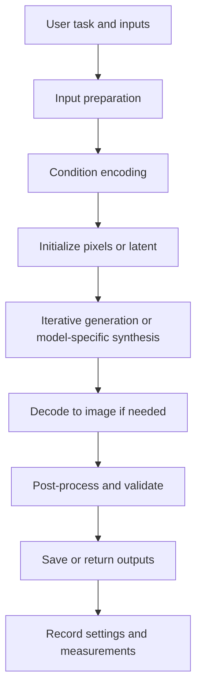
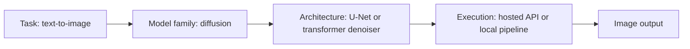

# 01. Image Generation Overview

## 1. Learning Objectives

By the end of this chapter, you should be able to:

- Compare text-to-image, image-to-image, inpainting, and outpainting.
- Trace the main stages of an image-generation workflow.
- Distinguish image-understanding models from image-generation models.
- Explain why image generation is a task category and diffusion is only one model family.
- Identify the difference between a task, a model architecture, and a service/API interface.
- Describe the main settings that influence an image-generation request.

<br/>

## 2. What Is Image Generation?

**Image generation** is the task of creating a new image, or modifying an existing image, using a model conditioned on information such as text, a reference image, a mask, or structural guidance.

A generation system may create pixels directly or operate on a compressed representation called a **latent**. Depending on the model family, generation may happen in one pass or through a sequence of refinement steps.

Examples include:

- Creating a product mock-up from a text description.
- Changing the style of an existing photograph.
- Replacing the background behind a subject.
- Extending a photograph beyond its original borders.
- Producing concept art from a text prompt and a pose guide.

Image generation is not the same as image understanding. An understanding system interprets an image; a generation system creates or edits one. Some multimodal systems support both capabilities, but they are conceptually different tasks.

<br/>

## 3. Four Common Image-Generation Tasks

### 3.1 Text-to-Image

**Text-to-image** creates an image from a text prompt, typically without requiring a starting image.

**Example prompt**

> A small white Indian owl perched on a branch at dawn, soft mist, natural feathers, wildlife photography, detailed eyes, vertical composition.

The text prompt conditions the model. The system may also accept settings such as width, height, seed, number of outputs, inference steps, or guidance strength.

**Use cases**

- Concept art and storyboarding
- Marketing and campaign visuals
- Product and interior design exploration
- Educational illustrations
- Early-stage visual prototyping

**Main limitation:** a prompt is not a strict scene specification. The model may omit details, miscount objects, misrender text, or arrange elements differently from what was requested.

<br/>

### 3.2 Image-to-Image

**Image-to-image** uses an existing image as a starting point or condition and generates a transformed result.

**Example:** provide a rough room sketch and ask for a photorealistic interior design concept.

Common transformations include:

- Sketch to rendered image
- Day scene to night scene
- Photo to a different artistic style
- Rough composition to a polished concept
- Color or atmosphere changes

Many diffusion pipelines expose a **strength** or equivalent control. Its meaning depends on the implementation, but it generally controls how much the starting image is altered. More transformation can improve adherence to the new prompt while losing details from the original.

Image-to-image does **not** guarantee exact preservation of identity, geometry, layout, or fine details.

<br/>

### 3.3 Inpainting

**Inpainting** edits a selected region within an image. The selected area is described with a **mask**; the model generates content for the region using the prompt and surrounding context.

**Example:** mask a distracting object on a desk and prompt the model to replace it with a closed notebook.

Typical uses:

- Removing unwanted objects
- Replacing an object or garment
- Repairing damaged regions
- Editing a small part of a product image
- Changing a background detail

Mask conventions vary. In one implementation, white may mean “edit” and black “preserve”; another interface may invert that convention. Always verify the chosen pipeline's mask semantics.

A good inpainting result should be assessed both inside the edit region and in the surrounding preserved area. Boundaries, lighting, perspective, and shadows may reveal inconsistencies.

<br/>

### 3.4 Outpainting

**Outpainting** extends an image beyond its original canvas. The new area is generated to fit the existing image's context.

**Example:** extend a landscape photograph horizontally to create a wider banner, generating more sky, trees, and terrain beyond the original edges.

Typical uses:

- Changing aspect ratio for social media or advertising
- Extending a background around a product
- Expanding a photograph for a layout
- Continuing scenery beyond the frame

Outpainting often uses a larger canvas and a mask marking the newly exposed area. It must maintain continuity in perspective, lighting, color, and scene structure.

<br/>

### 3.5 Task Comparison

| Task | Main input | What is generated? | Typical control | Main risk |
|---|---|---|---|---|
| Text-to-image | Text prompt | A new image | Prompt, dimensions, seed, steps, guidance | Prompt details may be missed |
| Image-to-image | Starting image + prompt or conditions | A transformed image | Strength/noise level, prompt, seed | Unwanted changes to original content |
| Inpainting | Image + mask + prompt | Content in a selected region | Mask, prompt, strength | Seams or changes outside the intended region |
| Outpainting | Image + expanded canvas/mask + prompt or conditions | Content beyond the original frame | Canvas size, mask, prompt | Poor continuity at the border |

<br/>

## 4. The End-to-End Generation Pipeline

A generation request typically moves through the following stages. Exact implementation details differ by model, library, and hosted service.



<br/>

### Stage 1: Define the task and inputs

Determine whether the request is text-to-image, image-to-image, inpainting, or outpainting. Collect the prompt, reference image, mask, or structural guide as required.

<br/>

### Stage 2: Prepare inputs

Typical preparation includes:

- Validating file type, dimensions, and size.
- Converting image color mode if required.
- Resizing or cropping to supported dimensions.
- Preparing a mask or structural condition.
- Tokenizing and validating the text prompt.
- Checking permissions and licensing for reference assets.

Input preprocessing can affect the result. Resizing may remove details, change aspect ratio, or alter a mask's alignment.

<br/>

### Stage 3: Encode conditions

The pipeline converts supported conditions into representations the model can use. Text may be tokenized and passed through a text encoder. Images may be encoded into latents or processed by a conditioning network. Masks, depth maps, edges, or pose maps may provide additional guidance.

Not every pipeline uses every encoder, and some systems combine or process conditions differently.

<br/>

### Stage 4: Initialize the generation state

A text-to-image diffusion pipeline commonly starts from random noise in pixel space or latent space. An image-to-image pipeline may instead encode a source image and add a controlled amount of noise. Inpainting and outpainting also use masks and preserved context according to the implementation.

Other model families may initialize or generate in a different way.

<br/>

### Stage 5: Generate or refine

In a diffusion pipeline, a denoising model is evaluated repeatedly at selected noise levels or timesteps. A sampler uses those predictions to update the noisy state toward an image-like result. Text and other conditions influence these updates.

The number of steps is a user-controlled setting in many pipelines, but more steps do not guarantee a better result. Non-diffusion systems can use different generation procedures.

<br/>

### Stage 6: Decode

Latent-diffusion pipelines typically decode the final latent representation into pixels using a decoder, often part of an autoencoder. Pixel-space diffusion does not need this latent-to-pixel decoding stage in the same form.

<br/>

### Stage 7: Post-process and validate

Depending on the system, this can include converting color mode, resizing, safety checks, file encoding, or other documented processing. Review the output for visual defects and prompt adherence. Do not assume that an image passed technical validation merely because the API returned it successfully.

<br/>

### Stage 8: Store and record

Save the output and, where appropriate, record:

- Prompt and negative prompt, if supported
- Model/checkpoint and version
- Dimensions and aspect ratio
- Seed, if exposed
- Sampler/scheduler and step count, if exposed
- Guidance and editing-strength settings
- Input asset identifiers and mask
- Runtime, memory, usage, or cost measurements
- Errors, refusals, and post-processing actions

Keep sensitive prompts and source images out of logs unless there is a justified, protected need to retain them.

<br/>

## 5. What Is User-Controlled?

Controls vary across models and services. A hosted API may expose only a subset of the controls available in a local pipeline.

| Setting | Meaning | Important qualification |
|---|---|---|
| Prompt | Describes the desired content, style, and composition | Natural language is ambiguous and not a guarantee |
| Negative prompt | Describes content or qualities to discourage, where supported | Not supported by every model; effects vary |
| Width and height | Requested output dimensions | May be restricted or rounded to supported dimensions |
| Aspect ratio | Proportion between width and height | Some services choose dimensions from a preset list |
| Seed | Initializes random sampling where supported | Same seed may not reproduce identical pixels across versions or hardware |
| Number of outputs | How many candidates to generate | Usually increases total compute and cost |
| Sampling steps | Number of denoising updates in supported diffusion pipelines | Not directly comparable across different samplers or models |
| Sampler/scheduler | Defines how the diffusion trajectory is numerically sampled | Compatibility and behavior are model-specific |
| Guidance scale | Controls conditioning influence in some diffusion pipelines | Higher is not always better; excessive guidance can create artifacts |
| Image strength | Controls the degree of transformation in many image-to-image pipelines | Exact meaning and range vary |
| Mask | Defines the intended editable region | Verify whether masked or unmasked pixels are regenerated |
| Structural/reference control | Supplies edges, depth, pose, or reference-image information | Requires compatible models or adapters |
| Output format | Specifies a format such as PNG or JPEG, where supported | Format may affect file size and transparency support |

**Practical rule:** record the controls the actual interface supports. Do not assume that a parameter from one library exists in every hosted API.

<br/>

## 6. Image-Understanding Models vs. Image-Generation Models

### Image-understanding models

These models interpret or extract information from images. Common tasks include:

- Image classification
- Object detection and segmentation
- Image captioning
- Visual question answering (VQA)
- OCR and document understanding

**Example:** a vision-language model receives a photo of a kitchen and answers, “A kettle is next to the sink.”

The output is usually text, labels, boxes, masks, or another structured interpretation—not a newly synthesized image.

<br/>

### Image-generation models

These models create or transform image content. They may accept text, images, masks, or structural conditions and return an image.

**Example:** an image generator receives “a modern kitchen with a red kettle next to the sink” and synthesizes a new kitchen image.

<br/>

### Models and systems can support both

A multimodal product may expose image understanding and image generation in one interface, or route them to separate underlying models. Evaluate the actual capability and interface rather than inferring it from the product name.

| Dimension | Image understanding | Image generation |
|---|---|---|
| Primary goal | Interpret existing visual content | Create or modify visual content |
| Common input | Image, sometimes with a question | Text, image, mask, or other conditions |
| Common output | Caption, answer, labels, detections, structured data | Image pixels or an image file |
| Example task | “What objects are in this picture?” | “Create a picture containing these objects.” |
| Evaluation | Accuracy, grounding, detection quality, answer relevance | Visual quality, prompt adherence, composition, edit preservation |

<br/>

## 7. Not Every Image Generator Uses Diffusion

**Image generation is a task; diffusion is one approach to performing it.** Do not treat the terms as synonyms.

| Model family or approach | High-level idea | Common considerations |
|---|---|---|
| Diffusion models | Learn to denoise corrupted samples and generate through a reverse sampling process | Often iterative; quality/runtime depend on model and sampler |
| Autoregressive image models | Generate discrete image tokens or other representations sequentially | Sequential generation can affect latency; design varies |
| GANs (Generative Adversarial Networks) | Train a generator against a discriminator | Can generate quickly after training, but training stability and coverage can be challenging |
| VAEs (Variational Autoencoders) | Learn a latent representation and decode samples from it | Useful for representation learning and generation; reconstruction quality depends on design |
| Flow-based and related approaches | Learn transformations between distributions | Training and sampling properties depend on the specific formulation |

Modern systems may combine ideas or use newer approaches such as flow matching. The table is a conceptual orientation, not an exhaustive taxonomy, and these families are not interchangeable in training objective or implementation.

<br/>

## 8. Separate the Task, Architecture, and Service Interface

These three concepts answer different questions:

1. **Task — What do you want to do?**  
   Examples: text-to-image, image-to-image, inpainting, or outpainting.

2. **Model architecture or family — How does the model represent and generate content?**  
   Examples: diffusion with a U-Net denoiser, diffusion with a transformer denoiser, a GAN, or an autoregressive image model.

3. **Service interface — How does your application request and receive the result?**  
   Examples: a hosted REST API, a provider SDK, or a local Python pipeline.

They are related, but they are not the same thing. A service can expose a generation task while hiding the underlying architecture and sampling details. A local library may expose more configuration options, but it also requires you to manage model files, dependencies, and hardware.



This is one possible configuration, not a mandatory architecture. Other model families and service designs are possible.

<br/>

## 9. Example: Choosing an Approach

Suppose a small online shop needs product visuals.

- **Create a new scene:** use text-to-image to explore backgrounds and styling.
- **Restyle an existing product photo:** use image-to-image, then check that product identity and geometry remain correct.
- **Replace a distracting item:** use inpainting with a carefully checked mask.
- **Make a wide banner:** use outpainting to extend the canvas and inspect the seams.

For accurate product representation, a generated image should not be assumed to preserve exact logos, labels, colors, or dimensions. Use approved source assets and human review when fidelity matters.

<br/>

## 10. Minimal Code: A Hosted Generation Request

The following is a **provider-neutral pseudocode pattern**, not a runnable SDK example. Real parameter names and supported controls differ by service.

```python
request = {
    "prompt": (
        "A small white owl perched on a branch at dawn, "
        "natural wildlife photography, soft mist, vertical composition"
    ),
    "size": "1024x1024",
    "n": 1,
    # Include a seed or other controls only if the service supports them.
}

response = image_service.generate(**request)

# The actual response shape depends on the provider.
image_bytes = response.image_bytes
save_image(image_bytes, "owl.png")
```

For a runnable implementation, choose a specific provider API or a compatible local library first. Then verify its official documentation for authentication, request fields, output decoding, supported sizes, usage reporting, and error handling. Avoid copying unsupported parameters from examples for another provider.

<br/>

## 11. Common Failure Modes

- **Prompt omission:** the image looks plausible but misses a requested object or attribute.
- **Ambiguous composition:** the prompt does not clearly specify positions, scale, or camera framing.
- **Unexpected source changes:** image-to-image alters important details that were meant to remain.
- **Mask errors:** inpainting edits the wrong region because mask polarity or dimensions were misunderstood.
- **Visible seams:** outpainting produces inconsistent edges, lighting, or perspective.
- **Incorrect assumptions about controls:** a hosted API does not support a setting used by a local pipeline.
- **False reproducibility:** the same prompt or seed yields different results after a model, scheduler, library, or hardware change.
- **Unrecorded experiments:** the best image is retained without the configuration needed to understand how it was produced.
- **Unreviewed use rights:** the model, adapter, or reference asset has terms that do not permit the intended use.

<br/>

## 12. Practice: Diagram a Text-to-Image Pipeline

Create a pipeline diagram and label where each of the following belongs:

- Prompt preparation and tokenization
- Text encoding
- Initial noise in pixel or latent space
- Denoising model and sampling loop
- Latent decoding, if applicable
- Output validation and storage

Identify at least five user-controlled settings exposed by your chosen interface. Mark unsupported settings as “not exposed” rather than assuming they are available.

<br/>

### Suggested experiment

Use one fixed prompt and generate a small set of outputs. If supported, vary **one** setting at a time, such as the seed or number of sampling steps. Record the model/version, settings, output, runtime, and observations. Do not claim a measured improvement unless you actually compare the results.

<br/>

## 13. Checkpoint Questions and Answers

**1. What is the difference between text-to-image and image-to-image?**  
Text-to-image starts from a text description to create a new image. Image-to-image uses an existing image as a starting point or condition for a transformation.

**2. How do inpainting and outpainting differ?**  
Inpainting fills or changes a selected region inside an image. Outpainting extends the canvas and generates content outside the original boundaries.

**3. Does every image generator use diffusion?**  
No. Diffusion is one model family. Image generation can also use autoregressive models, GANs, VAEs, flow-based approaches, and hybrid designs.

**4. What is the difference between a model and an API?**  
The model performs learned computation. The API is an interface through which software sends requests and receives outputs; it may hide much of the underlying implementation.

**5. Does a successful API response guarantee a good image?**  
No. A successful response indicates that the request was handled at the service level. The image still needs evaluation for visual defects, prompt adherence, safety, and suitability for the task.

**6. Why record the model version and generation settings?**  
They help explain differences between experiments, support debugging, and improve reproducibility. Exact pixel-level reproduction may still be limited by implementation and hardware differences.

<br/>

## 14. Summary

- Image generation includes creating new images and editing existing ones.
- Text-to-image, image-to-image, inpainting, and outpainting have different inputs and preservation goals.
- A typical pipeline prepares inputs, encodes conditions, generates or refines content, decodes where necessary, validates outputs, and records the experiment.
- Image understanding and image generation are different tasks, even when a product supports both.
- Diffusion is a major image-generation approach, not a synonym for image generation.
- The task, architecture, and service interface should be evaluated separately.
- Reliable experiments require controlled comparisons, supported settings, output review, and configuration records.

<br/>

## 15. Useful References

- [Hugging Face Diffusers documentation](https://huggingface.co/docs/diffusers/index) — pipelines, schedulers, model components, and generation workflows.
- [Hugging Face Diffusers: Text-to-image](https://huggingface.co/docs/diffusers/using-diffusers/text-img2img) — text-to-image workflow documentation.
- [Hugging Face Diffusers: Image-to-image](https://huggingface.co/docs/diffusers/using-diffusers/img2img) — image-to-image concepts and controls.
- [Hugging Face Diffusers: Inpainting](https://huggingface.co/docs/diffusers/using-diffusers/inpaint) — masked image editing.
- [Hugging Face Model Cards](https://huggingface.co/docs/hub/model-cards) — model details, intended use, and limitations.
- [Latent Diffusion Models paper](https://arxiv.org/abs/2112.10752) — research background on diffusion in learned latent spaces.

<br/>

> **Documentation note:** APIs, supported settings, model licenses, and service pricing change. Check the selected model's current documentation and license before implementation or deployment.
