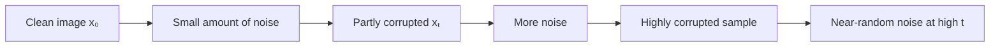
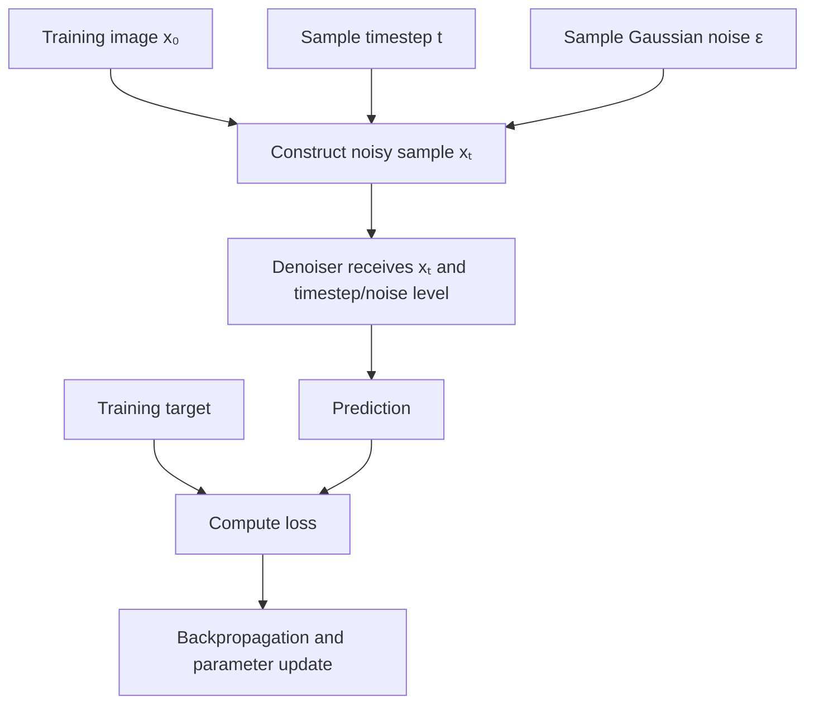
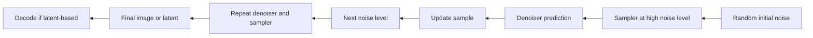
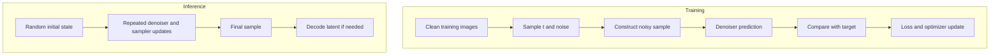

# 02. Diffusion Theory and Denoising

## 1. Learning Objectives

By the end of this chapter, you should be able to:

- Explain how a diffusion model gradually corrupts training images with noise.
- Describe how training samples timesteps and conditions the denoiser on the noise level.
- Compare noise prediction, clean-sample prediction, and velocity (`v`) prediction.
- Explain the denoising training objective and how it supports reverse generation.
- Distinguish a training update from a complete inference-time sampling trajectory.
- Explain why generation is not simply reversing one recorded noise sequence.

 

## 2. Core Intuition

A diffusion model learns to generate images by learning how to remove noise at different noise levels.

During training, the system starts with a real image and constructs a noisy version of it. At low noise levels, the image remains recognizable. At high noise levels, most of its visual structure is obscured. A neural network receives the noisy sample and information about its noise level, then learns to predict a target related to the clean image or the noise that was added.

At inference time, generation typically starts from random noise and repeatedly applies a learned denoising model together with a sampler. The sequence of updates gradually produces a sample with image-like structure.

The key distinction is:

- **Training:** learn denoising behavior from many noisy examples derived from training data.
- **Inference:** use the learned model repeatedly according to a sampling procedure to generate a new image.

The training process does not normally record and memorize one exact noise path for each image and then replay it backward.

 

## 3. Forward Noising: Corrupting a Training Image

Let:

- $x_0$ be a clean training image, represented as a tensor.
- $t$ be a timestep or noise-level index.
- $\epsilon$ be Gaussian noise, commonly sampled from $\mathcal{N}(0, I)$.
- $x_t$ be the noisy image at timestep $t$.

A conceptual forward process adds noise according to a schedule. In a common discrete formulation, each step adds a small amount of noise to the preceding sample. A useful closed-form expression allows a training example at a selected timestep to be constructed directly:

$$
x_t = \sqrt{\bar{\alpha}_t}\,x_0 +
      \sqrt{1-\bar{\alpha}_t}\,\epsilon
$$

where:

- $\beta_t$ is the noise variance schedule at step $t$.
- $\alpha_t = 1 - \beta_t$.
- $\bar{\alpha}_t = \prod_{s=1}^{t}\alpha_s$ is the cumulative product.

The coefficients balance the clean image and the sampled noise. At early timesteps, the clean-image contribution is usually large. At later timesteps, the noise contribution becomes larger. Exact schedules and parameterizations vary between model families.

 

### Conceptual trajectory

This diagram shows increasing corruption. It is not the generation direction.

 

### Why use Gaussian noise?

Gaussian noise provides a mathematically convenient corruption process. By training across many noise levels, the model can learn how image structure relates to corrupted observations. The training objective and parameterization determine exactly what the model predicts.

The noisy samples are training inputs; they are not intended to be useful images at every timestep.

 

## 4. Timestep Sampling and Noise-Level Conditioning

Training usually does not need to run the entire forward chain for every training update. In a common approach:

1. Sample a clean image $x_0$ from the training dataset.
2. Sample a timestep $t$ from a chosen distribution.
3. Sample noise $\epsilon$.
4. Construct $x_t$ directly using the schedule.
5. Give $x_t$ and a representation of $t$ to the denoising network.
6. Compare the network's prediction with the selected training target.
7. Calculate the loss and update the network parameters.

 

### Why tell the model the timestep?

The same noisy input pattern can mean different things at different noise levels. A model should know whether it is working with a lightly corrupted image or a sample dominated by noise. The timestep embedding or noise-level representation gives the denoiser this context.

A timestep is not necessarily interpreted as ordinary calendar-like time. It indexes the corruption level or noise scale used by the particular training and inference formulation.

 

### Why sample different timesteps?

Training over a range of noise levels teaches the model denoising behavior across that range. The timestep distribution and loss weighting affect which noise levels contribute most strongly to learning. They are design choices, not universal constants.

 

## 5. What Does the Denoiser Predict?

The network does not have to predict the same target in every diffusion formulation. Three important parameterizations are **noise prediction**, **clean-sample prediction**, and **velocity prediction**.

 

### 5.1 Noise prediction ($\epsilon$-prediction)

The model predicts the noise component $\epsilon$ used to construct the noisy sample.

$$
\hat{\epsilon}_\theta = \epsilon_\theta(x_t, t)
$$

Here, $\theta$ represents the learned network parameters. The training target is the sampled noise $\epsilon$.

**Intuition:** “Given this noisy sample and its noise level, estimate the noise component.”

A common objective is mean squared error (MSE) between the true noise and the predicted noise.

 

### 5.2 Clean-sample prediction ($x_0$-prediction)

The model predicts the original clean sample directly:

$$
\hat{x}_0 = f_\theta(x_t, t)
$$

The training target is the clean image $x_0$. Depending on the schedule and parameterization, the predicted clean sample can be used to derive other quantities needed by the sampler.

**Intuition:** “Given this noisy sample and its noise level, estimate the clean image that could have produced it.”

This does not mean the model can always reconstruct the exact original image uniquely from severe noise. At high noise levels, the observation may not contain enough information to determine every original detail.

 

### 5.3 Velocity prediction (`v`-prediction)

Some diffusion systems predict a transformed target commonly called velocity, $v$. Under a widely used variance-preserving parameterization:

$$
v = \sqrt{\bar{\alpha}_t}\,\epsilon -
    \sqrt{1-\bar{\alpha}_t}\,x_0
$$

The precise definition depends on the parameterization. The model is trained to predict the corresponding $v$ target.

**Intuition:** velocity prediction uses a different combination of clean-sample and noise information. It is an alternative prediction parameterization, not a different image-generation task.

 

### 5.4 Conceptual comparison

| Target | Network predicts | Typical target for loss | Key idea |
|---|---|---|---|
| Noise prediction | Added noise $\epsilon$ | Sampled $\epsilon$ | Estimate corruption |
| Clean-sample prediction | Clean image $x_0$ | Original $x_0$ | Estimate the underlying clean sample |
| Velocity prediction | A schedule-dependent combination of image and noise | Defined $v$ target | Predict an alternative parameterization |

These targets are related mathematically in common formulations, but they are not identical training objectives. The model, scheduler, and prediction type must agree. Do not change a pipeline's prediction type by assumption.

 

## 6. Denoising Loss and Parameter Learning

A loss measures the difference between the network prediction and the target. Training uses this error to update model parameters through backpropagation and an optimizer.

For a simplified noise-prediction objective:

$$
\mathcal{L}_{\epsilon}
= \mathbb{E}_{x_0,t,\epsilon}
\left[
\left\|\epsilon -
\epsilon_\theta(x_t,t)\right\|_2^2
\right]
$$

The expectation indicates that the loss is averaged over sampled training images, timesteps, and noise values. Practical systems may use weighting, different parameterizations, additional conditions, or other objective variants.

For clean-sample prediction, a simplified MSE objective is:

$$
\mathcal{L}_{x_0}
= \mathbb{E}_{x_0,t,\epsilon}
\left[
\left\|x_0 -
f_\theta(x_t,t)\right\|_2^2
\right]
$$

The exact objective depends on the model formulation. These equations illustrate common simplified targets rather than defining every diffusion system.

 

### What happens during one training update?

One training update generally uses a batch of images and sampled noise levels. The model predicts its target, a loss is calculated, gradients are computed, and the optimizer updates the parameters.

It is important to distinguish:

- **A training example:** one clean image paired with a sampled timestep and noise.
- **A training update:** a batch of such examples used to calculate gradients and update the parameters.
- **An inference trajectory:** a sequence of denoiser evaluations and sampler updates used to generate an output.

A typical training update does not run the full inference sampling loop for each image. This is one reason diffusion training and diffusion inference have different computational patterns.

 

## 7. Reverse Generation: From Noise Toward an Image

Once trained, the denoiser is used by a sampling algorithm. In a common diffusion workflow, generation begins with a random noisy state and repeatedly updates it using model predictions and the chosen sampler.

The diagram is conceptual. Actual implementations may organize the loop differently, use fewer selected timesteps than the training schedule, or use specialized samplers and prediction parameterizations.

 

### The denoiser and sampler have different roles

- **Denoiser:** a trained neural network that predicts the configured target from the current noisy sample and its noise-level information, often also using conditions such as text.
- **Sampler:** an algorithm that uses model predictions to calculate the next sample along the generation trajectory.

The model does not necessarily output the final image at every step. The sampler combines the prediction with the current state and schedule to update the sample.

 

### Why is the process iterative?

A single prediction may not be enough to transform a random state into a coherent image. Repeated updates gradually shape global structure and finer details. The number and placement of steps depend on the sampler and model. Fewer steps may reduce runtime, but may also reduce quality or change artifacts; more steps do not guarantee monotonic improvement.

 

## 8. Why Generation Is Not Simply Reversing One Known Noise Sequence

The forward corruption process begins with a particular training image and adds sampled noise. But a generated image usually does not have a known clean original associated with its initial random noise.

There are several reasons generation is not simply replaying the forward process backward:

1. **The original noise is not known for a new sample.** Generation starts from a newly sampled initial state, not a stored corruption record for a particular target image.
2. **Noise destroys information.** At high noise levels, many different clean images could be compatible with the noisy state. The exact original details cannot generally be recovered from the noisy sample alone.
3. **The model learns a statistical denoising behavior.** It learns from many images and noise levels; it does not memorize a reversible path for every possible image.
4. **The reverse procedure is learned and approximated.** The denoiser estimates a target, and the sampler determines how to update the state. This is not generally an exact inverse of every random forward-noising operation.
5. **Conditions shape the result.** Text, image references, masks, and guidance can steer generation toward outputs matching the request rather than reconstructing a particular training image.

The forward process is a way to create training examples. The learned reverse-generation procedure uses those examples to model how samples can be produced from noise.

 

## 9. Training vs. Inference: Side-by-Side

| Dimension | Training | Inference / generation |
|---|---|---|
| Main goal | Learn denoising behavior | Produce a new sample |
| Starting point | Real training image $x_0$ | Usually random noise for text-to-image diffusion |
| Noise | Sampled to construct noisy training inputs | Initial state and sampler updates define the trajectory |
| Timestep handling | Sample a timestep for each training example or item | Follow the sampler's selected sequence of noise levels |
| Model output | Prediction compared with a target | Prediction consumed by the sampler |
| Loss and gradients | Calculate loss and update parameters | Usually no parameter update for ordinary generation |
| Repeated calls | A training update need not traverse every timestep | Often calls the denoiser repeatedly across selected steps |
| Output | Updated model parameters over many updates | Generated image or latent that may be decoded |

 

### End-to-end distinction

 

## 10. Small Conceptual Example

Imagine a training image of a red apple on a table.

- At a low noise level, the apple's shape and table remain visible.
- At a medium noise level, color and broad shapes remain but fine details become unclear.
- At a high noise level, the sample looks mostly like random noise.

During training, the model sees noisy samples at selected levels and learns to predict the target specified by its training parameterization. At generation time, a sampler begins from random noise and repeatedly uses the learned predictions to move toward a plausible image. If text conditioning is supported and the prompt says “a red apple on a wooden table,” that condition influences the resulting sample.

The output need not match the original training apple. The objective is to learn a generative distribution, not to recover a specific training image from arbitrary random noise.

 

## 11. Practice: Sketch Forward and Reverse Trajectories

Draw two separate trajectories for a toy image.

### Forward-noising trajectory

Use the same image at each stage:

1. Clean image $x_0$
2. Slightly noisy $x_{t_1}$
3. Moderately noisy $x_{t_2}$
4. Heavily noisy $x_{t_3}$
5. Near-random sample $x_T$

Label the direction **increasing corruption**.

 

### Reverse-generation trajectory

Draw a separate sequence:

1. Random initial noise
2. Early denoising update
3. Emerging global structure
4. Refined structure and texture
5. Final image

Label the direction **sampling toward an image**. Do not imply that the reverse path recreates the exact clean image used in a forward-noising example.

 

### Experiment report checklist

- [ ] Name the model and its prediction parameterization if documented.
- [ ] Record the schedule/sampler used for inference.
- [ ] Explain the difference between training timesteps and inference steps.
- [ ] Record the seed and configuration if the interface exposes them.
- [ ] Compare at least two supported inference step counts or samplers while holding other settings fixed.
- [ ] Note output quality, runtime, and any artifacts.
- [ ] Clearly label conceptual sketches separately from measured model outputs.

 

## 12. Checkpoint Questions and Answers

**1. What is the purpose of forward noising?**  
It creates training inputs at different corruption levels so the model can learn to predict a denoising target from a noisy sample and its noise-level information.

**2. Why does the denoiser receive a timestep or noise-level representation?**  
Because the appropriate prediction depends on how much noise is present. The model needs context about the current corruption level.

**3. How do noise, clean-sample, and velocity prediction differ?**  
They train the network to predict different targets: the sampled noise, the clean sample, or a schedule-dependent combination of the two. The sampler must interpret the output according to the model's parameterization.

**4. Does every training update run all diffusion steps?**  
No. In a common training approach, a timestep is sampled and the corresponding noisy sample is constructed directly. The model predicts a target and receives a parameter update. The full repeated sampling trajectory is typically used at inference.

**5. Why is reverse generation not an exact reversal of one known noise sequence?**  
For a new sample, there is no stored original image/noise path to invert. The model learns statistical denoising behavior from many examples, and the sampler uses approximate updates to generate a plausible sample.

**6. What is the difference between the denoiser and sampler?**  
The denoiser predicts a configured target from the current state and conditions. The sampler uses that prediction to update the sample along a selected trajectory.

**7. Does a larger inference step count always improve quality?**  
No. Quality depends on the model, sampler, schedule, prompt, and other settings. More steps can increase runtime without guaranteeing better results.

 

## 13. Summary

- Forward noising creates versions of training images with different amounts of noise.
- Training samples timesteps and noise, then teaches a denoiser to predict a defined target.
- Common prediction targets include noise, the clean sample, and velocity.
- A loss compares the prediction with the target and provides a learning signal.
- Inference starts from an initial state and repeatedly combines denoiser predictions with sampler updates.
- A training update generally does not execute the full inference trajectory.
- Reverse generation is a learned statistical sampling procedure, not an exact reversal of one recorded corruption path.

 

## 14. Useful References

- [Denoising Diffusion Probabilistic Models (DDPM) — research paper](https://arxiv.org/abs/2006.11239) — foundational discrete diffusion formulation.
- [Understanding Diffusion Models: A Unified Perspective — research paper](https://arxiv.org/abs/2208.11970) — conceptual and mathematical background.
- [Hugging Face Diffusers: Schedulers](https://huggingface.co/docs/diffusers/api/schedulers/overview) — inference scheduler concepts and supported implementations.
- [Hugging Face Diffusers: Training](https://huggingface.co/docs/diffusers/training/overview) — training workflows and implementation context.
- [Latent Diffusion Models — research paper](https://arxiv.org/abs/2112.10752) — diffusion in learned latent spaces.

> **Implementation note:** Diffusion objectives, prediction parameterizations, timestep distributions, schedules, and samplers vary. Treat equations here as common conceptual formulations and verify the selected model's configuration and documentation before changing pipeline settings.
