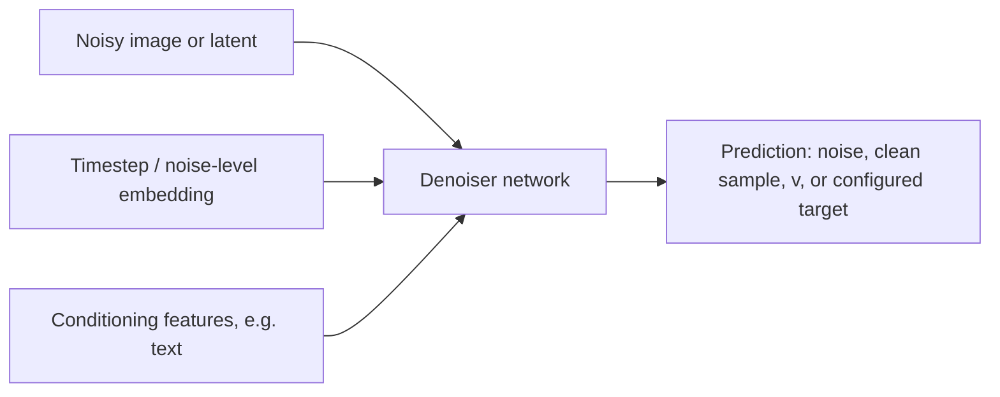
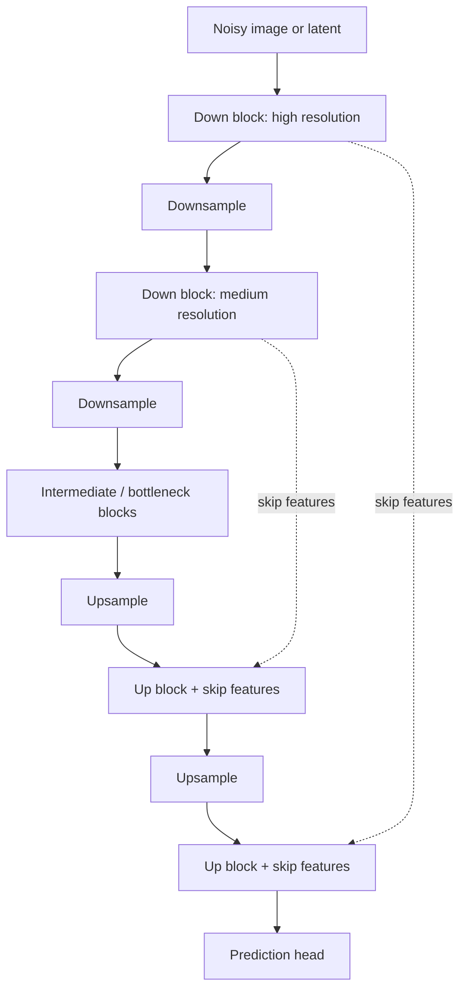
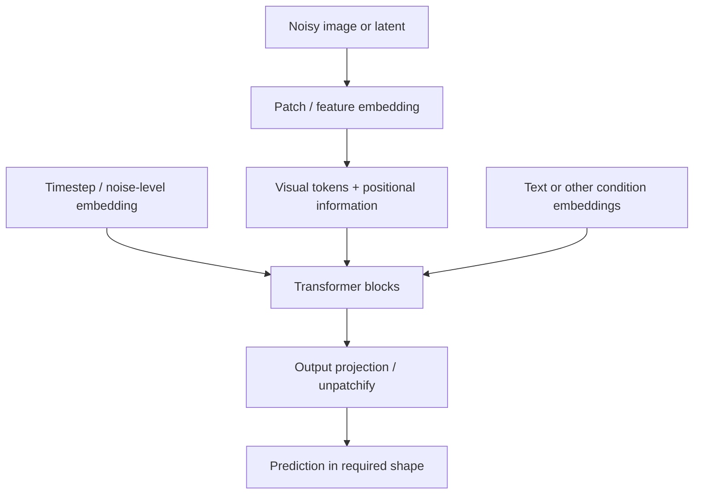
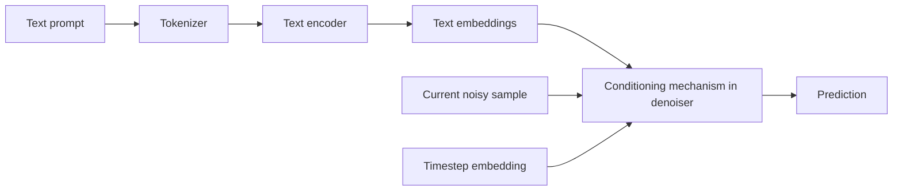
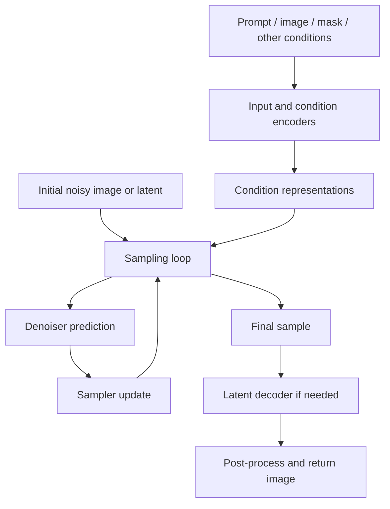

# 03. Diffusion Model Architecture

## 1. Learning Objectives

By the end of this chapter, you should be able to:

- Identify the noisy image or latent, timestep/noise-level representation, conditioning inputs, and prediction output in a diffusion denoiser.
- Trace the main stages of a U-Net: downsampling, intermediate processing, upsampling, and skip connections.
- Explain the high-level structure of transformer-based denoisers and their patch/token representations.
- Describe how attention and conditioning can influence denoising.
- Distinguish the denoiser architecture from the complete image-generation pipeline.

 

## 2. The Denoiser Within a Diffusion System

A **denoiser** is the learned neural network used by a diffusion system to predict a target from the current noisy state and relevant conditions. Depending on the model's training configuration, that target may be noise, a clean sample, velocity, or another supported parameterization.

For an image-generation task, the denoiser commonly receives:

1. **Noisy image or latent:** the current sample at a particular noise level.
2. **Timestep/noise-level information:** a representation that tells the network how corrupted the sample is.
3. **Conditioning information:** optional or required signals such as text embeddings, image features, masks, or structural guidance.
4. **Prediction output:** the target required by the training objective and sampling procedure.

The exact inputs depend on the model. A text-conditioned model uses prompt information; an unconditional model may not. A latent-diffusion model operates on a latent representation rather than directly on full-resolution pixels.

The output is not necessarily the final image. In a typical diffusion pipeline, the sampler interprets the prediction and updates the noisy state. The denoiser is one component of that larger process.

 

## 3. Common Components and Their Roles

| Component | Purpose | Architectural variation |
|---|---|---|
| Noisy sample input | Carries the current image or latent state | Pixel-space image or compressed latent |
| Timestep/noise embedding | Communicates the current noise level | Sinusoidal or learned embeddings and model-specific transformations |
| Conditioning path | Supplies prompt or other condition information | Cross-attention, concatenation, adaptive normalization, or other mechanisms |
| Feature-processing blocks | Transform spatial or token features | Convolutional blocks, transformer blocks, or hybrids |
| Skip connections | Preserve and reuse features across stages where present | Especially characteristic of U-Net-style designs |
| Prediction head | Produces the configured target | Output channels and interpretation depend on model parameterization |

Do not assume every architecture contains every component in the same form. The table describes common design patterns, not a universal specification.

 

## 4. U-Net-Based Denoisers

A **U-Net** is an encoder-decoder-style neural network with skip connections between corresponding levels of its downsampling and upsampling paths. U-Net designs are widely used in diffusion systems because they can combine broad contextual information with spatial detail.

### 4.1 Downsampling path

The downsampling path processes features at progressively lower spatial resolutions. Common operations include convolutions, residual blocks, and downsampling layers.

At higher resolution, features can represent local details such as edges and small textures. At lower resolution, the network can integrate information over a larger region of the image.

 

### 4.2 Intermediate or bottleneck blocks

The middle of the U-Net processes a compact, lower-resolution feature representation. Depending on the design, it may contain residual blocks, attention layers, transformer blocks, or combinations of these.

This stage helps integrate information across the image. Its exact structure varies by model.

 

### 4.3 Upsampling path

The upsampling path progressively restores spatial resolution. It combines processed features with information passed from the downsampling path, then refines the representation.

 

### 4.4 Skip connections

**Skip connections** pass features from downsampling stages to corresponding upsampling stages. They help preserve spatial information that could otherwise be lost during downsampling.

Skip connections do not mean the network simply copies the original image into the output. They carry intermediate learned features that are processed by later blocks.

 

### U-Net conceptual diagram

This is an illustrative layout. Real U-Nets can have more resolution levels, multiple residual blocks per level, attention at selected resolutions, and different skip-connection arrangements.

 

### 4.5 Where do timestep and text information enter?

The timestep embedding may be injected into residual blocks or other layers, often through learned projections and modulation. Text conditioning may be integrated using cross-attention or another model-specific mechanism. These pathways are separate concepts even when they interact inside the same block.

A U-Net is an architectural pattern, not a complete image-generation algorithm. The pipeline still needs the appropriate conditioning encoders, scheduler/sampler, and—when operating in latent space—a decoder.

 

## 5. Transformer-Based Denoisers

A transformer-based denoiser processes image or latent information as a sequence of tokens, or as another structured representation that supports attention.

### 5.1 Patch and token representations

A common design divides an image or latent feature map into patches. Each patch is projected into a vector, creating a sequence of tokens. The model processes these tokens using transformer blocks.

In latent-diffusion systems, the patches may come from a latent tensor rather than directly from RGB pixels. Other designs can use different tokenization or feature layouts.

Conceptually:

1. Receive the noisy image or latent.
2. Convert spatial regions or features into token representations.
3. add or combine positional information so the model can represent spatial relationships.
4. Integrate timestep and conditioning information.
5. Process tokens through transformer blocks.
6. Map the resulting representations to the required prediction shape.

The precise arrangement differs between architectures; not every transformer denoiser uses the same patch embedding, positional encoding, or conditioning scheme.

 

### 5.2 Attention

Self-attention allows tokens to exchange information with other tokens in the same representation. This can help the network model relationships between distant spatial regions.

For example, a generated scene may need to keep the relationship between a person, a held object, and a background element consistent even when those elements are spatially separated.

Attention does not guarantee correct relationships. Its effectiveness depends on the training, model capacity, conditioning, and generation setup.

 

### 5.3 Conditioning in transformer denoisers

Text or other conditions can enter transformer-based denoisers in several ways:

- **Cross-attention:** image/latent tokens attend to a separate sequence of condition tokens, such as text embeddings.
- **Joint attention:** visual and condition tokens may be processed in a shared attention representation, depending on the architecture.
- **Adaptive normalization or modulation:** timestep or condition embeddings modify intermediate feature activations.
- **Concatenation or token insertion:** condition information is added to the model's input representation in supported designs.

These are alternative or combinable mechanisms, not requirements that every model must implement.

 

### Transformer-based conceptual diagram

The diagram abstracts away architecture-specific details. Some models inject timestep information before the transformer stack; others use modulation inside blocks. Conditioning can be integrated in different ways.

 

## 6. U-Net vs. Transformer-Based Denoiser

| Dimension | U-Net-style denoiser | Transformer-based denoiser |
|---|---|---|
| Main representation | Spatial feature maps at multiple resolutions | Tokens or structured feature sequences |
| Common operations | Convolutions, residual blocks, down/up sampling | Attention, feed-forward blocks, token projections |
| Multi-scale processing | Explicit downsampling and upsampling paths are common | Depends on patching, hierarchy, and architecture |
| Skip connections | Common between encoder and decoder levels | May use residual connections and other architecture-specific paths |
| Long-range relationships | Can use attention or broad receptive fields | Attention directly exchanges information across tokens |
| Conditioning | May use cross-attention, modulation, or other methods | May use cross-attention, joint attention, modulation, or other methods |
| Key caveat | Not every U-Net has the same blocks | Not every transformer denoiser has the same tokenization or attention pattern |

Neither family is automatically superior for every task. Quality, speed, memory, and controllability depend on the full model design, training data, resolution, conditioning path, and inference implementation. Hybrid architectures are also possible.

 

## 7. How Timestep Information Influences the Denoiser

The denoiser must interpret its input in light of the current noise level. The same visual pattern can require different behavior at different timesteps.

For example:

- At a high noise level, the model may need to infer broad structure from a highly corrupted state.
- At a lower noise level, it may refine edges, textures, and smaller details.

A timestep/noise embedding converts the scalar or schedule index into a representation that neural-network blocks can use. That representation may be added to features or used to modulate them. The exact mechanism depends on the architecture.

**Important:** timestep information tells the denoiser which noise level it is processing. It is not the same as a text prompt and does not specify the scene's semantic content by itself.

 

## 8. How Prompt Information Influences the Denoiser

A text-conditioned generation pipeline typically encodes the prompt before the denoiser uses it.

A simplified path is:

The conditioning mechanism can use cross-attention or another design. In cross-attention, visual or latent features query the text representation, allowing the denoiser to use prompt information while predicting its output.

For example, the prompt “a yellow bicycle beside a blue wall” contains subject, attribute, and spatial-relation information. Conditioning provides a learned route for this information to influence denoising. However, the model may still confuse attributes, omit details, or arrange objects incorrectly.

Prompt conditioning is influential, not a hard guarantee. Explicit prompts, suitable model selection, structural controls, and evaluation can improve reliability but do not eliminate all errors.

 

## 9. The Denoiser Is Not the Full Generation Pipeline

A common conceptual mistake is to call the neural network itself “the whole diffusion model” without distinguishing the surrounding pipeline.

A complete image-generation workflow may contain:

- Prompt processing and a text encoder
- Reference-image preprocessing or image encoder
- Mask or structural-condition processing
- Initial noise creation or image-to-image initialization
- A denoiser network
- A sampler/scheduler that selects and updates the noise trajectory
- A latent decoder, if the model generates in latent space
- Post-processing, safety checks, file encoding, and output handling

Not every system includes all of these components. For example, an unconditional pixel-space diffusion system may not need a text encoder or latent decoder.

The feedback loop represents repeated denoiser evaluation and sampler updates. In a real implementation, the sampler controls the loop and determines when it has completed.

 

### Component responsibilities

| Component | Responsibility |
|---|---|
| Text encoder | Converts text into representations used by a conditioned model |
| Image/condition encoder | Converts reference images or other inputs into supported representations |
| Denoiser | Predicts the configured target from the current sample and conditions |
| Sampler/scheduler | Uses predictions and the noise schedule to update the sample |
| VAE decoder or other decoder | Converts final latents into pixels when required |
| Application/service layer | Handles requests, validation, configuration, errors, and returned files |

A hosted service may hide these components behind one API call. A local pipeline may expose more of them, but exact component boundaries depend on the implementation.

 

## 10. Worked Conceptual Example

Suppose the task is to generate “a small white owl perched on a branch at dawn.”

1. **Prompt processing:** a tokenizer and text encoder, if used by the model, convert the prompt into condition representations.
2. **Initial state:** the pipeline creates random noise in pixel or latent space for text-to-image generation.
3. **Timestep conditioning:** the denoiser receives the current sample and a representation of the current noise level.
4. **Prompt conditioning:** the denoiser uses the text condition through its supported conditioning mechanism.
5. **Prediction:** the denoiser predicts its configured target, such as noise or velocity.
6. **Sampler update:** the sampler uses the prediction to create the next sample in the trajectory.
7. **Repeat:** the process continues over the selected inference steps.
8. **Decode:** if generation occurred in latent space, a decoder converts the final latent to pixels.
9. **Output handling:** the application validates and stores the image and experiment configuration.

The U-Net or transformer denoiser is involved in the repeated prediction stage; it is not by itself the tokenizer, sampler, decoder, or API.

 

## 11. Practice: Annotate the Architectures

Create two annotated diagrams: one U-Net-based and one transformer-based denoiser.

### U-Net annotation checklist

- [ ] Noisy image or latent input
- [ ] Downsampling path
- [ ] Intermediate/bottleneck blocks
- [ ] Upsampling path
- [ ] Skip connections
- [ ] Timestep/noise-level injection
- [ ] Conditioning mechanism, if supported
- [ ] Prediction head and target type

 

### Transformer annotation checklist

- [ ] Noisy image or latent input
- [ ] Patch/token or feature embedding
- [ ] Positional information, if used
- [ ] Transformer blocks and attention
- [ ] Timestep/noise-level pathway
- [ ] Text or other conditioning pathway
- [ ] Output projection or reconstruction to the required shape
- [ ] Prediction target

 

### Short experiment

Choose a documented diffusion model and inspect its model card or pipeline documentation. Record:

- Whether its denoiser is U-Net-based, transformer-based, or hybrid.
- Whether it operates on pixels or latents.
- The documented prediction parameterization.
- How timestep information is represented or injected, if documented.
- How text or other conditions are integrated, if documented.
- Which components are included in the pipeline and which are external.

Do not infer undocumented internals solely from the model's product name.

 

## 12. Checkpoint Questions and Answers

**1. What are the main inputs and output of a diffusion denoiser?**  
Common inputs are the current noisy image or latent, timestep/noise-level information, and any supported conditioning features. The output is the configured prediction target, such as noise, a clean sample, or velocity.

**2. What do U-Net downsampling and upsampling paths do?**  
Downsampling builds features at progressively lower spatial resolutions. Upsampling restores resolution and combines processed features with information from skip connections.

**3. Why are skip connections useful?**  
They transfer intermediate spatial features from the downsampling path to the upsampling path, helping preserve useful detail and localization information.

**4. How does a transformer-based denoiser represent an image?**  
A common approach maps image or latent patches into tokens, processes the tokens with transformer blocks, and projects the resulting representations into the required prediction shape. Designs vary.

**5. How can prompt information enter a denoiser?**  
The prompt may be tokenized and encoded, then integrated through cross-attention, joint attention, modulation, concatenation, or another supported mechanism.

**6. How does timestep information differ from prompt information?**  
Timestep information indicates the current noise level. Prompt information describes desired semantic content or other user-provided conditions.

**7. Why is the denoiser not the complete generation pipeline?**  
The pipeline may also need encoders, initial-state creation, a sampler/scheduler, a latent decoder, and application-level validation and output handling.

**8. Are all diffusion architectures built with identical blocks?**  
No. U-Nets, transformer-based denoisers, and hybrid designs differ in feature representation, attention, conditioning, and other components. Inspect the specific model documentation.

 

## 13. Summary

- The denoiser consumes a noisy image or latent, noise-level information, and supported conditions.
- U-Net-style models commonly combine multi-resolution downsampling and upsampling paths with skip connections.
- Transformer-based denoisers commonly process image or latent tokens with attention.
- Timestep information tells the network how corrupted the current sample is.
- Prompt conditioning gives the denoiser information about desired content but does not guarantee perfect adherence.
- Architecture-specific conditioning may use cross-attention, joint attention, modulation, concatenation, or combinations.
- The denoiser is only one part of a full generation pipeline, which may also include encoders, a sampler, a decoder, and application logic.

 

## 14. Useful References

- [Hugging Face Diffusers documentation](https://huggingface.co/docs/diffusers/index) — pipelines and component concepts.
- [Diffusers: Models and modular components](https://huggingface.co/docs/diffusers/api/models/overview) — model component APIs.
- [Denoising Diffusion Probabilistic Models (DDPM)](https://arxiv.org/abs/2006.11239) — foundational diffusion formulation.
- [Latent Diffusion Models](https://arxiv.org/abs/2112.10752) — latent-space diffusion and cross-attention conditioning.
- [Scalable Diffusion Models with Transformers (DiT)](https://arxiv.org/abs/2212.09748) — transformer-based diffusion architecture.
- [U-Net: Convolutional Networks for Biomedical Image Segmentation](https://arxiv.org/abs/1505.04597) — original U-Net architecture paper.

 

> **Implementation note:** These diagrams are conceptual. Layer layouts, conditioning pathways, prediction heads, and component boundaries vary by model. Confirm architecture and compatibility details in the selected model's documentation before implementing or modifying a pipeline.
