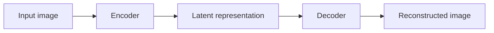
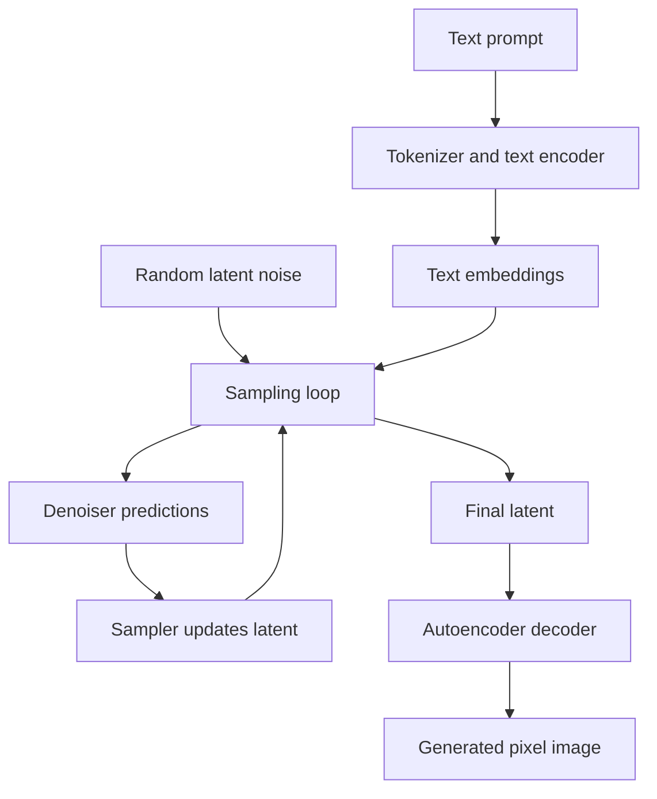
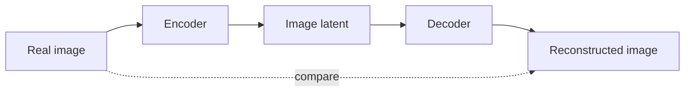
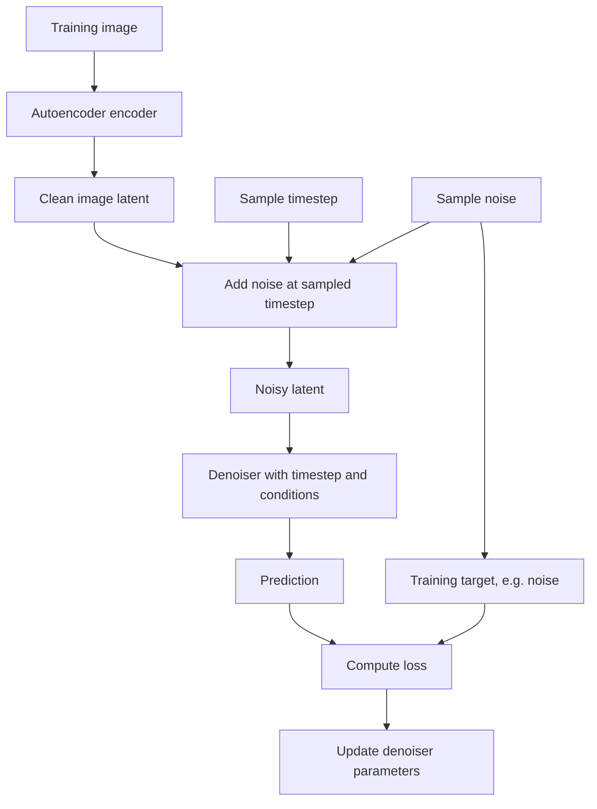
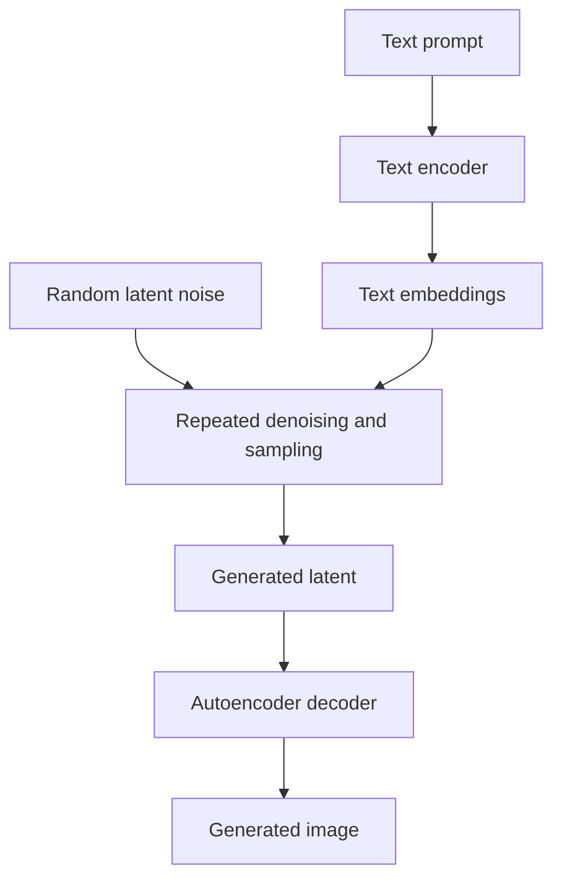

# 04. Latent Diffusion and Latent Spaces

## 1. Learning Objectives

By the end of this chapter, you should be able to:

- Compare diffusion in pixel space with diffusion in latent space.
- Trace image encoding, latent denoising, and image decoding.
- Explain the role of an autoencoder and the limitations of reconstruction.
- Understand spatial compression and why latent scaling matters.
- Distinguish image latents, text embeddings, and the random noise used to initialize generation.
- Draw separate training, reconstruction, and text-to-image generation paths.

<br/>

## 2. Pixel Space and Latent Space

### 2.1 Pixel space

An image in pixel space is represented directly as a tensor of pixel values. For an RGB image, the tensor commonly has three color channels and two spatial dimensions: height and width.

For example, an image with dimensions `512 × 512 × 3` has:

$$
512 \times 512 \times 3 = 786{,}432
$$

pixel-channel values.

A pixel-space diffusion model operates on an image representation at the image's spatial resolution. This can make denoising computation expensive, particularly for high-resolution images.

<br/>

### 2.2 Latent space

A **latent representation** is a learned, compressed representation of data. In latent diffusion, an encoder maps an image into a smaller spatial representation with a different number of channels. The diffusion process operates on that latent tensor rather than directly on the full-resolution image.

For example, a particular autoencoder might map an image of shape `512 × 512 × 3` to a latent of shape `64 × 64 × 4`. These dimensions are illustrative; actual compression factors and channel counts depend on the model.

The number of spatial positions changes from \(512 \times 512\) to \(64 \times 64\), a factor of 64 fewer spatial positions. This does **not** mean total runtime or memory will always be exactly 64 times lower: latent channels, attention, network design, decoding, and other overheads also matter.

<br/>

### 2.3 Core comparison

| Dimension | Pixel-space diffusion | Latent diffusion |
|---|---|---|
| Denoising representation | Image pixels or pixel-like tensor | Compressed image latent |
| Image encoder required | Not for the basic pixel-space representation | Typically yes |
| Decoder required to return pixels | No latent-to-pixel decoder in the same sense | Typically yes |
| Spatial size during denoising | Usually full image resolution | Usually smaller than the final image |
| Computation | Can be expensive at high resolution | Often reduces spatial computation |
| Representation constraint | Directly models the pixel representation | Limited by what the learned latent representation preserves |
| Main trade-off | Direct image-space modeling can be costly | More efficient denoising, with compression and decoding constraints |

Latent diffusion is a design strategy, not a separate image-generation task. A latent diffusion pipeline may support text-to-image, image-to-image, inpainting, or other tasks when designed for them.

<br/>

## 3. What Is an Autoencoder?

An **autoencoder** is a neural network with an encoder and a decoder:

- **Encoder:** maps an input image into a latent representation.
- **Decoder:** maps the latent representation back into an image.



The reconstructed image should preserve useful information from the input, but it may not be identical to the original. The autoencoder is trained according to a reconstruction objective and may include other regularization or perceptual objectives depending on the design.

In many latent-diffusion systems, the autoencoder is trained or selected separately from the denoiser. The encoder and decoder define the representation in which diffusion takes place.

<br/>

### 3.1 Reconstruction limitations

Compression creates a representation bottleneck. Fine details or subtle pixel-level information may be lost or changed during encoding and decoding. Possible effects include softened textures, small color shifts, altered tiny features, loss of high-frequency details, or reconstruction artifacts around complex patterns.

These are possible effects, not guaranteed defects in every model. The severity depends on the autoencoder, image content, compression, and training objectives.

The decoder does not simply copy pixels back. It synthesizes an image from the latent representation it receives. If information was discarded or not represented clearly, the decoder cannot reliably restore the exact original detail.

<br/>

## 4. The Latent-Diffusion Pipeline

A typical latent-diffusion text-to-image pipeline contains the following conceptual components:

1. **Prompt processing:** convert the prompt into a representation used by the model.
2. **Initial latent noise:** sample random noise with the shape expected by the diffusion model.
3. **Denoising:** repeatedly use the denoiser and sampler to refine the latent.
4. **Latent decoding:** pass the final latent through the autoencoder decoder.
5. **Output handling:** convert and save or return the generated image.



The loop is controlled by the sampler. The diagram separates the text representation from the image latent: they serve different purposes and typically have different shapes and semantics.

Not every system uses a text encoder or the same conditioning path. This diagram describes a common text-conditioned latent-diffusion pattern.

<br/>

## 5. Three Different Paths: Training, Reconstruction, and Generation

These workflows are related, but they are not interchangeable.

### 5.1 Autoencoder reconstruction path

The simplest reconstruction path tests what the autoencoder can preserve:



The purpose is to inspect representation and reconstruction quality. No diffusion denoising loop is required for this basic autoencoder reconstruction.

<br/>

### 5.2 Diffusion training path

A simplified latent-diffusion training path starts with a real image, encodes it into latent space, adds noise to the latent at a sampled timestep, and trains the denoiser to predict its configured target.



This is simplified. Implementations may freeze or train different components, use different targets, apply loss weighting, or use other objectives. In many common workflows, the autoencoder is already trained and frozen while the diffusion denoiser is trained in latent space.

<br/>

### 5.3 Text-to-image inference path

At generation time, there is no source image to encode. The pipeline starts from random latent noise, conditions denoising on the prompt, and decodes the final latent.



<br/>

### 5.4 Path comparison

| Workflow | Starts with | Encoder use | Diffusion denoising | Decoder use | Main purpose |
|---|---|---|---|---|---|
| Autoencoder reconstruction | Real image | Encodes source image | No | Yes | Test reconstruction |
| Latent-diffusion training | Real training image | Encodes source image | Noisy latent is used to train denoiser | Not necessarily in every denoiser update | Learn latent denoising |
| Text-to-image inference | Random latent noise + prompt | Text encoder; no source-image encoder is required for the basic task | Yes, repeated sampling | Yes | Generate a new image |

Training implementations may decode samples for visual monitoring or use additional losses, but this is not required for every standard denoiser update.

<br/>

## 6. Spatial Compression and Computation

Latent diffusion often reduces computation by reducing the spatial dimensions processed by the denoiser. Many operations in convolutional networks and attention-based models depend strongly on the number of spatial positions or tokens.

Consider an illustrative shape change:

- Pixel image: `512 × 512 × 3`
- Latent: `64 × 64 × 4`

Spatial positions:

$$
512 \times 512 = 262{,}144
$$

$$
64 \times 64 = 4{,}096
$$

The latent has 64 times fewer spatial positions in this example. The latent still has its own channels and the denoiser may have substantial internal feature maps, so this ratio is not a universal compute or memory ratio.

<br/>

### Why not compress as much as possible?

More compression can reduce the denoiser's spatial workload, but it may discard details or make certain visual structures harder to represent. The latent representation must preserve enough information for the intended generation tasks.

The practical design trade-off is between denoising efficiency, representation capacity, reconstruction fidelity, image resolution and detail, and model/hardware cost.

<br/>

## 7. Latent Scaling

Some latent-diffusion pipelines apply a **latent scaling factor** between the autoencoder and the diffusion model. This factor helps match the latent distribution's scale to the range expected during diffusion training and inference.

The exact convention is model-specific. A simplified illustration might look like:

```python
# Conceptual pseudocode only; exact conventions depend on the model.
latent = encoder(image)
diffusion_latent = latent * scaling_factor

# After denoising:
latent_for_decoder = generated_latent / scaling_factor
image = decoder(latent_for_decoder)
```

This is not a universal implementation recipe. Some libraries apply scaling internally, some expose it through model configuration, and some models use different conventions. Applying the factor twice—or failing to apply a required factor—can lead to incorrect latent magnitudes and poor output.

**Engineering rule:** follow the selected pipeline's documented latent-scaling convention. Do not manually scale latents unless the API or model documentation requires it.

<br/>

## 8. Image Latents, Text Embeddings, and Input Noise Are Different

These terms are sometimes confused because they are all numerical tensors. Their meanings are different.

### Image latent

A compressed representation of image content, commonly produced by an image encoder. During latent diffusion, the denoiser refines a noisy version of this image-space representation.

<br/>

### Text embedding

A representation of text produced by a tokenizer and text encoder. It encodes learned linguistic or semantic information and conditions the denoiser when the model supports text conditioning.

Text embeddings are not compressed images and are not usually decoded into RGB pixels by the image autoencoder.

<br/>

### Input noise

A random tensor sampled to initialize generation or to corrupt a training latent. In text-to-image latent diffusion, the initial noise often has the latent shape expected by the denoiser. It is not itself a meaningful image or prompt representation.

| Representation | Typical source | Purpose | Typical role |
|---|---|---|---|
| Image latent | Image encoder, or denoising state | Represents image content in compressed space | Main state refined by latent diffusion |
| Text embedding | Text encoder | Represents prompt information | Conditions generation |
| Input noise | Random sampling or training corruption | Provides stochastic starting state or corruption | Initialized or added according to the diffusion process |
| Final latent | Denoising and sampling process | Represents generated image content before decoding | Input to the decoder |

The exact tensor shapes and processing paths vary by model. Never assume these representations can be substituted for one another just because all are tensors.

<br/>

## 9. Compatibility Between Components

A latent-diffusion pipeline is a coordinated system. Components must agree on representation and configuration.

Important compatibility checks include:

- **Encoder and decoder:** their latent format and configuration must match.
- **Denoiser:** its input channels, latent dimensions, prediction type, and conditioning interfaces must match the expected pipeline.
- **Text encoder and tokenizer:** they must be compatible with the model's learned text-conditioning pathway.
- **Latent scaling:** scaling conventions must match the checkpoint and library.
- **Scheduler/sampler:** its configuration must be suitable for the denoiser's training parameterization.
- **Resolution and aspect ratio:** requested dimensions must follow the model and pipeline's supported constraints.
- **Adapters or fine-tuned components:** verify the required base model, component versions, and compatibility.

Mixing arbitrary components can produce errors or poor-quality outputs even if each component loads successfully. Prefer documented model pipelines and compatible checkpoint combinations.

<br/>

## 10. Worked Example: A New Image from Text

Prompt: “A white owl perched on a branch at dawn, misty forest, natural wildlife photography.”

A common latent-diffusion workflow is:

1. The text encoder turns the prompt into text embeddings.
2. The pipeline samples initial random noise with the required latent shape.
3. The denoiser processes the noisy latent at each selected noise level and uses the text condition.
4. The sampler repeatedly updates the latent using the model's predictions.
5. The final latent is passed to the compatible autoencoder decoder.
6. The decoder produces an image in pixel space.
7. The application saves the image and records the prompt, model version, seed (if available), generation settings, and runtime.

No source image is required for this basic text-to-image path. If the task were image-to-image, an image encoder would typically encode the reference image and the pipeline would initialize or condition the denoising process according to the implementation.

<br/>

## 11. Practice: Draw Three Separate Paths

Draw and label the following diagrams. Keep image latents, text embeddings, and noise as separate objects.

### A. Reconstruction

`Image → Encoder → Image latent → Decoder → Reconstructed image`

Add a note describing what information may be lost or changed.

<br/>

### B. Diffusion training

`Training image → Encoder → Clean latent → Add noise at sampled timestep → Denoiser → Target comparison → Loss/update`

Include the sampled timestep, noise, and conditioning input where relevant. State whether the autoencoder is frozen or trained in the workflow you study.

<br/>

### C. Text-to-image inference

`Prompt → Text encoder → Text embeddings`

`Random latent noise → Denoiser + sampler loop conditioned on text → Final latent → Decoder → Generated image`

Label the sampler loop as repeated inference, not as the ordinary denoiser training update.

### Experiment checklist

- [ ] Record the image and latent shapes for the selected model.
- [ ] Inspect the model documentation for the autoencoder and scaling convention.
- [ ] Compare an original image with its autoencoder reconstruction, if a reconstruction workflow is available.
- [ ] Record any detail or color differences.
- [ ] Identify the text-conditioning path separately from the image-latent path.
- [ ] Do not report theoretical shape ratios as measured runtime or memory savings.

<br/>

## 12. Checkpoint Questions and Answers

**1. Why can latent diffusion reduce computation?**  
It performs denoising on a compressed spatial representation rather than the full-resolution pixel tensor. This can reduce the number of spatial positions processed by the denoiser, although actual savings depend on the architecture and implementation.

**2. What is the role of the autoencoder?**  
Its encoder maps images into latents and its decoder maps latents back to pixels. The latent representation allows the diffusion model to operate in a compressed space.

**3. Why may a reconstructed image differ from the original?**  
The encoder may discard information, and the decoder reconstructs from the available latent representation. Fine details, colors, or textures may change.

**4. Is the image latent the same as the text embedding?**  
No. The image latent represents image content in a compressed visual space; the text embedding represents prompt information used for conditioning.

**5. Is input noise an image latent?**  
They can have the same shape in a particular pipeline, but their roles differ. Input noise is a random starting state or corruption; a denoised latent represents generated image content in the model's latent space.

**6. Why does latent scaling matter?**  
The diffusion model expects latent values in a particular convention or range. Incorrect scaling can create a mismatch between the autoencoder and denoiser.

**7. Does the text-to-image inference path need to encode a source image?**  
Not for the basic text-to-image task. It usually starts with random latent noise and uses text embeddings as conditioning. Image-to-image workflows generally require a reference-image path.

**8. What is the main trade-off of latent diffusion?**  
It can reduce denoising computation, but generation quality is constrained by the latent representation, decoder reconstruction, and compatibility between components.

<br/>

## 13. Summary

- Pixel-space diffusion operates on pixel-level representations; latent diffusion operates on compressed image latents.
- An autoencoder provides an encoder and decoder for moving between image and latent space.
- Latent diffusion can reduce spatial computation but may introduce representation and reconstruction constraints.
- Reconstruction, diffusion training, and text-to-image inference are distinct workflows.
- Image latents, text embeddings, and input noise have different meanings even when represented as tensors.
- Latent scaling and component compatibility are model-specific engineering requirements.
- Evaluate actual image quality, runtime, and memory rather than assuming savings from spatial ratios alone.

<br/>

## 14. Useful References

- [High-Resolution Image Synthesis with Latent Diffusion Models](https://arxiv.org/abs/2112.10752) — latent diffusion, autoencoders, and conditioning.
- [Hugging Face Diffusers documentation](https://huggingface.co/docs/diffusers/index) — practical pipelines and model components.
- [Diffusers: AutoencoderKL documentation](https://huggingface.co/docs/diffusers/api/models/autoencoderkl) — an example of a latent-space image autoencoder component.
- [Denoising Diffusion Probabilistic Models (DDPM)](https://arxiv.org/abs/2006.11239) — foundational diffusion formulation.

> **Implementation note:** Shape ratios, latent scaling, component names, and supported workflows are model-dependent. Verify the selected checkpoint's configuration and library documentation before connecting components or manually manipulating latents.
