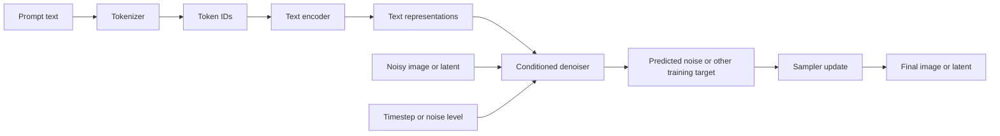
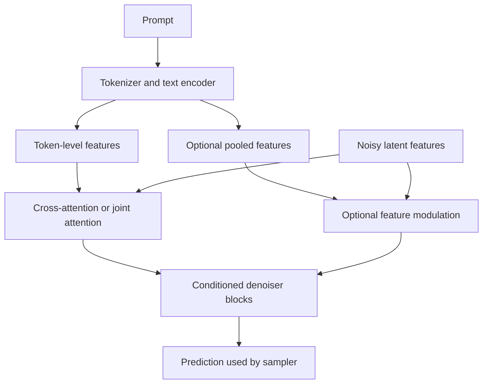

# Chapter 05: Text Encoders and Conditioning

## Learning Objectives

By the end of this chapter, you should be able to:

- Trace a text prompt from tokenization to the representations consumed by an image-generation model.
- Explain cross-attention and recognize other common conditioning paths.
- Identify prompt-length limits, truncation, and model-specific prompt handling.
- Distinguish positive prompts, negative prompts, and non-text conditions.
- Improve prompt clarity by specifying subjects, attributes, setting, composition, and visual style.
- Explain why conditioning influences generation without guaranteeing an exact scene.

<br/>

## 1. Where Text Conditioning Fits

In a text-to-image system, the prompt is usually not passed directly to the image denoiser as ordinary prose. A text encoder converts the prompt into numerical representations. The image-generation model uses those representations, along with the current noisy image or latent and a timestep/noise-level signal, to guide denoising.



This is a conceptual diagram. Real pipelines can use multiple text encoders, pooled representations, additional condition inputs, or different denoiser designs. Consult the selected model's documentation to understand its exact interface.

<br/>

### Three different things

- **Prompt:** Human-readable instructions, such as “a white owl perched on a moss-covered branch.”
- **Text representation:** Numeric features produced by a text encoder from tokenized input.
- **Conditioning mechanism:** The route through which the model uses those features during image generation.

These are related but not interchangeable. A prompt is not a formal scene graph, and a text embedding is not a guaranteed list of objects and relationships.

<br/>

## 2. Tokenization: From Text to Token IDs

A tokenizer splits text into model-specific units and maps those units to integer token IDs. A token may correspond to a word, part of a word, punctuation, or another subword unit. Token boundaries do not necessarily match words.

For example, the prompt “A small white owl on a branch” might be represented by a sequence of token IDs. The exact sequence depends on the tokenizer and vocabulary; it should not be assumed from the words alone.

<br/>

### Why tokenization matters

1. **The model sees token IDs, not raw text.** The tokenizer determines how text is represented before encoding.
2. **Token counts are model-dependent.** A sentence that fits one model's context may exceed another's.
3. **Special tokens may be added.** A tokenizer may add beginning-of-sequence, end-of-sequence, or padding tokens.
4. **Tokenization is not semantic parsing.** Splitting “red-winged bird” into tokens does not guarantee the model will preserve the intended attribute relationship.

<br/>

### Inspecting tokenization

The following example uses a Hugging Face tokenizer. Replace the model identifier with the text encoder/tokenizer specified by the image model you are using.

```python
from transformers import AutoTokenizer

model_id = "openai/clip-vit-large-patch14"  # Example tokenizer; not universal
tokenizer = AutoTokenizer.from_pretrained(model_id)

prompt = "A small white owl perched on a moss-covered branch"
encoded = tokenizer(
    prompt,
    add_special_tokens=True,
    truncation=False,
)

print("Token IDs:", encoded["input_ids"])
print("Token count including special tokens:", len(encoded["input_ids"]))
print("Tokens:", tokenizer.convert_ids_to_tokens(encoded["input_ids"]))
```

**Important:** This is an inspection example, not a complete image-generation pipeline. Use the tokenizer associated with the target model. A model may have multiple text encoders or a specialized prompt-processing function.

<br/>

## 3. Text Encoders and Text Representations

A text encoder transforms token IDs into learned numerical representations. In many diffusion pipelines, the output is a sequence of contextual token embeddings: each token's representation can reflect information from the surrounding prompt.

A simplified view is:

$$
\text{token IDs} \rightarrow \text{text encoder} \rightarrow H \in \mathbb{R}^{L \times d}
$$

where:

- $L$ is the encoded sequence length.
- $d$ is the embedding dimension.
- $H$ is a sequence of text features consumed by the image model.

This notation is illustrative. Real systems can return additional outputs, use different shapes, or combine multiple encoders.

<br/>

### Contextual representations

The representation for “bank” can differ depending on whether the prompt describes a riverbank or a financial institution. The encoder's output is learned from context; it is not simply a fixed dictionary lookup for each word.

<br/>

### Multiple text encoders

Some image-generation models use more than one text encoder. Different encoders may contribute token-level features, pooled sentence-level features, or complementary semantic information. This is model-specific.

**Engineering rule:** Do not assume every diffusion pipeline accepts a single prompt string and produces one embedding tensor. Read the pipeline documentation and model card, and use the expected tokenizer(s), encoder(s), and prompt-processing path.

<br/>

## 4. How the Image Model Uses Text Conditioning

The text features influence denoising, helping the model generate visual content that is compatible with the prompt. Several conditioning mechanisms are used in practice.

### 4.1 Cross-attention

Cross-attention lets image or latent features query text features. In simplified form:

$$
\operatorname{Attention}(Q,K,V)
=\operatorname{softmax}\left(\frac{QK^\top}{\sqrt{d_k}}\right)V
$$

For cross-attention:

- **Queries $Q$:** commonly derived from image/latent features.
- **Keys $K$ and values $V$:** commonly derived from text representations.
- **Attention weights:** determine how strongly image features draw information from different text positions.

This allows different spatial or token features to use different parts of the prompt during denoising. It does **not** guarantee that every noun, adjective, or relationship will be represented correctly.

<br/>

### 4.2 Other conditioning paths

Depending on the architecture, text or other conditions can also be introduced through:

- **Feature concatenation:** condition features are joined with image/latent features.
- **Feature modulation:** a condition generates scale, shift, or related parameters that modify network activations.
- **Pooled text embeddings:** a single vector summarizes the prompt and may condition parts of the denoiser.
- **Joint attention:** image and text tokens are processed together within an attention block.
- **Specialized control inputs:** depth maps, edges, pose, masks, reference images, or other signals guide generation through model-specific paths.

These mechanisms are not universally interchangeable. Their availability depends on the model and pipeline.



<br/>

## 5. Positive Prompts, Negative Prompts, and Other Conditions

### Positive prompt

The positive prompt describes content or qualities the generation should favor.

Example:

> A white Indian owl perched on a moss-covered branch, full body visible, centered composition, soft morning light, natural wildlife photography.

Useful prompt elements include:

- **Subject:** the main object, person, animal, or scene.
- **Attributes:** color, material, size, age, or other properties.
- **Action or pose:** what the subject is doing.
- **Setting:** location, background, season, or time of day.
- **Composition:** camera distance, viewpoint, framing, placement, or negative space.
- **Visual style:** photography, watercolor, 3D render, ink illustration, and so on.
- **Lighting and atmosphere:** backlighting, overcast light, mist, high contrast, etc.

<br/>

### Negative prompt

Where supported, a negative prompt provides concepts the system should discourage, such as “text, watermark, blurry image.” It is not a hard prohibition list, and its effect depends on the model, pipeline, and inference configuration.

Do not assume every model supports negative prompts. Some pipelines ignore them, handle them differently, or expose no negative-prompt argument.

<br/>

### Other conditions

Text may be only one source of guidance. A pipeline can also use:

- an input image for image-to-image generation;
- a mask for inpainting;
- a depth map, edge map, pose map, or other spatial control;
- reference-image features or adapter inputs;
- class labels, layout information, or other structured signals.

A condition can guide only the aspects represented by its interface and training. For example, a mask indicates a region to edit, but it does not by itself specify the exact object that should appear there.

<br/>

## 6. Prompt Length, Context Limits, and Truncation

Text encoders have finite input limits. The limit depends on the model, tokenizer, pipeline, and prompt-processing implementation.

When a prompt exceeds the supported length, the pipeline may:

- truncate tokens;
- warn that text was truncated;
- split or encode text in a model-specific way;
- use a specialized long-prompt technique;
- process multiple prompt segments or encoders.

There is no universal prompt-length limit for all image-generation models.

<br/>

### Why truncation is dangerous

If the end of a prompt is removed, important details such as composition, lighting, or exclusions may never reach the text encoder. The generated image may appear to “ignore” an instruction that was actually truncated.

<br/>

### Practical checks

1. Read the model's documentation for supported prompt length and long-prompt behavior.
2. Inspect token counts with the correct tokenizer.
3. Check runtime warnings and logs.
4. Place essential subject and relationship information early when the model may truncate input.
5. Prefer concise, specific instructions over long lists of loosely related adjectives.
6. If the pipeline supports multiple prompts or encoders, follow its documented conventions rather than manually concatenating embeddings.

**Do not hard-code a familiar token limit across model families.** Even models from the same family can have different prompt-processing behavior.

<br/>

## 7. Composition, Attribute Binding, and Ambiguity

A model can recognize many concepts yet combine them incorrectly. Common errors include attaching an attribute to the wrong object, omitting a subject, mixing styles, or misunderstanding spatial relationships.

### Attribute binding

Compare:

- “A red bird beside a blue bicycle.”
- “A blue bird beside a red bicycle.”

Both prompts contain the same colors and objects, but the intended attribute-object relationships differ. The output may still swap colors or otherwise misbind attributes.

<br/>

### Composition

Composition is often clearer when it is stated explicitly:

- **Camera distance:** close-up, medium shot, full-body, wide shot.
- **Viewpoint:** eye-level, overhead, low-angle, side view.
- **Placement:** subject on the left, centered subject, object in the foreground.
- **Background:** simple studio background, forest in the distance, uncluttered backdrop.
- **Visibility:** full body visible, both objects clearly separated, no crop.

These phrases influence the output; they do not guarantee exact spatial placement. Stronger spatial control may require a layout, mask, pose, depth map, or other supported conditioning input.

<br/>

### Ambiguous instructions

Ambiguous: “A modern owl in a dramatic setting.”

More specific: “A realistic white owl perched on a weathered branch in a misty forest at dawn; full body visible, subject centered, distant trees softly blurred, cool natural light, wildlife photography.”

The second prompt narrows the intended subject, setting, composition, and style. It still leaves creative degrees of freedom to the model.

<br/>

### A practical prompt template

```text
Subject and key attributes:
Action or pose:
Setting and background:
Composition and viewpoint:
Lighting and atmosphere:
Visual style and medium:
Important constraints:
```

Use only the fields that matter for the task. A prompt does not need to become a long checklist if a short instruction already communicates the intended result.

<br/>

## 8. Practice: Compare Explicit Prompts

Use the following prompts with the same model, dimensions, inference settings, and seed where the pipeline supports reproducible seeds. Generate several samples if possible, because a single result may be unrepresentative.

### Prompt A — underspecified

> A white owl in a forest.

<br/>

### Prompt B — explicit subject and setting

> A realistic white owl perched on a moss-covered branch in a dense forest at dawn.

<br/>

### Prompt C — explicit composition and style

> Wildlife photograph of a white owl, full body visible, perched on a moss-covered branch in a dense forest at dawn; eye-level medium shot, owl centered, distant trees softly blurred, soft natural side lighting, realistic feather detail.

<br/>

### Prompt D — conflicting or ambiguous attributes

> A tiny giant white owl, close-up with its entire body and the whole forest visible, photorealistic watercolor.

<br/>

### Experiment procedure

1. Keep the model, aspect ratio, steps, guidance settings, and seed fixed for the first comparison.
2. Compare subject identity, setting, composition, attribute binding, and visual style.
3. Record which requested details are present, absent, or incorrectly combined.
4. Repeat with multiple seeds to distinguish a prompt-level tendency from one random sample.
5. Inspect warnings for prompt truncation.
6. If supported, test a negative prompt separately rather than changing many settings at once.

<br/>

### Results table

| Criterion | What to record |
|<br/>|<br/>|
| Subject | Is the owl present and visually dominant? |
| Attributes | Is it white? Are requested details attached to the right subject? |
| Setting | Is the forest recognizable and consistent with the prompt? |
| Composition | Is the subject centered, fully visible, and at the requested distance? |
| Style | Does the output resemble the specified medium? |
| Consistency | Do repeated samples preserve the key instructions? |
| Limitations | Which requirements were missed or interpreted differently? |

<br/>

### Practice questions

1. Why can two prompts containing the same words produce different attribute relationships?
2. How can you tell whether a missing detail may have been truncated?
3. When would a mask or depth map be more appropriate than adding more prose?
4. Why should a prompt comparison control the seed and inference settings?

<br/>

## 9. Common Failure Modes and Debugging

| Symptom | Possible cause | Practical response |
|<br/>|<br/>|<br/>|
| A detail near the end is missing | Prompt truncation, weak conditioning, or competing instructions | Check token count and warnings; shorten or reorder the prompt |
| Colors are assigned to the wrong object | Attribute binding failure or ambiguous syntax | Separate objects and attributes clearly; test simpler prompts |
| Several requested objects merge | Crowded composition or weak object separation | Describe positions and separation; consider supported layout or spatial controls |
| Style is inconsistent | Conflicting style terms or model limitations | Choose one primary style and remove contradictory descriptors |
| Negative prompt has no visible effect | Unsupported argument or model-dependent behavior | Verify pipeline support and configuration |
| Different seeds vary substantially | Stochastic sampling and under-specified constraints | Test multiple samples and measure consistency |
| Text instruction is followed only approximately | Conditioning is learned guidance, not a symbolic constraint solver | Use structured/spatial conditioning if exact placement is essential |

Prompt changes are not a substitute for validating the whole pipeline. Check the model, tokenizer, conditioning interface, inference configuration, and output quality together.

<br/>

## 10. Checkpoint: Why a Prompt Is Not a Guarantee

A prompt influences image generation because a text encoder maps tokens into learned representations and the denoiser uses those representations as conditioning while updating a noisy image or latent. The model has learned statistical associations between text and visual patterns during training.

A prompt is not a guaranteed scene specification for several reasons:

1. **Representation is learned.** Tokenization and text encoding do not create a perfect symbolic representation of every instruction.
2. **Conditioning is soft guidance.** Attention and other conditioning mechanisms influence denoising; they do not necessarily enforce hard logical constraints.
3. **Training data is imperfect.** The model may have learned uneven or conflicting associations.
4. **Instructions can be ambiguous or contradictory.** The model must resolve competing cues.
5. **Generation is stochastic.** Sampling settings and random noise can produce different results from the same prompt.
6. **Model interfaces vary.** Prompt limits, encoders, negative prompts, and additional conditions differ by pipeline.

For exact requirements—such as a precise layout, a specific pose, or strict object placement—consider supported masks, control maps, reference conditioning, or post-generation validation instead of relying only on prose.

<br/>

## 11. Key Takeaways

- A prompt is tokenized before a text encoder converts it into learned representations.
- The image model uses text features through cross-attention or other architecture-specific conditioning paths.
- Token limits and truncation are model- and pipeline-dependent.
- Positive prompts describe desired content; negative prompts are available only where supported and are not hard guarantees.
- Explicit subject, attribute, setting, composition, and style instructions usually make intent clearer.
- Learned conditioning guides generation but does not guarantee exact object relationships or scene structure.
- When precision matters, combine prompting with supported spatial controls and output evaluation.

<br/>

## 12. References and Further Reading

Prefer the documentation for the exact model and pipeline you use; interfaces and long-prompt behavior vary.

- [Hugging Face Transformers — Tokenizers](https://huggingface.co/docs/transformers/main_classes/tokenizer)
- [Hugging Face Diffusers — Text-to-Image](https://huggingface.co/docs/diffusers/using-diffusers/text-img2img)
- [Hugging Face Diffusers — API and Pipeline Documentation](https://huggingface.co/docs/diffusers/api/pipelines/overview)
- [Hugging Face Diffusers — Textual Inversion](https://huggingface.co/docs/diffusers/training/text_inversion)
- [High-Resolution Image Synthesis with Latent Diffusion Models (research paper)](https://arxiv.org/abs/2112.10752)
- [Attention Is All You Need (research paper)](https://arxiv.org/abs/1706.03762)

**Version note:** Documentation paths and model interfaces can change. Before implementing a pipeline, confirm the current docs and model card for the specific checkpoint and installed library version.
