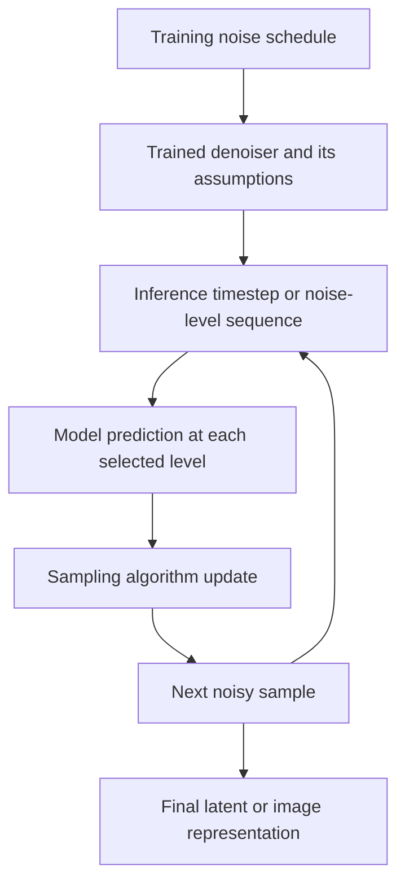
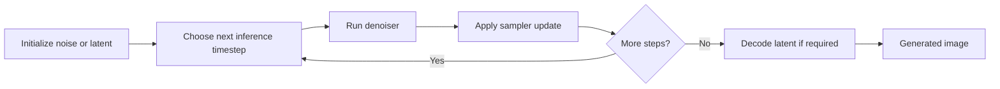
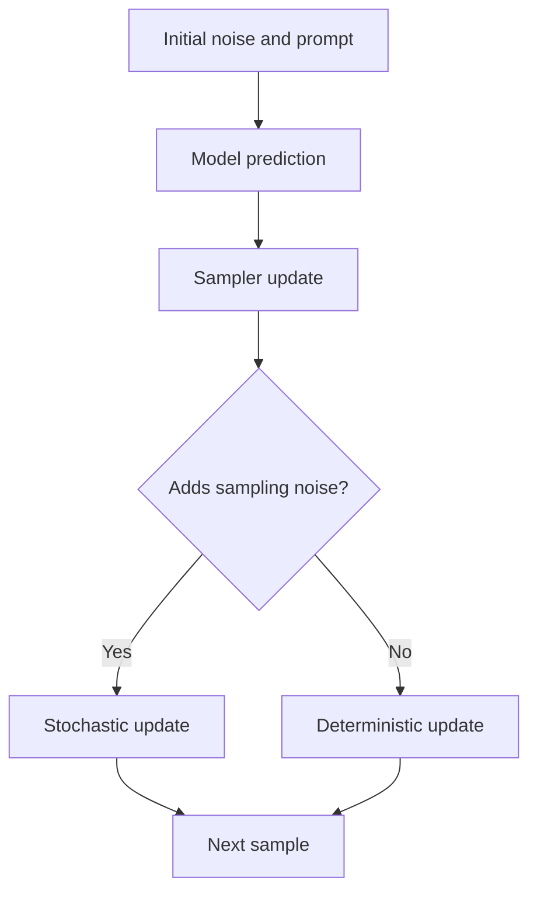

# Chapter 06: Noise Schedules, Samplers, and Sampling Steps

## Learning Objectives

By the end of this chapter, you should be able to:

- Distinguish a model's training noise schedule from inference timestep selection and the sampling algorithm.
- Explain stochastic and deterministic sampling at a high level.
- Describe how step count, noise levels, numerical approximation, and model compatibility affect generation.
- Compare quality and runtime without assuming that more steps always produce better images.
- Record the sampler and schedule—not just the number of steps—when documenting experiments.

<br/>

## 1. The Three Concepts to Keep Separate

Diffusion systems are often described using the word *schedule* or *sampler*, but these terms refer to different parts of the process.

### 1.1 Training noise schedule

During training, a noise schedule defines how noise levels are associated with timesteps. In a common diffusion formulation, the forward process gradually corrupts a clean training image or latent. The model learns to predict a target, such as noise, at sampled noise levels.

The schedule influences the noise distribution used to train the denoiser. It is part of the model's training formulation and learned assumptions.

<br/>

### 1.2 Inference timestep selection

At inference, the pipeline selects a sequence of noise levels or timesteps at which to evaluate the trained model. The selected sequence may be a subset or transformation of the training-time timeline.

A pipeline may expose a setting such as `num_inference_steps`, but this number alone does not specify the exact noise levels used or how they are spaced.

<br/>

### 1.3 Sampling algorithm

The sampler—or scheduler in many libraries—defines how the model's prediction is used to update the current noisy sample from one inference step to the next. Different algorithms can use different update equations, assumptions, and noise-injection behavior.



This is a conceptual diagram. Actual pipelines may implement the model, timestep selection, and sampler in more integrated ways.

**Core distinction:** training noise schedule, inference timestep selection, and sampling algorithm are related, but they are not synonyms.

<br/>

## 2. What Happens During Inference?

A typical diffusion inference loop starts from random noise or another initialized sample and repeatedly applies the denoiser and sampler update. In latent diffusion, the iterative process commonly occurs in latent space, followed by decoding to pixels.



At each step, the denoiser predicts a training target according to its model formulation. The sampler interprets that prediction to estimate or update the sample at another noise level.

<br/>

### Important terminology

- **Denoiser/model:** predicts noise, a clean sample, velocity, or another parameterization learned during training.
- **Inference timestep/noise level:** indicates the current point in the denoising trajectory.
- **Sampler/scheduler:** determines the update rule and often provides the inference timestep sequence.
- **Inference step:** one model evaluation/update in the configured sampling loop, though exact accounting can vary by pipeline.
- **Decoder:** in latent diffusion, maps the final latent representation back to image pixels.

Do not assume every library uses these names identically. Read the documentation for the specific pipeline and scheduler.

<br/>

## 3. Training Schedules Versus Inference Schedules

A training noise schedule defines the noise levels used by the training process. Inference often needs to traverse the learned noise range with a finite sequence of model evaluations.

The inference sequence can differ from the full training timeline because running every training timestep may be too expensive. A scheduler may select a smaller set of levels or use a solver designed to approximate the denoising trajectory efficiently.

<br/>

### Why timestep spacing matters

Two inference configurations with the same number of steps can choose different noise levels. For example, one may place steps differently across high-noise and low-noise regions. The model's predictions and the update rule can therefore be applied at different points in the trajectory.

Relevant concepts include:

- **Timestep spacing:** how the selected timesteps are distributed.
- **Noise-level parameterization:** how the noise level is represented, such as a discrete timestep or a continuous noise parameter.
- **Terminal noise level:** the final noise level expected by the sampler and model.
- **Prediction type:** whether the model predicts noise, a clean sample, velocity, or another target.
- **Model configuration:** training-time assumptions that constrain compatible inference settings.

Exact options vary by scheduler and model. Do not change these settings blindly; use model documentation and library guidance.

<br/>

## 4. Sampling Algorithms: A High-Level Comparison

Sampling algorithms approximate a path from noise toward a sample consistent with the learned distribution and the conditioning. They differ in update equations, numerical assumptions, and whether they introduce additional randomness during sampling.

The table below is a conceptual comparison, not a universal ranking. Names and available options depend on the implementation and model.

| Sampler family or example | High-level idea | Practical consideration |
|<br/>|<br/>|<br/>|
| DDPM-style sampling | Uses a probabilistic reverse-process formulation, often with noise added during intermediate updates | Can be computationally expensive at high step counts; exact behavior depends on the formulation |
| DDIM-style sampling | Uses a non-Markovian sampling formulation that can support deterministic sampling when configured accordingly | Useful for studying repeatability and reduced-step sampling; quality still depends on configuration |
| Euler-style methods | Use numerical updates based on the model's prediction along a noise trajectory | Often straightforward and widely available; behavior depends on the scheduler configuration |
| Higher-order solver methods | Use more advanced numerical approximations to improve the trajectory estimate per step | May achieve useful results with fewer evaluations for compatible models, but are not automatically better in every setting |

Use the scheduler's documentation for precise definitions and parameter behavior. A familiar name alone is not enough to determine whether a configuration is stochastic, deterministic, or appropriate for a particular checkpoint.

<br/>

## 5. Stochastic and Deterministic Sampling

### Stochastic sampling

A stochastic sampler introduces randomness into one or more sampling updates, in addition to the initial noise. As a result, the same initial seed and settings may not be sufficient for exact reproducibility across all implementations or hardware environments.

<br/>

### Deterministic sampling

A deterministic update introduces no additional random noise at the relevant update stage. Given the same initial sample, conditioning, model, and settings, the trajectory can be repeatable within the limits of the implementation and hardware.

<br/>

### Important qualification

“Deterministic sampler” does not mean the image is deterministic regardless of the seed. If the initial noise changes, the generated result will generally change. Nor does deterministic sampling guarantee bit-for-bit identical results across different devices, kernels, library versions, or numerical precision settings.



This diagram simplifies the distinction. Some methods have configuration-dependent behavior, so consult the implementation rather than inferring it solely from the sampler's name.

<br/>

## 6. What Does the Number of Steps Mean?

The inference step count usually controls how many denoising updates or model evaluations are performed. More steps often increase latency and compute cost, but their quality benefit is model- and sampler-dependent.

<br/>

### Why more steps do not always improve quality

- A sampler may already reach an adequate approximation at a lower step count.
- The scheduler may be designed for a particular range of steps or noise levels.
- Poorly matched settings can spend additional evaluations inefficiently.
- Different samplers may converge at different rates.
- Image quality includes several dimensions: prompt alignment, detail, composition, artifacts, and aesthetic preference.
- A change in step count can interact with guidance, resolution, precision, and model architecture.

More steps can help in some configurations, but there is no universal rule that doubling steps doubles quality or that the highest step count is best.

<br/>

### Runtime implications

A rough conceptual model is:

$$
T_{\text{generation}} \approx
N_{\text{model evaluations}} \times T_{\text{evaluation}}
+ T_{\text{setup and decoding}}
$$

This is not an exact performance formula. Some pipelines use multiple model evaluations per nominal step, different model components, batching, or other optimizations. Hardware utilization, memory movement, attention implementation, and image resolution also affect runtime.

<br/>

### Quality and cost should be measured

Compare configurations using the same model, prompt, resolution, seed policy, hardware, and evaluation criteria. Measure latency and memory as well as image quality. A visual improvement that is not repeatable or does not matter for the use case may not justify its cost.

<br/>

## 7. Model Compatibility and Configuration

A sampler should be compatible with the model's parameterization and training assumptions. Compatibility can depend on:

- the model's prediction type, such as noise prediction, clean-sample prediction, or velocity prediction;
- the noise schedule and supported noise-level range;
- the scheduler's expected input scaling;
- the model architecture and checkpoint configuration;
- guidance method and conditioning setup;
- pipeline implementation and library version.

A scheduler can be technically available in a library but still be an inappropriate choice for a particular checkpoint or configuration.

<br/>

### Safe workflow

1. Start with the model's recommended pipeline and scheduler.
2. Record the model identifier and revision, library versions, and scheduler configuration.
3. Change one sampling variable at a time.
4. Check warnings, errors, and the model documentation.
5. Compare both output quality and runtime.
6. Preserve a known-good baseline for regression testing.

Avoid manually changing the training noise schedule of a pretrained model unless the model's documentation explicitly supports that procedure. Inference scheduler configuration is not the same thing as retraining the model with a different schedule.

<br/>

## 8. Example: Inspecting a Diffusers Scheduler

The following example shows how to load a scheduler configuration from a Diffusers pipeline and inspect it. The checkpoint is illustrative; choose a model you are authorized and able to run. Pipeline classes and scheduler APIs can differ between model families and library versions.

```python
from diffusers import DiffusionPipeline

model_id = "stable-diffusion-v1-5/stable-diffusion-v1-5"

pipe = DiffusionPipeline.from_pretrained(model_id)

print("Pipeline:", type(pipe).__name__)
print("Scheduler:", type(pipe.scheduler).__name__)
print("Scheduler configuration:")
print(pipe.scheduler.config)
```

If you replace the scheduler, use the model's documented compatibility guidance. Do not assume that assigning any scheduler class to `pipe.scheduler` will preserve the intended behavior.

<br/>

### Recording a generation configuration

A minimal experiment record should include more than the step count:

```python
experiment = {
    "model_id": model_id,
    "scheduler_class": type(pipe.scheduler).__name__,
    "scheduler_config": dict(pipe.scheduler.config),
    "num_inference_steps": 30,
    "guidance_scale": 7.0,  # Only relevant if supported by the pipeline
    "height": 512,
    "width": 512,
    "seed": 1234,
}
```

This dictionary is a logging example, not a complete, universally valid call configuration. Use parameter names and supported dimensions from the selected pipeline. For robust reproducibility, also record model revision, library versions, device, dtype, prompt, negative prompt if supported, and any additional conditions.

<br/>

## 9. Practice: Compare Samplers or Step Counts

### Experiment design

Choose one pretrained image-generation model and its documented pipeline. Compare either:

- **Option A:** two supported inference step counts with the same sampler; or
- **Option B:** two compatible samplers using the same nominal step count.

Do not change both the sampler and step count in the same first experiment. Otherwise, you will not know which change caused the difference.

<br/>

### Controls

Keep these constant wherever possible:

- model checkpoint and revision;
- prompt and negative prompt;
- initial seed or seed policy;
- image dimensions and aspect ratio;
- guidance settings;
- device and numerical precision;
- other conditioning inputs.

For a fair runtime comparison, warm up the pipeline if appropriate, repeat measurements, and report median latency rather than relying on one timing. Ensure that compilation, model loading, or first-run setup is not unfairly included in only one condition.

<br/>

### Record results

| Field | Configuration A | Configuration B |
|<br/>|<br/>|<br/>|
| Model and revision | | |
| Sampler/scheduler | | |
| Scheduler configuration | | |
| Inference steps | | |
| Timestep spacing or schedule setting | | |
| Seed | | |
| Median generation time | | |
| Peak memory, if available | | |
| Prompt alignment | | |
| Composition and detail | | |
| Visible artifacts | | |
| Overall assessment | | |

<br/>

### Interpretation questions

1. Did the higher step count improve any meaningful quality criterion?
2. Was the improvement consistent across multiple seeds?
3. Did the sampler change affect quality, latency, or both?
4. Were the two configurations using equivalent timestep spacing and scheduler assumptions?
5. Which configuration offers the best trade-off for the target application?

Avoid concluding that one sampler is universally superior from a single prompt or one image.

<br/>

## 10. Common Failure Modes

| Symptom | Possible cause | Practical response |
|<br/>|<br/>|<br/>|
| More steps produce little visible improvement | The original configuration was already adequate, or the added evaluations are not useful | Measure quality and latency over a sensible range |
| Quality drops after changing scheduler | Incompatible or poorly matched scheduler configuration | Restore baseline; verify model and scheduler documentation |
| Same step count gives different-looking outputs | Different samplers, timestep sequences, guidance, seeds, or precision | Record the complete configuration |
| Results are not reproducible | Seed handling, nondeterministic kernels, different software or hardware | Record environment and seed policy; understand reproducibility limits |
| A scheduler emits warnings or fails | Unsupported prediction type or configuration mismatch | Use the recommended scheduler or a documented compatible alternative |
| Runtime is unexpectedly high | High resolution, slow model evaluations, multiple model components, or setup overhead | Profile the full pipeline and separate setup from steady-state generation |
| A low-step result looks oversmoothed or incomplete | Too few updates for that model/configuration, or a mismatched sampling method | Compare a controlled step-count range and inspect sampler guidance |

<br/>

## 11. Checkpoint: Why Equal Step Counts Are Not Equivalent

Equal step counts do not establish equivalent generation workloads or quality because the count describes only one aspect of the inference process.

1. **Different samplers use different update rules.** Each step can represent a different numerical approximation.
2. **Timesteps can be selected differently.** Two configurations with 30 steps may visit different noise levels.
3. **Model evaluations per step can differ.** Some methods or pipelines may require additional evaluations or model components.
4. **Model compatibility matters.** A sampler must match the checkpoint's prediction type and noise-level assumptions.
5. **Compute per evaluation can differ.** Resolution, architecture, precision, hardware, and implementation affect latency.
6. **Quality is multidimensional.** Prompt alignment, composition, detail, artifacts, and repeatability may respond differently to a configuration.

Therefore, report the model, sampler/scheduler, schedule or timestep settings, inference steps, conditioning, seed policy, software environment, and measured latency/quality. The step count is necessary metadata, but it is not a complete description of the generation workload.

<br/>

## 12. Key Takeaways

- The training noise schedule, inference timestep sequence, and sampling algorithm are distinct concepts.
- A sampler uses model predictions to update the sample along an inference trajectory.
- Stochastic and deterministic describe sampling behavior, not whether a prompt always produces the same image.
- Step count affects runtime, but quality improvements depend on the model, sampler, schedule, and task.
- Equal step counts can represent different timesteps, numerical updates, model-evaluation costs, and quality.
- Start from the model's recommended configuration and change one variable at a time.
- Record the sampler and schedule, not only the number of steps.

<br/>

## 13. References and Further Reading

- [Hugging Face Diffusers — Schedulers](https://huggingface.co/docs/diffusers/using-diffusers/schedulers)
- [Hugging Face Diffusers — Scheduler API](https://huggingface.co/docs/diffusers/api/schedulers/overview)
- [Denoising Diffusion Probabilistic Models (DDPM)](https://arxiv.org/abs/2006.11239)
- [Denoising Diffusion Implicit Models (DDIM)](https://arxiv.org/abs/2010.02502)
- [Elucidating the Design Space of Diffusion-Based Generative Models (EDM)](https://arxiv.org/abs/2206.00364)
- [Diffusion Models: A Comprehensive Survey of Methods and Applications](https://arxiv.org/abs/2209.00796)

**Version note:** Scheduler names, defaults, and configuration fields may change across library versions and model families. Verify the current documentation and model card before implementing or comparing schedulers.
