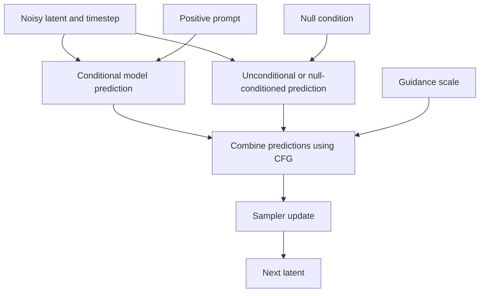

# Chapter 07: Guidance and Conditioning Controls

## Learning Objectives

By the end of this chapter, you should be able to:

- Explain classifier guidance and classifier-free guidance (CFG) conceptually.
- Describe conditional and unconditional predictions in standard classifier-free guidance.
- Recognize that guidance variants and supported controls depend on the model and pipeline.
- Evaluate trade-offs among prompt adherence, diversity, saturation, and visual artifacts.
- Distinguish guidance strength from inference step count and image-to-image strength.
- Design a controlled experiment to compare supported guidance settings.

 

## 1. What Is Guidance?

Text conditioning provides the model with information about what the image should depict. **Guidance** changes how strongly that conditioning influences the sampling trajectory.

In many diffusion pipelines, a guidance setting lets an engineer trade off prompt adherence against other properties such as naturalness, diversity, and artifact rate. The exact behavior depends on the model, the guidance method, and the inference configuration.

Guidance is not a universal “quality” knob. A stronger setting can make some requested details more prominent while making the overall image less coherent or visually pleasing.

 

### Keep three controls separate

- **Guidance strength:** adjusts the influence of conditioning in a guidance method that supports it.
- **Sampling steps:** controls the inference trajectory's number of updates or model evaluations, depending on the pipeline.
- **Image-to-image strength:** in pipelines that support it, controls how strongly an input image is altered or how much of the denoising trajectory is used.

These controls can interact, but they are not interchangeable. Changing one does not reproduce the effect of changing another.

 

## 2. Classifier Guidance

Classifier guidance is an approach in which a separate classifier provides a gradient indicating how to move a sample toward a desired class or condition. In diffusion sampling, this signal can be combined with the diffusion model's score or prediction to steer generation.

At a high level:

1. The diffusion model estimates how the noisy sample should be updated.
2. A classifier evaluates the sample with respect to a target condition.
3. A classifier-derived gradient provides additional direction toward that condition.
4. The sampling update combines the relevant signals according to the method's formulation.

This approach requires a suitable classifier and a compatible way to compute its guidance signal. It is distinct from classifier-free guidance, which does not require a separate classifier at inference time.

**Scope note:** This chapter explains the concept. Exact equations and implementation details vary by diffusion formulation and are not required to use a model's exposed guidance parameter safely.

 

## 3. Classifier-Free Guidance (CFG)

Classifier-free guidance is widely used in text-conditioned diffusion systems. It combines two model predictions:

- **Conditional prediction:** the model prediction when the requested condition, such as the text prompt, is provided.
- **Unconditional prediction:** the model prediction when the condition is omitted or replaced by the model's configured null condition.

The unconditional path is not necessarily a model that has never seen text. It is a prediction under the model's designated “unconditional” or null-conditioning setup.

A common conceptual CFG expression is:

$$
\hat{\epsilon}_{\text{CFG}}
=
\hat{\epsilon}_{\text{uncond}}
+
w\left(
\hat{\epsilon}_{\text{cond}}-\hat{\epsilon}_{\text{uncond}}
\right)
$$

where:

- $\hat{\epsilon}_{\text{cond}}$ is the conditional prediction;
- $\hat{\epsilon}_{\text{uncond}}$ is the unconditional prediction;
- $w$ is a guidance scale under this convention.

The equation uses noise prediction as an example. Other models may predict a different parameterization, and implementations may define the scale convention differently. Always check the selected model and pipeline documentation before interpreting a numeric value.

 

### Intuition

The difference between the conditional and unconditional predictions represents a direction associated with the condition. CFG adjusts the model prediction along that direction.

- A lower guidance value may allow more freedom from the prompt.
- A moderate value may improve adherence for some prompts and models.
- A high value may overemphasize prompt-related features and produce artifacts or reduce visual quality.

These are tendencies, not universal guarantees. Some pipelines use different scale conventions or guidance mechanisms.

In a standard CFG implementation, the two predictions may be evaluated in one batched model call for efficiency. The precise execution strategy depends on the pipeline.

 

## 4. Interpreting Guidance Strength

The meaning of a guidance-scale value depends on the implementation. Under the common formula above, increasing $w$ increases the contribution of the difference between conditional and unconditional predictions. Do not assume that all libraries or model families use identical conventions.

### Typical trade-offs

| Guidance behavior | Potential benefit | Potential cost |
| | | |
| Lower guidance | More variation or a less forceful conditioning signal | Important prompt details may be missed |
| Moderate guidance | A useful balance between prompt adherence and image plausibility | The best value still depends on prompt and model |
| Higher guidance | Requested features may become more pronounced | Oversaturation, harsh contrast, repeated textures, reduced diversity, or other artifacts |

Guidance does not directly specify object placement, guarantee correct counting, or turn a prompt into a hard constraint system. If exact structure is important, use a supported spatial-control mechanism where available.

 

### Common symptoms of excessive guidance

- Strong or unnatural color saturation
- Harsh contrast or clipped highlights/shadows
- Overemphasized edges and textures
- Repetitive or unnatural details
- Images that technically reflect prompt keywords but look less coherent
- Reduced variation among outputs

These symptoms are model-dependent. A high value does not always cause all—or any—of them.

 

## 5. Model-Specific Guidance Variants and Unsupported Controls

CFG is common, but not universal. Model families may expose different conditioning and guidance methods, including model-specific variants designed for different trade-offs. Some pipelines may not support a conventional guidance scale at all.

Before using a guidance parameter, verify:

1. Whether the pipeline exposes it.
2. What the parameter means for that model.
3. Whether a negative prompt is supported and how it is incorporated.
4. Whether guidance is applied at every step or through a specialized mechanism.
5. Whether the recommended range differs from familiar models.
6. Whether the model card documents a special guidance method or recommended defaults.

Do not add an argument simply because it appears in an example for another model. Unsupported parameters may raise an error, be ignored, or have semantics different from what you expect.

 

### Negative prompts are not the same as guidance strength

A negative prompt, where supported, supplies additional conditioning information intended to discourage certain content. Guidance strength controls how a particular guidance method combines or scales predictions. They can interact, but they are separate settings.

 

## 6. Guidance Is Not Sampling Steps

Guidance strength and sampling steps influence different parts of the generation process.

- **Guidance strength** changes the model prediction or conditioning influence used by the sampling update.
- **Sampling steps** changes how many inference updates or evaluations are performed and, often, which noise levels are visited.

Increasing the step count does not reproduce a stronger guidance signal. Increasing guidance does not substitute for a better-suited sampler or an adequate inference trajectory.

A useful experiment changes one control at a time. For example, compare guidance scales while keeping the sampler, step count, prompt, seed, and image dimensions fixed. Then, in a separate experiment, compare step counts while keeping guidance fixed.

 

## 7. Guidance in Image-to-Image Pipelines

Image-to-image generation starts from an input image rather than only from random noise. In pipelines that expose an image-to-image **strength** parameter, the setting commonly controls how much noise is added to the input or how far along the denoising trajectory generation begins.

The precise definition varies by pipeline, but the general distinction is:

- **Guidance strength:** how strongly the guidance method steers predictions toward the condition.
- **Image-to-image strength:** how much the input image is allowed to change during generation.

A high image-to-image strength can lead to larger changes from the source image. A high guidance scale may make the generated result follow the prompt more forcefully. Neither guarantees a better output, and the two settings can interact.

Do not compare these values numerically as if they shared a scale. A guidance value of 7 and an image-to-image strength of 0.7 describe different controls.

 

## 8. Practice: Compare Supported Guidance Values

Choose a pretrained model whose documentation explicitly describes its guidance parameter. Use a short prompt that has observable attributes and composition, such as:

> A white owl perched on a moss-covered branch, full body visible, centered composition, soft natural morning light, wildlife photography.

### Experiment procedure

1. Use the same model checkpoint and revision for all runs.
2. Keep prompt, dimensions, sampler/scheduler, timestep settings, and inference steps fixed.
3. Select two or three guidance values supported or recommended for the chosen model.
4. Use the same seed for an initial controlled comparison if the pipeline supports reproducible seeds.
5. Compare prompt adherence, composition, color, detail, artifacts, and overall visual coherence.
6. Repeat with several seeds to see whether the observed pattern is robust.
7. Do not change the step count or image-to-image strength during this first comparison.

Avoid assuming that a specific numeric range is appropriate for every model. Select values based on the model's own documentation.

 

### Results table

| Criterion | Lower guidance | Higher guidance |
| | | |
| Subject matches prompt | | |
| Requested attributes are correct | | |
| Composition is preserved | | |
| Colors and contrast look natural | | |
| Fine details are coherent | | |
| Visible artifacts | | |
| Variation across seeds | | |
| Overall suitability for task | | |

 

### Follow-up experiment

After comparing guidance, fix the best-performing guidance setting and vary the inference step count in a separate experiment. If using image-to-image, study its strength parameter separately as well.

 

### Practice questions

1. What are the conditional and unconditional predictions in CFG?
2. Why can stronger guidance increase prompt adherence but reduce visual quality?
3. Why is guidance strength not equivalent to image-to-image strength?
4. Why should the model's supported guidance range be checked before experimentation?

 

## 9. Common Failure Modes

| Symptom | Possible explanation | Practical response |
| | | |
| Image ignores some prompt details | Guidance may be too weak, prompt may be ambiguous, or the model may struggle with the concept | Clarify the prompt, test supported guidance values, and evaluate spatial controls if needed |
| Image looks oversaturated or harsh | Guidance may be too strong for the model, prompt, or settings | Lower guidance and compare with the same seed and other settings |
| High guidance emphasizes keywords but harms coherence | Strong conditioning can overemphasize learned associations | Test a lower value; simplify conflicting prompt terms |
| Guidance parameter has no effect or errors | The pipeline may not support that control or may use different semantics | Check the pipeline API and model card |
| Same guidance value behaves differently across models | Scale conventions, training, and conditioning architecture differ | Tune per model; do not transfer numeric settings blindly |
| Image-to-image output changes too much | Image-to-image strength may be high, independent of guidance | Lower image-to-image strength and evaluate separately |
| Results vary despite a fixed seed | Nondeterministic operations, software/hardware differences, or pipeline-specific randomness | Record the environment and understand reproducibility limits |

 

## 10. Checkpoint: Why Stronger Guidance Is Not Automatically Better

Stronger guidance does not automatically produce a better image because guidance amplifies or adjusts the influence of conditioning; it does not directly optimize every dimension of image quality.

A stronger setting may improve the visibility of requested concepts, but it can also overemphasize certain features, reduce variation, distort colors or textures, and create artifacts. The optimal setting depends on the model, prompt, sampler, schedule, resolution, and intended use.

Quality is multi-dimensional. A useful evaluation asks whether the result:

- depicts the requested subject and attributes;
- follows the intended composition;
- remains visually coherent and natural;
- avoids distracting artifacts;
- offers sufficient variation when multiple outputs are needed;
- meets the application's latency and compute constraints.

For this reason, select guidance settings empirically using controlled comparisons rather than assuming that the largest value is best.

 

## 11. Key Takeaways

- Classifier guidance uses a separate classifier-derived signal; classifier-free guidance combines conditional and unconditional model predictions.
- In standard CFG, guidance scale adjusts the contribution of the difference between those predictions, subject to the implementation's convention.
- Guidance support and recommended values are model-specific.
- Excessive guidance can improve some aspects of adherence while harming coherence, color, texture, or diversity.
- Guidance strength, inference step count, and image-to-image strength control different aspects of generation.
- Compare guidance values with prompts, seeds, sampler settings, and dimensions held fixed.
- Stronger conditioning is not a guarantee of better image quality.

 

## 12. References and Further Reading

- [Hugging Face Diffusers — Classifier-Free Guidance](https://huggingface.co/docs/diffusers/using-diffusers/classifier_free_guidance)
- [Hugging Face Diffusers — Text-to-Image](https://huggingface.co/docs/diffusers/using-diffusers/text-img2img)
- [Classifier-Free Diffusion Guidance (research paper)](https://arxiv.org/abs/2207.12598)
- [Diffusion Models Beat GANs on Image Synthesis (classifier guidance context)](https://arxiv.org/abs/2105.05233)
- [Denoising Diffusion Implicit Models (DDIM)](https://arxiv.org/abs/2010.02502)

**Version note:** Guidance arguments, formulas, and defaults vary by model family and library version. Verify the current pipeline documentation and model card before implementing experiments.
