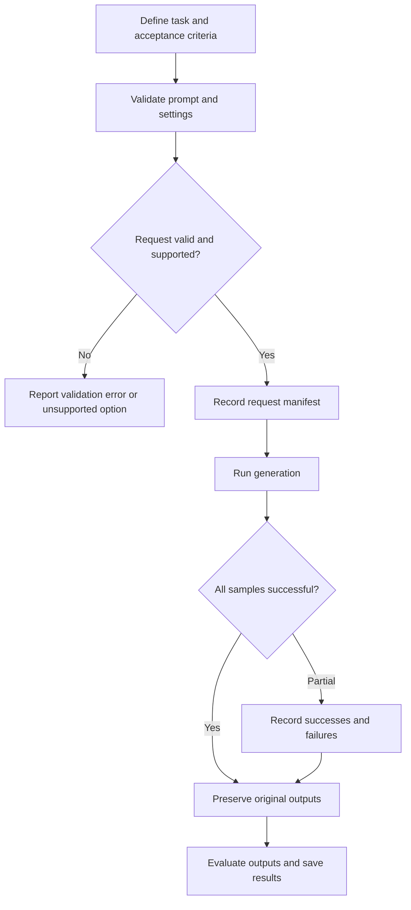

# Chapter 08: Text-to-Image Generation

## Learning Objectives

By the end of this chapter, you should be able to:

- Define a text-to-image task and specify its prompt, dimensions, sample count, and supported generation settings.
- Record seeds where available and explain practical limits to reproducibility.
- Compare prompt variants using controlled settings and multiple outputs.
- Preserve original generated images and maintain an experiment manifest.
- Handle invalid requests, refusals, partial failures, and generation-budget limits.
- Reproduce a request configuration without promising identical pixels across all environments.

<br/>

## 1. Text-to-Image Generation Workflow

Text-to-image generation turns a text prompt into one or more images using a trained generative model. A production workflow is more than calling a model: it defines the task, validates inputs, selects supported settings, manages compute and failures, and records enough information to understand or repeat the experiment.



The workflow should distinguish a **request configuration** (what was asked for), **execution metadata** (how it ran), and **output artifacts** (the images and related files).

<br/>

## 2. Define the Generation Task

Before calling a model, write down what the task is intended to achieve.

A useful task definition includes:

- **Goal:** what the image will be used for, such as a concept illustration, product mock-up, wildlife image, or background.
- **Prompt:** subject, attributes, setting, composition, style, and any important constraints.
- **Output dimensions:** width, height, and aspect ratio, subject to the model's supported resolutions.
- **Sample count:** number of candidate images requested.
- **Generation settings:** sampler/scheduler, inference steps, guidance settings, and other supported parameters.
- **Seed policy:** fixed seed for controlled comparisons, or varying seeds for diversity.
- **Acceptance criteria:** the properties an acceptable image must satisfy.
- **Budget limits:** maximum number of images, time, memory, API calls, or estimated spend.

Not every model exposes every setting. Validate against the selected API or pipeline rather than assuming parameters are universal.

<br/>

### Example task specification

```yaml
task_name: owl_prompt_comparison
goal: Compare prompt specificity for wildlife imagery
prompt_suite:
  - "A white owl in a forest."
  - "A realistic white owl perched on a moss-covered branch in a forest at dawn."
  - "Wildlife photograph of a white owl, full body visible, centered, soft morning light."
width: 512
height: 512
samples_per_prompt: 3
seed_policy: fixed_per_variant_where_supported
sampler: use_model_default
inference_steps: use_model_default
guidance: use_model_default
budget:
  max_total_images: 9
  max_retries_per_sample: 1
```

This is an illustrative manifest, not a universal API request schema. Replace defaults with actual values and validate that the selected model supports the requested dimensions and settings.

<br/>

## 3. Prompt Design for Text-to-Image Tasks

A prompt should communicate the visual intent clearly enough to compare results. For many tasks, useful prompt components are:

1. **Subject:** the main object or scene.
2. **Attributes:** color, material, size, or distinguishing features.
3. **Action or pose:** what the subject is doing.
4. **Setting:** background, location, time, or weather.
5. **Composition:** camera distance, viewpoint, framing, and placement.
6. **Visual style:** photography, illustration, watercolor, 3D render, etc.
7. **Lighting and mood:** soft morning light, dramatic backlighting, muted atmosphere.
8. **Constraints:** essential visibility, exclusions, or other task-specific requirements.

Do not add all possible descriptors automatically. Keep the prompt aligned with the task and avoid contradictory terms.

<br/>

### Prompt suite example

| Variant | Prompt | Purpose |
|<br/>|<br/>|<br/>|
| A | A white owl in a forest. | Baseline, minimal specificity |
| B | A realistic white owl perched on a moss-covered branch in a forest at dawn. | Add subject detail and setting |
| C | Wildlife photograph of a white owl, full body visible, centered composition, distant trees softly blurred, soft natural morning light. | Add composition and style |

The prompt suite is a small controlled experiment: it changes a defined aspect of the instruction while holding the rest of the generation configuration constant.

<br/>

## 4. Output Dimensions and Sample Count

### Dimensions

Width and height determine the output shape, subject to model and service restrictions. Resolution can affect memory use, latency, cost, and visual characteristics. Some models support only specific dimensions, aspect ratios, or resolution ranges.

Before generation:

- check supported width and height values;
- check whether dimensions must be multiples of a particular value;
- check whether the model internally resizes or crops;
- confirm whether the requested aspect ratio is supported;
- estimate the cost and memory implications.

Do not assume that every diffusion model can natively generate any arbitrary resolution.

<br/>

### Sample count

Sample count specifies how many candidate images the request should produce. More samples help evaluate variation, but they also increase cost and execution time.

If the API accepts a batch count, its semantics may differ from submitting several separate requests. A batch can have different limits, failure behavior, or seed-handling behavior than repeated single-image calls. Verify the provider's documentation.

<br/>

## 5. Seeds and Reproducibility

A random seed initializes a pseudorandom number generator. In many generation pipelines, this helps control the initial noise and can make comparisons more meaningful.

For a controlled prompt comparison, use the same seed across prompt variants where the pipeline supports that behavior. This reduces one source of variation, although changing the prompt can still change the resulting image substantially.

<br/>

### Reproducibility is conditional

Recording a seed does **not** guarantee identical pixels across every environment. Results can differ because of:

- model checkpoint or revision changes;
- changes in the generation library or scheduler implementation;
- different hardware or numerical precision;
- nondeterministic operations or kernels;
- provider-side model updates in hosted services;
- differences in preprocessing, tokenization, or request parameters.

For hosted APIs, the provider may not expose the underlying seed, model revision, or complete inference configuration. Record the information actually returned and label unavailable fields as unknown rather than inventing them.

<br/>

### Record at least

- model identifier and revision, if available;
- prompt and negative prompt, if supported;
- width, height, and sample count;
- sampler/scheduler and its settings, if exposed;
- inference steps and guidance settings, if exposed;
- seed and seed policy, if exposed;
- software/library versions and hardware where relevant;
- timestamp, request identifier, and provider response metadata where available.

<br/>

## 6. A Basic Hugging Face Diffusers Example

The example below demonstrates a local text-to-image workflow with a Diffusers pipeline. The model identifier is illustrative; select a checkpoint whose license, hardware requirements, and recommended pipeline are suitable for your task.

Install the required packages in your environment using the current installation instructions for Diffusers and PyTorch. Model access may require accepting a license or authenticating with the model host.

```python
import json
import platform
from datetime import datetime, timezone
from pathlib import Path

import torch
from diffusers import DiffusionPipeline

model_id = "stable-diffusion-v1-5/stable-diffusion-v1-5"
prompt = (
    "Wildlife photograph of a white owl perched on a moss-covered branch, "
    "full body visible, centered composition, soft natural morning light"
)
negative_prompt = "watermark, text, blurry image"  # Use only if supported
width, height = 512, 512
num_images = 3
num_inference_steps = 30
guidance_scale = 7.0
seed = 1234

output_dir = Path("generation_run")
images_dir = output_dir / "images"
images_dir.mkdir(parents=True, exist_ok=True)

device = "cuda" if torch.cuda.is_available() else "cpu"
pipe = DiffusionPipeline.from_pretrained(model_id)
pipe = pipe.to(device)

generator = torch.Generator(device=device).manual_seed(seed)

# Confirm that this pipeline supports each argument before running.
result = pipe(
    prompt=prompt,
    negative_prompt=negative_prompt,
    width=width,
    height=height,
    num_images_per_prompt=num_images,
    num_inference_steps=num_inference_steps,
    guidance_scale=guidance_scale,
    generator=generator,
)

saved_files = []
for index, image in enumerate(result.images):
    file_path = images_dir / f"sample_{index:03d}.png"
    image.save(file_path)
    saved_files.append(str(file_path))

manifest = {
    "task_name": "owl_text_to_image",
    "timestamp_utc": datetime.now(timezone.utc).isoformat(),
    "model_id": model_id,
    "prompt": prompt,
    "negative_prompt": negative_prompt,
    "width": width,
    "height": height,
    "num_images_requested": num_images,
    "num_images_saved": len(saved_files),
    "num_inference_steps": num_inference_steps,
    "guidance_scale": guidance_scale,
    "seed": seed,
    "device": device,
    "torch_version": torch.__version__,
    "python_version": platform.python_version(),
    "saved_files": saved_files,
}

(output_dir / "manifest.json").write_text(
    json.dumps(manifest, indent=2),
    encoding="utf-8",
)
print(f"Saved {len(saved_files)} images and manifest to {output_dir}")
```

<br/>

### Implementation notes

- The example assumes a pipeline that accepts `negative_prompt`, `width`, `height`, `num_images_per_prompt`, `num_inference_steps`, `guidance_scale`, and `generator`. Verify the selected pipeline's API before running it.
- Some pipelines use different parameter names or do not support one or more arguments.
- Loading a large checkpoint can require substantial memory. Check the model's hardware guidance.
- `torch.Generator` seed handling can differ by device and pipeline. A seed is useful metadata, not a cross-environment pixel-identity guarantee.
- For a prompt-comparison experiment, run each prompt variant separately and define whether the same seed or a seed range is used.
- The example records the software version and requested configuration. For stronger reproducibility, also record the exact model revision, Diffusers version, hardware details, scheduler configuration, and any provider-specific request IDs.

<br/>

## 7. Preserve Outputs and Maintain an Experiment Manifest

Generated images are experiment artifacts. Keep the original outputs unchanged so that later evaluation is not affected by accidental overwrites or edits.

A practical directory structure is:

```text
generation_experiment/
├── manifest.json
├── prompts.jsonl
├── results.csv
├── images/
│   ├── variant_a_seed_1234.png
│   ├── variant_a_seed_1235.png
│   ├── variant_b_seed_1234.png
│   └── ...
└── logs/
    └── run.log
```

<br/>

### Suggested manifest fields

| Field | Purpose |
|<br/>|<br/>|
| `experiment_id` | Unique identifier for the experiment |
| `timestamp_utc` | When the request ran |
| `model_id` / `model_revision` | Identifies the checkpoint or hosted model when known |
| `prompt` / `negative_prompt` | Records the exact text sent |
| `width` / `height` | Records requested dimensions |
| `sample_count` | Number of requested images |
| `seed` / `seed_policy` | Records random initialization behavior where exposed |
| `scheduler` / `scheduler_config` | Records sampling method and settings where available |
| `steps` / `guidance` | Records supported inference controls |
| `environment` | Library versions, device, dtype, and other relevant details |
| `status` | Success, partial success, refusal, invalid request, or failure |
| `output_paths` | Locates preserved original images |
| `request_id` | Provider identifier, if returned |
| `error` | Sanitized error details when applicable |

For larger experiments, store one row per requested sample or attempt. Keep prompt variants and sample identifiers explicit so that results can be joined back to their configuration.

<br/>

### Preserve provenance

- Do not overwrite an original output with a retouched or resized version.
- Save derived images in a separate directory and record the transformation.
- Keep a mapping from each image to its exact request and seed where available.
- Avoid logging API keys, access tokens, or sensitive user data.
- Follow the provider's data retention, privacy, and licensing requirements.

<br/>

## 8. Handling Invalid Requests, Refusals, and Partial Failures

A robust generation workflow anticipates that some requests may not produce an image.

### Invalid requests

Examples include unsupported dimensions, malformed arguments, missing required inputs, or settings that the pipeline does not recognize.

**Response:** validate inputs before spending compute; return a clear error that identifies the invalid field and the supported alternatives when known.

<br/>

### Refusals or policy blocks

A model or service may refuse a request or block it under its usage policy. A refusal is not the same as a network failure.

**Response:** record the status and any safe, user-facing explanation returned by the service. Do not attempt to bypass safety controls. If appropriate, revise the request to a legitimate, supported alternative.

<br/>

### Partial failures

A request for several images may return fewer images than requested, or a batch may fail partway through. The behavior depends on the provider and pipeline.

**Response:**

1. Record the requested count and actual successful count.
2. Preserve successful outputs.
3. Record which sample indices or request IDs failed, if available.
4. Retry only failed work when safe and supported.
5. Use bounded retries with backoff for transient errors.
6. Avoid retrying invalid requests or refusals as if they were transient failures.

<br/>

### Timeouts and service errors

Distinguish transient service problems from permanent validation errors. Use request deadlines, bounded retries, and sanitized logs. If the API supports idempotency keys or request tracking, use them according to the provider's documentation.

<br/>

## 9. Budget and Resource Limits

A generation budget can constrain image count, resolution, number of retries, runtime, memory, or hosted API spend.

Before running a prompt suite, estimate:

$$
N_{\text{requested}} =
N_{\text{prompt variants}} \times
N_{\text{samples per variant}}
$$

If each prompt variant uses multiple settings or seeds, include those dimensions in the estimate. For example, 3 prompt variants × 3 seeds means 9 requested images for one setting combination.

The actual cost can depend on resolution, model, provider pricing, batch semantics, and retries. Do not assume all images cost the same or that a failed request is always free.

<br/>

### Practical budget controls

- Set a maximum total image count before starting.
- Limit retries and avoid retrying permanent errors.
- Validate dimensions and arguments before calling the model.
- Generate a small pilot batch before scaling up.
- Track actual image count, latency, memory, and spend where available.
- Stop or ask for confirmation if the experiment exceeds its agreed budget.
- Prefer controlled comparisons over generating many uncontrolled samples.

<br/>

## 10. Practice: Generate a Small Fixed Prompt Suite

Use one model and a small prompt suite. Keep dimensions, sampler, steps, guidance, and other supported settings fixed while comparing prompts.

### Prompt suite

1. **Baseline:** “A white owl in a forest.”
2. **Subject and setting:** “A realistic white owl perched on a moss-covered branch in a forest at dawn.”
3. **Composition and style:** “Wildlife photograph of a white owl, full body visible, centered composition, distant trees softly blurred, soft natural morning light.”

<br/>

### Procedure

1. Check the model's license, hardware requirements, and supported parameters.
2. Define a maximum image count and retry policy.
3. Record the exact prompt suite and configuration before generation.
4. Generate a small, fixed number of samples per prompt.
5. Use a documented seed policy. Reuse the same seed across variants when supported for a controlled comparison; use several seeds to examine variation.
6. Save original images without overwriting them.
7. Update the manifest with actual outcomes, errors, and output paths.
8. Compare prompt adherence, composition, detail, artifacts, and consistency.

<br/>

### Evaluation table

| Criterion | Prompt 1 | Prompt 2 | Prompt 3 |
|<br/>|<br/>|<br/>|<br/>|
| Correct subject | | | |
| Correct attributes | | | |
| Setting matches prompt | | | |
| Composition matches prompt | | | |
| Style matches prompt | | | |
| Artifact severity | | | |
| Consistency across samples | | | |

<br/>

### Practice questions

1. Why should a prompt comparison change one major variable at a time?
2. What metadata would you need to reproduce the request configuration?
3. Why can a fixed seed fail to produce identical pixels on another environment?
4. How should a partial batch failure be recorded and retried?
5. Which budget limits should be set before generating the prompt suite?

<br/>

## 11. Checkpoint: Reproduce the Configuration, Not a Pixel Guarantee

To reproduce a generation request as faithfully as possible, preserve the model identifier and revision, exact prompt and negative prompt, dimensions, sample count, sampler/scheduler and settings, inference steps, guidance controls, seed policy, environment versions, and any additional conditions. Record the actual outputs, status, errors, and request identifiers where available.

This reproduces the **request configuration and experimental procedure**. It does not guarantee identical pixels across environments. Different hardware, numerical precision, nondeterministic operations, library changes, or hosted-model updates can alter the output even when the visible request looks identical.

A reproducible engineering workflow therefore has two goals:

1. **Configuration reproducibility:** retain enough metadata to reconstruct the request.
2. **Outcome evaluation:** measure whether outputs satisfy the same quality criteria, rather than relying only on byte-for-byte equality.

<br/>

## 12. Key Takeaways

- Treat text-to-image generation as an experiment with explicit inputs, controls, outputs, and acceptance criteria.
- Validate dimensions and settings against the selected model or provider.
- Use seeds to support controlled comparisons where available, but do not promise cross-environment pixel identity.
- Compare prompt variants with controlled settings and several samples.
- Preserve original outputs and link each artifact to its request manifest.
- Handle invalid inputs, refusals, partial failures, and transient errors as different cases.
- Set sample, retry, runtime, memory, and cost limits before scaling generation.
- Record the full configuration—not only the prompt and step count.

<br/>

## 13. References and Further Reading

- [Hugging Face Diffusers — Text-to-Image](https://huggingface.co/docs/diffusers/using-diffusers/text-img2img)
- [Hugging Face Diffusers — Loading Pipelines](https://huggingface.co/docs/diffusers/using-diffusers/loading)
- [Hugging Face Diffusers — Reproducibility](https://huggingface.co/docs/diffusers/using-diffusers/reusing_seeds)
- [Hugging Face Diffusers — Schedulers](https://huggingface.co/docs/diffusers/using-diffusers/schedulers)
- [PyTorch — Reproducibility](https://pytorch.org/docs/stable/notes/randomness.html)
- [Hugging Face Model Hub documentation](https://huggingface.co/docs/hub/index)

**Version note:** Pipeline arguments, supported dimensions, seed behavior, and model defaults vary. Confirm the current documentation and model card for the exact checkpoint and installed library version.
