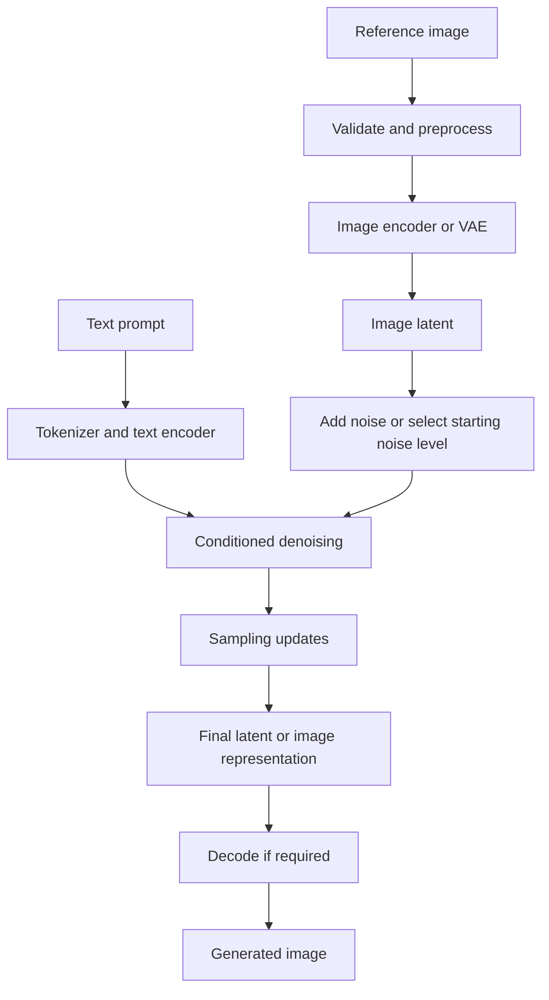

# Chapter 09: Image-to-Image Generation

## Learning Objectives

By the end of this chapter, you should be able to:

- Trace reference-image preparation, encoding or noising, conditioning, and generation.
- Explain image-to-image strength or starting-noise controls where supported.
- Evaluate preservation of layout, identity, color, and content against the intended transformation.
- Account for resizing, aspect ratio, and reference-image provenance.
- Run a controlled comparison using two supported strength settings.
- Explain why a reference image conditions generation but does not guarantee exact preservation.

<br/>

## 1. What Is Image-to-Image Generation?

**Image-to-image (img2img)** generation uses an existing image as an input condition to guide the creation of a modified image. The text prompt may describe the desired transformation, while the reference image supplies visual information such as layout, subject appearance, colors, and scene structure.

Typical use cases include:

- changing the artistic style of an image;
- modifying lighting, atmosphere, or season;
- producing variations of a product or concept sketch;
- transforming a rough drawing into a more polished image;
- changing selected visual attributes while retaining much of the original scene.

The amount of preservation depends on the model, preprocessing, prompt, sampling configuration, and strength control. Img2img is not inherently an exact image editor.

<br/>

### Image-to-image versus text-to-image

| Aspect | Text-to-image | Image-to-image |
|<br/>|<br/>|<br/>|
| Initial visual input | Usually random noise or a model-specific initialization | A reference image, often encoded and noised |
| Main source of visual guidance | Text and other supported conditions | Reference image plus text and other conditions |
| Typical goal | Create a new image from instructions | Transform or create a variation of an existing image |
| Preservation expectation | No source image to preserve | Some source features may remain, depending on settings |
| Main risk | Prompt details may be omitted or misinterpreted | Source details may change more than intended |

<br/>

## 2. End-to-End Image-to-Image Workflow

A common latent-diffusion img2img workflow has the following stages:

1. **Prepare the reference image:** load it, check format, convert color mode, and resize or crop as required.
2. **Encode the image:** a VAE or model-specific encoder maps pixels into a latent representation in latent-diffusion systems.
3. **Choose the starting noise level:** the pipeline adds noise to the encoded representation or starts at a configured point in the inference trajectory.
4. **Encode the prompt:** text is tokenized and encoded into conditioning representations.
5. **Denoise under conditioning:** the model iteratively updates the noisy latent using the text condition and the reference-derived starting latent.
6. **Decode and post-process:** a latent decoder produces the final image, which may then be converted to the desired output format.

The exact path varies by architecture. Some systems operate in pixel space, use reference-image encoders or adapters, or have different editing interfaces.



<br/>

### Why preprocessing matters

The model does not necessarily receive the original file exactly as it was stored. Resizing, cropping, color conversion, normalization, and encoding can alter the input representation before generation begins. These transformations should be recorded when source fidelity matters.

<br/>

## 3. Reference-Image Preparation

Before generation, inspect and prepare the reference image deliberately.

### 3.1 Validate the input

Check:

- whether the image file can be decoded;
- supported file formats and color modes;
- width, height, and aspect ratio;
- transparency or alpha-channel handling;
- image orientation and metadata;
- whether the image contains sensitive or restricted material that should not be sent to the selected service.

Do not assume every API accepts the same formats, maximum file size, or dimensions.

<br/>

### 3.2 Resizing and aspect ratio

If the reference aspect ratio differs from the target dimensions, the pipeline may resize, crop, pad, or otherwise transform the image. Each choice has consequences:

- **Resize:** may distort proportions if width and height are scaled independently.
- **Crop:** preserves proportions but removes some content.
- **Pad:** preserves the whole image but adds borders or empty regions.
- **Model-specific preprocessing:** may automatically center-crop, normalize, or map the image to supported dimensions.

When layout preservation matters, choose a preprocessing strategy intentionally and inspect the actual prepared image. A subject near an edge can be cropped away by an automatic center crop.

<br/>

### 3.3 Preserve provenance

Record the source filename or a non-sensitive identifier, source URL or origin when appropriate, file hash if useful, original dimensions, preprocessing operations, target dimensions, and any rights or consent constraints. Avoid putting private file paths or sensitive metadata into logs shared outside the project.

<br/>

## 4. Encoding and Starting Noise

In a latent-diffusion system, an encoder maps the reference image into a latent representation. Img2img often adds noise to this representation before denoising begins. The amount of noise affects how much of the original encoded signal remains available as a starting point.

Conceptually:

- **Less added noise / lower transformation strength:** more source structure may remain, so the output may stay closer to the reference.
- **More added noise / higher transformation strength:** the source signal is disrupted more strongly, giving generation more freedom to change the image.

This is a general intuition, not a universal numerical rule. Some pipelines define their strength parameter differently or use a different editing mechanism. Always verify the selected pipeline's documentation.

<br/>

### Strength is not a universal unit

An img2img `strength` value is usually a model- and pipeline-specific control, often bounded to a documented range. Its exact meaning can include how much of the inference trajectory is used or where sampling begins. Do not assume that `0.5` in two different pipelines means identical corruption, preservation, or output quality.

A strength setting also differs from:

- **Guidance scale:** adjusts the influence of conditioning in a supported guidance method.
- **Inference step count:** controls the number of denoising updates or model evaluations, depending on the pipeline.
- **Mask:** specifies a region to edit in an inpainting workflow.
- **Reference-image guidance:** may use a separate encoder, adapter, or conditioning path.

These controls may interact, but they are not interchangeable.

<br/>

## 5. Text Conditioning and Transformation Goals

The reference image and the text prompt provide complementary information. The image supplies visual context; the prompt describes the desired transformation.

Example reference: a daytime photograph of a garden.

Prompt:

> Transform the garden scene into a misty autumn morning with warm golden leaves and soft overcast light, while retaining the original camera viewpoint and main path layout.

The prompt expresses a goal, but the model may alter the path, plant arrangement, or small objects. If a feature must remain exact, ordinary img2img conditioning may be insufficient.

<br/>

### Be explicit about what should change and what should remain

A useful prompt can separate the transformation from preservation goals:

```text
Transform:
- Change the scene to autumn.
- Add light morning mist.
- Use soft, warm natural lighting.

Preserve where possible:
- Keep the camera viewpoint.
- Retain the main path layout.
- Keep the main subject in approximately the same position.

Style:
- Naturalistic landscape photography.
```

This wording helps communicate intent but does not enforce hard constraints. Use masks, structural controls, or a dedicated editing tool if exact preservation is required and supported.

<br/>

## 6. Evaluating Preservation and Transformation

Image-to-image tasks should be evaluated on both what changes and what remains stable. A visually attractive result can still fail the task if it changes a required feature.

### Suggested criteria

| Criterion | Evaluation question |
|<br/>|<br/>|
| Layout | Are the major objects and spatial relationships preserved? |
| Identity | Does the main person, animal, or product remain recognizable where required? |
| Color | Are important colors retained or changed as requested? |
| Content | Are required objects still present? Have unwanted objects appeared? |
| Transformation | Did the requested style, lighting, season, or attribute change occur? |
| Detail | Are textures and fine structures plausible and coherent? |
| Artifacts | Are there distortions, duplicated parts, or unnatural boundaries? |
| Aspect ratio and crop | Is important source content still visible? |

Use a consistent evaluation method across settings. Depending on the task, this can combine human review, a task-specific checklist, image similarity measures, or domain-specific tests. Pixel similarity alone can be misleading when a successful transformation is expected.

<br/>

## 7. Example: Image-to-Image with Hugging Face Diffusers

The example below illustrates a common Stable Diffusion img2img pipeline. Use a checkpoint whose license and model card permit your intended use. Model identifiers, class names, supported resolutions, and argument behavior can vary; verify the current model documentation and installed Diffusers version.

```python
from pathlib import Path

import torch
from PIL import Image
from diffusers import StableDiffusionImg2ImgPipeline

model_id = "stable-diffusion-v1-5/stable-diffusion-v1-5"
input_path = Path("reference.png")
output_dir = Path("img2img_run")
output_dir.mkdir(parents=True, exist_ok=True)

prompt = (
    "Naturalistic landscape photograph of the same garden in autumn, "
    "warm golden leaves, light morning mist, soft overcast light, "
    "retain the main path layout and camera viewpoint where possible"
)
negative_prompt = "watermark, text, distorted objects"
seed = 1234
strength = 0.45
steps = 30
guidance_scale = 7.0

# Prepare the input explicitly. This example resizes while preserving aspect ratio
# and pads to a square; choose preprocessing suitable for your task.
image = Image.open(input_path).convert("RGB")
image.thumbnail((512, 512))

canvas = Image.new("RGB", (512, 512), (255, 255, 255))
offset = ((512 - image.width) // 2, (512 - image.height) // 2)
canvas.paste(image, offset)
prepared_path = output_dir / "prepared_reference.png"
canvas.save(prepared_path)

pipe = StableDiffusionImg2ImgPipeline.from_pretrained(model_id)
device = "cuda" if torch.cuda.is_available() else "cpu"
pipe = pipe.to(device)

generator = torch.Generator(device=device).manual_seed(seed)

# Verify that the selected pipeline supports all arguments before running.
result = pipe(
    prompt=prompt,
    negative_prompt=negative_prompt,
    image=canvas,
    strength=strength,
    num_inference_steps=steps,
    guidance_scale=guidance_scale,
    generator=generator,
)

output_path = output_dir / "generated.png"
result.images[0].save(output_path)

print(f"Prepared reference: {prepared_path}")
print(f"Generated image: {output_path}")
```

<br/>

### Implementation notes

- The white padding in this example is a deliberate but simple choice; it may not be suitable for every reference. Inspect the prepared image before generation.
- Some pipelines require dimensions or image formats different from those shown.
- The example uses a single image and a fixed seed for clarity. Batch and seed handling may differ by pipeline.
- `strength`, `guidance_scale`, and `num_inference_steps` are separate controls.
- The phrase “retain ... where possible” communicates a goal but does not guarantee exact layout preservation.
- For reproducible experiments, record the exact checkpoint revision, library versions, scheduler configuration, input hash, preprocessing operations, seed, and output path.

<br/>

## 8. Practice: Compare Two Strength Settings

Choose a reference image with a clear subject and layout. Select a model whose img2img pipeline documents its strength parameter. Compare two supported settings while holding other variables fixed.

### Example task

Transform a daytime garden photograph into an autumn scene while trying to preserve the main path and camera viewpoint.

<br/>

### Procedure

1. Keep the reference image and preprocessing identical.
2. Keep the prompt, negative prompt, model revision, sampler/scheduler, inference steps, guidance, dimensions, and seed fixed where supported.
3. Choose two strength values from the pipeline's documented range. For example, test a lower and a higher value appropriate for that pipeline rather than assuming a universal range.
4. Generate one image at each setting.
5. Compare layout, identity, color, content, transformation strength, and artifacts.
6. Repeat with additional seeds to assess whether the observed difference is robust.
7. Preserve the original reference, prepared input, generated outputs, and experiment manifest.

<br/>

### Results table

| Criterion | Lower strength | Higher strength |
|<br/>|<br/>|<br/>|
| Main layout preserved | | |
| Subject identity preserved | | |
| Important colors retained | | |
| Requested transformation achieved | | |
| Unwanted content changes | | |
| Visible artifacts | | |
| Overall suitability | | |

<br/>

### Practice questions

1. Why might higher strength produce a more dramatic transformation but less source preservation?
2. Why should the prepared reference image be saved?
3. Why is strength not equivalent to guidance scale?
4. When might inpainting or a structural control input be preferable to ordinary img2img?

<br/>

## 9. Common Failure Modes

| Symptom | Possible cause | Practical response |
|<br/>|<br/>|<br/>|
| Subject or layout changes too much | Starting noise/strength is too high for the preservation goal | Test a lower supported strength and evaluate multiple samples |
| Requested transformation is too subtle | Strength is too low, prompt is weak, or model is not suited to the edit | Test a higher supported strength or a more explicit transformation prompt |
| Subject is stretched or cropped | Preprocessing changed aspect ratio or used an unsuitable crop | Preserve aspect ratio, inspect padding/cropping, and document the operation |
| Colors drift unexpectedly | Noise, text conditioning, model priors, or preprocessing altered color information | Compare outputs at controlled settings; consider masks or specialized editing controls |
| Fine identity details are lost | The pipeline does not guarantee identity preservation | Use a supported reference-conditioning or identity-preserving method where appropriate |
| Output includes unexpected objects | Prompt ambiguity or model sampling behavior | Simplify the prompt and use supported structural constraints if available |
| Two pipelines respond differently to the same strength value | Different parameter definitions and scheduler behavior | Tune each pipeline independently using its documentation |
| Results cannot be traced to their source | Input and preprocessing metadata were not recorded | Save source identifiers, dimensions, hashes where appropriate, and preprocessing details |

<br/>

## 10. Checkpoint: Why the Input Is a Condition, Not a Guarantee

An input image guides image-to-image generation because the pipeline encodes or otherwise conditions on visual information from the reference, then uses that information during a generative process. In many diffusion pipelines, noise is added to the encoded reference and the denoiser reconstructs a new sample under text and other conditions.

The input is not a guarantee of exact preservation because:

1. **Encoding can be lossy.** A VAE or other image encoder may not preserve every pixel-level detail.
2. **Noise disrupts the reference representation.** Higher transformation strength can reduce the influence of the original signal.
3. **The denoiser is generative.** It synthesizes a plausible result rather than copying the source exactly.
4. **Text and image conditions can compete.** The model may favor the requested transformation over a source feature.
5. **Preprocessing can change the input.** Resizing, cropping, padding, and color conversion affect what the model receives.
6. **Sampling is not an exact preservation operation.** The output can vary with the seed, scheduler, model, and runtime environment.

When exact preservation matters, use a more constrained editing workflow—such as masking, inpainting, structural controls, or specialized reference conditioning—if the selected model supports it, and validate the output against explicit acceptance criteria.

<br/>

## 11. Key Takeaways

- Img2img combines reference-image information with a generative process and often with text conditioning.
- Input preparation, encoding, noise level, denoising, and decoding all affect the result.
- Strength usually controls the amount of transformation or starting point, but its exact definition is pipeline-specific.
- Layout, identity, color, and content should be evaluated separately from whether the requested transformation occurred.
- Resizing and cropping can remove or distort important source features; save and inspect the prepared image.
- Preserve source provenance and all generation settings for traceability.
- A reference image is a condition, not a pixel-level guarantee of preservation.

<br/>

## 12. References and Further Reading

- [Hugging Face Diffusers — Image-to-Image](https://huggingface.co/docs/diffusers/using-diffusers/img2img)
- [Hugging Face Diffusers — API Overview](https://huggingface.co/docs/diffusers/api/pipelines/overview)
- [Hugging Face Diffusers — Reusing Seeds](https://huggingface.co/docs/diffusers/using-diffusers/reusing_seeds)
- [High-Resolution Image Synthesis with Latent Diffusion Models](https://arxiv.org/abs/2112.10752)
- [ControlNet: Adding Conditional Control to Text-to-Image Diffusion Models](https://arxiv.org/abs/2302.05543)

**Version note:** Pipeline names, supported parameters, strength semantics, and image preprocessing may vary by checkpoint and library version. Verify the current model card and API documentation before implementation.
