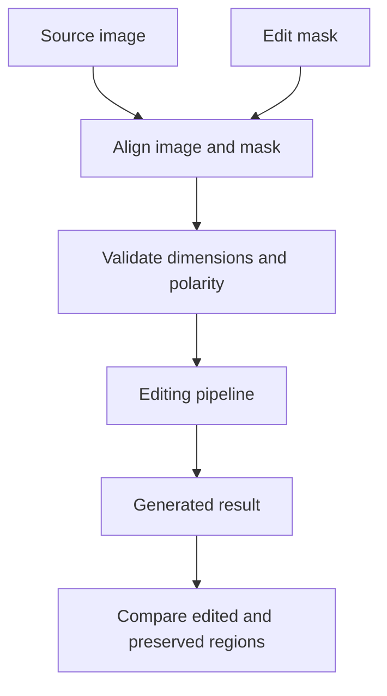
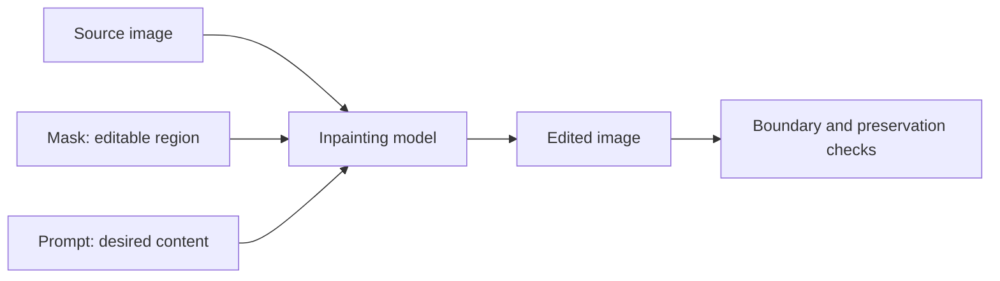
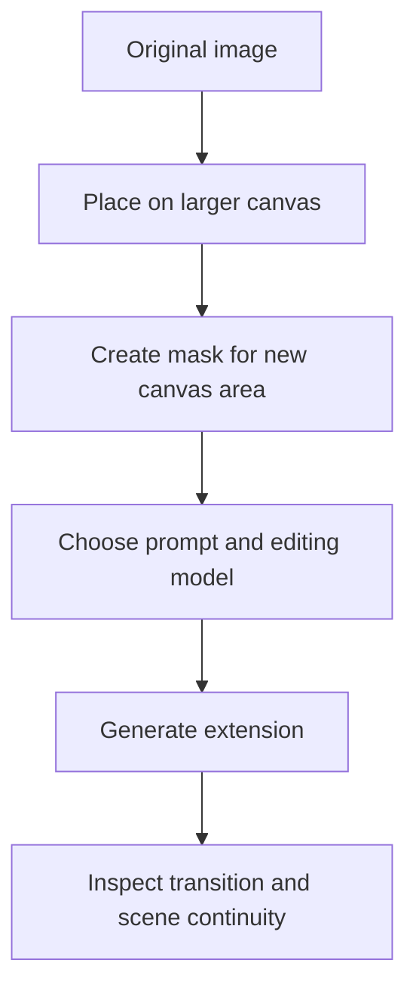

# Chapter 10: Inpainting and Outpainting

## Learning Objectives

By the end of this chapter, you should be able to:

- Define edit regions, masks, and preserved context for image editing.
- Verify mask polarity, value conventions, and resizing behavior for the selected implementation.
- Distinguish dedicated editing models from generic pipelines that expose editing features.
- Evaluate boundary blending, visual consistency, and unintended changes outside the intended region.
- Explain outpainting as canvas extension followed by generation of missing content.
- Measure whether an edit respects its intended boundaries.

<br/>

## 1. Inpainting and Outpainting

**Inpainting** generates or reconstructs content in a selected region of an existing image while using the surrounding image as context.

**Outpainting** extends an image beyond its original canvas and generates plausible content in the newly added area. The original image provides context for the extension, but the generated scene may not perfectly continue the original perspective, lighting, or objects.

| Task | Main goal | Typical input |
|<br/>|<br/>|<br/>|
| Inpainting | Replace, remove, or add content in a selected region | Source image, mask, and often a prompt |
| Outpainting | Extend the canvas and generate content outside the original boundary | Source image placed on a larger canvas, a mask for the new area, and often a prompt |

The exact workflow depends on the model. Some models have dedicated inpainting checkpoints or editing interfaces; others expose inpainting through a more general pipeline. Do not assume that all image-generation models support masks or canvas extension in the same way.

<br/>

## 2. Masks and Edit Regions

A **mask** identifies which pixels or regions are eligible for editing. The image supplies the visual context, while the mask defines the intended edit area.

A common binary-mask convention is:

- **White (or 1):** region to be generated or edited.
- **Black (or 0):** region to preserve.

However, mask polarity is **implementation-dependent**. Some tools use the opposite convention, and some accept grayscale masks with partial values. Always verify the convention for the exact model or API.

<br/>

### Mask semantics

A mask is not simply a drawing over the image. It is an input to the editing pipeline, and its interpretation affects which areas can change.

Important properties include:

- **Polarity:** which values mean edit and which mean preserve.
- **Resolution:** whether the mask must match the source image dimensions.
- **Color mode:** whether the implementation expects a single-channel grayscale mask or another representation.
- **Thresholding:** whether grayscale values are converted to binary regions.
- **Resizing and alignment:** whether the mask is resized, cropped, or transformed with the image.
- **Soft edges:** whether intermediate values are interpreted as partial coverage or ignored.

A mask with reversed polarity can cause the tool to modify the background instead of the intended object. A misaligned mask can produce edits in the wrong location.

<br/>

### Conceptual mask workflow



<br/>

## 3. Preparing and Validating a Mask

Before generation, inspect the mask visually and validate it programmatically where possible.

### Practical validation checklist

1. Confirm the documented polarity for the selected implementation.
2. Confirm that the mask aligns with the intended object or region.
3. Check whether the mask dimensions must match the source image.
4. Check the required image mode and accepted value range.
5. Inspect whether preprocessing resizes, crops, thresholds, or blurs the mask.
6. Confirm whether the implementation supports soft masks or expects a binary mask.
7. Save the exact mask used for the run so the edit can be traced later.

<br/>

### Example: inspect a grayscale mask

```python
from pathlib import Path
from PIL import Image
import numpy as np

image_path = Path("source.png")
mask_path = Path("mask.png")

image = Image.open(image_path).convert("RGB")
mask = Image.open(mask_path).convert("L")

print("Image size:", image.size)
print("Mask size:", mask.size)
print("Mask mode:", mask.mode)

mask_array = np.asarray(mask)
print("Mask minimum:", int(mask_array.min()))
print("Mask maximum:", int(mask_array.max()))
print("Unique values (sample):", np.unique(mask_array)[:20])

if image.size != mask.size:
    raise ValueError("Image and mask dimensions do not match; align them intentionally.")
```

This checks dimensions and values, but it does not determine mask polarity. Confirm polarity in the target pipeline's documentation and inspect the mask against the source image.

<br/>

### Resizing behavior

If an image is resized, the mask must be transformed consistently so the selected region remains aligned. For binary masks, nearest-neighbor resizing often avoids introducing new intermediate values. For soft masks, a different resampling method may be appropriate. The correct choice depends on the pipeline's expected mask representation.

Do not resize a mask independently without checking its alignment with the corresponding image.

<br/>

## 4. Inpainting Workflow

A common inpainting process is:

1. Load and validate the source image.
2. Load or create a mask identifying the region to edit.
3. Align the image and mask and apply documented preprocessing.
4. Supply a prompt describing the desired replacement or addition.
5. Run a dedicated inpainting model or a compatible inpainting pipeline.
6. Inspect the result inside the mask and in the preserved context.
7. Save the output together with the source, mask, prompt, settings, and model metadata.



<br/>

### Prompting for inpainting

Describe the intended content in the masked region and include relevant context when needed.

Example:

> Replace the selected empty patch of grass with a small cluster of white flowers, matching the surrounding garden's natural lighting, perspective, and photographic style.

The prompt guides the model, but it does not guarantee that the generated content will fit perfectly into the scene. The model may alter the boundary, lighting, shadows, or nearby objects.

<br/>

### Dedicated editing models vs. generic pipeline support

A dedicated inpainting model may have been trained or fine-tuned to handle masked regions and surrounding context. A generic text-to-image or image-to-image pipeline may not understand a mask unless it explicitly supports inpainting.

Before implementation, verify:

- the pipeline class and model checkpoint are designed for inpainting;
- the API accepts the required image and mask inputs;
- the mask polarity and preprocessing rules;
- whether the model is expected to preserve unmasked pixels;
- the supported dimensions, prompt fields, and inference controls.

A pipeline accepting a mask argument does not by itself prove that all unmasked pixels will remain identical.

<br/>

## 5. Boundary Blending and Visual Consistency

The edit boundary is often the most visible failure point. Generated content can differ from the original context in color, sharpness, lighting, texture, or perspective.

### Common boundary problems

- hard seams between edited and preserved areas;
- mismatched shadows or light direction;
- different sharpness or noise levels;
- halos or color shifts around the mask;
- duplicated edges or partial objects;
- implausible object contact with the surrounding scene.

<br/>

### Ways to improve consistency

- Design the mask around the full region that needs to change, including relevant shadows or boundaries.
- Avoid masks that cut through important structures unless that is intentional.
- Describe lighting, perspective, material, and style in the prompt.
- Use a supported mask-feathering or blending option if available.
- Compare the edited result with the source at full resolution.
- Use a dedicated editing model when the generic pipeline does not respect the intended region.
- Preserve the original and use a separate post-processing step for any manual blending.

Feathering can reduce visible seams, but it may also soften or alter nearby details. Apply it only when supported and appropriate for the task.

<br/>

## 6. Measuring Whether the Edit Respected Its Boundaries

Evaluate both the **edited region** and the **preserved region**. An output can look plausible while changing areas that were supposed to remain untouched.

### Region-based evaluation

Let $M$ be a binary mask where 1 marks the intended editable region and 0 marks the preserved region. Let $I$ be the source image and $O$ be the output.

A simple mean absolute error (MAE) over the preserved region can be written conceptually as:

$$
\operatorname{MAE}_{\text{preserved}}
=
\frac{\sum_{x,y}(1-M_{x,y})\,|I_{x,y}-O_{x,y}|}
{\sum_{x,y}(1-M_{x,y})}
$$

For RGB images, the implementation must also define how channel differences are aggregated. The formula is illustrative; normalize mask values and image ranges consistently.

A low preserved-region MAE indicates that pixel values changed little outside the mask. It does not necessarily prove perceptual identity: small shifts, color-space differences, resizing, or compression can affect the metric.

For the edited region, pixel similarity is usually not the right success criterion because the purpose is to change those pixels. Evaluate whether the new content satisfies the prompt and fits the scene.

<br/>

### Boundary-aware checks

Consider three separate areas:

1. **Interior of edit mask:** Did the intended new content appear?
2. **Boundary band:** Are there seams, halos, or mismatched transitions?
3. **Preserved region:** Did unrelated content change?

For stricter preservation requirements, compare the output to the source before any resizing or lossy encoding, and define an acceptable tolerance in advance.

<br/>

## 7. Outpainting: Extending the Canvas

Outpainting generates content beyond the original image boundaries. A common workflow creates a larger canvas, places the original image within it, and marks the newly added area for generation.



<br/>


### Main challenges

- **Perspective continuity:** buildings, roads, horizons, and other lines should continue plausibly.
- **Lighting consistency:** the extended region should match the direction and quality of light.
- **Color and texture continuity:** the new area should harmonize with the source.
- **Object completion:** partially visible objects may be continued incorrectly.
- **Scene interpretation:** the model may invent details that do not follow the original scene.
- **Boundary artifacts:** the join between the original image and the extension may be visible.

<br/>

### Practical workflow

1. Decide the target canvas size and aspect ratio.
2. Place the source image deliberately on the new canvas.
3. Choose whether to center it or align it to a particular edge.
4. Create a mask for the new area and any transition region that may need editing.
5. Use a prompt that describes the scene continuation and relevant perspective or lighting.
6. Generate and inspect both the new area and the original boundary.
7. Preserve the original image and record all canvas and mask transformations.

Outpainting is not a simple enlargement operation. The model synthesizes missing content based on learned patterns and available context, so exact continuation is not guaranteed.

<br/>

## 8. Example: Inpainting with Hugging Face Diffusers

The following example illustrates a common Diffusers inpainting workflow. Use a checkpoint whose model card documents an inpainting pipeline and whose license permits your intended use. Model identifiers and API details may change, so verify the current documentation before running the code.

Assumptions for this example:
- `source.png` is the reference image.
- `mask.png` is a grayscale mask aligned to the source image.
- White means “edit” and black means “preserve” **for this example only**; verify the polarity for the selected checkpoint and pipeline.

```python
from pathlib import Path

import torch
from PIL import Image
from diffusers import AutoPipelineForInpainting

model_id = "stable-diffusion-v1-5/stable-diffusion-inpainting"
source_path = Path("source.png")
mask_path = Path("mask.png")
output_dir = Path("inpainting_run")
output_dir.mkdir(parents=True, exist_ok=True)

source = Image.open(source_path).convert("RGB")
mask = Image.open(mask_path).convert("L")

if source.size != mask.size:
    raise ValueError(
        f"Source size {source.size} and mask size {mask.size} must be aligned."
    )

prompt = (
    "A small cluster of white flowers growing naturally in the selected patch "
    "of grass, matching the surrounding garden's lighting and photographic style"
)
negative_prompt = "watermark, text, visible seam, distorted flowers"
seed = 1234

device = "cuda" if torch.cuda.is_available() else "cpu"
pipe = AutoPipelineForInpainting.from_pretrained(model_id)
pipe = pipe.to(device)
generator = torch.Generator(device=device).manual_seed(seed)

# Verify the pipeline's required dimensions, mask polarity, and argument support.
result = pipe(
    prompt=prompt,
    negative_prompt=negative_prompt,
    image=source,
    mask_image=mask,
    num_inference_steps=30,
    guidance_scale=7.0,
    generator=generator,
)

output_path = output_dir / "inpainted.png"
result.images[0].save(output_path)
source.save(output_dir / "source_original.png")
mask.save(output_dir / "mask_original.png")

print(f"Saved result to {output_path}")
```

<br/>

### Implementation notes

- The example intentionally checks image/mask dimensions but does not resize either automatically. If resizing is necessary, apply a consistent, documented transform to both.
- Verify the checkpoint identifier and pipeline class in current Diffusers documentation. Some models require different classes, dimensions, or parameters.
- Confirm mask polarity before generation; a reversed mask can edit the wrong region.
- Save the exact source and mask used in the run, along with the model revision, prompt, seed, scheduler configuration, and library version.
- Inspect unmasked pixels rather than assuming they remain unchanged.

<br/>

## 9. Practice: Perform an Inpainting or Outpainting Edit

Choose one task.

### Option A — Inpainting

Remove or replace a small, clearly bounded object in a photograph. Create a mask for the object and run the supported inpainting pipeline.

<br/>

### Option B — Outpainting

Extend a landscape image to a wider aspect ratio. Place the original image on a larger canvas, mask the newly added area, and generate a continuation.

<br/>

### Procedure

1. Save the original source image.
2. Create and save the exact mask or canvas used.
3. Verify mask polarity and alignment in the selected implementation.
4. Record the model, prompt, dimensions, sampler/scheduler, steps, guidance, seed, and software versions where available.
5. Generate the edit.
6. Inspect the edited region, boundary band, and preserved region separately.
7. Calculate a preserved-region difference metric where appropriate.
8. Document both successful changes and unintended changes.

<br/>

### Results table

| Check | Observation |
|<br/>|<br/>|
| Intended edit occurred | |
| Mask region was interpreted correctly | |
| Boundary blending is acceptable | |
| Unmasked context remained consistent | |
| Lighting and perspective match | |
| Unintended changes outside the mask | |
| Preserved-region MAE or other metric | |
| Overall task success | |

<br/>

### Practice questions

1. Why must mask polarity be checked for each implementation?
2. Why can resizing an image without applying the same transform to the mask break the edit?
3. Why might a dedicated inpainting model outperform generic img2img for masked edits?
4. Why should boundary and preserved regions be evaluated separately?
5. What makes outpainting more than simply enlarging an image?

<br/>

## 10. Common Failure Modes

| Symptom | Possible cause | Practical response |
|<br/>|<br/>|<br/>|
| The wrong region changes | Mask polarity is reversed or mask is misaligned | Inspect the mask and verify documented semantics |
| Edit area is shifted or scaled | Image and mask preprocessing differ | Apply the same geometric transform and verify dimensions |
| A hard seam appears | Lighting, texture, or sharpness mismatch at the boundary | Adjust the mask, use supported feathering, or improve contextual prompting |
| Unmasked objects change | The model or pipeline does not enforce exact preservation | Measure outside-mask differences and consider a more constrained workflow |
| Output ignores the mask | Selected pipeline is not a compatible inpainting implementation | Use a documented inpainting model and pipeline |
| Outpainted lines do not continue | Perspective or geometry is ambiguous | Describe the scene structure and use structural controls if supported |
| Original image is cropped unexpectedly | Canvas placement or automatic resizing/cropping | Inspect preprocessing and record the target canvas geometry |
| Metric reports a large difference despite a visually similar result | Resizing, color conversion, compression, or global shifts | Compare aligned, consistently encoded images and interpret metrics with visual review |

<br/>

## 11. Checkpoint: Explain Mask Semantics and Measure Boundaries

A mask identifies where an editing pipeline should generate or replace content. In a common convention, white marks the editable region and black marks the preserved region, but the selected implementation may use a different convention. The engineer must verify mask polarity, dimensions, color mode, and resizing behavior rather than assuming universal semantics.

To measure boundary compliance:

1. Align the original and output images in the same coordinate system.
2. Define the intended edit mask and a separate narrow boundary band.
3. Evaluate the edited interior for task success.
4. Measure changes in the preserved region, using MAE or another appropriate metric.
5. Inspect the boundary band for seams, halos, and inconsistent lighting or texture.
6. Record the preprocessing, model, mask, and generation settings so the evaluation can be reproduced.

A low difference outside the mask is useful evidence of preservation, but it is not a complete perceptual guarantee. Conversely, some pipelines intentionally modify a narrow area around the mask to improve blending. Define the expected boundary tolerance before the experiment.

<br/>

## 12. Key Takeaways

- Inpainting edits a selected region; outpainting extends the canvas and generates missing content.
- Masks define intended edit regions, but polarity and value semantics vary by implementation.
- Image and mask must remain aligned through resizing, cropping, and preprocessing.
- Dedicated inpainting models and generic pipelines are not interchangeable.
- Evaluate the edit interior, boundary, and preserved region separately.
- Use region-based metrics alongside visual inspection; pixel metrics alone do not measure semantic success.
- Outpainting generates plausible continuation, not a guaranteed exact continuation of the original scene.
- Preserve the source, mask, prompt, settings, and model metadata for traceability.

<br/>

## 13. References and Further Reading

- [Hugging Face Diffusers — Inpainting](https://huggingface.co/docs/diffusers/using-diffusers/inpaint)
- [Hugging Face Diffusers — Pipeline API Overview](https://huggingface.co/docs/diffusers/api/pipelines/overview)
- [Hugging Face Diffusers — Image-to-Image](https://huggingface.co/docs/diffusers/using-diffusers/img2img)
- [High-Resolution Image Synthesis with Latent Diffusion Models](https://arxiv.org/abs/2112.10752)
- [LaMa: Resolution-robust Large Mask Inpainting with Fourier Convolutions](https://arxiv.org/abs/2109.07161)
- [ControlNet: Adding Conditional Control to Text-to-Image Diffusion Models](https://arxiv.org/abs/2302.05543)

**Version note:** Pipeline names, model identifiers, mask polarity, supported mask values, and preprocessing behavior can vary. Check the current model card and API documentation for the exact implementation you use.
