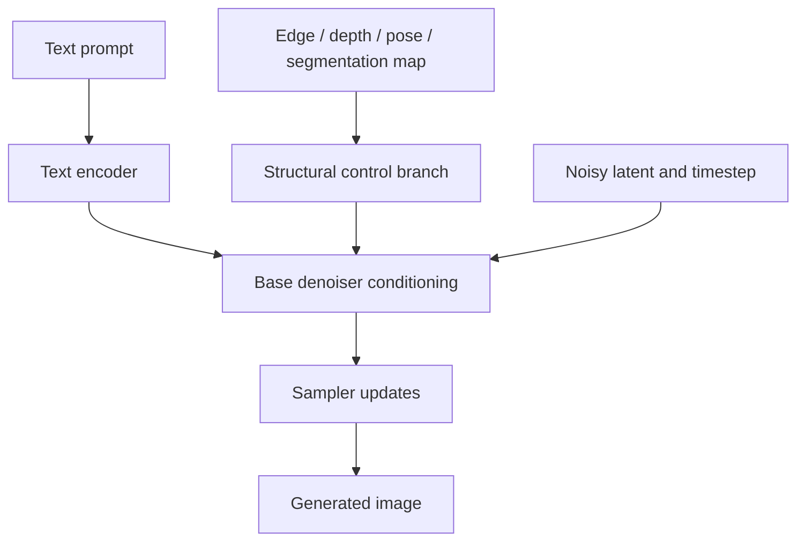
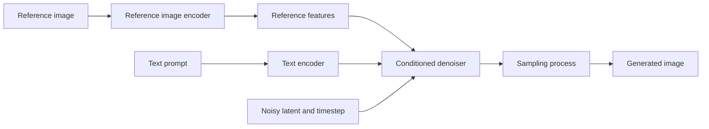

# Chapter 11: Image-to-Image Control and Adapter-Based Methods

## Learning Objectives

By the end of this chapter, you should be able to:

- Recognize edge, depth, pose, and segmentation maps as structural conditions for image generation.
- Explain ControlNet-style structural conditioning and reference-image adapters conceptually.
- Distinguish structural or reference conditioning from LoRA-based parameter adaptation.
- Identify preprocessing, condition-strength, and conflicting-control risks.
- Verify compatibility among the base model, adapter, and pipeline.
- Design a controlled experiment and explain what the control does—and does not—specify.

**Scope boundary:** This chapter focuses on conceptual understanding and using supported controls. Training adapters, combining several advanced controls, and detailed implementation internals are optional extensions.

<br/>

## 1. Why Use Structural or Reference Controls?

Text prompts describe a desired image in language, but language alone may not reliably specify exact geometry, pose, layout, or visual resemblance. Structural and reference conditioning provide additional information that can constrain parts of the generation process.

Common goals include:

- following the contours of a sketch;
- preserving approximate scene depth or spatial arrangement;
- generating a person in a specified pose;
- respecting regions identified by a segmentation map;
- drawing on visual features from a reference image.

These controls do not all provide the same kind of information. Select a condition based on what the task needs to preserve or guide.

| Condition | Information supplied | What it does not fully specify |
|<br/>|<br/>|<br/>|
| Edge map | Prominent contours and boundaries | Material, color, semantic identity, or all fine details |
| Depth map | Approximate near/far structure and spatial depth | Exact object identity, texture, or all geometry |
| Pose map | A represented pose or joint arrangement | Clothing, face identity, background, or exact appearance |
| Segmentation map | Regions or semantic classes, depending on format | Detailed texture, lighting, or appearance within each region |
| Reference-image adapter | Features derived from a reference image | Guaranteed pixel-level copying or exact identity preservation |

The precise information available depends on the preprocessing method, model, and control architecture.

<br/>

## 2. Structural Conditions: Edges, Depth, Pose, and Segmentation

### 2.1 Edge maps

An edge map highlights contours or intensity transitions. It can help a generation model follow the broad shape and boundary layout of a sketch, object, or scene.

Example task: generate a colored illustration while following the contours of a line drawing.

Potential limitations:
- edges can be noisy or incomplete;
- important semantic information may not be represented;
- textures or internal object boundaries may be mistaken for meaningful structure;
- a contour does not specify the correct color or material.

<br/>

### 2.2 Depth maps

A depth map encodes an estimate of relative or absolute distance. It can guide spatial layering, perspective, and approximate foreground/background structure.

Example task: restyle a room while retaining the rough depth arrangement of furniture.

Potential limitations:
- depth estimators can be inaccurate;
- depth values may be relative rather than metric;
- thin structures and reflective or transparent surfaces can be difficult;
- depth alone does not guarantee exact geometry or object identity.

<br/>

### 2.3 Pose maps

A pose map commonly represents keypoints and/or limb connections for a human or other supported subject. It can guide the placement and configuration of a figure.

Example task: generate a character illustration following a permitted pose reference.

Potential limitations:
- pose detectors can miss or misplace keypoints;
- occlusion can make pose estimation unreliable;
- pose does not specify clothing, face, lighting, or background;
- the target model may interpret a pose condition imperfectly.

<br/>

### 2.4 Segmentation maps

A segmentation map assigns pixels or regions to labels or classes, depending on the representation. It can guide the broad arrangement of semantic regions, such as sky, road, building, or vegetation.

Example task: generate a stylized landscape that follows a prescribed sky–mountain–foreground layout.

Potential limitations:
- label definitions and encodings are model-specific;
- class boundaries can be coarse;
- segmentation does not specify detailed appearance;
- unsupported labels or incorrect preprocessing can reduce control quality.

<br/>

## 3. ControlNet-Style Structural Conditioning

ControlNet is a family of approaches for adding spatial or structural conditions to a pretrained text-to-image diffusion model. Conceptually, a condition image—such as an edge, depth, pose, or segmentation map—is processed through a control branch whose learned features influence the denoising network.

The text prompt and structural condition play complementary roles:

- **Text prompt:** describes semantic content, appearance, and style.
- **Structural condition:** supplies a spatial or geometric guide.
- **Base denoiser:** generates the image under the combined signals.



This is a conceptual diagram rather than a layer-by-layer architecture. Exact connections, supported condition types, and parameter names vary across implementations.

<br/>

### What structural conditioning can achieve

A suitable control can improve adherence to the supplied structure relative to relying on text alone. It can be especially useful when the requested arrangement is hard to express in prose.

<br/>

### What it cannot guarantee

- exact preservation of every input pixel;
- perfect recognition of all control-map features;
- correct semantic content inside every region;
- freedom from artifacts or conflicts with the prompt;
- identical behavior across different base models or control checkpoints.

ControlNet-style conditioning guides generation; it is not equivalent to a deterministic graphics renderer.

<br/>

## 4. Reference-Image Adapters

Reference-image adapters provide a different type of conditioning. Rather than supplying only a hand-engineered spatial map, an adapter can encode visual features from a reference image and make those features available to the generation model.

Depending on the adapter and pipeline, a reference can influence properties such as:

- broad visual style or aesthetic;
- color palette and appearance;
- subject-related visual features;
- composition or other learned image characteristics.

The exact behavior depends on how the adapter was trained and what its interface is designed to control. Do not assume every reference adapter preserves identity, layout, or style equally well.



<br/>

### Structural condition vs. reference adapter

- An **edge/depth/pose/segmentation control** emphasizes a specific kind of structure represented in the control map.
- A **reference-image adapter** supplies learned visual features from an image and may influence appearance or other reference-related properties.

They are not interchangeable. If a task requires following a pose precisely, a pose control may be more direct than a general visual reference. If a task requires borrowing a broad visual appearance, a reference adapter may be more appropriate—provided the selected adapter supports that use.

<br/>

## 5. Structural and Reference Conditioning vs. LoRA

LoRA (Low-Rank Adaptation) is a parameter-efficient adaptation technique. It modifies selected model weights through learned low-rank updates, commonly to adapt a model toward a style, subject, concept, or domain.

This is fundamentally different from supplying an input condition at inference time.

| Aspect | Structural control / reference adapter | LoRA |
|<br/>|<br/>|<br/>|
| Main role | Guide a particular generation using an input condition | Adapt model behavior using learned parameter updates |
| Typical input at inference | Control map or reference image, plus prompt | Base model plus loaded LoRA weights and prompt |
| Per-image spatial guidance | Structural maps can specify geometry for a particular request | A LoRA alone does not define a per-image pose map or region layout |
| Training required by end user | Often not required when using a pretrained compatible control or adapter | Loading a pretrained LoRA does not require training; creating a new LoRA does |
| Compatibility | Must match the base model and supported pipeline | Must match compatible architecture and weight conventions |
| Typical failure | Control is misread, weak, or conflicts with prompt | Adaptation is too strong, mismatched, or changes unintended features |

A pretrained LoRA can be loaded at inference without training it yourself. The key distinction is not “adapter requires training, LoRA does not”; rather, it is **input conditioning versus parameter adaptation**. Both ecosystems include pretrained components, and both have compatibility requirements.

<br/>

## 6. Preprocessing and Alignment

The control map or reference image must be prepared according to the selected pipeline's requirements.

### Common preprocessing operations

- resizing or cropping to target dimensions;
- converting to RGB, grayscale, or another required mode;
- generating an edge, depth, pose, or segmentation representation;
- normalizing values to the expected range;
- aligning control-map dimensions with the target image dimensions;
- preserving aspect ratio or intentionally cropping/padding;
- checking the map for missing, noisy, or incorrectly encoded regions.

Preprocessing errors can undermine the control before the model runs. For example, a depth map resized differently from the intended image may no longer align with the scene. A segmentation map resized with a smoothing interpolation method may create invalid intermediate class values.

<br/>

### Inspect before generation

Save and inspect the actual control input. Do not rely only on the original photograph or the name of the preprocessing algorithm. Check whether important contours, joints, regions, or depth boundaries are represented correctly.

<br/>

## 7. Control Strength and Conflicting Conditions

Many control pipelines expose a parameter that adjusts the influence of the control condition. The parameter name, valid range, and interpretation are implementation-specific.

In general:

- **Weaker control influence:** allows more freedom but may follow the structure less closely.
- **Stronger control influence:** may follow the supplied structure more closely, but can restrict variation or create artifacts when the control is noisy or conflicts with the prompt.

This is a tendency, not a universal numeric rule. Confirm the documented meaning and recommended range for the selected pipeline.

<br/>

### Conflicting controls

A generation request can contain incompatible instructions. Examples include:

- a pose map with arms raised while the text prompt asks for arms folded;
- an edge map that outlines a square object while the prompt asks for a round object;
- a reference image with a bright palette and text asking for a very dark, muted style;
- a depth map that conflicts with the prompt's requested object arrangement.

When conditions conflict, the model may compromise, ignore part of a condition, or produce artifacts. It may not provide a clear error.

<br/>

### Debugging approach

1. Check that the condition map is correct and aligned.
2. Simplify the text prompt.
3. Run a baseline with text alone, if appropriate.
4. Add one control at a time.
5. Adjust only the documented control-strength setting.
6. Record which condition was changed and evaluate the resulting differences.
7. Avoid combining several advanced controls until each has been tested separately.

<br/>

## 8. Base-Model, Adapter, and Pipeline Compatibility

A control model or reference adapter is not automatically compatible with every diffusion checkpoint. Compatibility can depend on:

- base architecture and model family;
- model version and expected component configuration;
- latent or image channel conventions;
- text encoder and conditioning interface;
- control type and preprocessing method;
- adapter weights and expected injection points;
- library version and pipeline class;
- supported image dimensions and inference settings.

A file that loads successfully is not proof that the components are semantically compatible or will produce good results.

<br/>

### Compatibility checklist

Before running an experiment, verify:

1. The model card identifies the intended base model or supported model families.
2. The selected pipeline explicitly supports the control or adapter type.
3. The condition input has the expected format, size, mode, and value range.
4. The prompt and inference arguments match the pipeline API.
5. The recommended control-strength range and default are documented.
6. The installed library version supports the selected component.
7. The model license and reference-image rights permit the intended use.

Use the model's official examples as the baseline. Avoid mixing checkpoints or control weights based solely on similar names.

<br/>

## 9. Example: Structural Control with Diffusers

The following is a **conceptual code pattern** for a ControlNet-style pipeline, using an edge map as the condition. It is not guaranteed to run unchanged with every model or Diffusers version. Confirm the exact checkpoint, pipeline class, preprocessing, and arguments in the current documentation.

```python
from pathlib import Path

import torch
from PIL import Image
from diffusers import ControlNetModel, StableDiffusionControlNetPipeline
from diffusers.utils import load_image

base_model_id = "stable-diffusion-v1-5/stable-diffusion-v1-5"
control_model_id = "lllyasviel/sd-controlnet-canny"

reference_path = Path("reference.png")
control_path = Path("edge_map.png")
output_path = Path("controlled_generation.png")

prompt = (
    "A clean editorial illustration of a small garden pavilion, "
    "soft natural colors, clear materials, balanced composition"
)
seed = 1234
control_scale = 0.8

reference = Image.open(reference_path).convert("RGB")
control_image = load_image(str(control_path)).convert("RGB")

device = "cuda" if torch.cuda.is_available() else "cpu"

controlnet = ControlNetModel.from_pretrained(control_model_id)
pipe = StableDiffusionControlNetPipeline.from_pretrained(
    base_model_id,
    controlnet=controlnet,
)
pipe = pipe.to(device)

generator = torch.Generator(device=device).manual_seed(seed)

# Confirm argument names and model compatibility in current documentation.
result = pipe(
    prompt=prompt,
    image=control_image,
    controlnet_conditioning_scale=control_scale,
    num_inference_steps=30,
    guidance_scale=7.0,
    generator=generator,
)

result.images[0].save(output_path)
print(f"Saved: {output_path}")
```

<br/>

### Implementation notes

- The code expects an already-prepared control image. It does not generate the edge map from `reference.png`; create and inspect that map with a documented preprocessing tool.
- A ControlNet checkpoint must be compatible with the selected base model and pipeline. Verify the checkpoint's model card before loading.
- The `image` argument represents the control input in this pipeline pattern; exact argument semantics vary across pipelines.
- Remove unused inputs in a real implementation and record the control-generation method and its parameters.
- For a reference-image adapter, use that adapter's documented pipeline and input interface rather than substituting it into the ControlNet example.
- This chapter does not require training a ControlNet or adapter.

<br/>

## 10. Practice: One Controlled Structural or Reference Example

Choose a permitted reference image or a structural guide you have the right to use. Select **one** condition type—edge, depth, pose, segmentation, or a compatible reference adapter.

### Experiment procedure

1. Record the base model, condition model or adapter, pipeline class, and library version.
2. Save the original reference and the exact preprocessed condition input.
3. Write a prompt that specifies semantic content and visual style without contradicting the control.
4. Generate a baseline without the control if the pipeline supports a meaningful comparison.
5. Generate a controlled result using one documented control-strength value.
6. If appropriate, compare a second supported strength while keeping all other settings fixed.
7. Evaluate structure adherence, subject appearance, prompt adherence, artifacts, and unintended changes.
8. Save outputs and a manifest containing the prompt, seed, dimensions, control settings, and model identifiers.

<br/>

### Results table

| Criterion | Baseline / lower control | Controlled / higher control |
|<br/>|<br/>|<br/>|
| Structure follows guide | | |
| Semantic content matches prompt | | |
| Appearance and style | | |
| Important geometry preserved | | |
| Artifacts or conflicting signals | | |
| Unconstrained details | | |
| Overall suitability | | |

<br/>

### Practice questions

1. What specific information does your control map or reference adapter supply?
2. Which important image properties remain unconstrained?
3. Did stronger control improve structural adherence, and what did it cost?
4. How did you verify compatibility among the base model, control or adapter, and pipeline?
5. Could a preprocessing error explain any failure?

<br/>

## 11. Common Failure Modes

| Symptom | Possible cause | Practical response |
|<br/>|<br/>|<br/>|
| Generated geometry does not follow the guide | Incorrect preprocessing, weak control, or incompatible checkpoint | Inspect the condition image and verify model compatibility |
| Result follows the guide but ignores key prompt details | Structural control and text prompt compete, or the prompt is under-specified | Simplify the prompt and test one control at a time |
| Output contains artifacts around edges or joints | Noisy edge/pose map or strong conflicting conditions | Improve the guide and test a documented control-strength range |
| Depth or segmentation layout appears distorted | Incorrect value range, interpolation, alignment, or map format | Use the expected preprocessing and inspect the actual condition |
| Reference adapter changes style but not layout | Adapter may encode broad appearance rather than precise geometry | Use a structural condition for geometry if supported |
| Loading fails or output is unstable | Base model, adapter, or pipeline mismatch | Verify checkpoint documentation, architecture, and library version |
| Results vary unexpectedly between runs | Seed handling, sampler, settings, or environment differ | Record the complete configuration and compare controlled runs |

<br/>

## 12. Checkpoint: What Does the Control Supply—and What Remains Unconstrained?

A structural control supplies a specific representation of the image's structure: edges provide contours, depth maps provide distance relationships, pose maps provide keypoint or body configuration, and segmentation maps provide labeled regions. A reference-image adapter supplies learned visual features extracted from a reference image, according to that adapter's design.

These conditions guide the model but do not specify every property of the final image. Depending on the control, unconstrained or weakly constrained properties may include color, material, texture, identity, fine detail, lighting, background content, or semantic interpretation. The text prompt and the model's learned distribution also influence the result.

To evaluate whether the control worked:

1. Identify the property the control is intended to constrain.
2. Compare the output against that property, not just overall visual appeal.
3. Check whether the prompt conflicts with the condition.
4. Verify preprocessing and component compatibility.
5. Record the control strength and all other generation settings.
6. State which aspects remain free for the model to synthesize.

The correct control is the one that supplies the missing information required by the task—not necessarily the one with the most complicated architecture.

<br/>

## 13. Key Takeaways

- Edge, depth, pose, and segmentation conditions encode different forms of spatial structure.
- ControlNet-style methods inject structural information into a compatible generation model.
- Reference-image adapters provide learned features from an image; their behavior depends on the adapter design.
- Structural/reference conditioning is different from LoRA-based parameter adaptation.
- Preprocessing and alignment are critical; inspect the actual control input before generation.
- Stronger control can improve adherence but may restrict variation or create artifacts, especially when conditions conflict.
- Verify compatibility across base model, control or adapter, pipeline, and library version.
- Training adapters and combining multiple advanced controls are optional extensions, not prerequisites for this chapter.

<br/>

## 14. References and Further Reading

- [Hugging Face Diffusers — ControlNet](https://huggingface.co/docs/diffusers/using-diffusers/controlnet)
- [Hugging Face Diffusers — ControlNet API](https://huggingface.co/docs/diffusers/api/pipelines/controlnet)
- [ControlNet: Adding Conditional Control to Text-to-Image Diffusion Models (paper)](https://arxiv.org/abs/2302.05543)
- [IP-Adapter: Text Compatible Image Prompt Adapter for Text-to-Image Diffusion Models (paper)](https://arxiv.org/abs/2308.06721)
- [Hugging Face Diffusers — LoRA](https://huggingface.co/docs/diffusers/using-diffusers/loading_adapters)
- [Hugging Face Diffusers — Image Processors](https://huggingface.co/docs/diffusers/using-diffusers/image_processors)

**Version note:** Pipeline classes, adapter APIs, control types, and argument names vary across checkpoints and library versions. Confirm the current model card and official documentation for the exact implementation you use.
