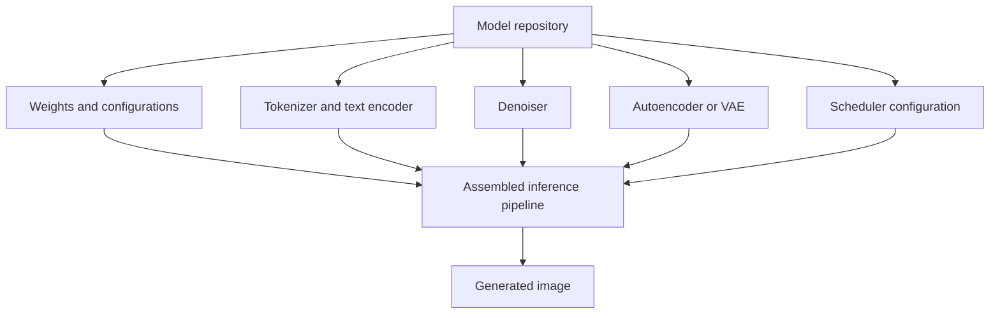
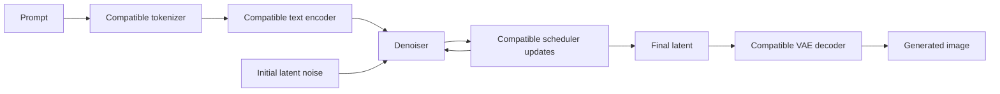
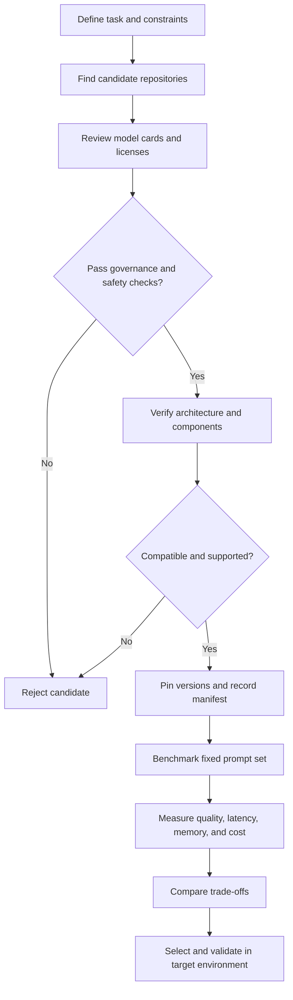

# Chapter 12: Model Checkpoints and Model Selection

## Learning Objectives

By the end of this chapter, you should be able to:

- Distinguish a complete generation pipeline from component checkpoints, fine-tuned weights, and adapters.
- Inspect model cards, licenses, intended uses, and technical compatibility before loading artifacts.
- Record reproducible model and component identifiers, versions, precision, and runtime configuration.
- Compare candidate configurations using task fit, output quality, hardware requirements, latency, and operating cost.
- Load model artifacts from trusted sources while avoiding unsafe arbitrary-code execution.
- Explain why compatible denoiser, tokenizer, text encoder, and autoencoder components are necessary.

<br/>

## 1. What Is a Model Checkpoint?

A **checkpoint** is a saved set of model parameters and associated configuration needed to resume training, run inference, or adapt a model. In image generation, the word *checkpoint* can refer to several different artifact types. The label alone does not guarantee that an artifact is a complete, ready-to-run pipeline.

A model repository may contain:

- Learned weights, such as `.safetensors`, `.bin`, or sharded weight files.
- Configuration files that describe the architecture.
- Tokenizer vocabulary and configuration.
- Text-encoder weights and configuration.
- Denoiser weights and configuration.
- Autoencoder or VAE weights and configuration.
- Scheduler configuration.
- Safety, preprocessing, or image-processing components.
- Optional adapter weights, such as LoRA files.
- Model-card documentation and license terms.

The exact files depend on the architecture and how the model is packaged.

<br/>

### 1.1 Checkpoint versus pipeline

A **checkpoint** is an artifact or set of artifacts. A **pipeline** is the assembled inference workflow that coordinates the necessary components.

For a latent diffusion text-to-image system, a pipeline may coordinate text tokenization and encoding, latent denoising, scheduler updates, and latent decoding. A component checkpoint may provide only one part of that workflow.



**Key distinction:** possessing a denoiser weight file does not necessarily mean you possess everything required to generate an image.

<br/>

## 2. Four Artifact Categories

### 2.1 Full pipeline

A **full pipeline** packages, or provides references to, the components required for a supported inference task.

Typical contents may include:

- Denoiser or diffusion transformer.
- Text encoder(s) and tokenizer(s).
- Autoencoder or VAE for latent-space models.
- Scheduler configuration.
- Pipeline configuration and preprocessing utilities.

**Advantages**
- Easier to load and use.
- Component relationships are usually documented.
- Less manual assembly and fewer opportunities for accidental mismatch.

**Limitations**
- May require substantial disk space and memory.
- May include components unnecessary for a particular task.
- The pipeline can still require custom dependencies or remote code; inspect the repository and loading instructions.

<br/>

### 2.2 Component checkpoint

A **component checkpoint** contains weights for one part of a larger system—for example, a denoiser, text encoder, or VAE.

Use it when:
- Replacing a component in a supported architecture.
- Building a custom pipeline.
- Performing controlled experiments on a component.

Before using it, verify the expected architecture, configuration, tensor dimensions, and compatible companion components.

<br/>

### 2.3 Fine-tuned weights

**Fine-tuned weights** are model parameters updated through additional training. Fine-tuning may target a full model or a component, depending on the training method.

Fine-tuning can adapt a model toward:
- A visual style.
- A subject or character.
- A domain-specific image distribution.
- A task or output convention.

A fine-tuned checkpoint is not automatically interchangeable with the original model. Confirm the base model family, architecture, training method, required components, and documented loading procedure.

<br/>

### 2.4 Adapters

An **adapter** is a relatively small set of learned parameters intended to modify or condition a compatible base model. LoRA is a common parameter-efficient adaptation method.

Adapters usually require:
- A compatible base model and component.
- A compatible architecture and layer layout.
- A documented loading method.
- An appropriate adapter scale or strength, where supported.

Adapters generally do **not** replace the base model, tokenizer, text encoder, or VAE unless the artifact explicitly includes and documents those components.

| Artifact type | What it provides | What else may be needed? |
|<br/>|<br/>|<br/>|
| Full pipeline | Coordinated inference components and configuration | Runtime dependencies, model access, and sufficient hardware |
| Component checkpoint | Weights for one component | Compatible pipeline and companion components |
| Fine-tuned weights | Parameters adapted from a base model | The expected architecture and often the base configuration/components |
| Adapter | Small parameter update or conditioning module | Compatible base model and a supported adapter loader |

**Important:** these categories describe different aspects of an artifact and can overlap. For example, a full pipeline may contain fine-tuned weights, and a repository may distribute an adapter separately from the base model.

<br/>

## 3. Read the Model Card Before Loading

A **model card** describes what a model is, how it was developed or evaluated, and the conditions under which it should be used. Treat it as a technical and governance document, not merely a marketing summary.

Inspect the following fields.

### 3.1 Identity and provenance

Record:
- Repository or publisher.
- Exact model and repository identifier.
- Revision, commit hash, release, or version tag.
- Base model, if the artifact is fine-tuned or an adapter.
- File format and checksums, if supplied.
- Release date and update history, where available.

Prefer a pinned revision over a moving default branch when reproducibility matters.

<br/>

### 3.2 Intended use and limitations

Check:
- Supported task: text-to-image, image-to-image, inpainting, or another task.
- Expected input and output types.
- Recommended prompt format and inference settings.
- Known limitations, failure modes, and evaluation conditions.
- Intended users and prohibited or restricted use cases.
- Whether the model is a research artifact or supported for production.

Do not infer capability from a model name alone. Verify the documentation and test the exact task.

<br/>

### 3.3 License and usage conditions

Review:
- The stated license and any model-specific terms.
- Commercial-use permissions and restrictions.
- Redistribution and attribution requirements.
- Acceptable-use policies or additional conditions.
- Dataset or output restrictions, where stated.

A code library's license and a model's weight license may be different. Check the actual model repository and its associated terms; do not assume that an open-source loader makes the weights unrestricted.

<br/>

### 3.4 Technical compatibility

Look for:
- Architecture or pipeline class.
- Expected tokenizer and text encoder(s).
- Autoencoder/VAE requirements.
- Supported scheduler configurations.
- Expected image resolution and latent dimensions.
- Required library versions and optional dependencies.
- Supported precision and hardware.
- Whether custom model code is required.

<br/>

### 3.5 Evaluation evidence

Record the reported metrics, benchmark, prompt set, and inference configuration when available. Quality comparisons are only meaningful when their conditions are understood. A score from one benchmark does not guarantee better results for your own task.

<br/>

## 4. Component Compatibility: Why It Matters

A generation pipeline is a coordinated system. Components exchange tensors and representations with specific shapes, dimensions, semantics, and scaling conventions. A component can load successfully and still produce poor or invalid outputs if it is incompatible with the rest of the pipeline.

### 4.1 Architecture and denoiser

The denoiser expects a particular input representation and conditioning interface. For example, a U-Net and a diffusion transformer may differ in architecture, configuration, and expected tensors.

Verify:
- Model family and architecture.
- Expected latent channels and spatial dimensions.
- Conditioning interfaces and embedding dimensions.
- Required configuration fields.
- Supported scheduler and prediction parameterization.

Do not assume that similarly named weights from different model families are interchangeable.

<br/>

### 4.2 Tokenizer

The tokenizer converts prompt text into token IDs and attention masks. Its vocabulary, tokenization rules, special tokens, and maximum sequence length must match the expectations of the associated text encoder.

A mismatch can change how prompts are represented or cause shape and loading errors. A tokenizer from another model family may split the same text differently or use incompatible token IDs.

<br/>

### 4.3 Text encoder

The text encoder maps tokenized prompts into conditioning embeddings. The denoiser is trained to interpret embeddings with particular dimensions and semantics.

Verify:
- Correct text-encoder model and version.
- Expected embedding dimension and sequence length.
- Whether the pipeline uses one or multiple text encoders.
- Required pooled embeddings, masks, or other conditioning outputs.
- Precision and memory requirements.

A tensor having the expected shape does not guarantee semantic compatibility. Embeddings from a different text encoder may be numerically valid but misaligned with what the denoiser learned to use.

<br/>

### 4.4 Autoencoder or VAE

Latent diffusion models commonly encode images into a lower-dimensional latent representation and decode final latents into pixels.

The VAE's architecture, latent channel count, scaling convention, and learned representation must be compatible with the denoiser and pipeline. A mismatched VAE may cause color shifts, blur, artifacts, incorrect contrast, or shape errors.

<br/>

### 4.5 Scheduler and prediction type

The scheduler determines how the noisy latent is updated at each inference step. It must interpret the denoiser's output according to the model's prediction convention, such as noise prediction, clean-sample prediction, or velocity prediction.

A scheduler can be syntactically loadable but conceptually inappropriate if its configuration does not match the model's training setup. Use documented compatible configurations and validate output quality.

<br/>

### 4.6 Compatibility summary

| Component | Compatibility requirement | Typical mismatch symptom |
|<br/>|<br/>|<br/>|
| Denoiser | Architecture, latent shape, conditioning interface | Loading error, unstable or poor generation |
| Tokenizer | Vocabulary, token IDs, special tokens, sequence conventions | Prompt truncation or incorrect conditioning |
| Text encoder | Embedding dimensions, semantics, masks, pooled outputs | Shape errors or weak prompt adherence |
| VAE/autoencoder | Latent channels, representation and scaling | Color shifts, blur, artifacts, decode errors |
| Scheduler | Prediction type and compatible configuration | Poor denoising, artifacts, unstable sampling |
| Adapter | Base model family, target layers and loader | Missing-key errors or degraded output |



<br/>

## 5. Record a Reproducible Model Configuration

A model selection decision is only useful if the chosen setup can be identified and reproduced later. Record the full configuration, not just a display name.

### 5.1 Recommended manifest fields

At minimum, store:

- Model repository and exact revision.
- Artifact category: pipeline, component, fine-tune, or adapter.
- Base model identifier and revision, if applicable.
- Denoiser, tokenizer, text encoder(s), VAE, and scheduler identifiers.
- Library and runtime versions.
- Weight format and precision (for example, FP32, FP16, or BF16).
- Device and hardware type.
- Resolution, batch size, inference steps, guidance settings, and seed.
- Adapter identifier, revision, and strength, if used.
- License and source review status.
- Evaluation dataset/version and measured results.

Precision labels alone are insufficient to predict memory use or performance. Actual support depends on the model, operators, hardware, and runtime.

<br/>

### 5.2 Example YAML manifest

The following is a template; replace placeholders with verified values from the actual artifacts.

```yaml
task: text-to-image

model:
  repository: "publisher/model-repository"
  revision: "PINNED_COMMIT_OR_VERSION"
  artifact_type: "full_pipeline"
  base_model: null

components:
  denoiser: "repository-or-component-id"
  tokenizer: "repository-or-component-id"
  text_encoder: "repository-or-component-id"
  vae: "repository-or-component-id"
  scheduler_config: "repository-or-component-id"

runtime:
  library: "diffusers"
  library_version: "PINNED_VERSION"
  precision: "fp16"
  device: "cuda"

generation:
  width: 1024
  height: 1024
  steps: 30
  guidance_scale: 5.0
  seed: 12345
  batch_size: 1

governance:
  license_reviewed: false
  intended_use_reviewed: false
  trusted_source_verified: false

evaluation:
  dataset_version: "my-eval-set-v1"
  quality_score: null
  latency_seconds: null
  peak_memory_gb: null
```

Do not copy these sample settings as universal defaults. Resolution, step count, guidance, and precision should be chosen for the model and workload.

<br/>

## 6. Compare Candidate Models Systematically

Select models against a defined workload rather than choosing solely by popularity, parameter count, or sample images.

### 6.1 Evaluation dimensions

1. **Task fit:** Does the model support the required generation mode and inputs?
2. **Output quality:** Does it meet requirements for composition, prompt adherence, style, details, and artifact rate?
3. **Compatibility:** Are all components supported together?
4. **Hardware:** Can it fit in available VRAM/RAM and disk space?
5. **Latency and throughput:** How long does it take per image, and how many images can it produce per unit time?
6. **Operating cost:** Include accelerator time, hosting, storage, bandwidth, and engineering/maintenance effort.
7. **License and governance:** Is the planned use allowed, and can the provenance be established?
8. **Reliability:** Does it behave consistently across a representative prompt set?
9. **Operational complexity:** Does it require custom code, extra dependencies, or manual component assembly?

<br/>

### 6.2 Practice: selection matrix for two configurations

The matrix below is an illustrative template. The candidate names and ratings are placeholders, not claims about specific real models.

| Criterion | Candidate A: complete pipeline | Candidate B: base + adapter |
|<br/>|<br/>|<br/>|
| Target task | Text-to-image | Text-to-image with a target style |
| Component assembly | Lower; integrated pipeline | Higher; base and adapter must match |
| Prompt adherence | Measure on fixed prompt set | Measure on the same prompt set |
| Style fit | Measure against requirements | Measure against target style examples |
| Peak VRAM | Benchmark on target hardware | Benchmark on target hardware |
| Latency per image | Measure after warm-up | Measure after warm-up |
| Cost per 1,000 images | Calculate from measured runtime and price | Calculate from measured runtime and price |
| License | Verify pipeline and weight terms | Verify both base and adapter terms |
| Reproducibility | Pin pipeline revision and settings | Pin base, adapter, loader, and settings |
| Decision rule | Prefer if simplicity and general quality win | Prefer if style gain justifies added complexity |

Use a fixed test set and identical evaluation conditions wherever possible. Keep the seed, resolution, inference settings, and hardware constant unless the purpose of the test is to evaluate those variables.

A simple scoring rubric can use a 1–5 rating for each criterion, with higher scores indicating better fit. Assign weights based on project requirements. Treat hard constraints—such as license restrictions or insufficient VRAM—as pass/fail gates rather than allowing a high weighted score to override them.

Example weighted score:

$$
S = \sum_{i=1}^{n} w_i s_i
$$

where $w_i$ is the normalized importance weight for criterion $i$, and $s_i$ is its rating. Ensure the weights sum to 1. Record raw measurements alongside the score so that a composite number does not conceal trade-offs.

<br/>

### 6.3 Cost estimation

A basic estimate is:

$$
\text{Cost per image} \approx
\text{runtime per image in hours}
\times
\text{hourly accelerator cost}
$$

For a batch, also account for failed jobs, warm-up, idle time, orchestration, storage, and any hosted API charges. Benchmark with realistic batch sizes and resolutions; memory and latency can change substantially with these factors.

<br/>

## 7. Trusted Sources and Safe Artifact Loading

Model files are executable inputs to a complex software stack. A repository can contain weights, configuration, tokenizer assets, and custom Python code. Loading untrusted artifacts can expose the environment to security risks.

### 7.1 Safer acquisition practices

- Prefer official publisher repositories or trusted model hubs with clear provenance.
- Verify the exact repository, publisher identity, revision, and file names.
- Review model cards, licenses, dependency requirements, and repository code.
- Pin a specific revision or commit for production and reproducible experiments.
- Use checksums or signed release metadata when available.
- Keep the model-loading environment patched and isolated.
- Use least-privilege credentials and avoid exposing secrets to model-loading processes.
- Scan downloaded files according to your organization's security process.
- Test artifacts in a sandbox before deploying them.
- Do not execute scripts or install dependencies merely because a model card instructs you to do so; review the source and necessity first.

<br/>

### 7.2 Serialization formats and remote code

Prefer weight formats designed for tensor data, such as **Safetensors**, when supported. This reduces certain risks associated with general-purpose object serialization, but it does not make the entire repository or pipeline automatically safe.

Be especially cautious with:
- Pickle-based or other formats that can deserialize arbitrary Python objects.
- Custom repository code or `trust_remote_code`-style options.
- Unpinned dependencies and install scripts.
- Unknown repositories that imitate well-known publishers.

Do not enable remote-code execution by default. If custom code is genuinely required, inspect it, pin the revision, run it in an isolated environment, and apply normal dependency and security review. A “safe” weight format does not protect against malicious custom code, compromised dependencies, or unsafe surrounding application logic.

<br/>

### 7.3 Example: pin a repository revision

Illustrative Hugging Face Diffusers pattern; use the repository's documented pipeline class and a verified revision.

```python
import torch
from diffusers import DiffusionPipeline

model_id = "publisher/model-repository"
revision = "PINNED_COMMIT_OR_VERSION"

pipe = DiffusionPipeline.from_pretrained(
    model_id,
    revision=revision,
    torch_dtype=torch.float16,
    # Do not enable remote custom code unless reviewed and required.
)

pipe = pipe.to("cuda")
```

This example is not a guarantee that any repository is compatible with `DiffusionPipeline`, FP16, or CUDA. Confirm the model card, documented loader, component requirements, hardware support, and library version before use. If the model requires a specialized pipeline class, use that documented class.

<br/>

### 7.4 Security checklist

Before loading a model, confirm:

- [ ] Source and publisher are trusted and verified.
- [ ] Exact revision is pinned.
- [ ] Model card and license have been reviewed.
- [ ] Required components and dependency versions are known.
- [ ] File formats and any custom code have been inspected.
- [ ] Remote code is disabled unless explicitly reviewed and necessary.
- [ ] Loading is tested in a least-privilege, isolated environment.
- [ ] The resulting configuration and artifact identifiers are recorded.

<br/>

## 8. Practical Selection Workflow



Recommended order:

1. Define the exact task and non-negotiable constraints.
2. Identify candidate pipelines or compatible base-plus-adapter configurations.
3. Review intended use, license, provenance, and loading requirements.
4. Verify component compatibility and hardware feasibility.
5. Pin versions and create a configuration manifest.
6. Run a small smoke test to confirm loading and basic output.
7. Evaluate on a representative, fixed prompt set.
8. Measure latency, peak memory, failure rate, and cost.
9. Select based on measured evidence and document rejected alternatives.
10. Re-run validation when model revisions, libraries, hardware, or dependencies change.

<br/>

## 9. Common Failure Modes

| Failure | Why it happens | Mitigation |
|<br/>|<br/>|<br/>|
| Loading only a denoiser checkpoint | Other pipeline components are missing | Use the documented full pipeline or assemble all required compatible components |
| Mixing components from unrelated model families | Interfaces or learned representations differ | Use documented component combinations and verify dimensions/configuration |
| Using the wrong tokenizer | Token IDs and tokenization rules differ | Load the tokenizer paired with the intended text encoder |
| Swapping the text encoder | Embedding shape or semantics no longer match training | Use the expected encoder(s) and conditioning outputs |
| Replacing the VAE casually | Latent representation or scaling differs | Verify compatibility and compare decoded output on a fixed test set |
| Loading an adapter on the wrong base | Target layers or architecture do not match | Verify base-model identity and adapter documentation |
| Assuming FP16 always works | Hardware/operator/model support varies | Test supported precision modes and compare quality, memory, and speed |
| Comparing models with different settings | Results confound model and configuration effects | Fix seeds, prompts, resolution, steps, and runtime conditions |
| Treating sample images as proof | Samples may be cherry-picked or use different settings | Evaluate a representative prompt set and retain raw outputs |
| Loading unreviewed custom code | Repository code may execute in the environment | Review, pin, isolate, and minimize permissions |

<br/>

## 10. Practice Exercise

**Task:** Create a selection matrix for two candidate configurations.

Choose either:
- Two full pipelines from trusted sources, or
- One full pipeline and one compatible base-plus-adapter configuration.

Fill in the matrix with evidence from model cards and measurements from your own tests.

| Field | Candidate A | Candidate B |
|<br/>|<br/>|<br/>|
| Repository and pinned revision |  |  |
| Artifact type |  |  |
| Intended task |  |  |
| License and use restrictions |  |  |
| Denoiser architecture |  |  |
| Tokenizer and text encoder(s) |  |  |
| VAE/autoencoder |  |  |
| Required libraries/dependencies |  |  |
| Supported precision |  |  |
| Hardware and peak VRAM |  |  |
| Test-set prompt adherence |  |  |
| Visual quality and failure rate |  |  |
| Latency per image |  |  |
| Estimated cost per 1,000 images |  |  |
| Reproducibility and provenance |  |  |
| Main risk or limitation |  |  |
| Decision and rationale |  |  |

<br/>

### Suggested test protocol

1. Select 10–20 prompts representative of the intended application.
2. Include simple prompts, multi-object composition, text rendering if relevant, and difficult edge cases.
3. Use the same seed list, output dimensions, and comparable inference settings where supported.
4. Record all outputs and the exact configuration.
5. Rate prompt adherence, composition, detail, artifacts, and consistency.
6. Measure peak memory and generation latency after warm-up.
7. Estimate cost using the actual runtime environment.
8. Reject any candidate that fails a hard requirement, even if its visual score is high.
9. Write a short decision memo with evidence and remaining uncertainty.

<br/>

## 11. Checkpoint Answer

**Question:** Why do compatible architecture, tokenizer, text encoder, and autoencoder components matter?

**Answer:**

They matter because a diffusion pipeline is a coupled system whose components exchange representations with defined structures and learned meanings.

- **Architecture compatibility** ensures that the denoiser receives the expected tensors, latent shapes, conditioning inputs, and configuration.
- **Tokenizer compatibility** ensures that prompt text is converted into the token IDs, special tokens, and sequence format expected by the text encoder.
- **Text-encoder compatibility** ensures that the denoiser receives embeddings with the expected dimensions and learned semantics. Matching tensor shapes alone does not guarantee compatible representations.
- **Autoencoder/VAE compatibility** ensures that the latent representation used by the denoiser can be encoded and decoded correctly, including latent channel layout and scaling conventions.

A mismatch can cause loading errors, broken conditioning, poor prompt adherence, color shifts, blur, artifacts, or completely unusable output. Therefore, use documented compatible component combinations, pin their versions, and validate them together with a reproducible test set.

<br/>

## 12. Essential References

Use official documentation and the specific repository's model card as the primary source of truth. APIs, model packaging, and supported precision can change across library versions.

- Hugging Face Hub — Model Cards: https://huggingface.co/docs/hub/model-cards
- Hugging Face Hub — Download files and repositories: https://huggingface.co/docs/huggingface_hub/guides/download
- Hugging Face Diffusers — Loading pipelines: https://huggingface.co/docs/diffusers/using-diffusers/loading
- Hugging Face Diffusers — Loading adapters: https://huggingface.co/docs/diffusers/using-diffusers/loading_adapters
- Hugging Face Safetensors documentation: https://huggingface.co/docs/safetensors/index
- Hugging Face Hub — Repository security: https://huggingface.co/docs/hub/security
- PyTorch — Serialization semantics and safe loading: https://docs.pytorch.org/docs/stable/notes/serialization.html

**Chapter takeaway:** select a complete, compatible, licensed, and reproducible configuration—not merely a popular checkpoint. Evaluate the whole system on the target task, and treat model provenance and safe loading as part of engineering quality.
