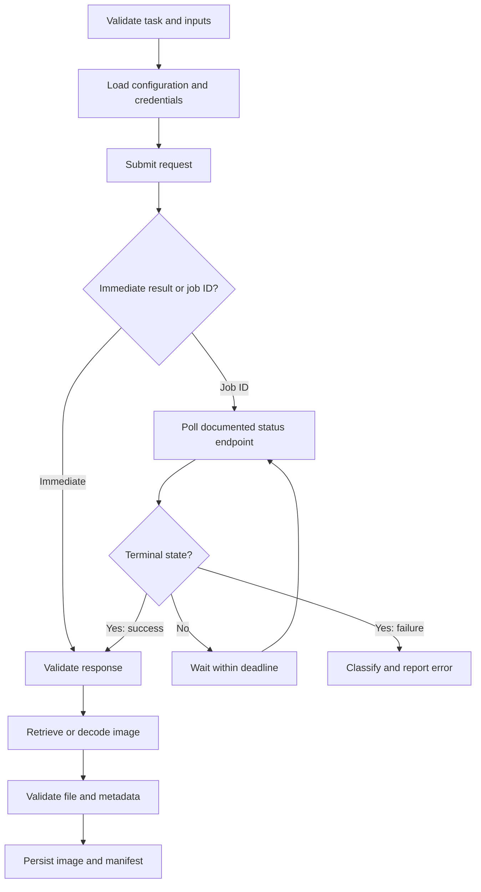

# Chapter 13: Image Generation APIs and Open Model Ecosystems

## Learning Objectives

By the end of this chapter, you should be able to:

- Compare hosted image-generation APIs with local model-pipeline execution.
- Inspect supported inputs, parameters, job states, output formats, and usage reporting.
- Implement a minimal generation workflow using a hosted API or a local library.
- Handle credentials, timeouts, bounded retries, polling, and output persistence.
- Record SDK/library versions and provider-side limits for reproducibility.
- Keep provider-specific capabilities separate from general diffusion concepts.

<br/>

## 1. Two Ways to Run Image Generation

Image-generation applications commonly use one of two execution patterns:

1. **Hosted API:** send a request to a provider's service; the provider runs the model and returns an image or a job identifier.
2. **Local pipeline:** download or otherwise access model artifacts and run inference in an environment you control.

A third pattern is a managed or self-hosted inference endpoint. It resembles an API from the client’s perspective but may use infrastructure that you configure or operate.

<br/>

### 1.1 Hosted API

The client sends an authenticated request containing a prompt and supported parameters. The service applies its documented validation, model configuration, safety checks, limits, and inference process.

**Advantages**
- No need to manage model weights or GPU drivers locally.
- Easier initial setup and centralized scaling.
- Provider may handle queueing, hardware, and model serving.

**Trade-offs**
- Requires network access and provider credentials.
- Availability, latency, pricing, rate limits, and supported controls depend on the service.
- Model implementation and inference internals may be hidden.
- Requests and outputs are subject to the provider's data-handling and retention terms.

<br/>

### 1.2 Local model pipeline

A local pipeline runs the model through a library such as Hugging Face Diffusers on your own machine or managed compute.

**Advantages**
- More direct control over compatible pipeline components and supported inference settings.
- Can work without a hosted inference request after model artifacts and dependencies are available.
- Easier to instrument internal stages when the library exposes them.

**Trade-offs**
- Requires compatible hardware, memory, storage, dependencies, and model artifacts.
- You are responsible for loading, updates, security, performance, and operations.
- Model licenses and usage terms still apply.
- “Local” does not automatically mean private or secure; logs, telemetry, plugins, or application code may still send data elsewhere.

<br/>

### 1.3 Comparison

| Dimension | Hosted API | Local pipeline |
|<br/>|<br/>|<br/>|
| Inference location | Provider infrastructure | Your machine or compute environment |
| Model weights | Usually hidden from the client | Usually accessible as downloaded artifacts |
| Setup | API client, network, credentials | Model files, libraries, hardware, drivers |
| Controls | Only documented API parameters | Parameters exposed by the selected pipeline and scheduler |
| Job execution | Synchronous response or asynchronous job, depending on service | Usually a local call; applications may still queue work |
| Limits | Provider quotas, rate limits, size and policy limits | Hardware, software, memory, and license constraints |
| Cost model | API pricing or credits | Compute, electricity/cloud GPU, storage, and engineering |
| Reproducibility | Provider/model version and server behavior may be opaque | More components can be pinned, but hardware and runtime still matter |
| Observability | Usage and request metadata exposed by provider | Application metrics and local runtime instrumentation |
| Maintenance | Provider operates service infrastructure | You manage runtime and model lifecycle |

There is no universal winner. Choose based on task requirements, privacy obligations, deployment constraints, cost, quality, and operational capacity.

<br/>

## 2. Open Model Ecosystems

An **open model ecosystem** is a collection of model artifacts, documentation, libraries, evaluation tools, and community or publisher resources that make it possible to inspect, download, run, adapt, or evaluate models. The phrase *open model* does not automatically mean every component is open source or that all uses are unrestricted.

<br/>

### 2.1 Common ecosystem layers

- **Model repositories:** weights, configuration, tokenizer assets, model cards, and licenses.
- **Inference libraries:** pipeline APIs that load components and run generation.
- **Model serving:** endpoints or servers that expose model inference through HTTP or another interface.
- **Adapters and fine-tunes:** optional artifacts that modify a compatible base model.
- **Evaluation and monitoring:** prompt sets, quality measurements, latency, memory, and failure tracking.

Examples include the Hugging Face Hub for model distribution and Diffusers for diffusion pipelines. Specific model availability, license terms, API behavior, and supported hardware vary by repository and release.

<br/>

### 2.2 Hosted service versus open weights

These are different dimensions:

- A hosted API may serve an open-weight model, a proprietary model, or a customized model.
- An open-weight model can be run locally, on rented compute, or behind a managed endpoint.
- A local library does not imply that the model is unrestricted for commercial use.
- A public model repository does not guarantee that its weights are safe to load without inspection.

Assess the service contract and the model artifact separately.

<br/>

## 3. Inspect the API Contract Before Writing Code

Do not assume all image APIs accept the same request fields or return the same response. Start with the provider's current documentation and the exact endpoint or SDK method you intend to use.

### 3.1 Supported inputs

Confirm whether the service accepts:
- Text prompts.
- Reference images or image URLs.
- Masks for inpainting.
- Multiple input images or other conditioning.
- Negative prompts, if supported.
- A model identifier or a fixed model selected by the endpoint.

Also inspect file-size limits, accepted MIME types, image dimensions, and any restrictions on image input.

<br/>

### 3.2 Generation settings

Potential controls include:
- Output width and height or aspect ratio.
- Number of images.
- Seed.
- Inference steps.
- Guidance scale.
- Output quality or format.
- Style or safety settings.
- Model/version selection.

These are examples, not a universal parameter list. A hosted provider may expose only a subset—or use different names and semantics. A local pipeline may expose scheduler, generator, latent, callback, or other implementation-specific controls not available through an API.

<br/>

### 3.3 Responses and job states

A service may return:
- Image bytes directly.
- A URL to a generated image.
- A structured response containing metadata.
- A job ID that must be polled.
- An error object with a code and request identifier.

For asynchronous services, document the possible states, such as queued, running, succeeded, failed, or cancelled. Use the provider's actual state vocabulary and polling guidance rather than assuming these exact labels.

<br/>

### 3.4 Usage reporting

Check whether the service reports:
- Input and output units or credits.
- Number of images.
- Model and resolution used.
- Request ID.
- Billing or usage metadata.
- Rate-limit headers or remaining quota.

Not every service exposes all of these fields. Record what is actually available, and do not treat an HTTP success response as proof that a request was free or within budget.

<br/>

## 4. A Reliable Request Lifecycle

A robust generation workflow has more steps than “send prompt, save image.”



<br/>

### 4.1 Credentials

- Store API keys in environment variables or a secrets manager.
- Never hard-code credentials into source control or notebooks committed to a repository.
- Do not log authorization headers or full secret-bearing request objects.
- Use least-privilege credentials and rotate them according to policy.
- Keep server-side API keys out of browser code and public client applications.

<br/>

### 4.2 Timeouts and bounded retries

A network call should have a finite timeout. Retrying indefinitely can increase cost and overload a service.

Use bounded retries for transient failures such as selected timeouts, connection errors, or rate limits. Respect documented `Retry-After` guidance when present. Use exponential backoff with jitter where appropriate.

Do **not** blindly retry:
- Invalid requests.
- Authentication or permission failures.
- Policy rejections.
- Unsupported parameter combinations.
- Requests that may already have completed if repeating them could create duplicate jobs or charges.

For uncertain outcomes, use an idempotency key if the provider documents support for it, or query the original job/request before submitting again.

<br/>

### 4.3 Polling

For asynchronous jobs:
- Poll only the documented status endpoint.
- Use a bounded overall deadline.
- Avoid tight loops; apply the documented interval or backoff.
- Stop on terminal success, failure, or cancellation.
- Preserve the job ID and request ID for debugging.
- Handle expired job records or output URLs explicitly.

<br/>

### 4.4 Output persistence

When a generation succeeds:
- Verify that the response contains a valid image or retrievable image URL.
- Check MIME type, file signature, and expected dimensions where practical.
- Save to a controlled output directory or object store.
- Store a manifest with prompt, seed if available, settings, model/version, request ID, timestamp, and output path.
- Apply retention and access controls appropriate to the data.
- Avoid logging sensitive prompts or reference-image URLs unnecessarily.

A URL may expire. Download outputs promptly when permitted and required by the service's terms.

<br/>

## 5. Minimal Hosted API Workflow

The following is an **illustrative generic HTTP pattern**, not a provider-specific endpoint. Replace the endpoint, headers, request body, response parsing, and polling logic with the provider's documented contract.

```python
import os
import time
import requests

API_KEY = os.environ["IMAGE_API_KEY"]
ENDPOINT = os.environ["IMAGE_API_ENDPOINT"]  # Exact documented endpoint
OUTPUT_PATH = "generated_image.png"

headers = {
    "Authorization": f"Bearer {API_KEY}",
    "Content-Type": "application/json",
}

payload = {
    "prompt": "A white owl perched on a branch in a misty forest",
    # Include only parameters documented by this API.
}

response = requests.post(
    ENDPOINT,
    headers=headers,
    json=payload,
    timeout=(10, 120),  # connect timeout, read timeout
)
response.raise_for_status()

content_type = response.headers.get("Content-Type", "")

if content_type.startswith("image/"):
    with open(OUTPUT_PATH, "wb") as f:
        f.write(response.content)
else:
    # Provider-specific JSON parsing belongs here.
    # The response may contain an image URL, base64 data, or a job ID.
    result = response.json()
    raise RuntimeError(
        "Adapt response parsing to the documented provider schema; "
        f"received keys: {list(result.keys())}"
    )

print(f"Saved image to {OUTPUT_PATH}")
```

**Important implementation notes**
- `IMAGE_API_ENDPOINT` must be the provider's documented endpoint.
- Do not assume that all services accept `prompt` as the only field.
- Some APIs return JSON even when generation succeeds; others return image bytes.
- Add bounded retries and job polling only according to the provider's error codes and status contract.
- Never print or persist the API key.

<br/>

## 6. Minimal Local Pipeline Workflow

A local library such as Diffusers exposes pipeline-specific controls. The following pattern is illustrative; replace the repository ID with a trusted, compatible model and use the documented pipeline class and settings for that model.

```python
import json
import torch
from diffusers import DiffusionPipeline

model_id = "publisher/model-repository"
revision = "PINNED_COMMIT_OR_VERSION"

pipe = DiffusionPipeline.from_pretrained(
    model_id,
    revision=revision,
    torch_dtype=torch.float16,
)
pipe = pipe.to("cuda")

prompt = "A white owl perched on a branch in a misty forest"
seed = 12345
generator = torch.Generator(device="cuda").manual_seed(seed)

result = pipe(
    prompt=prompt,
    num_inference_steps=30,
    generator=generator,
)

image = result.images[0]
output_path = "generated_image.png"
image.save(output_path)

manifest = {
    "model_id": model_id,
    "revision": revision,
    "prompt": prompt,
    "seed": seed,
    "num_inference_steps": 30,
    "output_path": output_path,
    "diffusers_version": __import__("diffusers").__version__,
    "torch_version": torch.__version__,
}
with open("generation_manifest.json", "w", encoding="utf-8") as f:
    json.dump(manifest, f, indent=2)

print(f"Saved image to {output_path}")
```

This code is not universally portable. Confirm that the model supports the selected pipeline, device, precision, and parameters. Some models require a specialized pipeline class, different dimensions, different prompt arguments, or additional components. Install and pin compatible library versions, and review the model repository before loading artifacts.

<br/>

## 7. SDK and Version Management

Hosted APIs and local libraries change over time. Record enough information to explain which contract and runtime produced an output.

### 7.1 For hosted APIs

Record:
- Provider and API endpoint or product.
- SDK name and version, if used.
- API version, if the provider exposes one.
- Model identifier or version returned by the service.
- Request ID and job ID, where available.
- Provider-side limits and relevant account/region settings.
- Request parameters and usage metadata actually returned.

A provider may update a model behind a stable alias. If exact model pinning is unavailable, document that limitation and preserve representative regression tests.

<br/>

### 7.2 For local pipelines

Record:
- Python version.
- Diffusers and Transformers versions, where applicable.
- PyTorch version and accelerator runtime.
- Model repository and pinned revision.
- Component identifiers and precision.
- Scheduler and generation settings.
- Hardware model, memory, and relevant driver/runtime versions.

Use a dependency lock file or pinned environment specification for repeatable deployments.

<br/>

### 7.3 Provider limits

Document limits such as:
- Maximum dimensions or pixel count.
- Maximum images per request.
- Payload size and upload constraints.
- Request rate and concurrency.
- Timeout and job-retention windows.
- Supported input/output formats.
- Model availability by region or account.
- Usage quotas and billing units.

Treat limits as provider-specific and version-sensitive. Verify current documentation instead of hard-coding assumptions from an old tutorial.

<br/>

## 8. Error Handling and Observability

Classify failures so the application can respond appropriately.

| Failure class | Example | Recommended response |
|<br/>|<br/>|<br/>|
| Input validation | Unsupported size or missing prompt | Fix the request; do not retry unchanged |
| Authentication/authorization | Invalid key or insufficient access | Correct credentials or permissions |
| Rate limiting | Too many requests | Respect provider guidance and retry within bounds |
| Transient network | Timeout or connection reset | Retry selectively; account for uncertain completion |
| Provider/server failure | Temporary service error | Bounded backoff, then surface a clear failure |
| Job failure | Asynchronous job reaches failed state | Capture documented error details; do not poll forever |
| Output failure | Expired URL or invalid image bytes | Re-fetch if permitted, otherwise report and investigate |
| Local resource failure | CUDA out-of-memory or missing dependency | Reduce workload or correct environment; avoid blind retries |

Track useful operational metrics:
- Request success/failure rate.
- End-to-end latency and generation latency when separable.
- Retry count and timeout rate.
- Job queue duration, where exposed.
- Images generated and usage/cost.
- Output validation failures.
- Peak memory and device utilization for local inference.

Do not collect more prompt or image data than needed for debugging and evaluation. Redact credentials and handle potentially sensitive user content according to policy.

<br/>

## 9. Practice Exercise

**Task:** Implement one minimal generation workflow through either an available hosted API or a local library.

### Option A — Hosted API

1. Choose a provider with accessible documentation and credentials.
2. Confirm the exact endpoint, request schema, response format, and usage limits.
3. Read the API key from an environment variable.
4. Submit one small generation request with a finite timeout.
5. Parse the actual response schema and save the image.
6. If the service returns a job ID, implement documented polling with a deadline.
7. Add bounded retry behavior for appropriate transient failures.
8. Save a manifest containing provider/model identifiers, request ID, settings, timestamps, and output path.

<br/>

### Option B — Local library

1. Choose a trusted model repository with a compatible pipeline.
2. Inspect the model card, license, architecture, and hardware requirements.
3. Pin the model revision and library versions.
4. Load the pipeline using the documented class.
5. Generate one image with a fixed seed where supported.
6. Save the image and a manifest.
7. Record runtime, peak memory if measurable, and any loading or generation failures.

<br/>

### Deliverables

- Working minimal script.
- One generated output.
- Dependency/version record.
- Configuration or request manifest.
- A short note listing unsupported controls, provider limits, or hardware constraints.
- A brief failure-handling test, such as an invalid parameter or a controlled timeout path.

<br/>

## 10. Checkpoint Answer

**Question:** Distinguish documented service controls from settings exposed by a local model pipeline.

**Answer:**

**Documented service controls** are the inputs and parameters that a hosted provider explicitly supports through its public API or SDK. They are constrained by the endpoint's request schema, account permissions, service limits, and provider-side implementation. A client cannot assume it can change internal scheduler details, latent tensors, model components, or other implementation choices unless the service documents those controls.

**Local pipeline settings** are the parameters exposed by the selected inference library and compatible model. Depending on the implementation, they may include scheduler choice, inference steps, guidance scale, generator/seed, dimensions, image or mask inputs, callbacks, and component-level configuration. The exact set varies by pipeline and model; not every library option is valid for every checkpoint.

Therefore, use the provider's API contract as the source of truth for hosted requests and the selected pipeline's documentation and configuration as the source of truth for local execution. Record the exact versions and settings, and do not present a provider-specific feature as a universal diffusion capability.

<br/>

## 11. Essential References

- Hugging Face Diffusers — Documentation: https://huggingface.co/docs/diffusers/index
- Hugging Face Diffusers — Loading pipelines: https://huggingface.co/docs/diffusers/using-diffusers/loading
- Hugging Face Hub — Model cards: https://huggingface.co/docs/hub/model-cards
- Hugging Face Hub — Download files and repositories: https://huggingface.co/docs/huggingface_hub/guides/download
- Python Requests — Timeouts: https://requests.readthedocs.io/en/latest/user/advanced/#timeouts
- Python Requests — Errors and exceptions: https://requests.readthedocs.io/en/latest/user/quickstart/#errors-and-exceptions
- Twelve-Factor App — Configuration and environment: https://12factor.net/config

For hosted services, also consult the chosen provider's official image-generation API reference for its current endpoint, request schema, response fields, limits, usage reporting, and data-handling terms.

**Chapter takeaway:** treat image generation as an integration contract, not just a model call. Verify the API or pipeline capabilities, handle failures deliberately, preserve outputs and configuration metadata, and keep provider-specific controls distinct from local inference settings.
