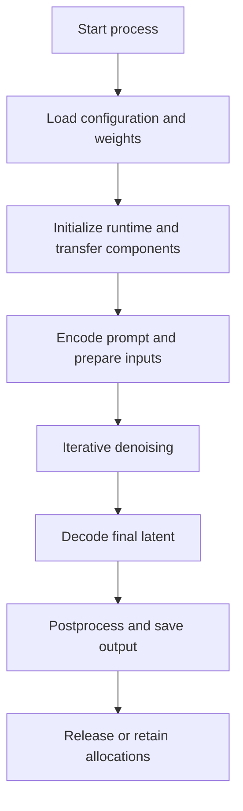

# Chapter 14: GPU, Memory, and Runtime Requirements

## Learning Objectives

By the end of this chapter, you should be able to:

- Separate model-weight memory from activations, temporary tensors, and component-loading overhead.
- Explain how precision, image resolution, batch size, and architecture affect runtime memory.
- Compare CPU inference, GPU inference, and supported offloading strategies.
- Identify implementation-dependent memory optimizations such as efficient attention, slicing, tiling, and quantization.
- Measure initialization, denoising, and decoding separately.
- Record peak memory where available without relying on universal hardware estimates.

<br/>

## 1. Why Resource Requirements Are More Than Model Size

A model's parameter count or checkpoint file size is only one part of its inference resource requirements. Image generation also allocates memory for intermediate tensors, conditioning representations, temporary operations, decoded images, and sometimes multiple components loaded at once.

For practical capacity planning, distinguish at least four categories:

1. **Model weights:** parameters for the denoiser, text encoder(s), autoencoder/VAE, and other required components.
2. **Activations and intermediate tensors:** latent states, attention representations, conditioning embeddings, and other tensors used during inference.
3. **Temporary workspace:** buffers and scratch memory used by attention kernels, matrix operations, convolutions, and memory allocators.
4. **Loading and orchestration overhead:** temporary copies during loading, host-to-device transfers, cached objects, preprocessing, and framework/runtime allocations.

These categories overlap in time and depend on implementation. They should be treated as a mental model for diagnosis, not as a universal additive formula.

<br/>

### 1.1 Memory lifecycle



The memory peak may occur during loading, denoising, or decoding. The stage with the longest runtime is not necessarily the stage with the highest memory use.

<br/>

## 2. The Main Sources of Memory Use

### 2.1 Model weights

Weight memory depends on parameter count, storage format, and runtime representation. A rough lower-bound estimate for raw parameter storage is:

$$
M_{\text{weights}} \approx N_{\text{parameters}} \times B_{\text{parameter}}
$$

where $B_{\text{parameter}}$ is the number of bytes per stored parameter. For example, a 16-bit representation uses approximately two bytes per parameter, while a 32-bit representation uses approximately four bytes. This estimate excludes configuration objects, non-parameter buffers, temporary copies, allocator overhead, and other components.

For a multi-component pipeline, the relevant weights may include:
- One or more text encoders.
- The denoiser.
- A VAE or autoencoder.
- Optional adapters or additional conditioning models.
- Safety or image-processing components, when included.

Some pipelines keep all components on the accelerator; others move components between host and device memory or load them on demand.

<br/>

### 2.2 Activations and intermediate tensors

During inference, the pipeline creates intermediate values even though gradients are usually not being stored for backpropagation. Examples include:
- Prompt embeddings and attention masks.
- Latent tensors at each denoising step.
- Attention and convolution intermediates.
- Conditional and unconditional predictions when classifier-free guidance is used.
- Control inputs, reference features, or multiple image-conditioned representations.

Inference commonly uses no-gradient execution, but intermediate activations still occupy memory while operations run.

<br/>

### 2.3 Temporary workspace and allocator overhead

Some operations need temporary workspace beyond the tensors directly visible in application code. GPU frameworks also use caching allocators, so memory reserved by the process may exceed memory occupied by currently live tensors.

This distinction matters when interpreting metrics:
- **Allocated memory** generally describes memory held by live framework tensors.
- **Reserved memory** generally describes memory managed by the framework allocator, including cached blocks.
- **Device-wide usage** may include other processes and non-framework allocations.

Exact metric definitions vary by framework. Always state which metric you measured.

<br/>

### 2.4 Loading and component-transfer overhead

Loading can temporarily require extra host RAM or GPU memory when weights are deserialized, converted to another dtype, or copied to a device. Loading a pipeline component-by-component, using low-memory loading paths, or offloading components may change this peak.

**Operational implication:** a pipeline may fit in GPU memory after initialization but still fail during loading—or the reverse may occur if a temporary loading peak is larger than steady-state inference.

<br/>

## 3. Precision and Memory

Precision affects weight storage and the memory footprint of many intermediate tensors, but the actual impact depends on the model, operators, hardware, and runtime.

| Precision | Typical storage per value | Potential benefits | Caveats |
|<br/>|<br/>:|<br/>|<br/>|
| FP32 | 4 bytes | Broad numerical compatibility | Larger memory footprint; may be slower on some accelerators |
| FP16 | 2 bytes | Lower storage and often faster GPU inference | Hardware/operator support and numerical behavior vary |
| BF16 | 2 bytes | Wider exponent range than FP16 | Support varies by device and operation |
| Quantized weights | Depends on scheme | Can reduce weight memory | Scales, zero-points, metadata, and compute support add overhead |

These sizes are nominal representations of a value, not a promise that the entire pipeline uses that precision. Some components or operations may use different dtypes. Quantization formats also have metadata and may not reduce activation memory.

<br/>

### 3.1 Precision trade-off

Precision selection should consider:
- Model compatibility.
- Hardware support.
- Peak memory.
- Latency and throughput.
- Output quality and stability.
- Whether some components remain in a higher precision.

Use a fixed prompt set and comparable settings to check for output changes. Do not assume that lower precision always produces a faster or better deployment on every device.

<br/>

## 4. Resolution, Batch Size, and Architecture

### 4.1 Image resolution

Increasing output width and height increases the number of output pixels:

$$
N_{\text{pixels}} = W \times H
$$

For a latent diffusion model, the denoiser often processes a lower-resolution latent representation. If the latent spatial dimensions scale proportionally with image dimensions, doubling both image width and height creates approximately four times as many latent spatial positions. This can increase memory and computation substantially, but the exact scaling depends on the architecture and operations used.

Attention implementations can have different memory complexity. Full attention over a sequence of length $L$ can involve intermediate relationships scaling on the order of $L^2$, while optimized kernels may avoid materializing the full attention matrix. Transformer-based and U-Net-based models can therefore respond differently to resolution changes.

<br/>

### 4.2 Batch size and number of images

Batch size is the number of images processed together in a generation batch. Increasing batch size often increases the number of simultaneously active tensors and therefore peak memory. It may improve throughput, but can also trigger out-of-memory errors.

Generating four images in one batch is not necessarily equivalent in memory behavior to generating four images sequentially. Sequential generation may reduce peak memory but can increase total wall-clock time.

<br/>

### 4.3 Architecture

Memory depends on more than parameter count:
- U-Net versus transformer-based denoiser.
- Width and depth of the network.
- Attention placement and implementation.
- Latent channel count and spatial resolution.
- One or multiple text encoders.
- Extra control networks, reference-image encoders, or adapters.
- VAE architecture and decode strategy.

Two models with similar checkpoint sizes can have different peak memory and latency.

<br/>

### 4.4 Guidance and conditioning

Classifier-free guidance may require both conditional and unconditional model predictions. Depending on implementation, the two branches may be processed together or separately. This can affect compute and memory.

ControlNet-style conditioning, reference-image adapters, and other controls may introduce extra model components or intermediate features. Measure the actual configured pipeline rather than extrapolating from the base model alone.

<br/>

## 5. CPU, GPU, and Offloading

### 5.1 CPU execution

CPU inference can be useful for:
- Functional testing.
- Small models or low-throughput workloads.
- Environments without a compatible accelerator.
- Debugging pipeline integration.

It is often slower for large image-generation models than GPU inference, but the difference depends on hardware, implementation, precision, and workload. CPU memory is still finite, and a pipeline can run out of system RAM.

<br/>

### 5.2 GPU execution

GPUs are designed for parallel tensor operations and commonly provide much higher throughput for diffusion inference. However, the pipeline must fit within available device memory or use a supported memory strategy.

GPU performance depends on:
- GPU architecture and VRAM capacity.
- Supported precision and kernels.
- Framework and driver versions.
- Resolution, batch size, denoising steps, and conditioning.
- Concurrent workloads and device utilization.

<br/>

### 5.3 Model/component offloading

**Offloading** moves some components or tensors between CPU RAM and GPU VRAM to reduce accelerator memory use. For example, a pipeline may keep inactive components on the CPU and transfer them to the GPU when needed.

Benefits:
- Enables some workloads on GPUs with limited VRAM.
- Reduces the amount of model state resident on the GPU at once.

Costs:
- Transfer overhead can increase latency.
- System RAM and memory bandwidth become important.
- Behavior depends on the library and pipeline; not every component supports every offloading mode.

Use documented offloading features for the selected pipeline and test them under realistic conditions.

<br/>

### 5.4 Sequential versus model CPU offloading

Libraries may offer different offloading strategies. Broadly, one strategy moves whole components when they are needed, while a more aggressive sequential strategy may move smaller model pieces. The lower-memory option can be slower due to more transfers. Exact names and behavior are library-version dependent; consult current documentation.

<br/>

## 6. Memory-Efficient Implementation Options

These techniques are not universal switches. Availability, compatibility, and benefit depend on the model, library, hardware, and runtime.

### 6.1 Memory-efficient attention

Optimized attention kernels can reduce memory traffic and avoid materializing large intermediate attention matrices. They may improve speed as well as memory use, but depend on hardware and software support.

Check:
- Whether the library selects an optimized backend automatically.
- Whether the model's attention implementation supports it.
- Whether the chosen dtype and hardware are compatible.
- Whether a fallback occurs silently or with a warning.

<br/>

### 6.2 Attention slicing

Attention slicing processes attention computations in smaller pieces. It can reduce peak memory in supported implementations, but may increase latency. It may be unnecessary or slower when an efficient attention kernel is already active.

<br/>

### 6.3 VAE slicing and tiling

- **VAE slicing** can process multiple images in a batch separately during VAE operations, reducing peak memory in supported implementations.
- **VAE tiling** can decode or encode spatial regions in tiles to reduce memory for high-resolution images.

Tiling can introduce boundary artifacts or subtle changes depending on overlap and implementation. Validate visual quality after enabling it. These features are not interchangeable: slicing addresses batch-related VAE memory, while tiling addresses spatial memory.

<br/>

### 6.4 Quantization

Quantization stores some or all weights in lower-bit representations. It may reduce weight memory and sometimes improve inference efficiency, but it does not automatically reduce all activations or temporary buffers.

Check:
- Which components are quantized.
- Quantization scheme and metadata overhead.
- Supported hardware and kernels.
- Quality impact.
- Compatibility with adapters and other components.
- Whether the loader dequantizes weights or creates extra copies.

<br/>

### 6.5 Resolution, batch size, and sequential work

When memory is insufficient, practical options include reducing resolution, generating fewer images per batch, or processing images sequentially. These choices can reduce memory at the cost of output size, throughput, or total elapsed time.

<br/>

## 7. Measure Initialization, Denoising, and Decoding Separately

A single end-to-end runtime hides useful information. Separate the phases:

1. **Initialization/loading:** read model artifacts, construct components, initialize runtime, and transfer weights.
2. **Input preparation:** tokenize and encode the prompt, prepare image inputs or masks, and create initial latents.
3. **Denoising:** perform the iterative sampling loop.
4. **Decoding:** convert final latents to pixels through the VAE or decoder.
5. **Postprocessing and saving:** convert formats, resize, encode, and write output.

The exact boundaries depend on the library. Some pipelines combine several phases inside one call, so instrumentation or callbacks may be needed to isolate them.

<br/>

### 7.1 Why warm-up matters

The first run may include kernel selection, compilation, lazy initialization, cache population, or device setup. Report cold-start and warm-run performance separately when they matter to the application.

Use multiple runs and report the measurement method. Do not compare one cold run from one model with a warmed-up run from another.

<br/>

### 7.2 Measuring CUDA time correctly

GPU work is asynchronous. A host-language timer may measure only the time spent enqueueing work unless you synchronize or use GPU events. Synchronization itself adds overhead, so use a consistent measurement procedure.

<br/>

### 7.3 Example: phase and peak-memory measurement

The following is a **measurement pattern** for a compatible CUDA Diffusers pipeline. Pipeline internals vary, so the timing around the call measures the entire generation call, not a guaranteed separation of denoising and VAE decoding.

```python
import time
import torch
from diffusers import DiffusionPipeline

model_id = "publisher/model-repository"
revision = "PINNED_COMMIT_OR_VERSION"

def cuda_memory_gb():
    return {
        "allocated_gb": torch.cuda.memory_allocated() / (1024 ** 3),
        "reserved_gb": torch.cuda.memory_reserved() / (1024 ** 3),
        "peak_allocated_gb": torch.cuda.max_memory_allocated() / (1024 ** 3),
        "peak_reserved_gb": torch.cuda.max_memory_reserved() / (1024 ** 3),
    }

load_start = time.perf_counter()
pipe = DiffusionPipeline.from_pretrained(
    model_id,
    revision=revision,
    torch_dtype=torch.float16,
)
pipe = pipe.to("cuda")
torch.cuda.synchronize()
load_seconds = time.perf_counter() - load_start

# Warm-up separately if the benchmark requires it.
torch.cuda.reset_peak_memory_stats()
torch.cuda.synchronize()
generation_start = time.perf_counter()

result = pipe(
    prompt="A white owl perched on a branch in a misty forest",
    num_inference_steps=20,
)

torch.cuda.synchronize()
generation_seconds = time.perf_counter() - generation_start
memory = cuda_memory_gb()

result.images[0].save("measured_output.png")

print({
    "load_seconds": load_seconds,
    "generation_call_seconds": generation_seconds,
    **memory,
})
```

**Interpretation cautions**
- Resetting peak statistics after loading measures a later phase's peak; it does not capture the loading peak.
- The code records peak allocated and reserved memory for the measured generation phase, not necessarily total device-wide memory.
- A process may already hold cached allocations before statistics are reset.
- The generation-call timing may include input preparation, denoising, decoding, and postprocessing.
- For separate denoising/decode measurements, use documented callbacks or instrument the pipeline at appropriate phase boundaries. Do not assume a callback measures every internal operation.
- For loading peak, sample memory during loading or use external device monitoring; a post-load snapshot cannot reconstruct the earlier peak.

<br/>

## 8. Practice: Resource Measurement Record

**Task:** Generate one small image using a compatible model and record the actual environment and measurements. Do not rely on generic estimates.

### 8.1 Record hardware and software

| Field | Value to record |
|<br/>|<br/>|
| CPU | Model and core count, if available |
| System RAM | Installed and available memory |
| GPU/accelerator | Exact device model |
| VRAM | Total capacity and available capacity before run |
| OS and driver | Version information |
| Python and library versions | Python, PyTorch, Diffusers, related packages |
| Model | Repository and pinned revision |
| Precision | FP32, FP16, BF16, or documented quantization |
| Runtime mode | CPU, GPU, or offloading strategy |

<br/>

### 8.2 Record generation configuration

| Field | Value |
|<br/>|<br/>|
| Prompt | Exact prompt used |
| Width × height | Actual output dimensions |
| Batch size | Number of images generated together |
| Inference steps | Actual step count |
| Guidance | Value and method, if applicable |
| Seed | Fixed seed if supported |
| Memory optimizations | Efficient attention, slicing, tiling, quantization, offloading |
| Output format | PNG, JPEG, or other actual format |

<br/>

### 8.3 Record measurements

| Measurement | Result |
|<br/>|<br/>|
| Model initialization/loading time |  |
| Warm-up time |  |
| Input preparation time |  |
| Denoising time |  |
| VAE decoding time |  |
| Postprocessing/save time |  |
| End-to-end latency |  |
| Peak GPU allocated memory |  |
| Peak GPU reserved memory |  |
| Device-wide peak memory, if measured |  |
| Peak system RAM, if measured |  |
| Errors or warnings |  |

If the library does not expose a phase directly, write “not measured” rather than inventing a value. State the measurement method and whether the value is cold-start, warm-run, per-image, or per-batch.

<br/>

### 8.4 Experiment plan

Run a controlled comparison changing one variable at a time:
- Precision.
- Resolution.
- Batch size.
- Inference step count.
- One supported memory optimization.

Keep other settings fixed and record output quality as well as resource use. A lower-memory configuration is not automatically better if it makes the output unacceptable or increases latency beyond the application's budget.

<br/>

## 9. Common Resource-Management Mistakes

| Mistake | Why it misleads | Better approach |
|<br/>|<br/>|<br/>|
| Estimating VRAM from checkpoint size alone | Ignores activations, temporary workspace, and extra components | Measure peak memory on the actual pipeline |
| Assuming all 16-bit models use half the total memory | Only some weights and tensors may use that dtype | Inspect component dtypes and measure runtime behavior |
| Reporting allocated memory as total GPU use | Framework allocation may omit other processes and non-framework allocations | Name the metric and use device-wide monitoring when needed |
| Timing only the Python call without synchronization | GPU work may continue after the timer stops | Synchronize consistently or use GPU events |
| Mixing loading time with generation time | Hides cold-start and steady-state behavior | Measure phases separately |
| Reducing steps to fix an OOM | Step count often affects repeated work more than per-step peak tensor size | Reduce resolution/batch or use supported memory strategies; test actual peak |
| Enabling every optimization | Features may conflict, be redundant, or slow execution | Change one option at a time and benchmark |
| Comparing different prompts or settings | Confounds the resource comparison and output quality | Use fixed prompts, seeds, and comparable settings |
| Assuming CPU offloading always helps | Transfers can add latency and system RAM pressure | Measure speed and peak memory on the target machine |
| Quoting a universal GPU requirement | Model family, resolution, precision, and implementation differ | Report the tested configuration and measured results |

<br/>

## 10. Checkpoint Answer

**Question:** Why may reducing sampling steps reduce runtime without proportionally reducing peak memory?

**Answer:**

Sampling steps control how many denoising iterations the pipeline performs. Reducing the step count usually reduces the number of repeated denoiser evaluations, so total computation and elapsed denoising time often decrease.

However, the memory required during an individual denoising step is largely determined by the model weights resident at that time, latent and conditioning tensor shapes, attention implementation, batch size, precision, and temporary workspace. If those factors remain unchanged, each step may require nearly the same peak memory even when fewer steps are executed.

Therefore, fewer steps can reduce total runtime without proportionally reducing peak memory. Actual behavior can vary with scheduler, caching, compilation, and implementation. To address a memory-limit failure, measure the peak and consider resolution, batch size, precision, component offloading, or a supported memory-efficient implementation—not just the number of sampling steps.

<br/>

## 11. Essential References

Use documentation for the exact model and library version being tested. Optimization APIs and their performance can vary across releases and hardware.

- Hugging Face Diffusers — Memory and speed: https://huggingface.co/docs/diffusers/optimization/memory
- Hugging Face Diffusers — Loading pipelines and model variants: https://huggingface.co/docs/diffusers/using-diffusers/loading
- PyTorch — CUDA semantics: https://docs.pytorch.org/docs/stable/notes/cuda.html
- PyTorch — CUDA memory management: https://docs.pytorch.org/docs/stable/notes/cuda.html#memory-management
- PyTorch — Automatic mixed precision: https://docs.pytorch.org/docs/stable/amp.html
- PyTorch — `torch.cuda` API: https://docs.pytorch.org/docs/stable/cuda.html

**Chapter takeaway:** resource requirements are properties of the complete model configuration and runtime, not just the checkpoint. Measure loading, generation, decoding, and peak memory on the target hardware, and report the settings that produced those measurements.
