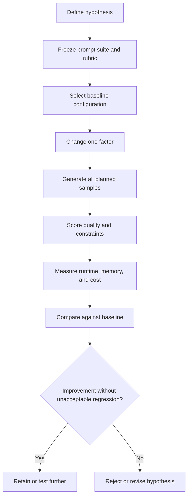

# Chapter 15: Image Quality, Prompt Adherence, and Trade-offs

## Learning Objectives

By the end of this chapter, you should be able to:

- Define a repeatable rubric for visual quality, prompt adherence, composition, and preservation during edits.
- Test difficult capabilities such as text rendering, counting, spatial relations, anatomy, and repeated patterns.
- Compare multiple outputs instead of relying on one favorable sample.
- Run controlled experiments that change one factor at a time and record regressions as well as improvements.
- Explain the limits of automated similarity metrics and model-based judges.
- Evaluate image quality alongside runtime, memory, cost, and reproducibility.

 

## 1. What Does “Image Quality” Mean?

Image quality is not a single universal property. A result can look attractive while failing the prompt, or satisfy the requested content while having visible artifacts. Evaluation should distinguish **aesthetic preference** from **task completion**.

For example, a beautifully composed image of one bird does not complete a request for exactly three birds. A visually polished edit that changes the subject's identity may fail a preservation requirement.

A practical evaluation separates several dimensions:

1. **Visual quality:** clarity, coherence, artifacts, lighting, texture, and overall finish.
2. **Prompt adherence:** whether requested objects, attributes, actions, and scene details are present.
3. **Composition and spatial relations:** placement, orientation, relative size, and relationships among objects.
4. **Constraint satisfaction:** counts, text, colors, exclusions, aspect ratio, and other explicit requirements.
5. **Edit preservation:** whether content outside the intended edit region remains sufficiently unchanged.
6. **Operational performance:** latency, memory, cost, reliability, and reproducibility.

The weights assigned to these dimensions depend on the application. Product visualization, concept art, image editing, and document illustration may require different evaluation priorities.

 

## 2. Build a Task-Specific Evaluation Rubric

A useful rubric defines observable criteria before inspecting the outputs. Avoid vague labels such as “good image” without specifying what good means for the task.

### 2.1 Example scoring scale

Use a five-point scale for each criterion:

| Score | Interpretation |
| :| |
| 1 | Major failure; requirement is absent or unusable |
| 2 | Significant errors; requirement is only weakly satisfied |
| 3 | Partial success; noticeable defects or omissions remain |
| 4 | Good result; minor defects that do not prevent intended use |
| 5 | Strong result; requirement is clearly and consistently satisfied |

Add **N/A** when a criterion does not apply. Define the rubric before comparing configurations, and apply the same definitions to every output.

 

### 2.2 Core rubric dimensions

| Dimension | What to inspect | Example evidence |
| | | |
| Visual quality | Coherence, sharpness, artifacts, lighting, textures | No obvious malformed regions or distracting artifacts |
| Requested objects | Presence and identity of requested objects | All named objects appear |
| Attributes | Color, material, size, clothing, state, and other modifiers | The specified red umbrella is red |
| Actions and relationships | Who is doing what and how objects relate | The person is holding the umbrella, not standing beside it |
| Composition | Framing, relative position, orientation, scale | The smaller object is visibly behind the larger object |
| Text rendering | Spelling, legibility, exact wording, placement | All requested words are legible and correctly spelled |
| Counting | Exact number of objects | Exactly four cups are visible |
| Anatomy and structure | Plausible body parts, joints, hands, faces, object geometry | No obvious extra or fused limbs |
| Repeated patterns | Consistent repeated objects, symmetry, grids, textures | Repeated windows or tiles follow the intended pattern |
| Edit preservation | Similarity of protected regions and identity | Background and subject outside the mask remain stable |
| Constraint compliance | Explicit exclusions and format requirements | No unwanted logos; requested aspect ratio is used |

Not every criterion should be averaged into one score. If exact text, a specific object count, or preservation is a hard requirement, treat it as a pass/fail gate in addition to reporting the rubric score.

 

### 2.3 Hard constraints versus preferences

Separate:
- **Hard constraints:** mandatory requirements, such as exact wording, no extra objects, a required product feature, or an unchanged protected region.
- **Soft preferences:** subjective qualities such as mood, artistic style, dramatic lighting, or visual elegance.

A high aesthetic score should not compensate for a failed hard constraint when that constraint determines whether the image is usable.

 

## 3. Evaluate Difficult Prompt Capabilities

### 3.1 Text rendering

Test text rendering with:
- Exact short phrases.
- Mixed capitalization and punctuation.
- Similar-looking characters.
- Text placement and line breaks.
- Multiple text regions, if relevant.

Score spelling, character accuracy, legibility, and placement separately. An image can resemble the intended typography while containing incorrect letters. For high-stakes or production text, consider generating the image without text and compositing verified text with a conventional rendering tool.

 

### 3.2 Counting

Counting prompts should specify a clear number and distinguishable objects, for example, “exactly five blue ceramic cups.” Inspect:
- Whether the number is correct.
- Whether objects overlap or are partially hidden.
- Whether one object is duplicated or fused.
- Whether extra instances appear in the background.

A model may produce a plausible scene but fail exact cardinality. Use several prompts and seeds because one successful sample is not evidence of consistent counting.

 

### 3.3 Spatial relations

Use prompts that state observable relations, such as:
- “A small vase to the left of a large book.”
- “A red ball inside a transparent box.”
- “A person standing behind a chair.”

Check the relation itself, not just the presence of the two objects. Define viewpoint-sensitive terms carefully; “left” can mean the viewer's left or the subject's left.

 

### 3.4 Anatomy and structured objects

Inspect hands, faces, limbs, joints, reflections, and object geometry where they are relevant to the prompt. Score visible defects and task impact rather than treating every unusual style choice as an error.

For a task involving a stylized character, realistic anatomy may not be the goal. The rubric should reflect the intended visual style and use case.

 

### 3.5 Repeated patterns

Evaluate repeated structures such as windows, fence posts, tiles, product labels, buttons, or rows of objects. Look for:
- Missing or extra elements.
- Inconsistent spacing or scale.
- Broken symmetry or alignment.
- Pattern discontinuities.
- Repeated details that change unexpectedly.

These cases are useful stress tests because local visual plausibility can hide global consistency errors.

 

### 3.6 Image editing and preservation

For image-to-image, inpainting, or outpainting, evaluate both the intended change and what should remain unchanged.

Ask:
- Did the requested edit occur?
- Did the subject's identity or defining features change?
- Did pixels outside the intended region change unnecessarily?
- Are the edit boundaries visible?
- Are lighting, perspective, and texture consistent with the surrounding image?

A low pixel difference is not always desirable: the target region is supposed to change. Measure protected regions separately from edited regions.

 

## 4. Compare Multiple Outputs Fairly

A diffusion model can produce different results for the same prompt due to different random seeds, stochastic sampling, or runtime differences. Selecting only the most attractive sample creates selection bias.

### 4.1 Use a fixed prompt suite

Create a small set of prompts that represent the actual workload. Include:
- Typical requests.
- Complex prompts with several objects and attributes.
- Exact counts and spatial relations.
- Text rendering, if relevant.
- Negative or exclusion constraints, if supported.
- Editing cases with protected regions, if relevant.

Keep prompts unchanged when comparing two configurations.

 

### 4.2 Use multiple seeds

For each prompt and configuration, generate multiple samples using a predetermined seed list where the pipeline supports reproducible seeds. Report the number of attempts and the rate of hard-constraint success.

If a hosted service does not expose a seed or model revision, document that limitation. Reproducibility may be weaker than in a local pipeline.

 

### 4.3 Avoid cherry-picking

Report:
- All outputs, or a predefined representative sample.
- The number of prompts and samples tested.
- Mean or median scores where appropriate.
- Variation across prompts and seeds.
- Hard-constraint pass rate.
- Failure examples, not only successful examples.

For small samples, show individual scores rather than presenting an average as definitive evidence.

 

### 4.4 Example experiment layout

| Prompt ID | Configuration | Seed | Visual quality | Prompt adherence | Composition | Hard constraints pass? | Notes |
| | | :| :| :| :| | |
| P01 | A | 101 |  |  |  |  |  |
| P01 | A | 202 |  |  |  |  |  |
| P01 | B | 101 |  |  |  |  |  |
| P01 | B | 202 |  |  |  |  |  |

For stochastic services, identical seed values may not be supported or may not produce equivalent behavior across providers. In that case, compare a sufficiently large set of outputs under the same request policy and document the difference.

 

## 5. Controlled Experiments: One Factor at a Time

When evaluating quality, change one factor at a time where feasible. Potential factors include:
- Prompt wording.
- Model checkpoint or adapter.
- Sampler or scheduler.
- Number of inference steps.
- Guidance scale.
- Resolution.
- Image-to-image strength.
- Control or adapter strength.
- Precision or memory optimization.

Keep other settings fixed and record both improvements and regressions. For example, increasing guidance may improve the visibility of prompt attributes while making the image less natural or increasing artifacts. More inference steps may improve some details while increasing latency.

 

### 5.1 Experiment record

For each run, record:
- Hypothesis.
- Configuration changed.
- Settings held constant.
- Prompt suite and seeds.
- Quality scores and hard-constraint outcomes.
- Latency and peak memory.
- Cost, if applicable.
- Unexpected regressions.
- Decision and remaining uncertainty.

 

### 5.2 Beware of confounding

If model, resolution, seed, sampler, and guidance all change at once, it is difficult to identify why the results differ. For a broad comparison, some settings may need to be model-specific; document those deviations and avoid claiming that a single variable caused the outcome.

 

## 6. Automated Metrics: Useful but Incomplete

Automated metrics can support evaluation at scale, but no single metric fully measures image quality or task success.

### 6.1 Similarity and distribution metrics

Depending on the evaluation goal, teams may consider:
- **CLIP-style image-text similarity:** estimates alignment between an image and text in a learned embedding space.
- **FID (Fréchet Inception Distance):** compares feature distributions of generated and reference image sets.
- **Image similarity measures:** compare images at pixel or feature level.
- **OCR-based checks:** assess text recognized from generated images.
- **Object detectors or counting tools:** estimate the presence and number of target objects.
- **Segmentation or keypoint tools:** evaluate spatial or structural properties.
- **Human ratings or structured expert review:** judge qualities not captured reliably by automated metrics.

Each method measures a limited proxy. Choose metrics based on the task, and validate them against human judgments or ground-truth requirements where possible.

 

### 6.2 Important limitations

**CLIP-style similarity**
- May reward broad semantic similarity without verifying exact attributes or relations.
- A high score does not guarantee exact object count or correctly rendered text.
- Scores can vary with the encoder, preprocessing, prompt phrasing, and normalization.

**FID**
- Is a distribution-level metric, not a direct per-image task-completion score.
- Requires an appropriate reference set and enough samples for meaningful estimates.
- Can be misleading if the reference distribution does not match the intended use case.
- Does not tell you whether a specific output obeyed a particular prompt.

**Pixel similarity**
- Can penalize legitimate changes in image editing.
- Can miss semantic errors when images are visually similar at the pixel level.
- Is sensitive to alignment, resizing, and small shifts.

**OCR and vision models**
- Can fail on stylized text, small objects, occlusion, unusual viewpoints, or domain-specific imagery.
- May make correlated errors if the evaluator shares limitations with the generator.

 

### 6.3 Model-based judges

A vision-language model can score images against a rubric or compare candidates. This can scale evaluation, but its judgments may be sensitive to phrasing, position, visual salience, and evaluator model limitations.

Good practice:
- Use a fixed rubric and structured output schema.
- Blind the judge to candidate identity when possible.
- Randomize presentation order for pairwise comparisons.
- Include human-reviewed calibration examples.
- Measure agreement between the judge and human raters.
- Preserve image evidence and judge rationales for audit.
- Avoid treating fluent explanations as proof that a score is correct.

When evaluation is important, use a combination of automated checks, human review, and task-specific pass/fail tests.

 

## 7. Quality Versus Runtime, Memory, Cost, and Reproducibility

A model should be selected against the application's requirements, not by quality alone.

| Dimension | What to measure | Example trade-off |
| | | |
| Visual quality | Rubric scores and failure rate | More detail may not improve correctness |
| Prompt adherence | Required-object/attribute and relation pass rates | Stronger adherence may introduce artifacts |
| Runtime | Cold-start, warm latency, and throughput | More steps may increase latency |
| Memory | Peak allocated/reserved and device-wide usage where measurable | Larger resolution can exceed VRAM |
| Cost | Cost per image or batch | Higher-quality configuration may be too expensive at scale |
| Reproducibility | Repeatability under pinned versions/settings | Hosted model aliases may change behind a stable endpoint |
| Reliability | Error rate and variability across samples | Best-case outputs can hide frequent failures |
| Operational complexity | Dependencies, maintenance, and instrumentation | Local control can increase engineering burden |

 

### 7.1 Define acceptance criteria before testing

Example acceptance criteria might include:
- At least a target proportion of outputs satisfy all hard constraints.
- Median visual-quality score meets a predefined threshold.
- p95 latency remains below the application budget.
- Peak memory fits within available hardware capacity.
- Cost per image remains within budget.
- Required provenance and reproducibility metadata are recorded.

Set thresholds for the actual application; do not use these example categories as universal numeric standards.

 

### 7.2 Decision principle

A configuration that produces one outstanding sample but fails frequently may be less useful than one with slightly lower aesthetic scores and consistently correct outputs. Prefer the configuration that satisfies hard constraints and meets quality, performance, cost, and reliability targets together.

 

## 8. Practice: Score a Fixed Prompt Suite Under Two Configurations

**Task:** Compare configurations A and B using the same rubric and prompt suite.

### Step 1 — Define the prompt suite

Choose 5–10 prompts from your intended use case. Include at least:
- One ordinary prompt.
- One multi-object prompt with specific attributes.
- One exact-count or spatial-relation prompt.
- One difficult text or repeated-pattern prompt, if relevant.
- One edit-preservation prompt, if the system supports editing.

 

### Step 2 — Freeze the test conditions

Record model/revision, prompt, seed where supported, resolution, batch size, sampler, steps, guidance, and any adapters or controls. If a setting is not available in one configuration, mark it as unsupported rather than silently substituting an equivalent.

 

### Step 3 — Score outputs

Use the same rubric for every image.

| Criterion | Score 1–5 or N/A | Evidence to record |
| | :| |
| Visual quality |  | Artifacts, coherence, detail |
| Requested objects present |  | Missing or extra objects |
| Attributes correct |  | Colors, materials, states |
| Actions/relations correct |  | Observable spatial or action evidence |
| Composition |  | Framing and placement |
| Text/count/pattern correctness |  | Exact failures and pass/fail |
| Preservation (if applicable) |  | Changes outside intended region |
| Overall task completion |  | Hard constraints satisfied? |

 

### Step 4 — Measure operational cost

Record cold-start and warm latency, peak memory where measurable, cost per image, error rate, and the measurement method. Do not compare hardware metrics from different devices as if they were directly equivalent.

 

### Step 5 — Summarize

| Result | Configuration A | Configuration B |
| | | |
| Number of outputs tested |  |  |
| Hard-constraint pass rate |  |  |
| Mean/median visual-quality score |  |  |
| Mean/median prompt-adherence score |  |  |
| Most frequent failure |  |  |
| Warm latency per image |  |  |
| Peak memory and method |  |  |
| Estimated cost per image |  |  |
| Reproducibility limitations |  |  |
| Recommendation |  |  |

Write a short decision statement: which configuration meets the acceptance criteria, which requirements remain weak, and what additional experiment would reduce uncertainty?

 

## 9. Common Evaluation Mistakes

| Mistake | Why it fails | Better practice |
| | | |
| Choosing the prettiest image | Ignores whether it fulfills the task and how often it succeeds | Score task completion separately from aesthetics |
| Using one seed or one prompt | Results may be unrepresentative | Use a fixed suite and multiple samples |
| Changing several settings at once | Creates confounding | Change one factor at a time when feasible |
| Using only one automated metric | A proxy cannot cover every failure mode | Combine task-specific checks, metrics, and human review |
| Averaging away hard failures | A high average can hide unusable outputs | Report hard-constraint pass rates separately |
| Using a model judge without calibration | The evaluator may share systematic biases | Calibrate against human-reviewed examples |
| Comparing outputs at different resolutions | Quality and runtime comparisons are confounded | Match conditions or explicitly document deviations |
| Ignoring failed requests | Success-only analysis overstates reliability | Include failures and retries in operational metrics |
| Reporting only mean scores | Variability and worst-case failures disappear | Report distributions, medians, pass rates, and examples |
| Ignoring cost and memory | A quality gain may be operationally impractical | Evaluate the full quality-performance-cost trade-off |

 

## 10. Checkpoint Answer

**Question:** How do you separate aesthetic preference from task completion and evidence of consistent performance?

**Answer:**

Evaluate them as separate dimensions.

- **Aesthetic preference** concerns qualities such as style, visual balance, lighting, and appeal. It may be subjective and should use a defined rubric or preference protocol.
- **Task completion** checks observable requirements: requested objects and attributes, exact counts, text, spatial relations, exclusions, and preservation constraints. Hard requirements should have explicit pass/fail outcomes.
- **Consistent performance** measures how often the configuration succeeds across a predefined prompt suite and multiple samples, including failure rates and score variation. One favorable image is not evidence of reliability.

Use the same rubric and test conditions for competing configurations. Report individual failures, aggregate scores, hard-constraint pass rates, and operational measurements such as latency, memory, and cost. Automated metrics and model-based judges can support the assessment, but their limitations should be validated against task-specific checks and human review where appropriate.

 

## 11. Essential References

- Hugging Face Diffusers — Evaluation and optimization documentation: https://huggingface.co/docs/diffusers/index
- CLIP paper — Learning Transferable Visual Models From Natural Language Supervision: https://arxiv.org/abs/2103.00020
- FID paper — GANs Trained by a Two Time-Scale Update Rule (introduces the commonly used FID evaluation approach): https://arxiv.org/abs/1706.08500
- ImageReward paper — Learning and Evaluating Human Preferences for Text-to-Image Generation: https://arxiv.org/abs/2304.05977
- Pick-a-Pic paper — An Open Dataset of User Preferences for Text-to-Image Generation: https://arxiv.org/abs/2305.01569
- Hugging Face Evaluate: https://huggingface.co/docs/evaluate/index

Metric implementations and evaluation conventions can differ. Record the implementation, preprocessing, sample count, reference dataset, and version when reporting results.

**Chapter takeaway:** image-generation quality is multidimensional. Measure aesthetic quality, task adherence, hard constraints, consistency, and operational cost separately; use controlled experiments and multiple outputs to support a defensible model-selection decision.
