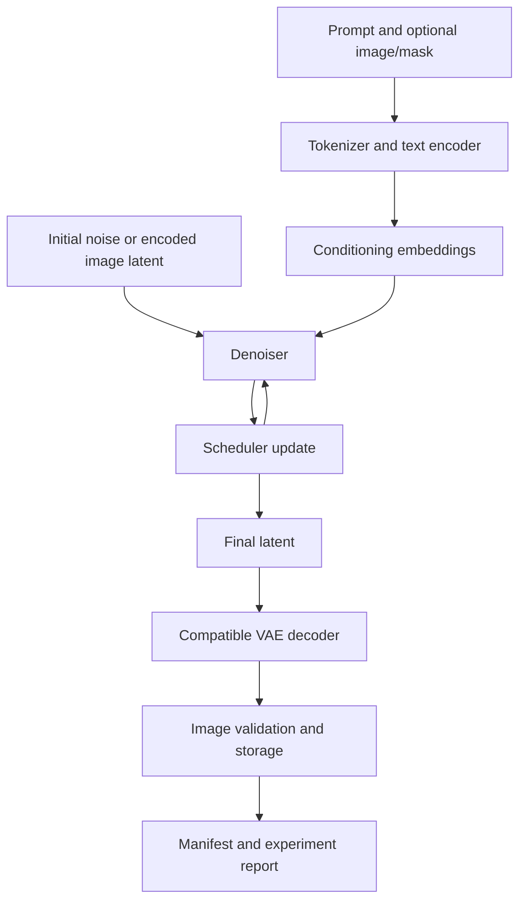

# Chapter 18: Practice and Revision

## Chapter Purpose

This chapter consolidates the main ideas from Image Generation with Diffusion Models. It is designed as a practical revision and decision-making exercise, not as a replacement for the earlier chapters.

By completing the chapter, you should be able to:

- Explain the generation pipeline from prompt encoding through denoising and image decoding.
- Compare noise schedules, samplers, guidance settings, and editing controls.
- Select compatible model components and justify hosted versus local execution.
- Evaluate prompt adherence, preservation, visual quality, runtime, memory, and cost.
- Produce an evidence-based experiment report and defend a configuration choice.

 

## 1. Review the End-to-End Generation Pipeline

A typical latent diffusion text-to-image workflow contains several coordinated stages:

1. **Prompt processing:** tokenize the prompt and produce text-conditioning embeddings.
2. **Latent initialization:** create an initial latent state, often from random noise.
3. **Iterative denoising:** use a denoiser and scheduler to update the latent over a sequence of timesteps.
4. **Guidance and conditioning:** incorporate prompt information and any supported structural or reference-image controls.
5. **Decoding:** use the compatible autoencoder/VAE decoder to map the final latent into image space.
6. **Postprocessing:** convert, validate, and save the image and its provenance record.

The exact components differ by model family and task. Image-to-image and inpainting also use reference-image latents and, for inpainting, a mask or other supported edit representation.

 

### Revision questions

- What is the difference between the denoiser and the scheduler?
- Why does a latent diffusion model need a compatible decoder?
- How does a text encoder influence the denoiser's output?
- Which parts of this workflow are exposed by a hosted API, and which may be available only in a local pipeline?

 

## 2. Theory, Architecture, Latent Representations, and Conditioning

### 2.1 Diffusion theory

During training, a diffusion model learns to reverse a process that progressively corrupts data with noise. During inference, the model starts from noise or a noisy latent and repeatedly updates it toward a sample.

Important distinctions:
- The **training noise schedule** defines how noise levels are represented during training.
- The **inference timestep schedule** selects which noise levels are visited during sampling.
- The **sampler or scheduler algorithm** determines how model predictions update the current sample.

These concepts are related but not interchangeable.

 

### 2.2 Denoiser architecture

The denoiser predicts a quantity used by the sampling process. Depending on the model, this may be noise, a clean sample, velocity, or another parameterization.

The architecture may be U-Net-based, transformer-based, or another documented design. It expects particular latent shapes, conditioning interfaces, and configuration fields. A compatible architecture is required; a model name or tensor shape alone does not establish full compatibility.

 

### 2.3 Latent representation

In latent diffusion, an autoencoder/VAE maps images to a compressed latent representation and decodes final latents back into pixels. Latent scaling and channel conventions matter. The text embeddings are not the same as image latents: they serve as conditioning inputs to the denoiser.

 

### 2.4 Conditioning

Conditioning can include:
- Text embeddings.
- Negative-prompt embeddings, where supported.
- Reference-image features.
- Edge, depth, pose, segmentation, or other structural conditions.
- Masks and edit-strength controls.

Not every model or API supports every condition. Confirm the exact pipeline contract and model documentation.

 

### Revision task

Draw or explain the data flow for:
1. Text-to-image.
2. Image-to-image.
3. Inpainting.

For each workflow, identify the initial state, conditioning inputs, denoising component, scheduler, decoder, and output-validation steps.

 

## 3. Compare Schedules, Samplers, and Guidance

### 3.1 Controlled comparison

Choose a fixed prompt suite and seed list where supported. Compare two documented sampler/scheduler configurations, or two supported inference timestep settings. Keep resolution, prompt, model revision, and other settings fixed where possible.

Record:
- Model and revision.
- Scheduler name and configuration.
- Number of inference steps.
- Guidance method and scale, if exposed.
- Prompt and seed.
- Quality and hard-constraint outcomes.
- Generation latency and peak memory where measurable.

 

### 3.2 Guidance trade-offs

Classifier-free guidance combines conditional and unconditional predictions in a supported implementation. Guidance can strengthen prompt influence, but increasing it does not guarantee improved output. It may introduce artifacts, reduce diversity, or make the image look less natural.

 

### 3.3 Sampling-step trade-offs

More steps can increase runtime because the denoiser is evaluated repeatedly. They do not necessarily improve every output. Peak memory may remain similar when the model, resolution, batch size, precision, and per-step tensor shapes remain unchanged.

 

### Revision table

| Factor | What it changes | What to measure |
| | | |
| Noise/timestep schedule | Which noise levels are visited and how they are represented | Quality, stability, latency |
| Sampler algorithm | How predictions update the sample | Quality, runtime, artifacts |
| Step count | Number of denoising iterations | Latency, quality, memory |
| Guidance scale | Strength of conditional influence in supported methods | Adherence, artifacts, aesthetic quality |
| Seed | Initial random state where controllable | Output variation and repeatability |

Do not compare configurations solely by their best image. Retain all planned samples and report failures.

 

## 4. Compare Editing Controls

### 4.1 Image-to-image

Image-to-image starts from a reference image or its encoded representation. A strength/noise parameter controls how far the output can depart from the input, although exact semantics vary by pipeline.

Evaluate:
- Whether the intended transformation occurred.
- Whether subject identity and defining features were preserved.
- Whether composition and layout drifted.
- Whether unwanted artifacts appeared.

 

### 4.2 Inpainting

Inpainting modifies a masked region using the reference image, mask, prompt, and model-specific process. Confirm mask polarity, alignment, resolution, and pipeline requirements.

Evaluate the edited region and protected region separately. A global image similarity score can hide an important failure if the intended region changed correctly but the surrounding image also changed unexpectedly.

 

### 4.3 Structural and reference controls

Edge, depth, pose, segmentation, and reference-image adapters may improve control over specific properties. They introduce compatibility requirements and can conflict with prompt instructions or one another.

Only test controls supported by the selected model and pipeline. Record preprocessing and control strength, and change one control at a time when diagnosing a failure.

 

### Revision questions

- Why can high image-to-image strength cause greater reference drift?
- What must be checked before combining a mask with an input image?
- Why should protected regions be evaluated separately from the edited region?
- What additional resource costs might a control model or reference encoder introduce?

 

## 5. Component Compatibility and Execution Choices

### 5.1 Component compatibility

A complete generation setup may require a denoiser, tokenizer, text encoder(s), VAE/autoencoder, scheduler configuration, and optional control or adapter components.

Compatibility matters because components exchange representations with specific shapes and learned meanings:
- The tokenizer must produce token IDs and sequence structure expected by the text encoder.
- The text encoder must produce conditioning outputs the denoiser is trained to interpret.
- The denoiser must match the model's architecture and latent/conditioning interfaces.
- The VAE must use compatible latent conventions and scaling.
- The scheduler must interpret the denoiser prediction according to the documented model configuration.
- An adapter must match its intended base model and target components.

Prefer documented compatible combinations and pin model revisions. Do not assume that files can be mixed because their names or tensor dimensions look similar.

 

### 5.2 Hosted versus local execution

| Decision factor | Hosted API | Local pipeline |
| | | |
| Setup | Credentials, network, API contract | Model files, libraries, compatible hardware |
| Model internals | Often abstracted | More visible and configurable |
| Controls | Only documented service parameters | Settings exposed by the selected pipeline |
| Infrastructure | Provider operates serving hardware | User/team manages runtime and resources |
| Limits | Provider quotas, supported sizes, pricing, policies | Hardware, software, memory, and license constraints |
| Reproducibility | May be limited by provider-side model changes | More components can be pinned and recorded |
| Operational burden | Integration and provider management | Environment, security, performance, and maintenance |

The correct choice depends on task fit, permissions, privacy, cost, latency, required controls, and engineering capacity.

 

## 6. Evaluate Quality and Task Completion

Separate aesthetic preference from task completion and consistent performance.

Use a fixed rubric covering:
- Visual coherence and artifacts.
- Requested objects and attributes.
- Actions and spatial relations.
- Text rendering and exact counts, where relevant.
- Composition and framing.
- Edit preservation.
- Hard-constraint pass/fail outcomes.

Test multiple prompts and samples. Keep unsuccessful outputs and note common failure modes. Automated metrics, OCR, detectors, and model-based judges can help, but none provides a complete measure of task success. Validate important checks against the task requirements and human review where appropriate.

 

### Quality and operational metrics

| Category | Example measurements |
| | |
| Quality | Rubric scores, hard-constraint pass rate, failure categories |
| Runtime | Initialization, warm latency, generation, decoding, end-to-end time |
| Memory | Peak allocated/reserved GPU memory and device-wide usage where measurable |
| Cost | Provider charges or compute cost per image |
| Reliability | Request failures, output-validation failures, variation across samples |
| Reproducibility | Model revision, seed support, software versions, saved settings |

State the measurement method. Do not report universal hardware requirements; resource use depends on the full configuration and runtime.

 

## 7. Experiment Report Template

Complete this report using recorded outputs and measurements from your own workflow. Do not invent missing values: mark them as “not measured” or “not available” and explain why.

### 7.1 Project summary

| Field | Record |
| | |
| Project name |  |
| Intended use |  |
| Success criteria |  |
| Execution route | Hosted API / local pipeline |
| Model/service and version |  |
| License and input permissions reviewed |  |
| Hardware and software environment |  |

 

### 7.2 Configuration record

| Field | Configuration A | Configuration B |
| | | |
| Model ID and pinned revision |  |  |
| Pipeline/architecture |  |  |
| Tokenizer and text encoder(s) |  |  |
| VAE/autoencoder |  |  |
| Scheduler/sampler |  |  |
| Precision |  |  |
| Resolution and batch size |  |  |
| Inference steps |  |  |
| Guidance setting |  |  |
| Editing strength/control/mask |  |  |
| Seed or reproducibility mechanism |  |  |

 

### 7.3 Results

| Measurement | Configuration A | Configuration B |
| | | |
| Number of outputs tested |  |  |
| Hard-constraint pass rate |  |  |
| Median visual-quality score |  |  |
| Median prompt-adherence score |  |  |
| Edit-preservation result, if applicable |  |  |
| Most frequent failure |  |  |
| Initialization/loading time |  |  |
| Warm generation latency |  |  |
| Decode time, if measured separately |  |  |
| Peak memory and measurement method |  |  |
| Cost per image, if available |  |  |
| Reproducibility limitations |  |  |

 

### 7.4 Failure analysis

For each significant failure, record:
- Run ID and output path.
- Prompt and relevant settings.
- Expected behavior.
- Observed behavior.
- Failure category: compatibility, resource, integration, prompt adherence, composition, preservation, or other.
- Evidence supporting the diagnosis.
- Whether the root cause is confirmed or only hypothesized.
- Next controlled experiment.

 

### 7.5 Decision statement

Write a concise recommendation:

1. Which configuration did you select?
2. Which recorded measurements support the decision?
3. Which hard requirements did it satisfy or fail?
4. What quality, resource, licensing, or reproducibility trade-offs remain?
5. What is the next experiment most likely to reduce uncertainty?

 

## 8. Practice and Revision Plan

Complete the following checklist:

- [ ] Explain the forward noising and reverse denoising concepts.
- [ ] Describe the selected denoiser architecture and its conditioning inputs.
- [ ] Distinguish text embeddings from image latents.
- [ ] Identify the role of the VAE/autoencoder and scheduler.
- [ ] Compare two documented sampler or scheduler configurations.
- [ ] Explain guidance and edit-strength trade-offs.
- [ ] Generate text-to-image samples from a fixed prompt suite.
- [ ] Complete one image-to-image or inpainting task with permitted inputs.
- [ ] Check component compatibility and record model revisions.
- [ ] Explain why hosted API controls differ from local pipeline settings.
- [ ] Score adherence, visual quality, and preservation separately.
- [ ] Record initialization, generation, decoding, and memory measurements where possible.
- [ ] Save manifests, validation records, and failures.
- [ ] Complete the experiment report and defend the configuration choice.

 

## 9. Checkpoint Answer

**Question:** How do you defend a configuration choice using recorded outputs and measurements?

**Answer:**

First, define the task's hard constraints and quality targets. Then compare configurations on the same prompt suite and, where supported, the same seed list. Use a consistent rubric to score visual quality, prompt adherence, composition, and edit preservation. Report hard-constraint pass rates separately from aesthetic scores and retain representative failures.

Next, compare operational measurements: initialization time, warm generation latency, decoding time where separately measurable, peak memory with the metric identified, cost per image where available, and request or validation failure rates. Include the hardware, model revision, component identifiers, precision, resolution, batch size, scheduler, guidance, and editing settings so that the results can be interpreted.

Finally, select the configuration that meets the task requirements within resource, cost, permission, and reproducibility constraints. State the evidence, trade-offs, remaining weaknesses, and the next experiment. Do not claim a universal best model from a small or unrepresentative test; defend the choice for the measured workload and environment.

 

## 10. Essential References

Use the exact documentation for the model and library versions in your experiment.

- Hugging Face Diffusers documentation: https://huggingface.co/docs/diffusers/index
- Diffusers — Loading pipelines: https://huggingface.co/docs/diffusers/using-diffusers/loading
- Diffusers — Image-to-image: https://huggingface.co/docs/diffusers/using-diffusers/img2img
- Diffusers — Inpainting: https://huggingface.co/docs/diffusers/using-diffusers/inpaint
- Diffusers — Memory and speed optimization: https://huggingface.co/docs/diffusers/optimization/memory
- Hugging Face Hub — Model cards: https://huggingface.co/docs/hub/model-cards
- PyTorch — CUDA semantics and memory: https://docs.pytorch.org/docs/stable/notes/cuda.html
- C2PA — Content provenance: https://c2pa.org/

**Chapter takeaway:** the strongest configuration is the one supported by recorded evidence: compatible components, repeatable tests, task-relevant quality checks, known failure modes, and measured resource use. A defensible engineering decision states not only what worked, but why it worked under the tested conditions and what remains uncertain.
