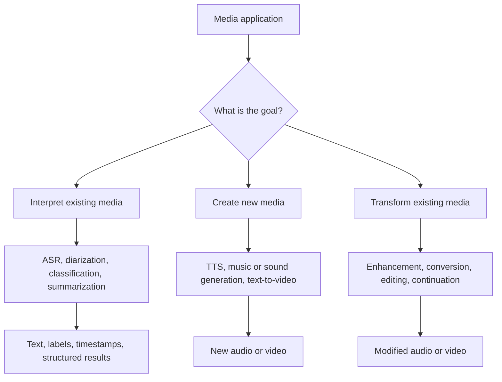
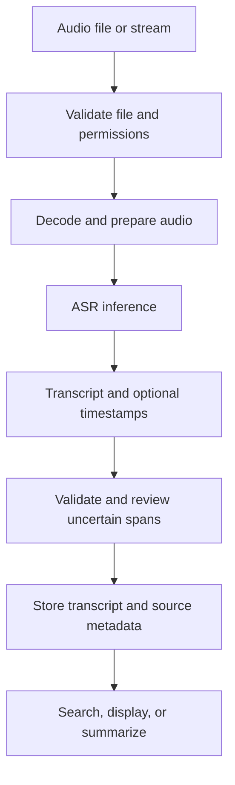
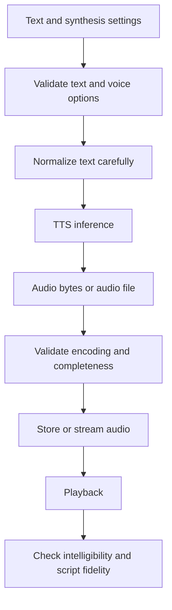
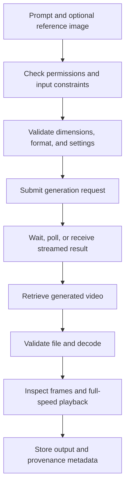
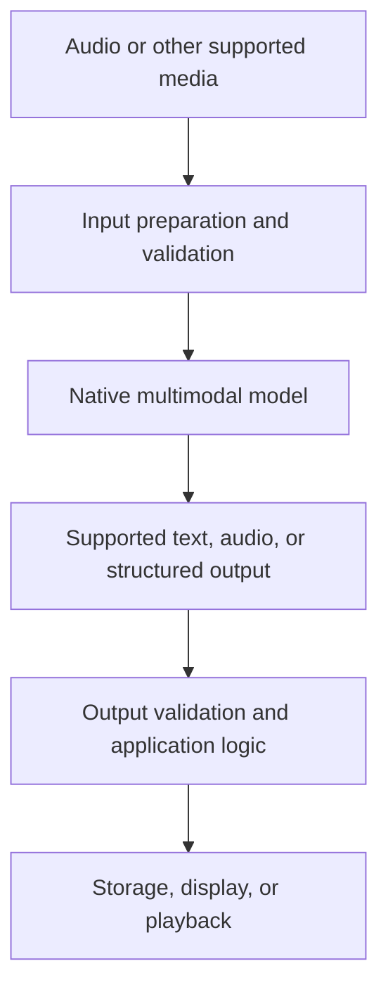
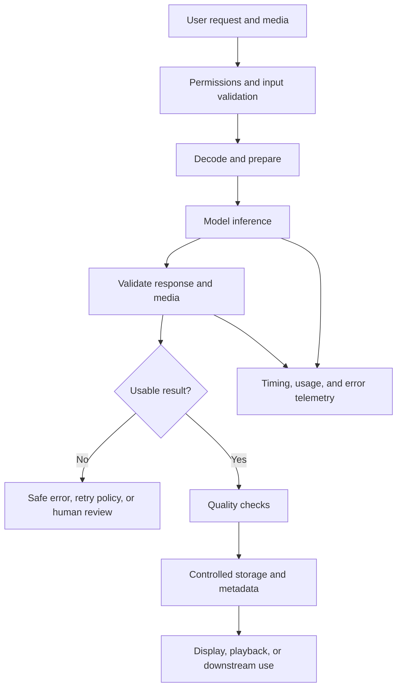
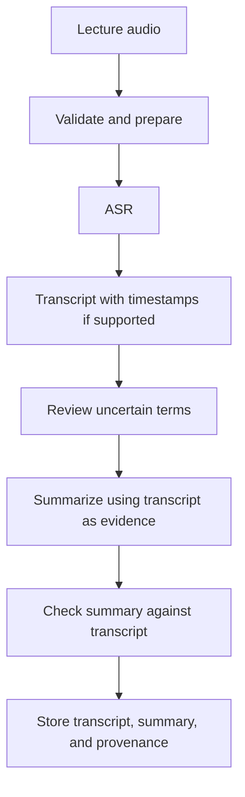
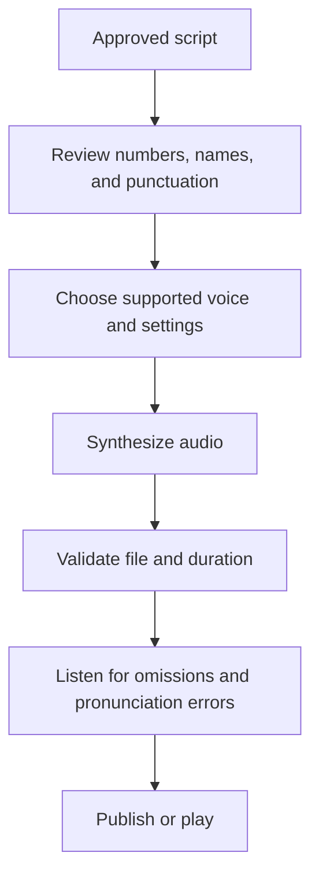
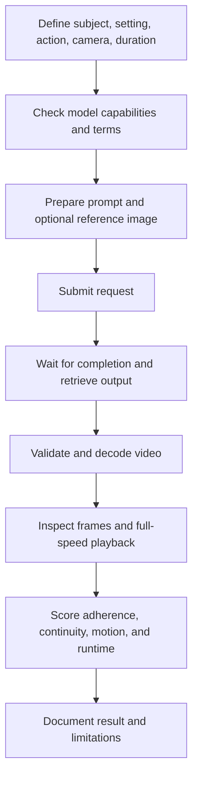

# 01. Audio, Speech, and Video Application Overview

## Learning Objectives

By the end of this chapter, you should be able to:

- Map speech-to-text (STT/ASR), text-to-speech (TTS), audio-to-audio, and video-generation tasks.
- Distinguish recognition and analysis from content generation.
- Compare pipelines built from specialized models with native multimodal models.
- Trace media preparation, inference, validation, storage, and playback.
- Choose task-specific success criteria and define application boundaries.

<br/>

## 1. The Main Task Families

Audio and video applications may **interpret existing media**, **transform existing media**, or **generate new media**. These are different objectives and should be evaluated differently.

| Task family | Typical input | Typical output | Primary purpose | Example |
|---|---|---|---|---|
| Speech-to-text (STT) / automatic speech recognition (ASR) | Speech recording or audio stream | Text, sometimes timestamps or speaker labels | Recognize spoken language | Transcribe a meeting |
| Text-to-speech (TTS) | Text and voice/configuration settings | Audio waveform or encoded audio file | Synthesize speech | Read an article aloud |
| Audio-to-audio | Existing audio, optionally a text instruction | Modified or newly generated audio | Transform, enhance, continue, or create audio | Reduce noise or generate a sound effect |
| Video generation | Text prompt, image, or other supported conditioning | Video clip | Create a sequence of frames, sometimes with audio | Animate a reference image |
| Audio/video understanding | Existing audio/video | Labels, transcript, answers, timestamps, summary, or structured metadata | Analyze media | Summarize a lecture recording |

**Important distinction:** speech recognition is not the same as fact-checking. An ASR system may accurately transcribe a false statement spoken in a recording. Recognition answers “what was said?”, not “is it true?”

<br/>

### 1.1 Recognition and analysis

Recognition/analysis systems derive information from existing media. Examples include:

- ASR: convert spoken words into text.
- Language identification: estimate the language being spoken.
- Speaker diarization: estimate which speaker spoke when, if supported.
- Audio event classification: identify events such as applause or a door slam.
- Video understanding: answer questions about visible events or summarize a clip.
- Speech summarization: produce a shorter account based on a transcript or audio input.

These outputs are interpretations of source material. They can contain errors, omissions, and uncertainty.

<br/>

### 1.2 Generation

Generation systems create new media or new media content:

- TTS generates speech audio from text.
- Music and sound-generation systems create audio from prompts or other conditioning.
- Audio transformation systems create a modified version of an input.
- Text-to-video generates a new sequence conditioned on a prompt.
- Image-to-video generates a moving sequence conditioned on a reference image and instructions.

A transformation task has both a **change objective** and a **preservation objective**. For example, denoising should reduce unwanted noise while preserving intelligible speech.

<br/>

### 1.3 A useful classification




<br/>


## 2. Speech-to-Text: From Recording to Usable Text

**Speech-to-text** converts spoken language into written text. Automatic speech recognition is the core recognition task; an application may add language detection, timestamps, speaker labels, or post-processing.

### Example use cases

- Meeting and interview transcription.
- Lecture transcription for searchable study notes.
- Voice input for accessibility.
- Customer-support call analysis.
- Transcription followed by a source-grounded summary.

<br/>

### Typical pipeline



<br/>

### Preparation and validation

Depending on the model interface, preparation can include:

- Checking file type, size, duration, and whether the file is readable.
- Decoding the container and checking sample rate and channel count.
- Resampling or converting channels only when required by the model.
- Splitting long recordings into bounded segments when necessary.
- Preserving segment offsets so timestamps can be mapped back to the original recording.

Avoid unnecessary transformations. Resampling, compression, or aggressive denoising can discard information and sometimes reduce recognition quality.

<br/>

### Common failure modes

- Accents or dialects poorly represented in model training.
- Background noise, reverberation, overlapping speakers, or low volume.
- Proper nouns, technical terms, abbreviations, and numbers.
- Hallucinated words in silence or highly ambiguous audio.
- Lost timing alignment after segmentation.
- Text normalization that changes the speaker's intended meaning.

Review names, numbers, dates, and other high-impact terms. If a phrase is unclear, preserve uncertainty rather than silently inventing a likely phrase.


<br/>


## 3. Text-to-Speech: From Text to Speech Audio

**Text-to-speech** synthesizes spoken audio from text. Depending on the system, inputs may include a supported voice, language, delivery style, speed, or other documented controls.

### Example use cases

- Narration for educational content.
- Screen-reader and accessibility features.
- Voice responses in customer applications.
- Audiobooks and explainer videos.
- Spoken summaries of documents.

<br/>

### Typical pipeline



<br/>

### Text preparation

Text formatting affects spoken output:

- Punctuation influences pauses and phrasing.
- Abbreviations may need expansion when the desired reading is ambiguous.
- Numbers, dates, units, URLs, and symbols may be spoken differently by different systems.
- Names and domain-specific vocabulary may require pronunciation guidance if the interface supports it.
- Long scripts may be synthesized in chunks, but chunk boundaries can create unnatural pauses or changes in delivery.

Keep a version of the exact input script. This allows the generated audio to be checked for missing, repeated, or altered words.

<br/>

### Evaluation

Evaluate at least two dimensions separately:

1. **Intelligibility:** Can a listener understand the speech?
2. **Script fidelity:** Does the speech accurately express the supplied text?

Naturalness, pronunciation, voice consistency, and segment transitions can be additional criteria. A pleasant-sounding voice is not necessarily faithful to the script.


<br/>


## 4. Audio-to-Audio and General Audio Generation

Audio-to-audio systems take audio as input and produce audio as output. The task can be a constrained transformation or a generative task.

| Task | Intended change | What should usually be preserved |
|---|---|---|
| Noise reduction | Reduce unwanted background noise | Speech content and speaker characteristics |
| Speech enhancement | Improve clarity or quality | Meaning and important acoustic cues |
| Voice conversion | Change permitted voice characteristics | Intended linguistic content |
| Audio continuation | Extend an existing audio sequence | Relevant style, timing, or musical context |
| Sound-effect generation | Create a requested sound | Prompt-relevant characteristics |
| Music generation | Create music from supported conditions | Requested style, structure, or duration where controllable |

The preservation column is a target, not a guarantee. A model may introduce artifacts, remove quiet speech, alter timbre, or change timing.

<br/>

### Transformation versus conventional signal processing

Not every audio operation requires a generative model. Filtering, resampling, channel mixing, trimming, and format conversion can often be handled with conventional signal-processing tools. A learned model may be useful when the task requires complex perceptual changes, but it introduces model-specific errors and resource costs.

Before selecting a method, specify:

- What must change?
- What must remain unchanged?
- How will quality be assessed?
- Is a conventional deterministic operation sufficient?


<br/>


## 5. Video Generation and Video Understanding

A digital video is a sequence of frames displayed over time, commonly accompanied by an audio track. Video generation creates a new sequence; video understanding analyzes an existing sequence.

### Common generation modes

- **Text-to-video:** generate a clip from a text prompt.
- **Image-to-video:** use a reference image to condition a moving sequence.
- **Video-conditioned generation or editing:** use existing video as conditioning when the chosen model supports it.

A prompt may describe the subject, setting, action, camera movement, lighting, and intended duration. However, natural-language instructions do not guarantee exact control over every frame.

<br/>

### Typical generation pipeline



Some services run generation asynchronously: a request returns a job identifier, and the application polls or waits for completion. Others may provide a different interface. Follow the selected provider's current API contract.

<br/>

### Generation is not playback

Generation time is the time required to produce the clip. Playback duration is the length of the resulting video. A five-second video may take much longer than five seconds to generate.

<br/>

### Common video failures

- Flickering textures or changing object identity.
- Objects appearing, disappearing, or deforming.
- Implausible movement or inconsistent physics.
- Camera motion that differs from the prompt.
- Inconsistent lighting, geometry, or background details.
- Poor transitions or temporal discontinuities.
- Audio that is absent, inappropriate, or unsynchronized when audio is expected.

Inspect both individual frames and the complete clip. A set of attractive frames does not necessarily form a coherent video.


<br/>


## 6. Specialized Pipelines Versus Native Multimodal Models

There are two broad application patterns. They are not mutually exclusive; a production system can combine them.

### 6.1 Specialized-model pipeline

A specialized pipeline connects models or components designed for distinct tasks.

For example:

1. An ASR model transcribes a recording.
2. A language model summarizes the transcript.
3. A TTS model reads the summary aloud.
4. The application stores the transcript, summary, and audio with appropriate metadata.


**Advantages**

- Components can be selected and evaluated independently.
- Intermediate transcripts and summaries can be inspected.
- Different providers can be used for different tasks.
- Individual stages can be retried, replaced, or cached.

**Trade-offs**

- More integration code and more failure points.
- Errors can propagate from one stage to the next.
- Intermediate data may increase latency and storage needs.
- Separate models may lose acoustic or visual context when it is reduced to text.

<br/>

### 6.2 Native multimodal model

A native multimodal model can accept or produce multiple modalities through one model interface. Depending on the model, it may process audio directly, combine audio with text, or support real-time speech interactions.



**Advantages**

- May preserve useful information in the original modality.
- Can reduce the need for explicit conversion between separate models.
- May support low-latency interactive experiences when streaming is available.

**Trade-offs**

- Intermediate reasoning or representations may be less inspectable.
- Supported modalities, controls, output formats, and limits vary by model.
- Evaluation can be harder when the model produces several output types.
- A single model may not be best-in-class for every stage.

<br/>

### 6.3 Comparison

| Criterion | Specialized pipeline | Native multimodal model |
|---|---|---|
| Modularity | Usually high | Often lower at the model stage |
| Intermediate inspection | Easier when outputs are exposed | Depends on the interface |
| Modality conversion | Often required between stages | May be reduced |
| Error localization | Intermediate outputs help isolate failures | Failures may be harder to attribute |
| Latency | Can accumulate across calls | May reduce round trips, but not guaranteed |
| Best use | Workflows needing explicit control and stage-level evaluation | Tasks that benefit from integrated multimodal input/output |

**Selection rule:** choose based on measured task quality, supported capabilities, latency, cost, observability, privacy requirements, and the degree of control needed—not simply on whether a model is described as multimodal.


<br/>


## 7. A Reusable Media Application Architecture

Regardless of the task, a reliable media workflow typically has the following stages:

1. **Input and permissions:** verify that the media may be processed and stored.
2. **Preparation:** validate the container, codec, duration, dimensions, sample rate, channels, and size as relevant.
3. **Inference:** invoke the selected model with supported parameters.
4. **Result validation:** confirm that the response is complete, parseable, and usable.
5. **Quality checks:** assess task-specific correctness and failure cases.
6. **Storage:** save outputs and only the necessary metadata under appropriate access controls.
7. **Delivery:** display text, play audio, or render video.
8. **Observability:** record processing time, errors, model/version, settings, and usage where available.



<br/>

### Application boundaries

The model should not be responsible for every application concern. The surrounding application should enforce:

- File-size and duration limits.
- Supported formats and codecs.
- Authentication and authorization.
- Timeouts, bounded retries, and cancellation.
- Output validation and safe file handling.
- Storage and retention policies.
- Access to private recordings and transcripts.
- Human review for high-impact or uncertain results.

Treat transcribed speech and retrieved media content as **untrusted input**. Instructions spoken in a recording must not automatically gain authority over the application's system instructions, permissions, or tool access.


<br/>


## 8. Task-Specific Success Criteria

There is no single universal metric for audio and video applications.

| Task | Useful criteria |
|---|---|
| ASR | Word error rate (WER), critical-term accuracy, timestamp quality, coverage of intelligible speech |
| Transcription summarization | Factual support from transcript, coverage of key points, omission of unsupported claims |
| TTS | Intelligibility, pronunciation, script fidelity, naturalness, voice consistency |
| Audio transformation | Desired-change success, preservation of important content, artifact severity |
| Sound or music generation | Prompt adherence, perceptual quality, continuity, duration compliance |
| Video generation | Prompt adherence, temporal consistency, motion coherence, visual quality |
| Streaming workflow | Time to first useful output, end-to-end latency, interruption behavior, dropped or repeated chunks |

Metrics must match the intended task. For example, WER is useful for comparing a transcript with a reference transcript, but it does not establish whether the speaker's claims are true. Human review may still be needed for ambiguous or consequential content.

Record the test inputs, model/version, settings, preprocessing, hardware, and measurement method when comparing configurations.


<br/>


## 9. Worked Application Designs

### 9.1 Transcription-to-summary workflow

**Goal:** Convert a permitted lecture recording into a transcript and a concise summary that can be checked against the source.



**Quality checks**

- Confirm important names, numbers, and technical terms.
- Preserve uncertainty in unclear spans.
- Ensure every important summary claim is supported by the transcript.
- Where precision matters, review the cited transcript segment against the original audio.
- Keep transcription separate from independent fact-checking.

<br/>

### 9.2 Text-to-speech workflow

**Goal:** Produce a spoken explanation from a controlled script.



**Quality checks**

- Compare spoken content with the script.
- Check pronunciation of names and technical terms.
- Listen at the beginning, middle, and end.
- Inspect chunk boundaries if synthesis was split into segments.
- Save the script version and supported generation settings.

<br/>

### 9.3 Video-generation workflow

**Goal:** Create a short clip showing a clearly specified action.



**Quality checks**

- Did the subject and action match the prompt?
- Did identity, geometry, and background remain stable?
- Was motion plausible?
- Did the clip meet the requested duration and format?
- If audio was expected, was it present and synchronized?
- Were actual runtime and usage recorded rather than guessed?


<br/>


## 10. Minimal Python Example: Inspect an Audio File

This example demonstrates **media preparation and inspection only**. It does not call an ASR or generative model. It uses `soundfile` to read audio metadata and NumPy to inspect the decoded waveform.

Install dependencies:

```bash
pip install soundfile numpy
```

```python
from pathlib import Path

import numpy as np
import soundfile as sf


def inspect_audio(path: str) -> dict:
    # Inspect a supported audio file without modifying its contents.
    audio_path = Path(path)

    if not audio_path.is_file():
        raise FileNotFoundError(f"Audio file not found: {audio_path}")

    waveform, sample_rate = sf.read(
        audio_path,
        dtype="float32",
        always_2d=True,
    )

    if waveform.size == 0:
        raise ValueError("Audio file contains no samples.")

    num_samples, channels = waveform.shape
    duration_seconds = num_samples / sample_rate

    return {
        "file": audio_path.name,
        "sample_rate_hz": sample_rate,
        "channels": channels,
        "num_samples_per_channel": num_samples,
        "duration_seconds": round(duration_seconds, 3),
        "peak_amplitude": float(np.max(np.abs(waveform))),
        "rms_amplitude": float(np.sqrt(np.mean(waveform ** 2))),
    }


if __name__ == "__main__":
    metadata = inspect_audio("sample.wav")
    for key, value in metadata.items():
        print(f"{key}: {value}")
```

<br/>

### Understanding the output

- **Sample rate (Hz):** samples recorded per second per channel.
- **Channels:** one for mono, typically two for stereo.
- **Number of samples:** samples per channel in the decoded waveform.
- **Duration:** number of samples divided by sample rate.
- **Peak amplitude:** largest absolute decoded sample value.
- **RMS amplitude:** a measure of average signal magnitude.

Peak and RMS amplitude are not complete measures of perceived loudness or audio quality. File size also depends on encoding, bit depth, compression, and container overhead.

This inspection function is a starting point, not a production media validator. A real service should also enforce upload-size and duration limits, supported-format policies, authorization, and safe error handling.


<br/>


## 11. Practice Exercises

### Exercise A: Classify the task

For each scenario, identify whether it is recognition/analysis, generation, or transformation.

1. Convert a recorded interview into text.
2. Read a supplied article aloud.
3. Reduce traffic noise in a voice recording.
4. Generate a short animation from a text prompt.
5. Identify when each speaker talks in a meeting.
6. Generate a musical background from a prompt.

**Suggested answers**

1. Recognition — ASR.
2. Generation — TTS.
3. Transformation — audio enhancement.
4. Generation — text-to-video.
5. Recognition/analysis — diarization, if supported.
6. Generation — music generation.

<br/>

### Exercise B: Draw and annotate the pipelines

Create three diagrams:

- Recording → transcription → review → grounded summary.
- Script → text validation → TTS → audio validation → playback.
- Prompt/reference image → video generation → retrieval → validation → inspection.

For each stage, label the input, output, possible failure, and validation step.

<br/>

### Exercise C: Define a quality rubric

Choose one task and define at least three success criteria. For example, for transcription:

- Overall transcript accuracy against a reference.
- Correct recognition of names and numbers.
- Timestamp alignment, if timestamps are required.
- Behavior on noise, silence, and overlapping speech.

<br/>

### Exercise D: Choose an architecture

A product needs to summarize a two-hour meeting and provide an optional spoken summary.

Explain whether you would choose a specialized ASR → summarization → TTS pipeline, a native multimodal model, or a hybrid design. Address:

- Accuracy and reviewability.
- Latency and cost.
- Intermediate artifacts and debugging.
- Privacy and retention.
- How you would evaluate the result.

There is no universally correct choice. Your recommendation should follow from requirements and measured results.


<br/>


## 12. Checkpoint: Which Stages Interpret and Which Create?

**Recognition and analysis interpret existing media.** Examples include ASR, diarization, and video summarization. Their outputs may be text, labels, timestamps, or structured metadata.

**Generation creates new media.** Examples include TTS, music generation, and text-to-video.

**Transformation modifies existing media or continues it.** Examples include denoising, enhancement, voice conversion, and audio continuation. These tasks need both change and preservation criteria.

In a complete application, preprocessing, validation, storage, and playback are application or media-processing stages rather than necessarily generative-model operations. A single workflow can contain all three task types—for example, transcribing a recording, generating a summary, and synthesizing that summary as speech.

<br/>

### Revision questions

1. Why is ASR not the same as fact-checking?
2. Why should script fidelity and voice naturalness be evaluated separately in TTS?
3. What is one advantage and one limitation of a specialized-model pipeline?
4. Why does generation time differ from video playback duration?
5. Why should transformed audio be evaluated for preservation as well as improvement?
6. What should an application validate before storing or playing model output?

**Answer key**

1. ASR recognizes the spoken content; it does not independently verify whether the statement is true.
2. A natural voice can still omit, repeat, or mispronounce supplied text.
3. Advantage: modularity and inspectable intermediate outputs. Limitation: integration overhead and error propagation.
4. Inference may require substantial computation before the completed clip is available.
5. A transformation can improve one property while damaging speech, timing, timbre, or other important information.
6. Check that the response is complete, the media can be decoded, its format is supported, and it meets application-specific quality and safety requirements.


<br/>

## 13. Useful References

Prefer official documentation for current capabilities and API details. Exact support, limits, and pricing vary by provider and model.

- [Hugging Face Audio course](https://huggingface.co/learn/audio-course/chapter0/introduction) — audio tasks, models, and practical concepts.
- [Hugging Face Transformers documentation](https://huggingface.co/docs/transformers/index) — model interfaces and supported tasks.
- [OpenAI API documentation](https://platform.openai.com/docs/overview) — consult the current audio and video-related capabilities available to your account.
- [librosa documentation](https://librosa.org/doc/latest/index.html) — audio analysis and signal-processing concepts.
- [SoundFile documentation](https://python-soundfile.readthedocs.io/en/latest/) — reading and writing audio files in Python.
- [FFmpeg documentation](https://ffmpeg.org/documentation.html) — media decoding, encoding, and format conversion.
- [Mermaid flowchart syntax](https://mermaid.js.org/syntax/flowchart.html) — creating and maintaining the diagrams in these notes.


<br/>


## Chapter Summary

- Audio and video applications may interpret, generate, or transform media.
- ASR produces a textual representation of speech; it does not verify the truth of the statement.
- TTS creates audio from text; script fidelity and intelligibility need explicit checks.
- Audio transformation requires a defined change objective and preservation criteria.
- Video generation must be evaluated over time, not only by individual frames.
- Specialized pipelines improve modularity and inspectability; native multimodal models may reduce conversion overhead. The right design depends on the use case and measurements.
- Reliable applications validate inputs and outputs, enforce boundaries, preserve provenance, and measure task-specific quality and resource use.

<br/>

**Next chapter:** `02_audio_representations_and_tokenization.md` — waveforms, sample rates, spectrograms, and learned audio tokens.
