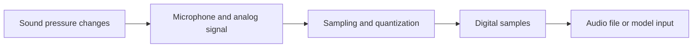
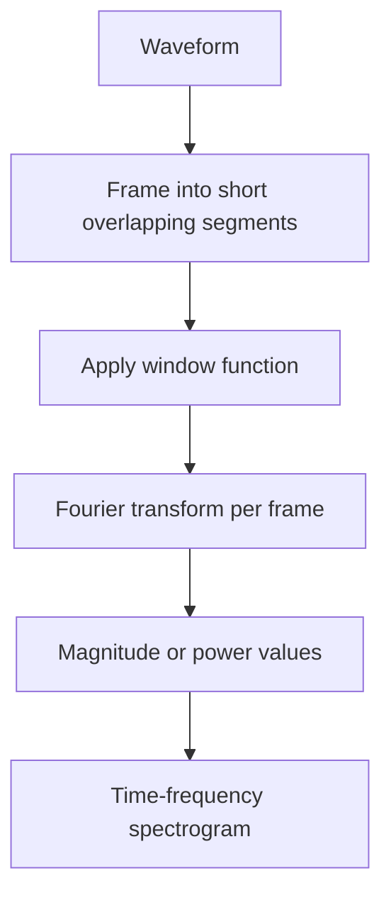
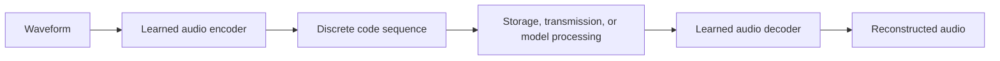
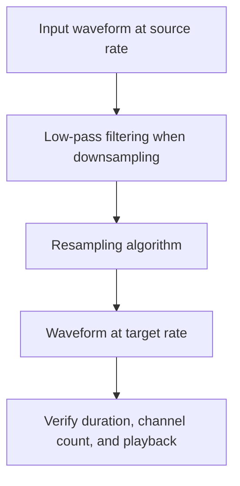

# 02. Audio Tokenization and Representation

## Learning Objectives

By the end of this chapter, you should be able to:

- Explain digital audio waveforms, sample rate, bit depth, channels, and duration.
- Interpret spectrograms as time-frequency representations.
- Describe learned audio codecs and discrete audio tokens at a high level.
- Distinguish text tokens, acoustic tokens, and model-dependent intermediate representations.
- Explain how resampling and compression can change or discard information.
- Inspect an audio file and record its basic technical properties.

<br/>

## 1. Why Audio Representation Matters

A microphone captures changes in air pressure. Digital audio stores a representation of those changes as numerical samples. Audio models may operate on waveform samples, spectrogram-like features, learned acoustic representations, discrete audio tokens, or combinations of these.

The representation affects:

- What information is available to a model.
- The amount of data that must be processed or transmitted.
- Which preprocessing operations are needed.
- How time and frequency information are preserved.
- The model's interface, computational requirements, and possible failure modes.

There is no single audio representation used by every model. Always distinguish the audio file's encoding from the representation expected internally by a particular model.

<br/>

## 2. Digital Audio Waveforms

A **waveform** represents signal amplitude as a function of time. In digital audio, the continuous acoustic signal is sampled at discrete time intervals.



A simplified digital waveform is a sequence:

$$
x[0], x[1], x[2], \ldots, x[N-1]
$$

where each $x[n]$ is a sample value and $N$ is the number of samples in one channel.

A waveform preserves signal timing and amplitude at the stored sample resolution. However, what can be reconstructed depends on the sample rate, quantization, signal processing, and file encoding.

<br/>

### 2.1 Sample rate

The **sample rate** is the number of samples captured per second for each channel. It is measured in hertz (Hz).

Examples:

- 16,000 Hz (16 kHz): 16,000 samples per second per channel.
- 44,100 Hz (44.1 kHz): a common rate for audio distribution.
- 48,000 Hz (48 kHz): common in video and production workflows.

For a fixed duration, a higher sample rate means more samples. It does **not** automatically mean that the recording sounds better: source quality, microphone, frequency content, noise, quantization, and encoding also matter.

For a sampled signal, the Nyquist frequency is half the sample rate. Frequencies above that limit cannot be represented correctly without appropriate filtering during sampling.

<br/>

### 2.2 Bit depth

**Bit depth** describes the number of bits used to represent each uncompressed PCM sample. Common PCM formats include 16-bit and 24-bit audio. Floating-point formats are also used in audio processing.

For an ideal signed integer PCM representation, increasing bit depth allows more quantization levels and can reduce quantization error. It does not recover detail that was never captured, and it does not by itself guarantee a clean recording.

Do not confuse bit depth with bitrate:

- **Bit depth:** bits per sample in an uncompressed sample representation.
- **Bitrate:** bits stored or transmitted per second.
- **File size:** total bytes in the encoded file, including payload and possible container metadata.

<br/>

### 2.3 Channels

A **channel** is a separate audio signal.

- **Mono:** one channel.
- **Stereo:** two channels, often left and right.
- **Multichannel:** more than two channels, such as surround formats.

For the same sample rate, bit depth, and duration, uncompressed PCM with two channels requires approximately twice the audio sample data of mono. Downmixing stereo to mono combines channel information and can lose spatial cues or cause phase-related cancellation.

Some model APIs require mono input; others accept stereo or perform conversion internally. Check the chosen interface rather than assuming.

<br/>

### 2.4 Duration and sample count

For one channel:

$$
\text{Duration (seconds)} = \frac{\text{Number of samples}}{\text{Sample rate}}
$$

Equivalently:

$$
N = \text{Duration} \times \text{Sample rate}
$$

Example: a 10-second mono recording at 16 kHz contains:

$$
10 \times 16{,}000 = 160{,}000 \text{ samples}
$$

For two channels, there are 160,000 samples **per channel**, or 320,000 scalar sample values in total.


<br/>


## 3. Estimating Uncompressed PCM Size

For uncompressed PCM, a useful estimate is:

$$
\text{Audio payload bits} =
\text{duration} \times \text{sample rate} \times \text{bit depth} \times \text{channels}
$$

To estimate bytes, divide by 8. The actual file can be slightly larger because of headers and metadata.

<br/>

### Example

Consider 60 seconds of stereo PCM at 48 kHz and 16-bit depth:

$$
60 \times 48{,}000 \times 16 \times 2
= 92{,}160{,}000 \text{ bits}
$$

$$
92{,}160{,}000 / 8 = 11{,}520{,}000 \text{ bytes}
$$

That is approximately 11.52 MB using decimal megabytes, before container overhead.

This formula is for uncompressed PCM payloads. It does not directly predict the size of MP3, AAC, Opus, or other compressed formats, whose sizes depend on codec settings, bitrate or quality mode, content, and container overhead.


<br/>


## 4. Spectrograms and Time-Frequency Representations

A waveform shows amplitude over time. It does not make the frequency content at each moment easy to inspect. A **spectrogram** represents how signal energy is distributed across frequencies over time.

A common way to produce a spectrogram is to apply a short-time Fourier transform (STFT):

1. Divide the waveform into overlapping frames.
2. Apply a window function to reduce boundary effects.
3. Compute a frequency transform for each frame.
4. Display magnitude or power by time and frequency.



A typical spectrogram uses:

- Horizontal axis: time.
- Vertical axis: frequency.
- Color or intensity: magnitude or power at that time-frequency location.

<br/>

### 4.1 What a spectrogram can reveal

- Harmonic structures in voiced speech.
- Broadband energy from some consonants or transients.
- Pauses and silence.
- Changes in pitch-related frequency structure.
- Some forms of noise, clipping, or interference.

A spectrogram is not a perfect picture of sound. Its appearance depends on window size, hop length, frequency scale, and whether magnitude, power, or a logarithmic scale is displayed.

<br/>

### 4.2 Time-frequency trade-off

A longer analysis window gives finer frequency resolution but blurs the exact timing of rapid events. A shorter window localizes changes in time more precisely but provides coarser frequency resolution.

This is a practical trade-off, not merely a visualization detail. The representation should fit the analysis task.

<br/>

### 4.3 Mel spectrograms

A **Mel spectrogram** maps frequency bins to a Mel-scaled frequency axis, which roughly reflects aspects of human pitch perception. It is widely used in speech and audio systems.

A Mel spectrogram is a derived feature representation, not the original waveform. The mapping and compression can discard detail. It should not be assumed that every modern audio model consumes Mel spectrograms; many use learned encoders, waveform inputs, or tokenized representations.

<br/>


## 5. Learned Audio Codecs and Discrete Audio Tokens

Some modern audio systems use learned codecs to compress audio into a sequence of discrete codes. A neural encoder maps audio into a more compact representation; a decoder uses those codes to reconstruct an approximation of the audio.



The codes are often selected from one or more learned codebooks. In some designs, multiple code sequences represent different levels of acoustic detail. Specific codec architectures differ, so this diagram is conceptual rather than a universal implementation.

<br/>

### 5.1 Why use learned codecs?

Potential benefits include:

- Compact representations compared with raw waveform samples.
- Representations designed to preserve perceptually important characteristics.
- A discrete sequence that can be modeled by sequence-generation architectures.
- Support for audio generation, continuation, or other model-specific tasks.

Potential limitations include:

- Lossy reconstruction and codec artifacts.
- Information discarded by the encoder or quantizer.
- Additional computation for encoding and decoding.
- A token sequence whose length and meaning depend on the codec design and settings.

A discrete audio token is not necessarily a word, phoneme, or directly interpretable sound label. It is usually a model- or codec-specific code.

<br/>

### 5.2 Lossy versus lossless

- **Lossless encoding** allows exact recovery of the encoded digital samples, assuming a correct decoder.
- **Lossy encoding** discards some information to reduce size or meet a target bitrate or perceptual objective.
- **Learned lossy codecs** use learned representations and reconstruction objectives; their fidelity depends on architecture, bitrate, training, and configuration.

Even lossless compression does not restore information absent from the original recording. If the source was clipped, noisy, or recorded at a limited sample rate, encoding it losslessly preserves those limitations.


<br/>


## 6. Text Tokens, Acoustic Tokens, and Intermediate Representations

The word *token* means different things in different systems. Do not assume all tokens correspond to the same unit or have comparable lengths.

| Representation | What it encodes | Example use | Important caveat |
|---|---|---|---|
| Text token | A piece of text, such as a word, subword, or punctuation unit | Transcript, prompt, summary | Tokenization depends on the tokenizer and text |
| Acoustic/audio token | A discrete code produced by an audio tokenizer or codec | Audio generation or reconstruction | Usually codec/model-specific; not necessarily a word |
| Learned continuous representation | A vector or sequence of vectors produced by an encoder | Speech understanding or multimodal processing | May not be directly interpretable |
| Spectral feature | Values derived from waveform frames, such as STFT or Mel features | Some speech/audio pipelines | Depends on analysis settings and may discard information |
| Raw waveform samples | Numerical amplitude values at sample intervals | Signal processing or waveform models | High data volume at ordinary audio sample rates |

<br/>

### 6.1 Example: one speech workflow

A system could process spoken audio as follows:

1. Read waveform samples from an audio file.
2. Encode the waveform into learned acoustic representations.
3. Predict text tokens representing recognized words.
4. Pass the transcript to a language model that uses its own text tokenizer.
5. Send a response script to a TTS model.
6. Generate audio through a waveform decoder or another supported output mechanism.

This is only one possible design. Some models combine stages, use different intermediate representations, or directly map between audio and text.

<br/>

### 6.2 Why token counts differ

Text token counts depend on the tokenizer and text content. Audio token counts may depend on the codec, frame rate, number of codebooks, audio duration, sampling configuration, and model architecture. Continuous representations may not even be described as discrete tokens.

Therefore, an audio duration cannot be converted to a universal audio-token count. Use the selected model's documentation and usage metadata when available.


<br/>


## 7. Resampling: Changing the Sample Rate Correctly

**Resampling** converts a sampled signal from one sample rate to another—for example, 48 kHz to 16 kHz. It is not simply changing the sample-rate label or dropping arbitrary samples.

A proper resampler applies appropriate filtering and interpolation/decimation so that the new sequence represents the intended signal at the new rate.



<br/>

### 7.1 Downsampling and upsampling

- **Downsampling:** lowers the sample rate. Frequencies above the new Nyquist limit must be filtered to avoid aliasing.
- **Upsampling:** increases the sample rate by estimating/interpolating additional sample values. It does not recreate high-frequency information that was never captured.

<br/>

### 7.2 Common mistakes

- Relabeling a 48 kHz waveform as 16 kHz without resampling changes playback speed and duration interpretation.
- Downsampling without suitable anti-alias filtering can create aliasing.
- Resampling to a rate unsupported by the model can cause errors or hidden conversions.
- Resampling cannot remove all noise or improve a poor recording by itself.

Always check the target model's expected sample rate and channel format.


<br/>


## 8. Compression and Information Loss

Compression reduces the amount of data needed to store or transmit media.

### 8.1 Common categories

- **Uncompressed PCM:** stores sample values directly, with relatively predictable payload size.
- **Lossless compression:** reduces file size while allowing exact reconstruction of the digital samples.
- **Lossy compression:** reduces file size by discarding information according to a codec's design and settings.
- **Learned audio coding:** uses trained models to encode and decode audio, often with a lossy reconstruction objective.

<br/>

### 8.2 Where information can be lost

Information may be lost during:

- Original recording and analog-to-digital conversion.
- Clipping, noise, or low-quality microphones.
- Downsampling and filtering.
- Lossy compression.
- Mono downmixing of stereo or multichannel content.
- Feature extraction, quantization, or learned encoding.
- Model inference and generated output.

Repeated lossy conversion can compound artifacts. Preserve a high-quality source where permitted, and make processing copies for experiments.

<br/>

### 8.3 Match the representation to the task

- For forensic or high-fidelity work, preserve original files and document all transformations.
- For speech recognition, follow the model's accepted input format and avoid unnecessary conversion.
- For bandwidth-constrained streaming, compression may be necessary, but test recognition and intelligibility after compression.
- For audio generation, use the representation and decoder expected by the chosen model.


<br/>


## 9. Practice: Inspect a Short Audio File

This exercise records the duration, sample rate, channel count, sample count, and basic amplitude statistics of an audio file. It does not call a model or change the file.

### Install dependencies

```bash
pip install soundfile numpy
```

<br/>

### Python implementation

```python
from pathlib import Path

import numpy as np
import soundfile as sf


def inspect_audio(path: str) -> dict:
    audio_path = Path(path)

    if not audio_path.is_file():
        raise FileNotFoundError(f"Audio file not found: {audio_path}")

    # Decode to float samples and preserve channel dimension.
    waveform, sample_rate = sf.read(
        audio_path,
        dtype="float32",
        always_2d=True,
    )

    if waveform.size == 0:
        raise ValueError("Audio file contains no samples.")

    samples_per_channel, channels = waveform.shape
    duration = samples_per_channel / sample_rate

    return {
        "filename": audio_path.name,
        "sample_rate_hz": int(sample_rate),
        "channels": int(channels),
        "samples_per_channel": int(samples_per_channel),
        "duration_seconds": round(float(duration), 3),
        "peak_amplitude": round(float(np.max(np.abs(waveform))), 5),
        "rms_amplitude": round(float(np.sqrt(np.mean(waveform**2))), 5),
        "decoded_sample_dtype": str(waveform.dtype),
    }


if __name__ == "__main__":
    report = inspect_audio("sample.wav")

    for name, value in report.items():
        print(f"{name}: {value}")
```

<br/>

### Example interpretation

Suppose the output reports:

```text
sample_rate_hz: 16000
channels: 1
samples_per_channel: 160000
duration_seconds: 10.0
```

The duration is:

$$
\frac{160{,}000}{16{,}000} = 10 \text{ seconds}
$$

This is an illustrative result, not a measurement of your file.

<br/>

### Record your experiment

| Field | Your observation |
|---|---|
| File name and format | |
| Duration (seconds) | |
| Sample rate (Hz) | |
| Channel count | |
| Samples per channel | |
| File size (bytes) | |
| Any resampling or conversion | |
| Intended model input format | |

**Note:** `soundfile` support depends on the underlying library and file format. For broader media decoding, FFmpeg may be appropriate. File metadata can also be incorrect or incomplete; successful decoding is a useful validation step.


<br/>

## 10. Checkpoint: Why File Size, Duration, and Token Count Differ

These quantities measure different things:

- **Duration** measures elapsed media time.
- **File size** measures the number of bytes needed to store the encoded media and its metadata.
- **Model token count** measures the number of representation units processed or produced by a particular model interface.

<br/>

### Worked comparison

Imagine two 10-second recordings:

- Recording A is mono, 16 kHz, 16-bit PCM.
- Recording B is stereo, 48 kHz, 16-bit PCM.

Ignoring headers, their PCM payload estimates are:

**Recording A**

$$
10 \times 16{,}000 \times 16 \times 1 / 8
= 320{,}000 \text{ bytes}
$$

**Recording B**

$$
10 \times 48{,}000 \times 16 \times 2 / 8
= 1{,}920{,}000 \text{ bytes}
$$

Both are 10 seconds long, but Recording B has six times the uncompressed PCM payload. If either recording is encoded with a lossy codec, its file size can change substantially without changing its nominal duration.

Neither file-size figure determines the number of tokens used by a model. A text transcript tokenizer, a learned audio codec, and a multimodal model's internal representation use different units and may have different length rules.

<br/>

### Revision questions

1. What is the relationship between sample count, sample rate, and duration?
2. How does bit depth differ from bitrate?
3. Why does stereo PCM generally need more data than mono PCM with otherwise identical settings?
4. What does a spectrogram show that is difficult to inspect directly in a waveform?
5. Why is upsampling not a way to recover missing high-frequency detail?
6. Why must an audio token count be tied to a specific model or representation?

**Answer key**

1. Duration equals samples per channel divided by sample rate.
2. Bit depth is bits per sample; bitrate is bits per second.
3. Stereo stores two channels, approximately doubling uncompressed sample payload.
4. A spectrogram shows how energy is distributed across frequencies over time.
5. Upsampling estimates extra samples but cannot reconstruct information that was not captured.
6. Token units and sequence lengths depend on the tokenizer, codec, model architecture, and settings.


<br/>


## 11. Useful References

- [SoundFile documentation](https://python-soundfile.readthedocs.io/en/latest/) — reading and writing audio files in Python.
- [librosa documentation](https://librosa.org/doc/latest/index.html) — waveform analysis, spectrograms, and audio feature extraction.
- [SciPy signal processing documentation](https://docs.scipy.org/doc/scipy/reference/signal.html) — signal processing and resampling utilities.
- [FFmpeg documentation](https://ffmpeg.org/documentation.html) — decoding, encoding, resampling, and media conversion.
- [Hugging Face Audio course](https://huggingface.co/learn/audio-course/chapter0/introduction) — audio modeling concepts and model workflows.
- [Hugging Face Transformers documentation](https://huggingface.co/docs/transformers/index) — inspect model-specific audio inputs and outputs.
- [Mermaid flowchart syntax](https://mermaid.js.org/syntax/flowchart.html) — maintaining the diagrams in these notes.

Check the documentation for your selected model before assuming support for a codec, sample rate, channel layout, audio-token format, or maximum duration.


<br/>


## Chapter Summary

- A waveform is a sequence of amplitude samples; sample rate controls samples per second, bit depth describes sample precision, channels represent separate signals, and duration is elapsed time.
- A spectrogram displays time-frequency energy and depends on analysis settings.
- Learned audio codecs can encode audio into discrete codes, but those codes are codec-specific and may be lossy.
- Text tokens, acoustic tokens, spectral features, and continuous learned representations are different units.
- Resampling must be performed correctly; changing a sample-rate label is not resampling.
- Compression and preprocessing can trade file size or computational efficiency for information loss.
- File size, duration, and model token count are distinct quantities and should not be used interchangeably.

**Next chapter:** `03_speech_to_text_and_asr.md` — transcription, timestamps, language identification, speaker diarization, and recognition failures.
