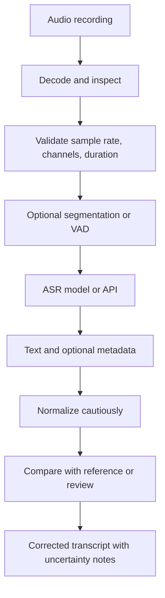
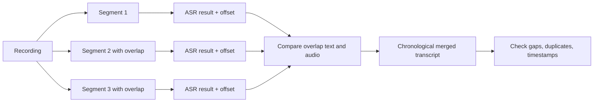
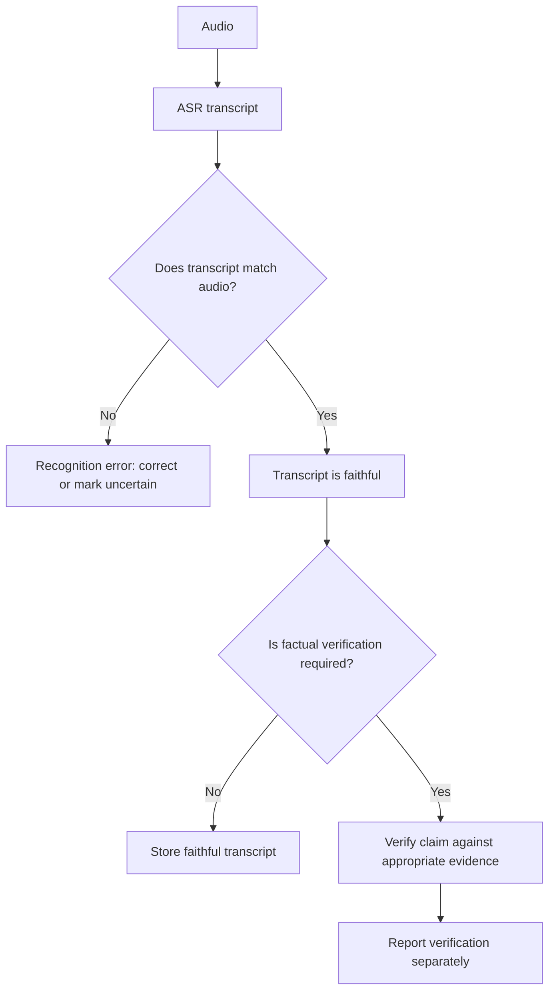

# 03. Speech-to-Text and Automatic Speech Recognition

## Learning objectives

By the end of this chapter, you should be able to:

- Distinguish transcription, speech translation, language identification, and speaker diarization.
- Inspect transcript segments, word-level timestamps, and speaker labels when a model provides them.
- Explain common ASR errors caused by accents, noise, overlapping speech, silence, domain vocabulary, and non-speech audio.
- Process long recordings with bounded segments and reconcile overlaps without silently dropping or duplicating words.
- Preserve uncertainty and prioritize human review of names, numbers, and consequential terms.
- Evaluate recognition quality against a known reference and separate transcription accuracy from factual correctness.

<br/>

## 1. What ASR does

**Automatic Speech Recognition (ASR)** maps an audio signal to a sequence of words or other textual units. A speech-to-text (STT) service is an application interface that exposes this capability. Depending on the system, its output may include only text or additional information such as language, timestamps, confidence estimates, and speaker labels.

A transcript is a hypothesis about what was spoken. It is not proof that the speaker's statement is true.

<br/>

### Related tasks

| Task | Input | Output | Main question |
|---|---|---|---|
| Transcription / ASR | Speech audio | Text in the spoken language | “What was said?” |
| Speech translation | Speech audio | Text translated into another language; sometimes translated speech | “What was said in another language?” |
| Language identification (LID) | Audio, sometimes a speech segment | Language label or ranked language candidates | “Which language is being spoken?” |
| Speaker diarization | Audio with one or more speakers | Speaker turns, such as `SPEAKER_00` and `SPEAKER_01` | “Who spoke when?” |
| Word/segment alignment | Audio plus transcript, or audio alone in supported systems | Time boundaries for words or segments | “When was each word spoken?” |
| Speech understanding | Audio or transcript | A task-specific interpretation, such as intent or topic | “What does the utterance mean for this task?” |

These tasks can be combined, but they are not interchangeable. Translation may paraphrase; diarization identifies turns rather than a person's real-world identity; timestamps can be approximate; and language identification can be uncertain for short or mixed-language clips.

<br/>

## 2. Typical ASR pipeline



- **Decode and inspect:** Confirm the file can be read and determine duration, channels, sample rate, and clipping.
- **Segment:** Split long files into manageable windows, preferably at pauses or sentence boundaries where possible.
- **Recognize:** Send supported audio to the selected model or service.
- **Inspect metadata:** Retain segment and word timestamps, language fields, and speaker labels if provided.
- **Review:** Compare the output to the audio, especially in high-impact portions.
- **Store provenance:** Keep the original recording, raw model output, correction history, and the final reviewed transcript separate.

<br/>

## 3. Transcript structure and timestamps

An API may return a single text string, timestamped segments, word-level timings, or a structured combination. Do not assume every model exposes all fields.

Example of a **generic normalized representation** (illustrative, not the response schema of a specific provider):

```json
{
  "text": "Please send the report on Friday.",
  "language": "en",
  "segments": [
    {
      "start": 1.20,
      "end": 3.05,
      "text": "Please send the report on Friday.",
      "speaker": "SPEAKER_00",
      "words": [
        {"start": 1.20, "end": 1.52, "text": "Please"},
        {"start": 1.53, "end": 1.78, "text": "send"}
      ]
    }
  ]
}
```

Interpretation:

- `start` and `end` are time offsets in seconds, usually relative to the submitted audio or segment. Confirm the provider's convention.
- Segment boundaries may include a little silence or omit part of a word.
- Word-level timing can be approximate, particularly with rapid speech, coarticulation, and noisy audio.
- Speaker labels are normally anonymous cluster labels, not verified identities.
- Missing fields mean “not supplied,” not “none exists.”

For a segmented recording, convert segment-relative timestamps to recording-relative timestamps by adding the segment's start offset. Do this only when the provider returns relative times; otherwise timestamps may be shifted incorrectly.

<br/>

## 4. Why recognition fails

| Condition | Typical failure | Recommended response |
|---|---|---|
| Accent or dialect | A word is replaced with a more common-sounding word | Review unfamiliar terms in context; test the target accent |
| Background noise | Words are omitted or substituted | Improve capture, use appropriate denoising, and compare before/after |
| Overlapping speakers | One voice masks another; words or turns are assigned incorrectly | Use diarization-capable processing and human review; do not assume every speaker is recovered |
| Silence or long pauses | Empty segments, false speech, or awkward segmentation | Use voice activity detection carefully and retain timing context |
| Domain-specific vocabulary | Product names, acronyms, or technical terms are normalized incorrectly | Supply vocabulary hints only if supported; review against a domain glossary |
| Proper names and numbers | Names, dates, amounts, IDs, or phone numbers are misheard | Verify against the recording and authoritative records where appropriate |
| Code-switching | Language changes within a sentence are missed | Use a system that supports the languages involved; inspect language changes locally |
| Non-speech sounds | Laughter, coughing, music, or alarms are omitted or mistaken for words | Represent meaningful events explicitly when the task requires them |
| Clipping or poor recording | Initial/final phonemes disappear | Obtain a better source if possible; avoid inventing missing words |
| Very short clips | Insufficient context for language or word recognition | Include a little surrounding audio if privacy and task constraints permit |

<br/>

### Preserve uncertainty

If a span cannot be confidently resolved, mark it rather than inventing a clean sentence. A transcript convention might use `[unclear 00:14.2–00:15.0]` or `[possibly “fifteen”]`. Choose one convention and document it.

For critical content, retain:
1. Raw model transcript.
2. Reviewed transcript.
3. Uncertainty markers and reviewer notes.
4. Relevant audio offsets.
5. Any corrections made and their reason.

Do not use a model's confidence score as a guarantee of correctness. Confidence values may be absent, uncalibrated, or incomparable across systems.

<br/>

## 5. Long recordings: bounded segmentation and overlap reconciliation

A long recording may exceed an API's duration, file-size, or context limits. Segmentation reduces request size and can simplify retries, but it creates boundary errors.

### Practical segmentation strategy

1. Inspect the recording's duration and supported input limits.
2. Prefer boundaries at pauses or utterance boundaries using manual inspection or voice activity detection (VAD).
3. Keep each segment within the service's documented limit, with a safety margin.
4. Add a small overlap between adjacent segments when needed to preserve words at boundaries.
5. Transcribe segments independently and retain their original start offsets.
6. Reconcile duplicate text in overlaps by comparing the audio and timestamps—not by blindly deleting repeated words.
7. Review gaps, duplicates, and any segment that starts or ends mid-word.
8. Merge in chronological order and validate that all audio intervals are covered.



Example: segment A covers 0–60 seconds and segment B covers 58–118 seconds. The two-second overlap helps recover a phrase that straddles 60 seconds. Since both outputs may contain the same phrase, merge using audio and time evidence. Never remove every repeated phrase automatically: a speaker may genuinely repeat a word or sentence.

<br/>

### Simple chunk-boundary bookkeeping

The following Python example illustrates how to create fixed-duration chunk windows with overlap. It does **not** call an ASR model and does not decide where speech boundaries occur.

```python
def make_chunks(duration_s: float, chunk_s: float = 30.0, overlap_s: float = 1.0):
    # Return (start, end) windows in seconds.
    if duration_s < 0:
        raise ValueError("duration_s must be non-negative")
    if chunk_s <= 0:
        raise ValueError("chunk_s must be positive")
    if overlap_s < 0 or overlap_s >= chunk_s:
        raise ValueError("overlap_s must be >= 0 and < chunk_s")

    chunks = []
    start = 0.0
    while start < duration_s:
        end = min(start + chunk_s, duration_s)
        chunks.append((start, end))
        if end >= duration_s:
            break
        start = end - overlap_s
    return chunks

for window in make_chunks(75.0, chunk_s=30.0, overlap_s=1.0):
    print(window)
```

Expected windows: `(0, 30)`, `(29, 59)`, `(58, 75)`. Actual segment duration and overlap must be chosen based on the model's limits, speech characteristics, and latency budget.

<br/>

## 6. Evaluation against a known reference

For the practice task, create or obtain a **reference transcript** that has been carefully checked against the audio. Compare the model transcript with the reference using a consistent normalization policy.

### Word Error Rate (WER)

Word Error Rate is a common ASR metric:
$$
\mathrm{WER} = \frac{S + D + I}{N}
$$

where:
- $S$ = substitutions (a reference word is replaced by another word)
- $D$ = deletions (a reference word is missing)
- $I$ = insertions (an extra word appears)
- $N$ = number of words in the reference

WER can exceed 1.0 (100%) when the number of errors exceeds the reference word count. It is sensitive to tokenization and normalization. Decide in advance how to treat punctuation, capitalization, contractions, numbers, disfluencies, and non-speech labels.

Example: reference = `we need five boxes`; hypothesis = `we need fine boxes`. There is one substitution among four reference words, so WER = 1/4 = 0.25 (25%).

<br/>

### Character Error Rate (CER)

$$
\mathrm{CER} = \frac{S_c + D_c + I_c}{N_c}
$$

CER applies edit counts to characters rather than words. It can be useful for languages or tasks where word segmentation is difficult, but it does not replace listening to critical segments.

<br/>

### Beyond one score

Report overall WER/CER **and** inspect error categories:
- Proper nouns and domain terms.
- Numbers, dates, units, and negation.
- Overlapping speech and speaker attribution.
- Boundary errors from chunking.
- Missing non-speech events when relevant.
- Errors by language, speaker, noise condition, or recording quality.

A lower average WER does not guarantee that the transcript is safe for every downstream use. One misrecognized “not,” dosage, amount, or name may matter more than several punctuation differences.

<br/>

## 7. Recognition accuracy is not factual verification

This distinction is essential:

- **Recognition error:** The recording contains “fifteen,” but the transcript says “fifty.”
- **Accurately recognized false claim:** The speaker clearly says “The capital of Australia is Sydney,” and the transcript correctly records that sentence. The statement is factually incorrect, but the ASR result is accurate.
- **Unverifiable claim:** The speaker says something that cannot be confirmed from the audio alone. The transcript should preserve the statement without implying that it is true.

ASR answers “what words were spoken?” Fact-checking asks “is the claim supported by reliable evidence?” These are separate evaluation tasks.



Do not silently rewrite a speaker's claim to make it true. If a transcript is later annotated with fact-checking results, keep the original spoken words and the verification notes separate.

<br/>

## 8. Minimal implementation: inspect an audio file

This example inspects local audio metadata before sending it to a model. It does not perform transcription. Install dependencies with `pip install soundfile numpy`.

```python
from pathlib import Path
import soundfile as sf

audio_path = Path("recording.wav")

info = sf.info(audio_path)
duration_s = info.duration

print(f"File: {audio_path.name}")
print(f"Duration: {duration_s:.2f} seconds")
print(f"Sample rate: {info.samplerate} Hz")
print(f"Channels: {info.channels}")
print(f"Frames: {info.frames}")
print(f"Format: {info.format}")
print(f"Subtype: {info.subtype}")
```

Before inference, verify the provider's accepted formats, file-size/duration limits, language support, timestamp options, retention policy, and whether diarization is available. Convert audio only when needed, and preserve the original file. Resampling changes the sample representation; it does not restore missing information.

<br/>

## 9. Practice: compare a transcript with a known reference

Use a short clean clip and a second clip with noise, an accent, overlapping speech, or domain terms. Build a checked reference transcript before evaluating the ASR output.

| Reference | ASR hypothesis | Error category | Review action |
|---|---|---|---|
| “We need fifteen units.” | “We need fifty units.” | Number substitution | Replay the interval; verify the number carefully |
| “The name is Nandita.” | “The name is Mandita.” | Proper-noun substitution | Replay and ask for confirmation if the recording remains ambiguous |
| `[laughter]` | *(omitted)* | Non-speech omission | Decide whether non-speech events are in scope |
| “I did not approve it.” | “I did approve it.” | Negation deletion | Mark as high impact and verify against the audio |
| Speaker A: “Go now.” Speaker B: “Wait.” | “Go now, wait.” | Overlap/diarization loss | Inspect the original audio and speaker turns |

These are illustrative cases, not measured results from a model.

<br/>

### Practice procedure

1. Choose a 30–120 second clip for which you can produce a reliable reference.
2. Record language, accent/dialect if known, noise conditions, number of speakers, and domain vocabulary.
3. Generate a transcript using a model that supports the audio format.
4. Preserve the raw response and note whether timestamps, language labels, and speaker labels were returned.
5. Compare the hypothesis with the reference using WER or CER under a documented normalization policy.
6. Listen to each substitution, deletion, and insertion in the noisy or ambiguous sections.
7. Classify errors and mark critical terms for human review.
8. Write a short conclusion distinguishing measured recognition quality from any factual claims made by speakers.

<br/>

### Experiment report template

- **Audio source and permitted use:**
- **Duration / sample rate / channels:**
- **Model or service and version:**
- **Language and recording conditions:**
- **Segmentation and overlap settings:**
- **Reference transcript procedure:**
- **Normalization policy:**
- **WER / CER:**
- **Errors in names, numbers, negation, or domain terms:**
- **Timestamp and speaker-label quality:**
- **Uncertain intervals requiring review:**
- **Limitations and data-handling notes:**

<br/>

## 10. Revision questions and answers

**1. How is speech translation different from transcription?**  
Transcription represents the words in the spoken language. Translation renders the meaning into another language and may not preserve the original wording.

**2. Does diarization tell you a speaker's real identity?**  
No. Diarization typically groups voice turns into anonymous speaker labels. Identity verification is a different task.

**3. Why segment long recordings with overlap?**  
Segmentation controls request size and enables retries. Overlap reduces the risk of losing words at boundaries, but requires reconciliation to prevent duplicates.

**4. Should an uncertain name be replaced by the most likely spelling?**  
Not without evidence. Mark the span uncertain and review the audio or an appropriate authoritative source.

**5. Can a transcript have a low WER but still contain a serious error?**  
Yes. A single error in a number, name, negation, or other critical term can be consequential even when aggregate WER is low.

**6. If ASR accurately transcribes a false claim, is that an ASR error?**  
No. The recognition is accurate. Whether the claim is true requires separate verification.

**7. Are word timestamps exact?**  
Not necessarily. They are model estimates and may be approximate, especially around coarticulation, noise, and overlapping speech.

<br/>

## Checkpoint

Given a recording in which a speaker says, “The capital of Australia is Sydney,” and the transcript reproduces those words correctly, the transcript is **recognition-accurate** even though the statement is factually false. If the speaker actually says “Canberra” but the transcript says “Sydney,” that is a recognition error. Keep transcript fidelity and fact verification in separate fields or stages.

<br/>

## References and useful resources

- [OpenAI Audio guide](https://platform.openai.com/docs/guides/audio) — API-level audio task patterns and supported interfaces; check current documentation for exact models and response fields.
- [OpenAI API reference](https://platform.openai.com/docs/api-reference/audio) — request and response details for the current audio API.
- [Whisper repository](https://github.com/openai/whisper) — open-source speech recognition and translation implementation.
- [Hugging Face ASR task guide](https://huggingface.co/tasks/automatic-speech-recognition) — model/task overview and examples.
- [JiWER](https://github.com/jitsi/jiwer) — utilities for computing WER and related text error measures.

<br/>

**Implementation note:** Provider capabilities, accepted formats, model names, timestamp granularity, diarization support, limits, and pricing can change. Verify them against current official documentation before building a production workflow.
