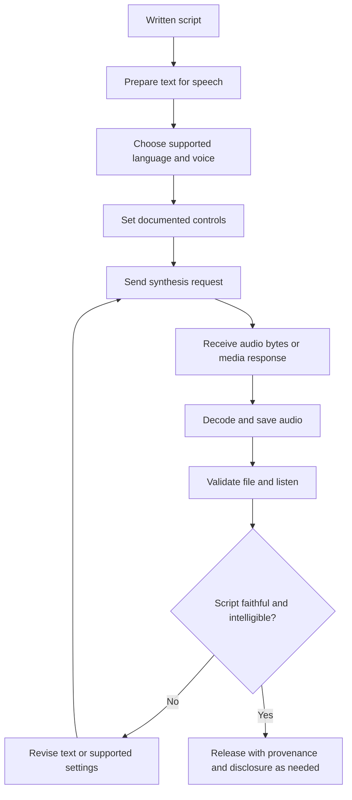
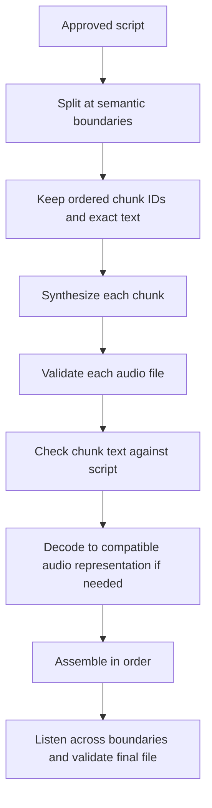

# 04. Text-to-Speech and Voice Generation

## Learning objectives

By the end of this chapter, you should be able to:

- Trace the text-to-speech (TTS) workflow from text preparation through voice selection, synthesis, and output encoding.
- Explain how pronunciation, punctuation, abbreviations, numbers, and language support affect generated speech.
- Use speed, pitch, or style controls only when the selected model or API documents them.
- Compare whole-text synthesis with chunked generation and explain their quality and latency trade-offs.
- Validate generated audio and detect missing, repeated, or altered speech.
- Evaluate intelligibility and script fidelity separately from voice pleasantness.

<br/>

## 1. What text-to-speech does

**Text-to-speech (TTS)** converts written text into synthesized speech audio. A TTS system may expose a fixed set of voices, language choices, delivery styles, or generation controls. The exact capabilities depend on the model and interface.

**Voice generation** is a broader phrase that can include synthesizing speech in a selected voice or, in systems that explicitly support it, creating or adapting a voice. Do not assume that an ordinary TTS endpoint supports custom voice cloning, arbitrary voice design, pitch adjustment, or every language.

A typical application accepts a script, prepares it for spoken delivery, requests synthesis, decodes or saves the response, and checks the result.

<br/>

## 2. TTS workflow



<br/>

### Stage-by-stage responsibilities

1. **Prepare the text.** Fix obvious typos, choose punctuation for natural pauses, and decide how to express dates, units, abbreviations, and symbols.
2. **Select a supported voice and language.** Check the provider's current voice catalogue and language documentation. A voice name does not necessarily imply native-quality pronunciation in every language.
3. **Set documented controls.** Apply only parameters listed for the selected model and endpoint. Unsupported controls may be rejected or ignored.
4. **Synthesize.** Send the request with the required text, voice, model, and output settings.
5. **Decode and save.** Write the returned bytes using the documented output format. Do not label bytes as WAV, MP3, or another format unless the response actually uses that encoding.
6. **Validate.** Confirm that the file is readable, has non-zero duration, and contains the intended spoken content.
7. **Review and retain evidence.** Listen to the output and compare it with the original script. Keep the generated file, request settings, and review notes as appropriate.

<br/>

## 3. Preparing text for spoken delivery

Written text is not always an ideal spoken script. TTS models may interpret text differently depending on language, punctuation, formatting, and training conventions.

| Text feature | Potential problem | Practical approach |
|---|---|---|
| Proper names | Unfamiliar names may be pronounced incorrectly | Check pronunciation and, where supported, use documented pronunciation controls; otherwise test a written respelling carefully |
| Numbers | `1,250`, `03/04/2026`, or `7.5` can be read in multiple ways | Write out critical values when clarity matters; disambiguate dates, units, and decimals |
| Abbreviations | `Dr.`, `AI`, `SQL`, or `St.` may be expanded or spoken letter by letter unexpectedly | Decide the intended spoken form and spell it out when necessary |
| Punctuation | Long sentences may sound rushed; punctuation may create unwanted pauses | Use sentence breaks and punctuation to guide phrasing, then listen to the result |
| Symbols and units | `$12.50`, `5 kg`, `%`, and mathematical notation may be spoken inconsistently | Convert symbols into unambiguous words for high-stakes scripts |
| URLs and email addresses | Punctuation and separators may be read awkwardly | Replace with a spoken description when the literal address is not required |
| Mixed-language text | Names or words from another language may be mispronounced | Check documented language support and review code-switched passages |
| Lists and headings | Formatting marks may be spoken or ignored | Convert headings and bullets into clean spoken text |

<br/>

### Example: ambiguous text

Original:

> Meet Dr. Sen on 03/04 at 7:05. The total is ₹1,250.50.

This could be interpreted differently depending on locale and context. A clearer script might be:

> Meet Doctor Sen on the third of April at seven oh five in the morning. The total is one thousand two hundred fifty rupees and fifty paise.

That rewrite is only appropriate if the intended date and time are known. Never resolve ambiguity by guessing. For a US-style date, a different spoken form may be correct.

<br/>

### Pronunciation controls and phonetic hints

Some systems support pronunciation dictionaries, phoneme input, SSML, or other text controls; others accept plain text only. Check the exact endpoint's documentation before using any such feature.

- Do not assume SSML works in every TTS API.
- Do not assume phoneme alphabets are portable across vendors.
- If a name remains ambiguous, obtain the intended pronunciation from a reliable source or the person concerned.
- Test whether a respelling improves pronunciation without changing the word's identity.
- For multilingual text, validate each language and code-switch boundary separately.

<br/>

## 4. Voice choice and synthesis controls

### Voice selection

A supported voice is a predefined option exposed by a particular model or service. Compare voices using the same script and the same listening conditions.

Useful dimensions include:

- **Intelligibility:** Are the words easy to understand?
- **Script fidelity:** Are all intended words and values spoken correctly?
- **Prosody:** Are stress, rhythm, pauses, and intonation appropriate?
- **Consistency:** Does the voice remain stable across sentences and chunks?
- **Suitability:** Does the delivery fit the intended audience and context?
- **Accessibility:** Is the speech clear at the expected playback speed and on the expected device?

<br/>

### Controls are provider-specific

| Control | What it may change | Important limitation |
|---|---|---|
| Voice | Vocal identity or preset voice characteristics | Only documented voice identifiers are valid |
| Speed / rate | Speaking pace | Not every API exposes a rate parameter; changing pace may affect intelligibility |
| Pitch | Perceived highness or lowness | Do not assume direct pitch control exists; speed changes do not necessarily equal pitch changes |
| Style / emotion | Delivery characteristics such as calm or energetic speech | Often model-specific; labels and behavior may vary |
| Output format | Encoding/container or sample rate | Use the exact supported format values |
| Language | Language or locale behavior | A selected voice may not support every language equally |

The selected interface's official documentation is the authority for whether a control exists, its accepted values, and its interaction with other parameters. A parameter should not be added merely because another provider supports it.

<br/>

## 5. Whole-text versus chunked synthesis

### Whole-text synthesis

Send the full script in one request when the input fits within the service's documented limits.

**Advantages**
- More opportunity for consistent phrasing across the script.
- Fewer request boundaries to manage.
- Simpler assembly and less risk of duplicated or omitted chunk text.

**Limitations**
- May exceed input limits.
- A single failed request can require regenerating the whole output.
- Long outputs can increase time-to-first-result and make localized edits expensive.

<br/>

### Chunked synthesis

Split the script into sentence- or paragraph-sized pieces, synthesize each piece, then assemble the outputs.

**Advantages**
- Each request is bounded and can be retried independently.
- A small script edit may require regenerating only one chunk.
- Can support incremental playback in some systems.

**Limitations**
- Voice, loudness, cadence, or ambience can change at boundaries.
- Each chunk may restart prosody, producing unnatural pauses.
- Incorrect chunk bookkeeping can omit or repeat text.
- Audio concatenation must respect the output encoding; compressed formats cannot always be joined safely by simply appending bytes.

<br/>

### Chunking workflow



Practical guidance:

1. Split at paragraph or sentence boundaries where possible; avoid dividing names, numbers, or abbreviations.
2. Store the exact text for each chunk and its sequence number.
3. Record request settings and output format for every chunk.
4. Validate every chunk before assembly.
5. Use a media library to decode and combine audio when needed. Do not concatenate compressed-file bytes unless the format and tool explicitly support it.
6. Listen to chunk transitions for unnatural pauses, abrupt changes, duplicated phrases, and missing words.
7. Compare the assembled speech with the full approved script.

<br/>

## 6. Output encoding and file validation

Audio output has both a **container/format** and an **encoding**. The file extension alone does not prove the bytes match that format.

Validate at least:

- The response was successful and contains audio data.
- The saved file is non-empty and can be decoded.
- Duration is plausible for the script and speaking rate.
- Sample rate, channel count, and codec match expectations.
- The beginning and end are present; there is no unexpected truncation.
- No chunk is missing or repeated.
- The audio actually contains speech rather than silence, noise, or a corrupted stream.

Example: inspect a saved audio file using `soundfile`:

```python
from pathlib import Path
import soundfile as sf

audio_path = Path("generated_speech.wav")

if not audio_path.exists() or audio_path.stat().st_size == 0:
    raise RuntimeError("Audio file is missing or empty")

info = sf.info(audio_path)
if info.frames <= 0 or info.duration <= 0:
    raise RuntimeError("Audio file contains no decodable audio frames")

print(f"Duration: {info.duration:.2f} seconds")
print(f"Sample rate: {info.samplerate} Hz")
print(f"Channels: {info.channels}")
print(f"Format: {info.format}")
print(f"Subtype: {info.subtype}")
```

This example assumes the file is in a format supported by `soundfile` and does not prove that the speech matches the script. Use the appropriate decoder for the actual output format.

<br/>

## 7. Script fidelity and intelligibility are not voice pleasantness

Evaluate these dimensions separately. A voice can sound polished while misreading a name or omitting a sentence.

| Dimension | Evaluation question | Possible method |
|---|---|---|
| Script fidelity | Were the intended words and values spoken, in order? | Listen while following the script; optionally transcribe generated audio and compare |
| Intelligibility | Can listeners understand the words? | Human listening, including expected playback devices and conditions |
| Pronunciation | Were names, abbreviations, and technical terms pronounced as intended? | Targeted listening checklist or knowledgeable reviewer |
| Prosody | Are pauses, stress, rhythm, and intonation suitable? | Human rating with a consistent rubric |
| Naturalness / pleasantness | Does the voice sound acceptable for the use case? | Separate listener ratings; avoid treating preference as correctness |
| Completeness | Are the beginning, middle, and ending all present? | Compare script coverage and inspect duration |
| Technical quality | Is the file decodable, free from clipping, and correctly formatted? | Metadata inspection and playback |

A useful review table might use a 1–5 scale for intelligibility, pronunciation, prosody, and pleasantness, but script fidelity should also have explicit error counts. Keep reviewer instructions consistent across voices.

<br/>

## 8. Minimal implementation: synthesize through a documented API

The following is a **provider-neutral pseudocode pattern**, not executable code for a particular vendor. Replace the placeholders with the selected service's documented SDK, model, voice identifier, and output contract.

```python
script = (
    "Hello, Dr. Sen. Your appointment is at 7:05 a.m. "
    "The reference number is 1250."
)

# Pseudocode: exact method names and parameters vary by provider.
response = tts_client.synthesize(
    model=DOCUMENTED_MODEL_ID,
    voice=DOCUMENTED_VOICE_ID,
    text=script,
    output_format=DOCUMENTED_AUDIO_FORMAT,
)

audio_bytes = extract_audio_bytes_using_documented_response_contract(response)

if not audio_bytes:
    raise RuntimeError("TTS returned no audio bytes")

with open("generated_speech.audio", "wb") as f:
    f.write(audio_bytes)
```

Do not run this pseudocode as-is. A real implementation must follow the provider's current API reference, including authentication, accepted request fields, response decoding, errors, rate limits, and output format. Use an extension that matches the actual encoding rather than the placeholder `.audio`.

Before selecting a service, verify:
- Current model and voice IDs.
- Supported languages and locales.
- Text-length limits and chunking guidance.
- Available rate, pitch, style, or pronunciation controls.
- Returned format and how to extract audio bytes.
- Pricing, retention, privacy, and permitted use.
- Requirements for consent or disclosure in the intended application.

<br/>

## 9. Practice: synthesize a script with names, numbers, and punctuation

Use this sample only after confirming the intended reading of each name and value:

> Hello, Dr. Sen! Your appointment is on 14 October at 7:05 a.m. Please bring 2 forms, the ₹1,250 receipt, and reference ID A-307. Thank you.

<br/>

### Procedure

1. Select a documented voice and supported language.
2. Save the exact source script and the request settings.
3. Generate one whole-text output if it fits the documented limit.
4. Listen once for overall intelligibility and naturalness.
5. Listen again while following the script, checking names, date, time, amount, ID, punctuation-related pauses, and final sentence.
6. Mark each issue as omission, insertion, substitution, pronunciation problem, prosody issue, or technical file error.
7. If testing chunked generation, split at sentence boundaries and compare the assembled output against the whole-text version.
8. Record results rather than relying on memory or a general impression.

<br/>

### Practice review table

| Script span | Intended spoken form | Observed output | Issue | Action |
|---|---|---|---|---|
| `Dr. Sen` | Confirm the intended title and name pronunciation | Fill after listening | Pronunciation | Test documented pronunciation feature or clarify the script |
| `14 October` | Fourteenth of October (if that is the intended form) | Fill after listening | Date reading | Rewrite unambiguously if needed |
| `7:05 a.m.` | Seven oh five A-M (or a chosen natural equivalent) | Fill after listening | Time reading | Make intended time explicit |
| `₹1,250` | One thousand two hundred fifty rupees (if intended) | Fill after listening | Amount reading | Spell out critical values |
| `A-307` | Confirm whether letters/digits should be spoken individually | Fill after listening | Identifier reading | Write the intended spoken form explicitly |

These rows are review prompts, not measured outputs.

<br/>

### Experiment report template

- **Provider / model / version:**
- **Voice identifier:**
- **Supported language / locale:**
- **Exact script version:**
- **Controls used (and documentation reference):**
- **Output format / sample rate:**
- **Whole-text or chunked approach:**
- **Generation latency and total duration (measured):**
- **Script omissions / insertions / substitutions:**
- **Name, number, abbreviation, and punctuation issues:**
- **Intelligibility rating and method:**
- **Pleasantness rating and method:**
- **Chunk-boundary observations:**
- **Privacy, consent, and disclosure notes:**

<br/>

## 10. Revision questions and answers

**1. Why prepare text before synthesis?**  
Written forms can be ambiguous when spoken. Explicitly writing dates, numbers, units, names, and abbreviations can reduce pronunciation and interpretation errors.

**2. Can every TTS API control speed, pitch, and emotion?**  
No. Controls are model- and endpoint-specific. Use only documented parameters and supported values.

**3. When is whole-text synthesis preferable?**  
When the script fits within the service's limits and consistency across the whole passage matters.

**4. Why can chunked synthesis sound discontinuous?**  
Each chunk may be generated independently, resetting phrasing or vocal delivery. Chunk boundaries can also introduce missing or duplicated text.

**5. Is a valid WAV or MP3 file proof that synthesis succeeded correctly?**  
No. Decodability confirms technical validity, not script fidelity, intelligibility, or appropriate pronunciation.

**6. Why rate pleasantness separately from intelligibility?**  
A voice can be pleasant but difficult to understand, or clear but stylistically unsuitable. These are distinct evaluation dimensions.

**7. What should happen when a critical number is spoken incorrectly?**  
Mark the failure, revise the text or use a documented supported control, regenerate, and verify by listening. Do not rely solely on a subjective overall rating.

<br/>

## Checkpoint

Evaluate **intelligibility** (whether listeners can understand the speech) and **script fidelity** (whether the intended content was spoken correctly) separately from **pleasantness** (whether the voice sounds appealing). A pleasant voice that changes `A-307` to a different identifier fails script fidelity. A perfectly faithful recording that is hard to understand fails intelligibility. Neither outcome can be summarized adequately by a single “voice quality” score.

<br/>

## References and useful resources

- [OpenAI Text-to-Speech guide](https://platform.openai.com/docs/guides/text-to-speech) — check current supported models, voices, controls, output formats, and usage requirements.
- [OpenAI Audio API reference](https://platform.openai.com/docs/api-reference/audio) — current request/response contracts and endpoint details.
- [Python SoundFile documentation](https://python-soundfile.readthedocs.io/) — reading and inspecting supported audio files.
- [FFmpeg documentation](https://ffmpeg.org/documentation.html) — media inspection, decoding, conversion, and audio assembly.
- [W3C Speech Synthesis Markup Language (SSML) 1.1](https://www.w3.org/TR/speech-synthesis11/) — standard markup for speech synthesis; use only when the selected service supports the relevant features.

<br/>

**Implementation note:** Model availability, voice IDs, language coverage, request limits, output formats, and controls change over time. Confirm the selected provider's current documentation before implementing a production workflow.
