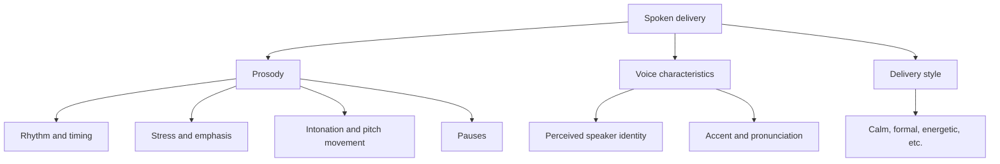
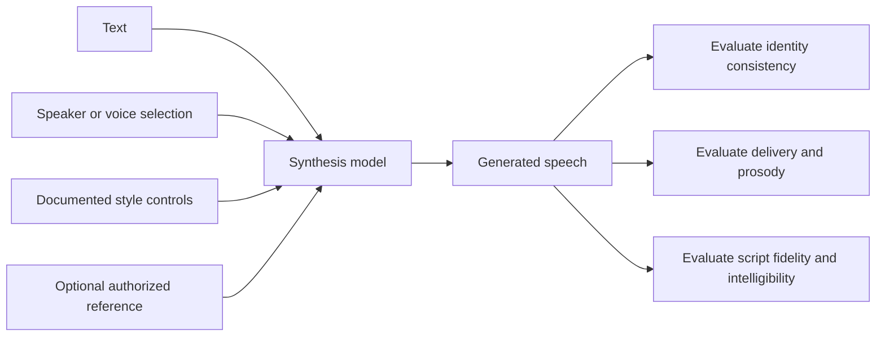

# 05. Speaker Characteristics and Expressive Speech

## Learning objectives

By the end of this chapter, you should be able to:

- Distinguish speaker identity, accent, delivery style, emotion, and prosody.
- Explain rhythm, stress, intonation, and pauses as components of spoken delivery.
- Compare preset voices with reference-conditioned or custom voices when the selected system permits them.
- Evaluate consistency across independently generated speech segments.
- Recognize the limits of expressive controls and avoid treating generated delivery as a reliable measurement of a real person's emotional state.
- Use voice references only with appropriate consent, authorization, and data-handling safeguards.

 

## 1. Five concepts that should not be conflated

Speech has multiple characteristics. They can interact, but each describes a different dimension.

| Concept | Meaning | Example | What it does not establish |
|---|---|---|---|
| **Speaker identity** | The perceived vocal identity associated with a speaker or voice | A consistent synthetic voice used for a narration | Real-world identity, authorization, or consent |
| **Accent** | Pronunciation patterns associated with a language variety or region | A regional pronunciation of English vowels | A person's nationality, ethnicity, or complete linguistic background |
| **Delivery style** | The manner in which speech is presented | Calm narration, energetic announcement, formal presentation | The speaker's actual inner state |
| **Emotion** | Affective meaning expressed or perceived in speech | A line delivered to sound reassuring or frustrated | A reliable diagnosis or certain inference about a real person's feelings |
| **Prosody** | Suprasegmental properties that organize speech beyond individual phonemes | Stress, rhythm, intonation, and timing | Speaker identity by itself |

A TTS system may expose a preset voice, a style selector, a reference-audio input, or none of these. The available controls depend on the model and interface. Do not infer capabilities from terminology alone.

 

## 2. Prosody: rhythm, stress, intonation, and pauses

Prosody strongly affects how speech is interpreted. The same words can sound like a question, a warning, a reassurance, or a list depending on timing and pitch movement.

### Core components

- **Rhythm:** The timing pattern of syllables, words, and phrases. Unnatural rhythm can make a sentence difficult to follow.
- **Stress:** Relative prominence given to a syllable or word. Word stress can affect pronunciation; sentence stress can signal contrast or emphasis.
- **Intonation:** Changes in pitch over an utterance. These can signal sentence type, continuation, contrast, or expressive intent, depending on language and context.
- **Pauses:** Silent intervals that separate phrases, mark boundaries, or give listeners time to process information.
- **Rate and articulation:** Speaking speed and how clearly speech sounds are produced. Faster delivery can reduce intelligibility even when the words are correct.
- **Loudness and emphasis:** Relative intensity or prominence. Loudness is not the same thing as emotion or speaker identity.

 

### Example: identical words, different emphasis

Consider the sentence:

> I didn't say she took the file.

Emphasizing **I**, **didn't**, **she**, **took**, or **file** can change the contrast a listener perceives. The exact interpretation depends on context and language, but this illustrates why word accuracy alone does not capture delivery quality.

Punctuation can influence generated prosody, but it is not a precise control language. A comma may create a pause in one model and have little effect in another. Test the actual model rather than assuming a particular punctuation mark guarantees a particular acoustic result.

 

## 3. Preset voices versus reference-conditioned or custom voices

### Preset voice

A preset voice is a supported voice option supplied by the provider. It is usually the simplest choice for a reproducible application.

**Advantages**
- Easier to select and reproduce using a documented voice ID.
- No need to collect reference recordings.
- Lower operational and consent burden than using a person's voice reference.
- Often suitable for narration, accessibility, and standard application prompts.

**Limitations**
- The voice catalogue may not match a project's desired accent, age impression, or delivery style.
- Expressiveness and pronunciation may be constrained.
- A preset may sound different across models or model versions.

 

### Reference-conditioned voice

A reference-conditioned system uses an audio example or other reference input to influence generated speech. Depending on the system, the reference may guide vocal characteristics, pronunciation, or style. It does not necessarily create a persistent custom voice.

 

### Custom voice

A custom-voice feature may allow an authorized user or organization to create or configure a voice for repeated use. Requirements vary substantially by provider and can include identity checks, explicit consent, eligibility limits, or other controls.

| Dimension | Preset voice | Reference-conditioned generation | Custom voice |
|---|---|---|---|
| Main input | Documented voice ID | Text plus permitted reference input | Text plus an authorized configured voice |
| Reproducibility | Often straightforward if model/version are fixed | Depends on reference, settings, and model | Depends on voice configuration and model version |
| Reference recording needed | Usually no | Usually yes | Often yes, but implementation varies |
| Consent and authorization burden | Use within provider terms | Important when reference contains a person's voice | Important; provider may require explicit verification |
| Style control | Only documented options | May be influenced by reference; not guaranteed | Depends on the service |
| Main risk | Misunderstood voice capabilities | Unauthorized imitation or reference leakage | Misuse, impersonation, or unclear voice ownership |

These are conceptual categories, not guarantees about a particular vendor. Read the selected provider's current documentation and usage policies before implementation.

 

## 4. Expressive controls are not speaker identity

A **voice identity** concerns the vocal characteristics that make a voice sound like a particular speaker or synthetic persona. **Expressive controls** affect how a line is delivered: for example, its pace, emphasis, or intended style, if the system supports those controls.

The same voice can deliver the same sentence in multiple styles. Conversely, different voices can deliver a sentence in a similar calm or energetic style.

Do not assume that:
- A “happy” style setting means the model has a genuine emotional state.
- A calm voice proves the speaker is calm.
- A voice that resembles a reference is authorized to represent that person.
- A pitch or speed change necessarily changes identity in a controlled or predictable way.
- A style label has the same acoustic effect across different models.

Expressive controls are often broad and probabilistic. A setting can influence output without guaranteeing a precise intonation contour, emotional interpretation, or pause duration.

 

## 5. Consistency across segments

Generating each sentence independently can introduce unwanted differences in perceived voice, accent, loudness, rate, or prosody. Even when the same voice ID is used, the model may phrase separate chunks differently.

### Common continuity problems

- A voice sounds brighter or lower in one chunk.
- Speaking rate changes between sentences.
- A pause becomes much longer at a chunk boundary.
- Emphasis is repeated or disappears.
- Pronunciation of a name changes between segments.
- The style is expressive in one chunk and neutral in the next.
- Audio levels differ, making the edit obvious.

 

### Mitigation

1. Fix the model/version, voice ID, language, and documented settings for all chunks.
2. Keep the script and chunk boundaries stable during comparisons.
3. Prefer sentence or paragraph boundaries; avoid splitting a phrase in the middle.
4. Use a consistent reference input if the API supports it and its use is authorized.
5. Listen to transitions, not just individual clips.
6. Compare measured loudness and duration where useful, but do not treat these measurements as a complete assessment of naturalness.
7. If a chunk is regenerated, rerun the boundary review because its phrasing may differ.
8. Keep an approved final recording when exact delivery must remain stable.

 

## 6. Responsible use of voice references

Voice recordings can be personal data and can be used to imitate or impersonate a person. Use reference audio only when you have the necessary rights and consent and when the provider's policies allow the intended use.

Practical safeguards:

- Obtain informed, explicit consent for uses that imitate or reproduce an identifiable person's voice.
- Follow the service's requirements for voice verification and permitted use.
- Do not use a reference to mislead listeners about who is speaking or whether a recording is synthetic.
- Apply access controls, retention limits, and deletion procedures to source recordings and derived voice assets.
- Disclose synthetic or voice-cloned speech when required by law, policy, platform rules, or the audience's reasonable need to know.
- Do not treat vocal delivery as certain evidence of a person's actual emotional state, intent, honesty, or mental health.
- Keep the origin of the audio and any human edits documented.

A voice can be performed to sound angry, confident, or reassuring without the performer actually feeling that emotion. Likewise, a real speaker's vocal cues can be ambiguous and affected by culture, context, health, recording conditions, and individual differences.

 

## 7. Practice: compare two supported delivery styles

Choose a TTS system that explicitly documents at least two delivery styles or style settings. If the service does not offer style controls, choose two documented voices only if the exercise is reframed as a voice comparison; do not invent unsupported parameters.

Use the same short script for both conditions:

> Good morning. Your appointment begins at 10:30 a.m. Please arrive ten minutes early and bring reference number B-204. Thank you.

 

### Controlled experiment

1. Confirm the intended spoken form of the time and reference number.
2. Fix the model/version, language, script, output format, and voice identity where the system allows it.
3. Select two documented delivery styles, changing only the style setting.
4. Generate each condition at least twice if variability is important to the evaluation.
5. Save the exact request settings and outputs.
6. Listen in randomized order, if practical, to reduce expectation bias.
7. Score each sample with the same rubric.
8. Record whether the style change affected intelligibility, script fidelity, and prosody—not just whether one sample sounded more appealing.

 

### Explicit evaluation rubric

Rate each dimension from **1 (poor) to 5 (excellent)**. For script fidelity, also record concrete errors; a rating alone is insufficient.

| Dimension | 1 — Poor | 3 — Acceptable | 5 — Excellent |
|---|---|---|---|
| Intelligibility | Several words difficult to understand | Most content understandable | Words consistently clear |
| Script fidelity | Important omissions or substitutions | Minor issue(s), no critical error | All words and identifiers match the script |
| Prosodic fit | Pauses, stress, or intonation conflict with intended use | Generally suitable, with some awkward phrasing | Timing and emphasis fit the intended use |
| Voice consistency | Noticeable changes in perceived voice | Mostly consistent | Stable across the full sample |
| Style fit | Delivery conflicts with the intended context | Usable but not ideal | Clearly appropriate to the intended context |
| Pleasantness | Listener finds the voice distracting or unpleasant | Acceptable | Listener finds it comfortable to hear |

Do not combine all dimensions into one score unless you have a reasoned weighting scheme. Script fidelity and intelligibility should remain visible even when style fit or pleasantness is high.

 

### Results table

| Condition | Documented setting | Intelligibility (1–5) | Script errors | Prosodic fit (1–5) | Consistency (1–5) | Pleasantness (1–5) | Notes |
|---|---|---:|---|---:|---:|---:|---|
| A | Fill in | | | | | | |
| B | Fill in | | | | | | |

This table is a template; no experimental measurements are implied.

 

## 8. Revision questions and answers

**1. How are accent and delivery style different?**  
Accent concerns pronunciation patterns associated with a language variety. Delivery style concerns how speech is presented, such as calmly, formally, or energetically.

**2. What is prosody?**  
Prosody includes rhythm, stress, intonation, and pauses—features that shape speech beyond individual speech sounds.

**3. Does a style control change the speaker identity?**  
Not necessarily. A style control is intended to influence delivery. Voice identity and delivery should be evaluated separately, even though some acoustic features can interact.

**4. Does reference-conditioned synthesis always clone a voice?**  
No. Depending on the model, a reference may condition some vocal or stylistic characteristics without creating a persistent custom voice or guaranteeing identity-level similarity.

**5. Can generated speech prove what a real person feels?**  
No. Generated style reflects a synthesis choice, and real-world vocal cues are ambiguous. Neither should be treated as certain evidence of a person's inner emotional state.

**6. Why assess continuity across chunks?**  
Independently generated segments may differ in pace, emphasis, loudness, or perceived voice. Listening across boundaries reveals problems that isolated clips may hide.

**7. What should be checked before using a person's voice recording as a reference?**  
Confirm consent, authorization, provider-policy compliance, secure handling, retention, and appropriate disclosure for the intended use.

 

## Checkpoint

**Expressive speech controls and speaker identity are separate concepts.** Identity concerns which voice is perceived; expressive controls influence how that voice delivers a particular line. The same voice can sound calm or energetic, and different voices can use similar styles. Evaluate voice consistency, prosodic fit, intelligibility, and script fidelity independently. Never infer that a style label reveals a real speaker's actual emotional state.

 

## References and useful resources

- [OpenAI Text-to-Speech guide](https://platform.openai.com/docs/guides/text-to-speech) — verify the currently supported voices, instructions, and synthesis controls.
- [OpenAI Audio API reference](https://platform.openai.com/docs/api-reference/audio) — current endpoint request and response details.
- [W3C Speech Synthesis Markup Language (SSML) 1.1](https://www.w3.org/TR/speech-synthesis11/) — standard concepts for speech synthesis markup; features must also be supported by the selected provider.
- [NIST Speaker Recognition Evaluation](https://www.nist.gov/itl/iad/mig/speaker-recognition) — background on speaker-recognition evaluation, which is distinct from style control and speech synthesis.
- [Python SoundFile documentation](https://python-soundfile.readthedocs.io/) — audio file inspection and processing.

 

**Implementation note:** Voice catalogues, reference-audio requirements, custom-voice eligibility, style controls, and usage policies vary by provider and change over time. Confirm current documentation and authorization requirements before deployment.
