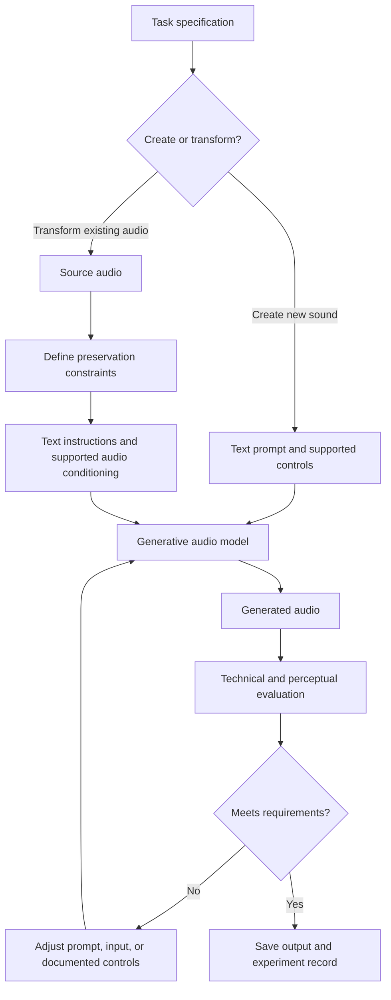

# 06. Audio-to-Audio and General Audio Generation

## Learning objectives

By the end of this chapter, you should be able to:

- Compare speech transformation, audio enhancement, sound-effects generation, music generation, and audio continuation.
- Explain how text conditioning and audio conditioning influence generation.
- Define content-preservation requirements before transforming an existing recording.
- Evaluate duration, continuity, diversity, prompt adherence, artifacts, and unwanted changes.
- Distinguish generative transformations from conventional signal-processing operations.
- Design a controlled audio-generation experiment using permitted inputs and a clear evaluation rubric.

<br/>

## 1. Task families

“Audio generation” covers multiple tasks. The correct workflow depends on whether the goal is to preserve an existing recording, transform it, or create new content.

| Task | Input | Intended output | Key evaluation question |
|---|---|---|---|
| Speech transformation | Existing speech, sometimes text or a reference voice | Speech with a changed characteristic, such as delivery or voice, where supported | Did the requested characteristic change while the words and meaning remained stable? |
| Audio enhancement | Existing audio | Cleaner or more usable audio | Was noise reduced without damaging important speech or sounds? |
| Sound-effects generation | Text prompt and optionally audio/reference conditioning | A sound such as a door closing, rain, or a mechanical hum | Does the sound match the prompt and have the intended duration and texture? |
| Music generation | Text prompt and/or musical/audio conditioning | A musical passage | Does it fit the requested instrumentation, mood, structure, and duration? |
| Audio continuation | An audio prefix or other conditioning | A plausible continuation of the existing audio | Does the continuation connect naturally while respecting the intended style and content? |
| Audio editing or inpainting | Existing audio plus a target region or instruction, where supported | A modified section of the recording | Was the target region changed while unaffected regions stayed stable? |
| Conventional signal processing | Existing audio plus explicit processing parameters | Filtered, resampled, compressed, mixed, or otherwise deterministically processed audio | Did the operation achieve its measurable signal-processing objective? |

These tasks are related but not interchangeable. A system designed to generate music may not support speech transformation; an enhancement model may not preserve every transient; and a generic text-to-audio model may not continue an existing clip.

<br/>

## 2. Generative transformation versus signal processing

A central design choice is whether the task requires a generative model or a conventional signal-processing operation.

### Conventional signal processing

Conventional processing applies an algorithm or transformation to an existing signal. Examples include:
- Resampling to a different sample rate.
- Changing gain or normalizing loudness.
- Applying an equalizer or high-pass filter.
- Compressing dynamic range.
- Mixing tracks or trimming silence.
- Applying a specified time stretch or pitch shift.

These operations can be predictable and measurable, but they have limitations. A filter cannot reliably reconstruct speech that was never recorded, and resampling cannot restore frequencies or details lost in the original recording.

<br/>

### Generative audio processing

A generative system produces audio using a learned model conditioned on text, audio, or other supported inputs. It may create plausible missing or new content, change the character of a voice, or generate a new sound scene.

Generative output is not necessarily a faithful reconstruction. It can introduce plausible but unobserved details, change timing, alter timbre, or omit content. That makes preservation checks essential when the input recording is evidence or must remain faithful.

| Requirement | Usually start with | Why |
|---|---|---|
| Convert sample rate | Resampling | Direct, measurable transformation |
| Reduce a known frequency band | Filtering / equalization | Explicit control over the affected band |
| Adjust loudness | Gain or loudness normalization | Predictable objective |
| Generate a new rain sound from a prompt | Text-to-audio generation | The content does not already exist |
| Create a musical continuation | A model that explicitly supports audio continuation | New content must connect to the prefix |
| Change speech delivery or voice | A system documented for that transformation | The operation requires learned speech generation |
| Restore heavily missing words | No automatic guarantee | A model may invent plausible words; verify against an independent source |

The choice is task-dependent. A generative model can be useful for complex transformations, but should not replace a simpler deterministic method when the latter meets the requirement with less risk.

<br/>

## 3. Conditioning: what guides generation?

**Conditioning** is information supplied to guide the model's output. A task may use text, an audio input, or a combination, depending on the model.

- **Text conditioning:** A prompt describes the target sound, such as “soft rain on a window with distant thunder.”
- **Audio conditioning:** An existing clip, reference, or prefix guides the generated output when the system supports it.
- **Text plus audio conditioning:** Text describes the desired transformation while audio supplies source content or style context.
- **Additional controls:** Duration, seed, strength, start/end regions, or other parameters may exist in some systems. Use only documented controls.

A prompt is an instruction, not a guarantee. The model may follow the broad scene but miss a specific instrument, rhythm, spoken word, or timing requirement.



<br/>

### Define change and preservation separately

Before running a transformation, write down:

1. **What should change?** For example, reduce steady background hiss, add a rain ambience, or create a continuation.
2. **What must remain stable?** For example, spoken words, speaker turns, event order, rhythm, timing, or the original segment outside an edit region.
3. **What may vary?** For example, the exact texture of generated rain or musical ornamentation.
4. **What is unacceptable?** For example, invented speech, altered names, clipped transients, abrupt boundaries, or a new sound that masks a warning tone.

These constraints determine how output quality should be measured.

<br/>

## 4. Duration, continuity, diversity, and prompt adherence

### Duration

Duration can be specified by a prompt, a parameter, an input prefix, or a model's fixed output behavior. Some interfaces provide explicit duration controls; others do not. Confirm the documented behavior and measure the actual output duration.

<br/>

### Continuity

Continuity matters when the output extends or transforms existing audio:
- Does the new audio connect smoothly to the source?
- Are there clicks, abrupt loudness shifts, or unnatural gaps at boundaries?
- Does rhythm or ambience remain coherent?
- Are timing and event order preserved when required?

<br/>

### Diversity

Generative systems may produce different outputs for the same prompt. Diversity is useful when exploring sound design, but it complicates reproducibility. Where supported, record random seeds and all generation settings. Do not assume a seed guarantees bit-identical output across model versions or infrastructure.

<br/>

### Prompt adherence

Assess whether the output includes the requested source, actions, instruments, mood, texture, and temporal structure. Broad semantic similarity is not enough if a particular event is required.

<br/>

### Artifact and preservation review

Listen and inspect for:
- Clicks, crackles, warbling, metallic or watery artifacts.
- Abrupt changes in background ambience.
- Unwanted extra sounds or missing expected events.
- Altered speech, names, numbers, or speaker turns.
- Clipping, silence, truncation, or incorrect duration.
- Phase or level changes introduced during mixing or assembly.
- Boundary discontinuities between source and generated segments.

<br/>

## 5. Evaluation methods

No single metric captures every audio-generation task. Combine technical validation with listening and task-specific checks.

| Dimension | Example measurement or method | Applies especially to |
|---|---|---|
| Duration | Actual duration versus target or expected range | All generation tasks |
| Prompt adherence | Human checklist against explicit prompt requirements | Sound effects, music, continuation |
| Content preservation | Compare transcript, event list, or source/output regions | Speech transformation, enhancement, editing |
| Intelligibility | Listening or a validated speech-recognition aid followed by human review | Speech tasks |
| Continuity | Boundary listening; waveform or loudness inspection | Continuation and chunked output |
| Artifacts | Structured listening checklist; waveform/spectrogram inspection where helpful | All tasks |
| Diversity | Compare multiple outputs against the same prompt | Generative exploration |
| Technical validity | Decoder success, duration, sample rate, channels, clipping checks | All tasks |
| User suitability | Task-specific listener rating | Music, sound effects, transformed speech |

Automated metrics are proxies. A low noise estimate does not prove that speech was preserved, and a similarity score does not prove that a generated sound satisfies the intended creative requirement.

<br/>

### A simple preservation check for speech

For speech transformations, a practical first check is to transcribe both the source and output and compare the transcripts. This is only a screening method: ASR itself can make errors, and identical transcripts do not guarantee identical speaker turns, timing, or meaning. Listen to differences, especially in critical content.

<br/>

## 6. Practical audio inspection with Python

Install dependencies with `pip install soundfile numpy`. This example compares basic metadata and peak amplitude for a source and a generated file. It does not judge semantic quality or whether the transformation followed the prompt.

```python
from pathlib import Path
import numpy as np
import soundfile as sf

def inspect_audio(path: str) -> dict:
    path = Path(path)
    if not path.exists() or path.stat().st_size == 0:
        raise FileNotFoundError(f"Missing or empty audio file: {path}")

    audio, sample_rate = sf.read(path, always_2d=True)
    if audio.size == 0:
        raise ValueError(f"No decoded samples in {path}")

    peak = float(np.max(np.abs(audio)))
    rms = float(np.sqrt(np.mean(np.square(audio))))
    duration = len(audio) / sample_rate

    return {
        "file": path.name,
        "duration_s": duration,
        "sample_rate_hz": sample_rate,
        "channels": audio.shape[1],
        "peak_amplitude": peak,
        "rms_amplitude": rms,
    }

for filename in ("source.wav", "generated.wav"):
    print(inspect_audio(filename))
```

Interpretation:
- Duration and channel count help detect truncation or format mismatch.
- Peak amplitude close to or above the representable maximum may indicate clipping in a normalized floating-point workflow; inspect the actual encoding and signal.
- RMS amplitude summarizes average signal level but does not measure perceived loudness or prompt adherence.
- A file can pass every check above and still contain the wrong sound.

For compressed formats not supported by your installed SoundFile/libsndfile build, decode to a supported format using an appropriate media tool before analysis. Preserve the original source.

<br/>

## 7. Practice: design a permitted audio experiment

Choose one of the following experiment types. Use recordings you own, have permission to process, or are otherwise permitted to use. Avoid uploading private or identifiable speech to a service without appropriate authorization and review of its data-handling terms.

### Option A — Generate a sound effect

**Goal:** Generate a short rain ambience.

Example prompt:

> Create a continuous 8-second sound of steady rain falling on a window, with a soft indoor room tone. No speech, music, thunder, or sudden impacts.

Use a model that documents text-to-audio or sound-effects generation. If duration is not a supported control, treat “8-second” as a prompt instruction and measure the actual output rather than assuming compliance.

**Change requirement:** Create the requested rain ambience from text.

**Stable requirements:** No speech, no music, no sudden loud impact, and no abrupt cut at the end.

<br/>

### Option B — Enhance an existing recording

**Goal:** Reduce steady background noise while retaining the speaker's words and timing.

**Change requirement:** Lower the unwanted noise.

**Stable requirements:** Spoken words, speaker order, important breaths or cues when required, and the timing of the original recording.

Use a permitted source recording. Compare source and output at matched playback levels so that “louder” is not mistaken for “better.”

<br/>

### Option C — Continue a music or ambience clip

**Goal:** Extend a short instrumental or ambience prefix.

**Change requirement:** Add new audio after the supplied prefix.

**Stable requirements:** A compatible texture, plausible transition, and no unintended abrupt change at the join. If the model cannot guarantee preservation of the original prefix, compare the prefix in the output with the original and document any differences.

<br/>

### Experiment procedure

1. Choose one task and state why a generative model is appropriate.
2. Record the source permissions and any consent requirements.
3. Write explicit **change**, **preserve**, **allow to vary**, and **reject** criteria.
4. Save the exact prompt, source version, model/version, settings, and output format.
5. Generate at least one output; generate multiple candidates if diversity is part of the experiment.
6. Validate that each output is decodable and measure its actual duration.
7. Listen using the same playback setup and a task-specific checklist.
8. Compare the output with the source where preservation matters.
9. Record failures and trade-offs instead of selecting an output solely because it sounds impressive.

<br/>

### Experiment report template

- **Task type:**
- **Why generation is appropriate:**
- **Input source and permission status:**
- **Model / version / documented interface:**
- **Prompt and settings:**
- **Target duration / measured duration:**
- **What should change:**
- **What must remain stable:**
- **What may vary:**
- **Unacceptable changes:**
- **Technical validation results:**
- **Prompt adherence observations:**
- **Artifacts or preservation failures:**
- **Candidate diversity (if measured):**
- **Limitations and next experiment:**

<br/>

## 8. Revision questions and answers

**1. How is generative audio transformation different from conventional signal processing?**  
Conventional processing applies explicit operations to a signal, such as filtering or resampling. Generative transformation uses a learned model to produce or modify content and may introduce details not present in the source.

**2. What is conditioning?**  
Conditioning is information—such as text, an audio reference, or an audio prefix—that guides a model's output when the model supports that input.

**3. Why define preservation requirements before generation?**  
Without them, evaluation may reward an output that sounds good but changes critical content. Preservation criteria determine what counts as a failure.

**4. Why is prompt adherence not enough?**  
An output can match the broad prompt while containing artifacts, wrong duration, missing events, or unwanted changes to the source.

**5. Does a valid audio file prove that the output is good?**  
No. Technical validity confirms that the file can be decoded and inspected. It does not establish content correctness, continuity, or suitability.

**6. How should diversity be evaluated?**  
Generate multiple outputs under recorded settings and compare how they vary against the same criteria. Record seeds where supported, but do not assume seeds guarantee identical output across versions.

**7. When should conventional processing be preferred?**  
When a deterministic operation such as resampling, gain adjustment, or a targeted filter directly meets the requirement with fewer risks than generation.

<br/>

## Checkpoint

Before evaluating an audio output, specify **what should change** and **what should remain stable**. For noise reduction, the intended change may be lower background noise, while the stable content includes spoken words and event timing. For a generated sound effect, the intended change is the creation of a new sound; stability may instead mean satisfying duration, continuity, and exclusion constraints. The evaluation rubric must follow the task rather than treating every output as a generic “quality” problem.

<br/>

## References and useful resources

- [OpenAI Audio guide](https://platform.openai.com/docs/guides/audio) — check current audio capabilities and API contracts; do not assume every audio-generation task is supported by the same endpoint.
- [Hugging Face Audio course](https://huggingface.co/learn/audio-course) — background on audio tasks and model workflows.
- [Python SoundFile documentation](https://python-soundfile.readthedocs.io/) — reading and inspecting audio data.
- [FFmpeg documentation](https://ffmpeg.org/documentation.html) — decoding, conversion, trimming, and media inspection.
- [ librosa documentation](https://librosa.org/doc/latest/index.html) — audio analysis and signal-processing tools.

<br/>

**Implementation note:** Supported conditioning inputs, task types, duration controls, model identifiers, output formats, licensing, and pricing vary by provider. Verify the current documentation and permissions for the specific model before building a workflow.
