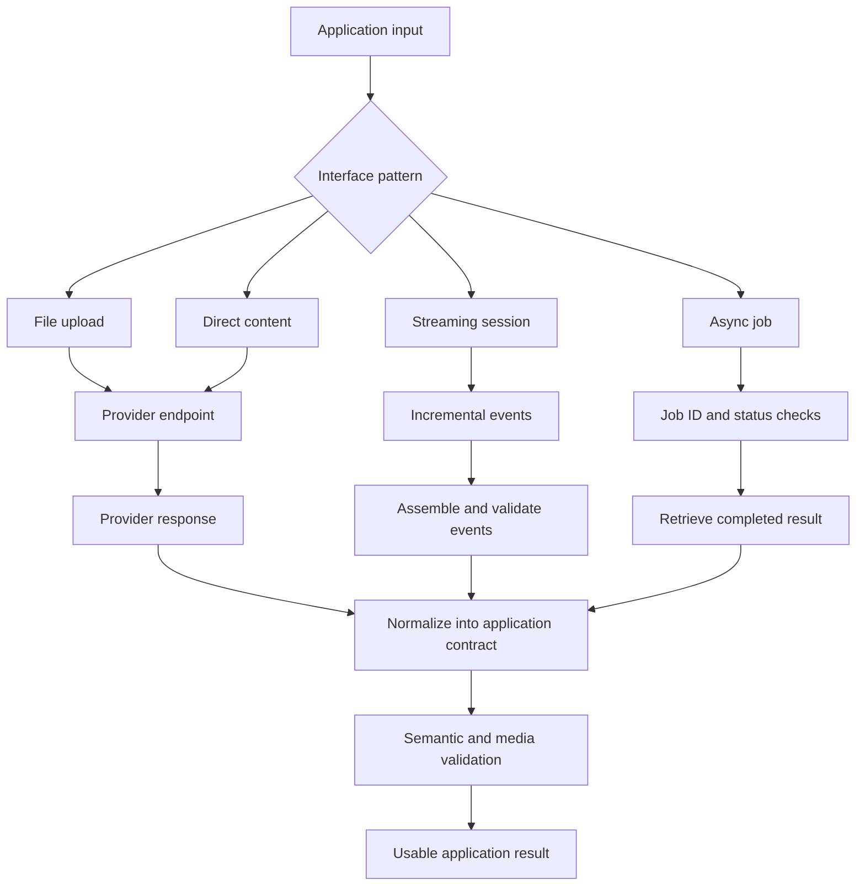
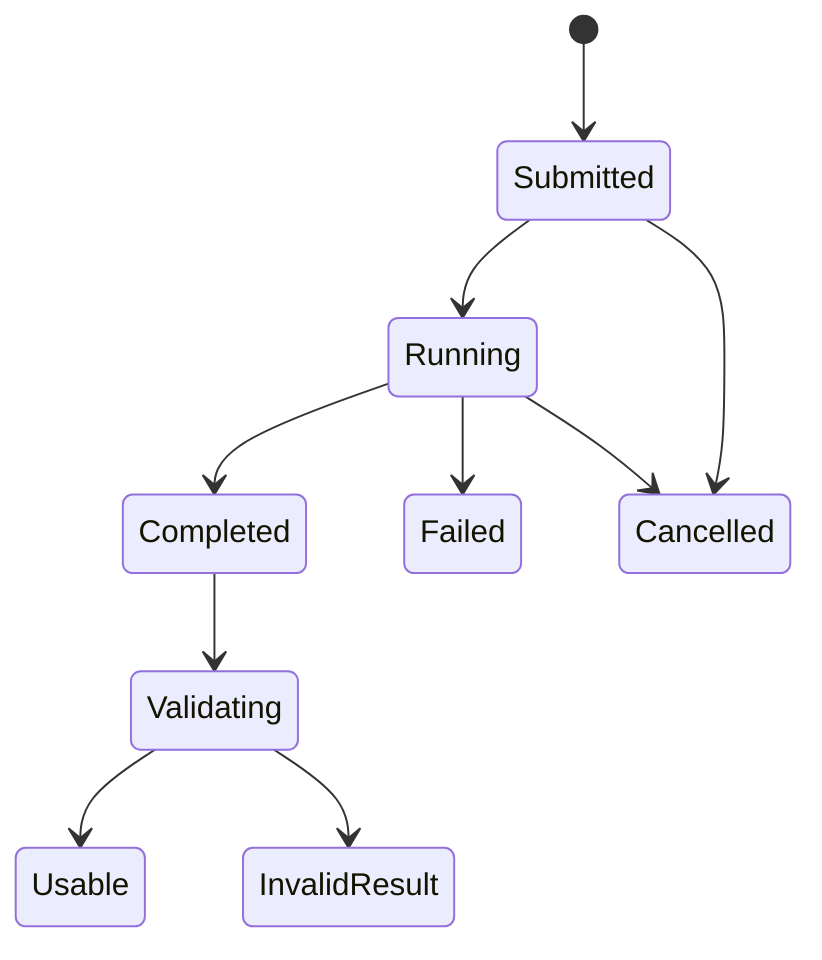

# 07. Text, Audio, and Speech Model Interfaces

## Learning objectives

By the end of this chapter, you should be able to:

- Inspect supported request formats, codecs, sample rates, file sizes, and duration limits before calling a model.
- Compare file upload, direct content input, streaming, and asynchronous-job interfaces.
- Parse transcripts, timestamps, audio bytes, and structured metadata into explicit application contracts.
- Handle credentials, input validation, provider errors, refusals, timeouts, and incomplete responses.
- Keep provider-specific capabilities, limits, and usage accounting explicit.
- Implement a small interface with a real or fake client and typed result contracts.
- Distinguish a successful network/API request from a valid, usable media result.

<br/>

## 1. Why interfaces matter

A model interface is the boundary between an application and an audio or speech service. It includes the request schema, accepted media representation, authentication, response schema, errors, and usage reporting.

A successful HTTP response does not guarantee that the returned media is valid or useful. For example:
- The request may succeed but return an empty transcript.
- Audio bytes may be present but fail to decode.
- A transcript may be returned without timestamps even though the application expects them.
- A long-running job may be accepted but not yet completed.
- A response may be syntactically valid but violate the application's semantic requirements.

Treat the provider interface as a contract and validate it at both the transport and application levels.

<br/>

## 2. Request and response contracts

A **request contract** specifies what an application may send. A **response contract** specifies what it can expect back. A **provider contract** documents the actual fields, limits, formats, and error behavior of a specific service.

### Request fields to inspect

| Field or property | Questions to answer |
|---|---|
| Task / endpoint | Is the task transcription, translation, speech generation, or another supported operation? |
| Model ID | Which model identifier is currently supported for this endpoint? |
| Input representation | Does the API accept a file upload, URL, raw bytes, encoded content, or a structured media object? |
| Container and codec | Which formats and codecs are accepted? Are they different for input and output? |
| Sample rate / channels | Are particular sample rates or channel counts required? Is conversion the caller's responsibility? |
| Size / duration | What are the documented maximum file size, request size, or audio duration? |
| Language | Is language selection required, optional, or inferred? Which language codes are supported? |
| Output detail | Can the endpoint return segments, word timestamps, speaker labels, or only plain text? |
| Streaming | Is incremental input/output supported? What events indicate completion or failure? |
| Async jobs | Does the request return a final result or a job ID that must be polled? |
| Usage / billing | What units are counted, and where is usage reported? |
| Data handling | What are the retention, logging, and permitted-use rules? |

Do not assume that support for a codec, timestamp option, language, or streaming mode on one endpoint implies support on another.

<br/>

### A generic request/response contract

The following JSON is an illustrative application-level schema, not a provider's API specification:

```json
{
  "task": "transcription",
  "input": {
    "kind": "file",
    "path": "recording.wav"
  },
  "options": {
    "language": "en",
    "timestamps": "segments"
  }
}
```

An application might normalize the provider response to:

```json
{
  "task": "transcription",
  "status": "completed",
  "text": "Please send the report on Friday.",
  "segments": [
    {
      "start_s": 1.2,
      "end_s": 3.05,
      "text": "Please send the report on Friday."
    }
  ],
  "audio_path": null,
  "usage": {
    "provider_reported_units": null,
    "unit_name": null
  }
}
```

The application contract should make optional fields explicit. A missing timestamp is different from a timestamp of zero; absent usage data is different from zero usage.

<br/>

## 3. Common interface patterns

### File upload

The application sends a media file through a multipart upload or another documented upload mechanism.

**Useful when:** the source is already a file and the endpoint accepts that format.

**Considerations:** upload size, network time, temporary files, MIME type, content validation, and provider limits.

<br/>

### Direct content input

The application supplies media as bytes, an encoded payload, or a structured content block.

**Useful when:** audio is already in memory or is part of a multimodal request.

**Considerations:** base64 or JSON encoding can increase payload size; large bodies can consume memory; accepted representations differ by endpoint.

<br/>

### Streaming

Audio or results arrive incrementally, often as chunks or events.

**Useful when:** low latency or live interaction matters.

**Considerations:** partial results may be revised, chunks may arrive out of order or fail, and the client must handle end-of-stream, cancellation, and backpressure according to the protocol.

<br/>

### Asynchronous jobs

The client submits a task and receives a job identifier. It later polls, receives a callback, or retrieves a result.

**Useful when:** processing takes longer than a normal request or the provider supports batch jobs.

**Considerations:** job states, retries, duplicate submissions, polling intervals, expiry, and idempotency.



Choose the interface based on latency, payload size, reliability needs, and supported provider behavior—not simply because one pattern is familiar.

<br/>

## 4. Input validation and media preflight

Validate inputs before spending time or money on a remote request.

Recommended preflight checks:
1. The file or payload exists and is non-empty.
2. The file can be decoded or its container metadata can be read.
3. The actual format matches the declared format.
4. Sample rate, channels, size, and duration meet the endpoint's documented requirements.
5. The task and model are compatible.
6. The user is authorized to submit the content.
7. The request does not include unsupported parameters.
8. Credentials are available without being exposed in logs.

Do not trust the filename extension or a caller-provided MIME type as the only evidence of media format. Inspect the file using a suitable decoder or media library.

Example local preflight for audio files:

```python
from pathlib import Path
import soundfile as sf

def validate_audio_file(path: str, max_duration_s: float) -> dict:
    file_path = Path(path)

    if not file_path.is_file():
        raise FileNotFoundError(f"Audio file not found: {file_path}")
    if file_path.stat().st_size == 0:
        raise ValueError("Audio file is empty")

    info = sf.info(file_path)
    if info.frames <= 0 or info.samplerate <= 0:
        raise ValueError("Audio file has no valid audio frames")
    if info.duration <= 0:
        raise ValueError("Audio duration must be positive")
    if info.duration > max_duration_s:
        raise ValueError(
            f"Duration {info.duration:.2f}s exceeds local limit "
            f"{max_duration_s:.2f}s"
        )

    return {
        "path": str(file_path),
        "size_bytes": file_path.stat().st_size,
        "duration_s": info.duration,
        "sample_rate_hz": info.samplerate,
        "channels": info.channels,
        "format": info.format,
        "subtype": info.subtype,
    }
```

`max_duration_s` must be configured from the selected endpoint's current documentation or the application's own stricter limit. This function validates local decodability and a duration threshold; it does not prove the provider will accept the request.

<br/>

## 5. Parse provider responses into typed application results

Do not allow provider-specific response objects to leak throughout the application. Normalize them at the boundary into a small, documented contract. This makes testing easier and reduces the impact of provider changes.

The example below uses Python dataclasses and a protocol for a small **transcription interface**. The client is injected, so tests can use a fake client without network access.

```python
from dataclasses import dataclass
from typing import Protocol, Sequence


@dataclass(frozen=True)
class Segment:
    start_s: float
    end_s: float
    text: str
    speaker_id: str | None = None


@dataclass(frozen=True)
class TranscriptionResult:
    text: str
    language: str | None
    segments: tuple[Segment, ...]
    provider: str
    model: str
    usage_units: float | None = None
    usage_unit_name: str | None = None


class TranscriptionClient(Protocol):
    def transcribe(self, audio_path: str) -> object:
        """Call the provider and return its documented response object."""
        ...


def normalize_transcription(raw: dict, provider: str, model: str) -> TranscriptionResult:
    text = raw.get("text")
    if not isinstance(text, str) or not text.strip():
        raise ValueError("Response does not contain a non-empty transcript")

    normalized_segments: list[Segment] = []
    for item in raw.get("segments", []):
        start = float(item["start"])
        end = float(item["end"])
        segment_text = str(item["text"])

        if start < 0 or end < start:
            raise ValueError("Invalid segment time range")
        if not segment_text.strip():
            raise ValueError("Segment text must not be empty")

        normalized_segments.append(
            Segment(
                start_s=start,
                end_s=end,
                text=segment_text,
                speaker_id=item.get("speaker"),
            )
        )

    return TranscriptionResult(
        text=text.strip(),
        language=raw.get("language"),
        segments=tuple(normalized_segments),
        provider=provider,
        model=model,
        usage_units=raw.get("usage_units"),
        usage_unit_name=raw.get("usage_unit_name"),
    )
```

The normalizer intentionally expects a **generic normalized dictionary**. Adapt the provider-specific response to this shape using the actual documented fields. Do not assume a real SDK returns this exact dictionary.

<br/>

### Important contract choices

- Use `None` for information that is not supplied; do not silently replace it with a false value or zero.
- Validate timestamps and segment ordering when the application depends on them.
- Decide whether empty transcripts are valid for the task. In this example, they are rejected.
- Keep provider and model identifiers in the result for traceability.
- Store usage values with their unit name. A token count, audio-second count, and request count are not interchangeable.
- Keep raw responses only when useful and permitted; remove secrets and sensitive content from logs.

<br/>

## 6. Fake client for deterministic testing

A fake client allows the application contract to be tested without API credentials, network access, or usage charges.

```python
class FakeTranscriptionClient:
    def transcribe(self, audio_path: str) -> dict:
        if audio_path.endswith("empty.wav"):
            return {"text": "  ", "segments": []}

        return {
            "text": "Please send the report on Friday.",
            "language": "en",
            "segments": [
                {
                    "start": 1.2,
                    "end": 3.05,
                    "text": "Please send the report on Friday.",
                    "speaker": "SPEAKER_00",
                }
            ],
            "usage_units": 12,
            "usage_unit_name": "illustrative_units",
        }


client = FakeTranscriptionClient()
raw = client.transcribe("recording.wav")
result = normalize_transcription(raw, provider="fake", model="demo-v1")

print(result.text)
print(result.segments[0].start_s, result.segments[0].end_s)
```

This fake response is invented for testing the application contract. Its usage value is illustrative and must not be interpreted as any provider's real billing unit.

Add tests for:
- A valid response.
- An empty or missing transcript.
- Missing or malformed timestamps.
- Negative or reversed time ranges.
- Missing optional fields.
- Unexpected provider errors and timeouts.
- Duplicate or out-of-order streaming events if the interface uses streaming.
- A successful HTTP response with invalid media bytes.

<br/>

## 7. Audio generation responses and binary outputs

Transcription and speech generation return different kinds of data. A TTS endpoint may return audio bytes, a file-like response, a stream of chunks, or a structured object that references an audio asset. Follow the provider's documented contract.

For a binary response, validate:
- The request completed successfully.
- The response body is present and non-empty.
- The content type and encoding are consistent with the documented output.
- The bytes can be decoded by an appropriate media library.
- The decoded duration, sample rate, channels, and other required metadata are plausible.
- The generated speech matches the requested script, if script fidelity is required.

Never decode arbitrary binary media as UTF-8 text or save it with an assumed extension. For streamed output, assemble chunks according to the documented framing protocol; chunk boundaries may not align with complete audio files or codec frames.

A response body that contains a job ID is not audio data. An accepted job is not a completed result. An audio URL is not a valid file until access, retrieval, and decoding succeed.

<br/>

## 8. Credentials, errors, refusals, and timeouts

### Credentials

- Store API keys in environment variables or a secrets manager.
- Do not hard-code credentials in notebooks, source files, or client-side applications.
- Do not log authorization headers, keys, or signed URLs.
- Use least-privilege credentials and rotate exposed secrets.
- Apply appropriate access controls to recordings, transcripts, and generated files.

<br/>

### Error categories

| Category | Example | Recommended handling |
|---|---|---|
| Authentication / authorization | Invalid key or insufficient permission | Stop and fix credentials or permissions; do not retry unchanged indefinitely |
| Validation | Unsupported format or parameter | Correct the request using current documentation |
| Rate limiting | Too many requests | Respect retry guidance and use bounded backoff |
| Timeout / network failure | Connection lost or response deadline exceeded | Retry only when safe; use request IDs or idempotency support where available |
| Provider-side failure | Temporary server error | Bounded retry with backoff and logging that excludes secrets |
| Refusal / policy outcome | Provider declines a request | Preserve the documented refusal state; do not mislabel it as an empty transcript |
| Incomplete result | Partial stream, pending job, truncated output | Resume, retrieve, or fail according to the documented protocol |
| Invalid media | Bytes cannot be decoded or duration is zero | Reject the result and record a media-validation failure |
| Semantic failure | Empty transcript, missing required timestamps, altered script | Reject or route to review based on task requirements |

A refusal is not the same as a transport error. A timeout is not proof that the provider did not process the request. For billable or non-idempotent operations, consider whether retrying could create duplicate work or charges.

<br/>

### A basic retry policy

Use a bounded retry policy for transient failures only. Validation errors and authentication failures usually require a changed request or configuration, not repeated retries.

```python
import time

def call_with_bounded_retry(operation, attempts=3, base_delay_s=0.5,
                            retryable=(TimeoutError, ConnectionError)):
    for attempt in range(attempts):
        try:
            return operation()
        except retryable:
            if attempt == attempts - 1:
                raise
            time.sleep(base_delay_s * (2 ** attempt))
```

This example handles only the listed Python exceptions and uses simple exponential backoff. A real SDK may raise its own exception types and provide retry-after headers, request IDs, or idempotency controls. Adapt the policy to the provider rather than wrapping every error in a blind retry.

<br/>

## 9. Streaming and asynchronous result states

### Streaming

A streaming client may receive partial transcripts, audio chunks, status events, or tool/protocol events. Define the application's state machine and use the provider's event semantics.

Possible normalized states include:
- `started`
- `partial`
- `completed`
- `failed`
- `cancelled`

These are illustrative application states, not a provider's exact event names. The application should handle incomplete streams and avoid treating a partial result as final.

<br/>

### Asynchronous jobs

A simple job lifecycle may be represented as:



A provider may use different statuses or omit some transitions. Normalize its documented states, retain the provider job ID, and avoid submitting duplicate jobs merely because a status check was delayed.

<br/>

## 10. Provider-specific capabilities and usage accounting

Keep a capability record for each endpoint/model rather than assuming one universal audio interface.

| Capability | Record explicitly |
|---|---|
| Task | ASR, translation, TTS, sound generation, or other supported task |
| Input formats | Containers, codecs, encoding, sample rates, channels |
| Limits | File/request size, duration, text length, concurrency |
| Output | Text, segments, timestamps, speaker labels, audio bytes, structured events |
| Interaction mode | Single request, streaming, asynchronous job, batch |
| Controls | Language, voice, timestamps, style, rate, or other documented options |
| Usage accounting | Provider-reported units, unit name, billing basis, and whether data is missing |
| Errors | Documented error codes, retryability, refusal behavior |
| Governance | Retention, privacy, consent, regional availability, permitted use |

Usage accounting must remain provider-specific. Do not compare unlike units directly or invent a universal cost estimate. Keep the raw provider usage and a normalized field, preserving the original unit and source. If the provider reports no usage, store it as unavailable rather than zero.

<br/>

## 11. Practice: implement a typed interface

Build a small transcription adapter with either a fake client or a real provider client.

### Required behavior

1. Accept an audio path or an explicitly documented media input.
2. Validate local input before calling the client.
3. Call a client through a narrow interface.
4. Normalize the response into a typed result.
5. Validate required fields and timestamp ranges.
6. Distinguish provider errors, incomplete results, invalid media, and semantically invalid transcripts.
7. Record provider/model identifiers and usage units when available.
8. Test the adapter with a fake client before connecting real credentials.

<br/>

### Suggested project layout

```text
audio_interface_demo/
├── src/
│   ├── contracts.py       # Typed request and result objects
│   ├── validation.py      # Local input and result checks
│   ├── client_protocol.py # Narrow provider-client interface
│   ├── adapter.py         # Provider-specific mapping
│   └── app.py             # Application orchestration
├── tests/
│   ├── test_valid_result.py
│   ├── test_empty_transcript.py
│   ├── test_bad_timestamps.py
│   └── test_provider_errors.py
├── .env.example           # Names of environment variables only
└── README.md
```

Do not commit `.env` files or credentials. Keep provider-specific request code inside the adapter and keep the normalized application contract stable.

<br/>

### Experiment report template

- **Task and selected endpoint:**
- **Provider/model/version:**
- **Input format, size, duration, sample rate, channels:**
- **Documented limits checked:**
- **Interface pattern:**
- **Typed request/result contract:**
- **Validation checks:**
- **Error and retry policy:**
- **Response parsing result:**
- **Media validation result:**
- **Usage units and source:**
- **Fake-client tests passed:**
- **Real-client tests passed (if run):**
- **Unresolved provider-specific assumptions:**

<br/>

## 12. Revision questions and answers

**1. Why is a typed application result useful?**  
It provides a stable contract for downstream code and isolates provider-specific schemas inside an adapter.

**2. Why should format and duration be validated before upload?**  
It catches predictable failures early and avoids unnecessary network time, latency, and potential usage charges.

**3. Is HTTP success enough to accept a transcription?**  
No. The response must be parsed, required fields validated, and the result checked for task-specific usability.

**4. Why distinguish a refusal from an empty transcript?**  
They have different meanings and require different handling. A refusal is a policy or service outcome; an empty transcript may be a valid no-speech result or a semantic failure, depending on the task.

**5. Should every timeout be retried?**  
No. Retry transient errors only, use bounded backoff, and consider whether the original operation may already have completed or incurred a charge.

**6. Why preserve usage units?**  
Providers can account using different units. Keeping the value and its unit avoids misleading comparisons and allows later cost analysis.

**7. What does it mean for media to be usable?**  
It must pass technical checks and meet the application's semantic requirements—for example, a decodable audio file with plausible duration or a non-empty transcript with valid timestamps when required.

<br/>

## Checkpoint

**Transport success** means the request/response exchange completed according to the protocol. A **valid media result** must also pass parsing, format/decoding, metadata, and task-specific semantic checks. A successful response containing empty text, corrupt audio bytes, missing required timestamps, or an unfinished job is not a usable result. Keep transport status, provider task status, media validation, and semantic validation as separate states.

<br/>

## References and useful resources

- [OpenAI Audio guide](https://platform.openai.com/docs/guides/audio) — current audio workflows and supported interface patterns.
- [OpenAI Audio API reference](https://platform.openai.com/docs/api-reference/audio) — endpoint-specific request and response fields.
- [Python typing documentation](https://docs.python.org/3/library/typing.html) — protocols, annotations, and typed contracts.
- [Python dataclasses documentation](https://docs.python.org/3/library/dataclasses.html) — lightweight result objects.
- [Python SoundFile documentation](https://python-soundfile.readthedocs.io/) — audio metadata inspection and decoding.
- [FFmpeg documentation](https://ffmpeg.org/documentation.html) — media probing, decoding, and conversion.

<br/>

**Implementation note:** Exact endpoint names, accepted codecs, sample rates, limits, streaming events, job states, refusal structures, and usage fields vary by provider and can change. Verify the current official documentation for the selected model before deployment.
