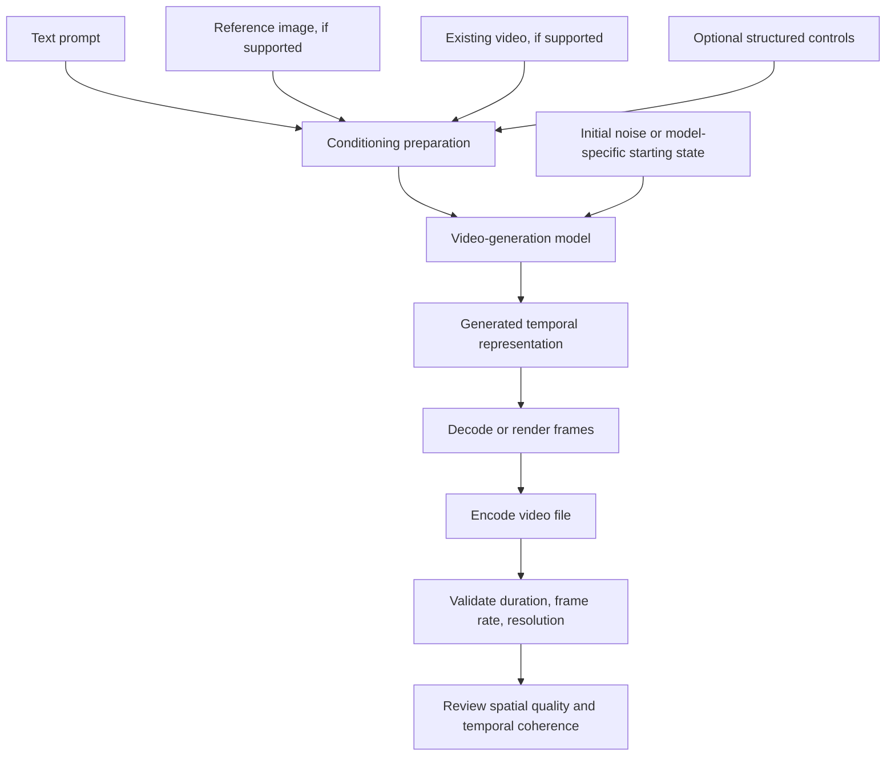

# 08. Video Generation Fundamentals

## Learning objectives

By the end of this chapter, you should be able to:

- Explain frames, frame rate, resolution, duration, and temporal representations.
- Describe latent representations, denoising, and spatiotemporal modeling at a conceptual level.
- Explain why video-generation architectures and objectives vary across models.
- Distinguish text, image, and existing-video conditioning.
- Discuss computational requirements and separate generation speed from playback speed.
- Annotate a high-level conditioned video-generation diagram and explain its data flow.

<br/>

## 1. What video generation means

Video generation creates a sequence of visual frames, often conditioned on a text prompt, one or more images, or an existing video. Depending on the model, the output may be a short clip, an extension of an existing clip, a transformation of a reference, or a sequence generated from a more structured specification.

A video is not simply a collection of unrelated images. Its frames are linked through time: objects move, people maintain their appearance, camera motion follows a path, and lighting and scene layout usually change in plausible ways. A useful video-generation system must therefore handle both **spatial quality** (how each frame looks) and **temporal coherence** (how frames relate to one another).

<br/>

## 2. Core video properties

### Frames

A frame is one still image in a video sequence. A video can be represented as an ordered sequence:
$$
V = (F_1, F_2, \ldots, F_T)
$$

where $F_t$ is the frame at time step $t$, and $T$ is the number of frames.

<br/>

### Frame rate

Frame rate is the number of frames displayed per second, measured in frames per second (FPS). If a clip contains $T$ frames and is displayed at frame rate $r$, its nominal duration is:

$$
D = \frac{T}{r}
$$

For example, a 5-second clip at 24 FPS contains $5 \times 24 = 120$ frames, assuming a constant frame rate and no special timing metadata.

The frame rate used to display a clip is not necessarily the same as the rate at which a generative model internally predicts or processes frames.

<br/>

### Resolution

Resolution describes the frame's pixel dimensions, such as 1280 × 720 or 1920 × 1080. Higher resolution generally increases the number of pixels that must be represented and can increase memory and compute requirements. Some systems generate at a lower internal resolution and then upscale; others use different latent or patch representations.

<br/>

### Duration

Duration is the temporal length of the clip. It may be requested directly, selected from supported presets, or determined by the model's output limit. Actual duration can differ from the requested value, so validate the returned media rather than assuming the prompt was followed exactly.

<br/>

### Temporal representation

A video model may represent time using explicit frames, compressed frame sequences, latent tokens, patches, or other internal structures. The exact representation varies by architecture. An application may see only the final video file and have no access to the model's internal temporal representation.

| Property | Typical unit or form | Why it matters |
|---|---|---|
| Frame count | Number of frames | Affects clip duration and computational workload |
| Frame rate | FPS | Controls playback timing and motion sampling |
| Resolution | Width × height in pixels | Affects visual detail, memory, and compute |
| Duration | Seconds | Determines how much temporal content is requested |
| Aspect ratio | Width : height | Shapes composition and output compatibility |
| Temporal coherence | Qualitative and task-specific | Measures consistency and plausible change over time |

<br/>

## 3. Why video generation is more difficult than image generation

An image model can focus on making one frame visually plausible. A video model must also coordinate frames so the same scene remains recognizable as time progresses.

Common temporal problems include:
- A character's face or clothing changes between frames.
- An object disappears and reappears without explanation.
- Motion reverses direction or violates basic physical expectations.
- Background geometry shifts even when the camera should be still.
- An object changes size or shape unexpectedly.
- Flicker appears in textures, lighting, or edges.
- The scene starts consistently but drifts later in the clip.

A clip may contain individually attractive frames and still be a poor video if objects, identities, or motion are inconsistent over time.

<br/>

## 4. Conceptual model components

Video-generation architectures differ. Some extend image-generation methods across time; others use dedicated spatiotemporal networks, transformer-based sequences, latent video representations, autoregressive components, or hybrid designs. Not every model uses the same architecture, training objective, or denoising procedure.

<br/>

### Latent representations

A **latent representation** is a compressed internal representation learned or used by a model. Instead of generating every output pixel directly at every stage, some systems operate in a lower-dimensional latent space and decode the result into frames. This can reduce computational cost, but the details depend on the model.

For video, the latent representation may encode spatial information and temporal relationships. It may compress both image content and motion-related structure.

<br/>

### Denoising, conceptually

In diffusion-style approaches, generation can be described as starting from a noisy representation and iteratively refining it toward a sample that matches the conditioning information. In a video model, the representation being refined may include information across multiple frames or a compressed temporal sequence.

This is a conceptual description, not a universal recipe. Some video-generation models use other objectives or combine multiple methods; do not assume every model uses diffusion or the same denoising schedule.

<br/>

### Spatiotemporal modeling

**Spatial modeling** concerns the contents and layout of a frame: objects, textures, geometry, and composition.

**Temporal modeling** concerns how content changes over time: object trajectories, pose transitions, camera movement, scene continuity, and event ordering.

A spatiotemporal model attempts to learn relationships across both dimensions. Its design determines how information from one frame influences other frames and how motion is represented.

<br/>

## 5. Conditioning: what guides the video?

Conditioning provides information that guides generation. Supported forms depend on the model and endpoint.

- **Text conditioning:** A prompt describes subjects, actions, environment, camera behavior, lighting, and desired style.
- **Image conditioning:** A reference image can guide the initial frame, visual appearance, composition, or another supported aspect.
- **Video conditioning:** An existing clip may guide continuation, transformation, or motion, if the system explicitly supports it.
- **Additional conditioning:** Some models may accept masks, keyframes, camera controls, or structured parameters. These are model-specific and must not be assumed.

<br/>

### High-level conditioned generation diagram



**How to annotate the diagram for practice:**
1. Mark which inputs are required and which are optional for the selected model.
2. Label the conditioning inputs with their actual accepted formats.
3. Add the model's documented duration, resolution, and aspect-ratio constraints.
4. Identify where the model's output is decoded or rendered into frames.
5. Mark the media-validation stage separately from visual-quality evaluation.
6. Note which stages are documented facts and which are only a conceptual abstraction of a closed model.

<br/>

## 6. Prompt design for video

A useful prompt describes the scene and its temporal behavior, not just a list of visual objects.

Consider a structured prompt with these elements:

- **Subject:** Who or what is visible?
- **Action:** What happens over the clip?
- **Environment:** Where does it happen?
- **Camera:** Is the camera static, tracking, panning, or moving closer?
- **Visual style:** What broad aesthetic is desired?
- **Temporal constraints:** What should remain consistent, and what changes?
- **Exclusions:** What should not appear, where the model supports negative constraints?

Example:

> A red bicycle rolls slowly along a quiet garden path at sunrise. The camera tracks beside it at a steady distance. The bicycle's frame and wheels remain consistent; soft mist moves through the background. No text overlays or abrupt cuts.

The prompt states the subject, action, environment, camera movement, continuity requirements, and exclusions. It does not guarantee that the model will satisfy them. Inspect the generated clip against each requirement.

<br/>

## 7. Computational requirements and generation speed

Video generation can be computationally expensive because it involves spatial detail across multiple time steps. Workload is affected by:
- Resolution and aspect ratio.
- Duration and frame count.
- Internal temporal representation and model architecture.
- Number of refinement steps or other model-specific generation settings.
- Conditioning complexity.
- Batch size, hardware, memory, and implementation efficiency.
- Decoding, encoding, upscaling, or post-processing.

A rough conceptual workload model is:

$$
\text{Workload} \propto
\text{spatial size} \times
\text{temporal extent} \times
\text{model-specific processing}
$$

This is not a universal performance formula. Real scaling can be nonlinear because models use latent compression, patching, attention optimizations, fixed presets, or other architectural choices.

<br/>

### Generation speed versus playback speed

These quantities answer different questions:

- **Playback speed:** How quickly the completed video is displayed, often measured in FPS.
- **Generation speed:** How quickly the model produces a clip, measured in elapsed time or generated seconds per wall-clock second.
- **Time to first output:** How long until the first frame or usable preview is available, where supported.
- **End-to-end latency:** Total time including upload, queueing, generation, decoding, encoding, and retrieval.

For example, a 5-second clip may take 90 seconds to generate and still play back at 24 FPS. Its generation rate is $5/90 \approx 0.056$ generated seconds per wall-clock second, while its playback rate is 24 frames per second. These metrics should not be confused.

When comparing models, record the same task settings and report actual elapsed time. Do not infer generation speed from the final video's FPS.

<br/>

## 8. Basic output validation

Before evaluating creative quality, confirm that the returned video is technically usable.

Check:
- The file exists and is non-empty.
- The file can be decoded.
- Actual duration is within the acceptable range.
- Actual frame rate and resolution are known.
- The frame count and playback timing are plausible.
- The first and last frames are present.
- Audio is present or absent as expected.
- The clip is not truncated, frozen, or corrupt.

A common tool for inspecting media is FFprobe, distributed with FFmpeg. For example, from a terminal:

```bash
ffprobe -v error \
  -show_entries format=duration:stream=codec_type,width,height,r_frame_rate,avg_frame_rate,nb_frames \
  -of json generated_video.mp4
```

The exact metadata fields available depend on the container and codec. Some files do not report `nb_frames` reliably. Inspect decoded frames or use a media library if exact frame counts are required.

Technical validation does not establish that the scene follows the prompt or that motion is coherent.

<br/>

## 9. Practice: annotate a conditioned video-generation diagram

Use the diagram in Section 5. Choose a model or API and consult its current documentation.

Fill out this table:

| Component | Your annotation |
|---|---|
| Task | Text-to-video, image-to-video, video continuation, or another documented task |
| Required inputs | Exact inputs required by the selected interface |
| Optional conditioning | Images, existing video, masks, keyframes, or other supported controls |
| Accepted input formats | Documented formats and size constraints |
| Output contract | File, URL, job ID, frames, or another documented result |
| Duration and resolution | Supported choices or limits |
| Model architecture | Documented information, or “not publicly specified” |
| Validation | How file integrity and media metadata will be checked |
| Quality review | How spatial fidelity and temporal coherence will be assessed |
| Compute measurement | Wall-clock generation time and output duration |

<br/>

### Practice procedure

1. Pick one bounded task, such as generating a short clip from a text prompt.
2. Identify which conditioning inputs the model actually supports.
3. Draw or annotate the data flow from request to output validation.
4. Mark unknown or proprietary internals as unknown rather than guessing.
5. Generate a clip if you have access to a suitable service, or label the exercise as a design-only analysis if no run is performed.
6. Record requested versus actual duration, resolution, and frame rate.
7. Inspect the clip at multiple points in time, not only the first frame.
8. Document one spatial-quality observation and one temporal-coherence observation.

<br/>

### Experiment report template

- **Provider / model / version:**
- **Task type:**
- **Prompt and conditioning inputs:**
- **Documented input constraints:**
- **Requested duration / actual duration:**
- **Resolution / aspect ratio / frame rate:**
- **Generation time (measured):**
- **Time to first output (if available):**
- **Spatial quality observations:**
- **Temporal coherence observations:**
- **Artifacts or prompt deviations:**
- **Documented versus unknown architecture details:**
- **Limitations and next experiment:**

<br/>

## 10. Revision questions and answers

**1. How is frame rate related to duration?**  
For a constant-frame-rate clip, duration is approximately frame count divided by frame rate. Container timing and variable frame rate can complicate the calculation.

**2. What is a latent representation?**  
It is an internal compressed representation used by some models. It can reduce the cost of working directly with pixels, but the representation and decoder vary by architecture.

**3. Does every video-generation model use diffusion?**  
No. Architectures and training objectives vary. Diffusion-style denoising is one family of approaches, not a universal requirement.

**4. What is conditioning?**  
Conditioning is information such as text, images, existing video, or supported controls used to guide generation.

**5. Why is frame-by-frame visual quality not enough?**  
A clip can have attractive individual frames but inconsistent identities, object geometry, lighting, or motion across time.

**6. Is playback FPS the same as generation speed?**  
No. Playback FPS describes display timing. Generation speed describes how long it takes to produce the clip.

**7. Why should proprietary architecture details be marked as unknown?**  
An API may expose inputs and outputs without documenting internal model design. Guessing details can lead to incorrect technical conclusions.

<br/>

## Checkpoint

Generating every frame independently usually fails to maintain a coherent scene because each frame can make its own decisions about object appearance, position, lighting, and composition. Without temporal constraints or cross-frame information, a character may change clothing, an object may move inconsistently, and backgrounds may flicker. Video generation therefore needs a mechanism—whose exact design varies by model—to coordinate visual content and motion across time.

<br/>

## References and useful resources

- [OpenAI Video generation guide](https://platform.openai.com/docs/guides/video-generation) — consult for current video-generation workflows and supported interface capabilities.
- [OpenAI API reference](https://platform.openai.com/docs/api-reference) — verify endpoint-specific request and output contracts.
- [FFmpeg documentation](https://ffmpeg.org/documentation.html) — media inspection, decoding, and encoding tools.
- [Hugging Face Diffusers documentation](https://huggingface.co/docs/diffusers/index) — background on diffusion pipelines and model-specific generation workflows.
- [PyTorch documentation](https://pytorch.org/docs/stable/index.html) — tensor and model-computing foundations.

<br/>

**Implementation note:** Video model availability, conditioning options, output limits, pricing, and architectural disclosures change over time. Verify the current provider documentation and distinguish documented facts from conceptual explanations or unmeasured assumptions.
