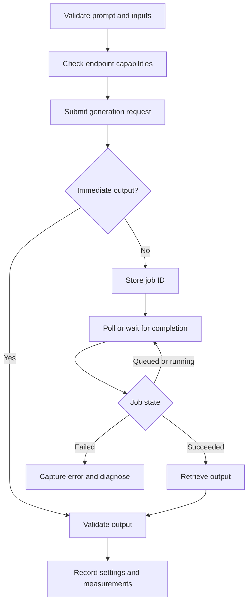

# Chapter 09: Text-to-Video and Image-to-Video

## Learning Objectives

By the end of this chapter, you should be able to:

- Design a concise text-to-video prompt that specifies subject, setting, action, camera movement, and scene duration.
- Distinguish motion occurring within a scene from movement caused by the camera.
- Prepare a reference image and validate its dimensions, aspect ratio, format, and visual suitability.
- Identify which generation controls are explicitly supported by a model or API and which details are only prompt-level requests.
- Implement the common asynchronous workflow: submit a job, poll its status, retrieve output, and handle failures.
- Record settings and observations so that a short generation experiment can be reproduced as far as the system allows.

<br/>

## 1. Text-to-Video vs. Image-to-Video

**Text-to-video (T2V)** generates a video from a text description. The prompt provides the model with a semantic specification of the scene and its intended motion.

**Image-to-video (I2V)** uses a supplied image as a visual starting point or conditioning reference. The prompt typically describes how the scene should move or evolve, rather than restating every visible detail.

| Aspect | Text-to-video | Image-to-video |
|---|---|---|
| Primary conditioning | Text prompt | Reference image, often with a text prompt |
| Visual starting point | Model synthesizes it | Image constrains initial appearance or composition |
| Main prompt emphasis | Subject, environment, action, visual style, camera | Intended motion, changes over time, camera behavior, preservation |
| Common challenge | Matching the requested scene and maintaining coherence | Preserving the reference subject/layout while introducing plausible motion |
| Best use | Creating a new scene from a description | Animating or extending an existing visual concept |

The exact role of an image, prompt, and any additional controls depends on the model. Do not assume all I2V systems preserve the first frame perfectly or support the same conditioning behavior.

<br/>

## 2. A Practical Prompt Specification

A useful prompt makes the requested scene legible and separates its major components.

### 2.1 Prompt components

1. **Subject:** What is the main object, person, animal, or group?
2. **Setting:** Where does the scene take place? Include relevant background and lighting.
3. **Action:** What changes over time? Prefer observable verbs.
4. **Camera movement:** Does the camera pan, tilt, track, dolly, or remain static?
5. **Scene duration:** How long should the event appear to unfold, if duration is a supported control? If it is not, treat duration wording as an instruction rather than a guaranteed setting.
6. **Style and constraints:** State the intended visual style, composition, and important elements to preserve or avoid, where appropriate.

<br/>

### 2.2 Prompt template

```text
Subject: [main subject and distinguishing features]
Setting: [location, background, lighting, time of day]
Action: [one clear action or short sequence]
Camera: [static / pan / tilt / tracking / dolly / other supported movement]
Duration: [target duration, if supported]
Style: [visual treatment, framing, atmosphere]
Preserve: [important features, especially for image-to-video]
Avoid: [unwanted changes or artifacts, if the model follows such instructions]
```

This template is a planning aid, not a universal API schema. A provider may accept one natural-language prompt rather than separate fields.

<br/>

### 2.3 Example: text-to-video

**Goal:** A short, calm nature shot.

```text
A white Indian owl perched on a weathered branch in a quiet forest at dawn.
The owl slowly turns its head and blinks while a few leaves move gently in
the breeze. Soft mist drifts through the background. The camera makes a
slow, smooth push-in while keeping the owl centered. Natural lighting,
realistic feather detail, calm atmosphere.
```

Why this is more useful than “an owl in a forest”:

- It identifies a clear subject and setting.
- It specifies observable motion.
- It separates subject motion (head turn, blink) from environmental motion (leaves, mist).
- It explicitly describes camera movement.
- It avoids requiring several unrelated actions in a very short clip.

<br/>

### 2.4 Example: image-to-video

Suppose the reference image already contains a person standing beside a bicycle on a quiet street.

```text
Animate the existing scene subtly. The person looks toward the street and
shifts their weight slightly; a few leaves move in the breeze. Keep the
person's clothing, bicycle design, street layout, and overall composition
consistent with the reference image. Use a gentle lateral camera move only
if supported; otherwise keep the camera still.
```

For I2V, describe the **change** you want. Avoid adding many new objects or changing the scene identity unless that transformation is intentional.

<br/>

## 3. Scene Motion vs. Camera Motion

These are related but distinct sources of apparent movement.

- **Scene/object motion:** The subject or objects move relative to the environment—for example, a bird turns its head, a car drives forward, or curtains flutter.
- **Camera motion:** The viewpoint moves—for example, a pan rotates the camera horizontally, a tilt rotates it vertically, a dolly moves the camera through space, or tracking follows a moving subject.
- **Environmental motion:** Background elements such as smoke, clouds, water, or leaves move.
- **Apparent motion from perspective:** A moving camera can cause foreground and background elements to shift relative to each other, producing parallax.

<br/>

### Common camera terms

| Term | Meaning | Prompt wording |
|---|---|---|
| Static/locked-off | Camera viewpoint stays fixed | “Keep the camera stationary.” |
| Pan | Camera rotates horizontally | “Pan slowly from left to right.” |
| Tilt | Camera rotates vertically | “Tilt upward toward the canopy.” |
| Dolly/push-in | Camera moves closer to or farther from the subject | “Make a slow push-in toward the subject.” |
| Tracking | Camera follows a moving subject | “Track alongside the cyclist.” |
| Orbit | Camera moves around the subject | “Move in a small, smooth arc around the object.” |

Terminology can vary across production contexts and model documentation. Use plain-language clarification when needed.

<br/>

### Why the distinction matters

A prompt such as “the camera moves closer as the owl turns its head” describes two simultaneous motions. If the output is wrong, diagnose them separately:

- Did the subject perform the intended action?
- Did the viewpoint move as intended?
- Did the camera movement change framing or hide important details?
- Did the background deform in a way that suggests inconsistent geometry?

For a first experiment, keep the motion budget low: one primary subject action and, at most, one simple camera move.

<br/>

## 4. Preparing a Reference Image

Before submitting an I2V request, inspect the image and check the model's documented input requirements.

### 4.1 Validation checklist

- [ ] The image file opens and decodes correctly.
- [ ] The file format is explicitly supported (for example, PNG or JPEG only if the target system accepts it).
- [ ] Width, height, and aspect ratio meet the documented limits.
- [ ] The file-size limit is satisfied.
- [ ] The subject is visible and not unintentionally cropped.
- [ ] Important objects are not obscured by text, watermarks, or unrelated overlays.
- [ ] The image has adequate resolution for the intended output.
- [ ] The image contains no private or unauthorized material.
- [ ] The expected reference-image behavior is understood: starting frame, conditioning image, or another form of guidance.

Do not assume a model accepts every common image format, arbitrary dimensions, transparent PNGs, or extremely wide/tall aspect ratios. Verify the chosen endpoint's contract.

<br/>

### 4.2 Inspect dimensions and format with Python

This checks the local file; it does **not** prove that a remote API accepts it.

```python
from pathlib import Path
from PIL import Image

image_path = Path("reference.png")

with Image.open(image_path) as image:
    image.verify()

# Reopen after verify() before reading image metadata.
with Image.open(image_path) as image:
    width, height = image.size
    aspect_ratio = width / height

    print("Format:", image.format)
    print("Dimensions:", f"{width} x {height}")
    print("Aspect ratio:", round(aspect_ratio, 3))
    print("Mode:", image.mode)
    print("File size (bytes):", image_path.stat().st_size)
```

If resizing or cropping is required, preserve the important subject and record the transformation. Avoid silently stretching an image because that distorts geometry. Follow the provider's documented preprocessing requirements.

<br/>

## 5. Model Controls: Explicit Settings vs. Prompt-Level Requests

A critical integration skill is distinguishing **validated controls** from natural-language instructions.

| Parameter or requirement | Typical interpretation | What to verify |
|---|---|---|
| Prompt | Required text input or instruction | Length limit, supported fields, prompt policy |
| Reference image | Conditioning input for I2V | File type, dimensions, upload method, role of image |
| Duration | Often a discrete set of supported clip lengths | Allowed values, defaults, endpoint-specific restrictions |
| Resolution | Often a set of output sizes or tiers | Supported dimensions, aspect ratio, cost/latency impact |
| Seed | May be supported, ignored, or unavailable | Whether it is exposed and what reproducibility it provides |
| Frame rate | May be a selectable output parameter or fixed by the service | Whether the API exposes it; distinguish generation frames from encoded playback FPS |
| Aspect ratio | May be selected directly or inferred from image/model configuration | Allowed ratios and any automatic crop/pad behavior |
| Camera movement | Frequently requested in the prompt; sometimes exposed as a structured control | Whether a dedicated camera control actually exists |
| Negative prompt | Available only in some systems | Whether the endpoint accepts it and how it is interpreted |
| Guidance/strength/motion controls | Model-specific | Valid ranges, defaults, and documented meaning |
| Output format | May be fixed or selectable | Returned container/codec, download URL lifetime, audio support |

**Rule:** A value is an explicit setting only when the selected endpoint exposes it and validates it. A prompt sentence such as “make a 10-second video at 24 fps” does not guarantee that the service will honor those values.

A seed, when supported, can help reproduce or compare runs, but it does not guarantee bit-for-bit identical results across model versions, hardware, service changes, or nondeterministic execution.

<br/>

### A capability ledger

Before coding, make a small table from the target provider's current documentation:

| Capability | Status | Evidence / notes |
|---|---|---|
| Text prompt | Supported / unsupported / unknown | Endpoint documentation |
| Reference image | Supported / unsupported / unknown | Accepted upload format and role |
| Duration | Supported values or prompt-only | Exact allowed values |
| Resolution/aspect ratio | Supported values or fixed | Exact limits |
| Seed | Exposed / absent / unclear | Reproducibility caveat |
| Camera controls | Structured / prompt-only / absent | Supported control names |
| Async job status | Required / not required | Job lifecycle |
| Output retrieval | URL / file / stream / other | Expiry and access rules |

Mark a capability **unknown** until verified; do not silently interpret unknown as supported.

<br/>

## 6. Job Lifecycle: Submit, Poll, Retrieve, Recover

Video generation can take long enough that an API returns a job identifier rather than the finished file. Some systems instead provide synchronous output or managed streaming. Follow the chosen service's actual contract.



<br/>

### 6.1 Recommended handling

1. Validate the prompt, image, and requested parameters locally.
2. Submit only documented fields and store the returned job ID.
3. Poll at a reasonable interval or use provider-supported callbacks/events. Avoid tight polling loops.
4. Distinguish `queued`, `running`, `succeeded`, `failed`, and `cancelled` states where the provider uses them.
5. On success, retrieve the output using the documented method.
6. Validate that the returned file exists, is non-empty, and can be decoded.
7. Record request settings, job ID, timestamps, model/version, and error details.
8. Handle expired output URLs, rate limits, transient network errors, timeouts, and provider-side failures.
9. Do not retry every error blindly. Correct invalid inputs before resubmitting; use bounded retries with backoff for retryable transient failures.
10. Avoid accidental duplicate jobs if a submission times out after the provider has accepted it. Use idempotency keys when the endpoint supports them, or query job state before resubmitting.

<br/>

### 6.2 Provider-neutral pseudocode

The following illustrates control flow, not a real provider SDK. Replace the placeholder methods and state names with those documented by your selected service.

```python
def generate_video(client, request, poll_interval_seconds=5, timeout_seconds=600):
    # request must contain only fields supported by the chosen endpoint.
    job = client.submit_video_job(request)
    job_id = job["id"]

    deadline = client.monotonic_time() + timeout_seconds

    while client.monotonic_time() < deadline:
        status = client.get_video_job(job_id)
        state = status["status"]

        if state == "succeeded":
            output = client.download_video(status["output"])
            client.validate_video(output)
            return {
                "job_id": job_id,
                "output": output,
                "status": status,
            }

        if state in {"failed", "cancelled"}:
            raise RuntimeError(
                f"Video job {job_id} ended with state={state}: "
                f"{status.get('error', 'No error details supplied')}"
            )

        client.sleep(poll_interval_seconds)

    raise TimeoutError(
        f"Video job {job_id} did not finish before the client timeout. "
        "Check the provider job status before submitting another job."
    )
```

This pseudocode uses an abstract `client` interface, so it cannot run without an adapter. The timeout is a client waiting limit, not proof that the remote job was cancelled.

<br/>

### 6.3 Failure categories

| Failure | Possible cause | Response |
|---|---|---|
| Request rejected | Unsupported field, invalid value, malformed input | Compare request with endpoint schema; correct and resubmit |
| Image rejected | Unsupported format, size, dimensions, or inaccessible upload | Revalidate image and upload path |
| Job remains queued | Provider capacity or queue delay | Continue bounded polling; inspect provider status guidance |
| Job fails during generation | Model/provider error or unsupported combination | Capture job error; simplify request and retry only if appropriate |
| Polling rate-limited | Poll interval too short | Back off and follow documented rate limits |
| Download fails | Expired URL, access issue, transient network failure | Refresh output metadata if possible; retry download within policy |
| File is corrupt/empty | Incomplete download or failed encoding | Check size and decode; retrieve again if possible |
| Output misses requested motion | Prompt ambiguity or model limitation | Simplify actions; separate camera and scene motion; rerun controlled experiment |

<br/>

## 7. Output Inspection and Experiment Design

A successful API status does not guarantee a successful creative result. Inspect the clip for:

- **Prompt adherence:** Are the intended subject, setting, and action present?
- **Temporal consistency:** Does the subject keep a stable identity and shape across frames?
- **Motion quality:** Is movement smooth and physically plausible?
- **Camera behavior:** Does the viewpoint follow the instruction?
- **Reference preservation (I2V):** Are important appearance and composition features retained?
- **Artifacts:** Are there flicker, morphing, ghosting, sudden object changes, or background warping?
- **Technical validity:** Does the file decode and have the expected duration, resolution, and frame rate?

For comparisons, change one variable at a time. For example, keep the prompt fixed and compare a static camera with a push-in only if both are supported or promptable. Record unsupported controls as such rather than implying that they were tested.

<br/>

### Experiment log template

| Field | Record |
|---|---|
| Experiment ID and date | |
| Task | Text-to-video / image-to-video |
| Model and endpoint/version | |
| Prompt | |
| Reference image and preprocessing | |
| Explicit settings | |
| Prompt-only requests | |
| Unsupported or unknown controls | |
| Seed (if exposed) | |
| Submission/job ID | |
| Queue and generation time | |
| Output duration, dimensions, FPS, format | |
| Adherence score (1–5) | |
| Temporal consistency score (1–5) | |
| Motion/camera score (1–5) | |
| Artifacts and failure notes | |
| Decision / next experiment | |

Do not report illustrative values as measured results. If no run was executed, mark the log as a plan.

<br/>

## 8. Practice: One Short Generation Request

Choose one task:

- **Text-to-video:** create a short clip from a carefully specified scene.
- **Image-to-video:** animate a suitable image with minimal, controlled motion.

### Procedure

1. Select a model and endpoint that currently support the chosen task.
2. Read the endpoint's input schema, image requirements, available settings, output format, job lifecycle, and usage/cost rules.
3. Write a prompt using subject, setting, action, camera movement, and intended duration.
4. Separate explicit API settings from prompt-level requests in the experiment log.
5. Validate the reference image if using I2V.
6. Submit the request. If the service is asynchronous, record the job ID and poll using the documented lifecycle.
7. Retrieve and validate the output.
8. Inspect the clip and score adherence, temporal consistency, motion quality, camera behavior, and artifacts.
9. Write one evidence-based conclusion and one improvement for the next run.

<br/>

### Minimum success criteria

- A short request is planned or run with documented settings.
- Every explicit parameter is confirmed by the endpoint contract.
- Prompt-only requests and unknown controls are clearly labelled.
- The job lifecycle and any failure are recorded accurately.
- The conclusion is based on the actual output—or clearly marked as a plan if no generation was run.

<br/>

## 9. Checkpoint: Supported Conditions vs. Prompt-Level Requests

A strong answer distinguishes **what the service can enforce as a parameter** from **what the model is merely asked to approximate**.

For example:

- If the endpoint lists a set of allowed durations, selecting one is an explicit control.
- If the endpoint does not expose camera movement, “slow push-in” is a prompt-level request.
- If a seed parameter is absent, writing a seed in the prompt does not make it a reproducibility control.
- If image input is supported only in certain dimensions or formats, a valid prompt cannot override those restrictions.
- If the endpoint returns an asynchronous job ID, completion must be handled through its documented status/retrieval flow rather than assuming the output is immediate.

<br/>

### Model answer

> I checked the selected endpoint's documented schema and recorded its supported image inputs, duration and resolution choices, seed availability, and job lifecycle. Parameters exposed by the endpoint are explicit controls; instructions such as camera motion or subtle subject behavior remain prompt-level requests unless the endpoint provides dedicated controls. I recorded unknown capabilities as unverified, then compared the generated clip with the requested motion and technical output requirements.

Adapt this answer to the actual endpoint used. Do not claim a setting is supported without checking the chosen model's documentation.

<br/>

## 10. Review Questions and Answers

**1. What is the central difference between text-to-video and image-to-video?**  
Text-to-video creates a scene from a textual description. Image-to-video conditions generation on a reference image, which constrains the initial appearance or composition according to the model's design.

**2. Why should a prompt specify subject action and camera movement separately?**  
They describe different causes of visual change. Separating them makes the request clearer and helps diagnose whether the subject motion or viewpoint motion failed.

**3. Does writing “10 seconds, 24 fps” in a prompt guarantee those values?**  
No. They are guaranteed only to the extent that the selected service exposes and honors them as settings; otherwise they are prompt-level requests.

**4. Does a fixed seed guarantee an identical video?**  
Not universally. Even where seeds are supported, exact reproducibility can depend on model version, infrastructure, and nondeterministic execution.

**5. Why validate an image locally and against provider requirements?**  
Local validation catches unreadable files and reveals dimensions/format. Provider requirements determine whether the endpoint accepts that file and how it uses the image.

**6. Why not resubmit whenever polling times out?**  
The original remote job may still be running. Blind resubmission can create duplicate jobs and extra cost; inspect the job state first.

**7. What should be recorded when a generation fails?**  
The request settings, job ID if returned, status/error details, timestamps, and the corrective action. This makes failures diagnosable and prevents unsupported claims about results.

<br/>

## 11. Further Reading

Use the documentation for the exact model and endpoint you select; capabilities and schemas differ by provider and can change.

- [OpenAI API documentation](https://platform.openai.com/docs/overview) — general API concepts and current endpoint references.
- [OpenAI API reference](https://platform.openai.com/docs/api-reference) — verify whether a specific video-generation endpoint and its parameters are available to your account.
- [Hugging Face Diffusers documentation](https://huggingface.co/docs/diffusers/index) — open-source diffusion pipelines and model-specific image/video generation workflows.
- [Pillow documentation](https://pillow.readthedocs.io/en/stable/) — image loading and metadata inspection.
- [FFmpeg documentation](https://ffmpeg.org/documentation.html) — video probing, decoding, and format validation.

Before using a service, check its current availability, access requirements, supported models, rate limits, costs, output retention, and usage policy.


<br/>


## Chapter Summary

- Text-to-video creates a scene from text; image-to-video uses an image as conditioning.
- Good prompts separate subject, setting, action, camera movement, and style.
- Scene motion and camera motion are distinct and should be planned separately.
- Image validity depends on the selected endpoint's documented format, dimensions, and size limits.
- API-exposed parameters are explicit controls; prompt wording is not a substitute for a supported parameter.
- Video generation may be asynchronous; submit, track, retrieve, validate, and record failures according to the provider's contract.
- The experiment log should distinguish measured observations, planned experiments, and unverified capabilities.
