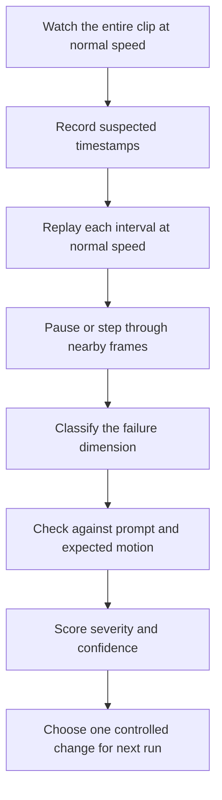

# Chapter 10: Temporal Consistency and Motion Coherence

## Learning Objectives

By the end of this chapter, you should be able to:

- Evaluate whether a generated video preserves object identity, geometry, texture, lighting, and background structure across time.
- Inspect motion paths, object interactions, camera movement, and transitions between scenes.
- Recognize temporal artifacts such as flicker, disappearing objects, implausible deformation, and abrupt discontinuities.
- Use both frame-by-frame inspection and full-speed playback to diagnose video quality.
- Explain how prompt complexity, clip duration, and reference conditioning affect consistency.
- Score a short clip with timestamped evidence and propose a controlled next experiment.

<br/>

## 1. What Temporal Consistency Means

A video is not simply a collection of attractive images. It is a sequence in which objects, surfaces, lighting, motion, and spatial relationships should evolve in a plausible way.

**Temporal consistency** is the stability of relevant visual properties across frames. **Motion coherence** is the plausibility and continuity of changes over time: objects follow understandable trajectories, actions connect, and camera movement behaves consistently with the scene.

A clip can contain excellent individual frames but still feel broken when played. For example, a generated bicycle may look realistic in each sampled frame while its frame geometry changes, its wheels wobble, or its position jumps between frames.

<br/>

### Core dimensions

| Dimension | What to inspect | Example of failure |
|---|---|---|
| Object identity | Is the same subject recognizable throughout? | A bird subtly changes species or markings |
| Geometry | Do shape, proportions, and spatial relationships remain plausible? | A cup stretches or a bicycle frame bends |
| Texture/material | Do surface details remain stable? | Fur, feathers, or fabric crawl or shimmer |
| Lighting/shadows | Do illumination and shadows change for a plausible reason? | A shadow flickers without a light or object movement |
| Background | Do buildings, trees, and other static elements remain stable? | Background lines bend or objects appear/disappear |
| Motion path | Does the subject move continuously through space? | A car jumps forward or reverses direction abruptly |
| Interaction | Do objects make and maintain plausible contact? | A hand passes through a handle or a ball teleports |
| Camera | Is viewpoint motion smooth and consistent? | A planned push-in becomes an unrequested snap zoom |
| Transitions | Does a scene change have a clear temporal relationship? | A new location appears without a requested cut or transition |

Not every change is an error. A subject may rotate, deform naturally, become occluded, enter or leave the frame, or move into different lighting. Judge changes against the prompt, physical plausibility, and the intended visual style.

<br/>

## 2. Identity and Appearance Stability

### 2.1 Object identity

Follow the same subject across time and ask:

- Are distinguishing features retained (color pattern, markings, clothing, shape, accessories)?
- Does the subject remain the same size and age/appearance unless change is intended?
- If the subject is partially occluded, does it reappear with consistent features?
- Do multiple similar objects remain distinct, or do they merge or exchange attributes?

For human subjects, inspect identity and clothing consistency without assuming that every tiny facial change is a failure; video synthesis can introduce fine-grained variation. For animals and objects, compare stable markings, silhouette, and distinctive parts.

<br/>

### 2.2 Geometry and spatial structure

Look for changes that are not explained by viewpoint or action:

- Proportions that shift between frames.
- Rigid objects that bend, melt, or gain/lose parts.
- Object boundaries that drift independently of motion.
- Hands, limbs, wheels, or other articulated parts that change count or connect incorrectly.
- Background structures that warp when the subject moves.

Perspective changes can legitimately alter apparent shape and size. The question is whether the change is consistent with camera position, object motion, and occlusion.

<br/>

### 2.3 Texture, material, and lighting

Texture instability often appears as crawling details, changing patterns, or shimmering surfaces. Lighting instability can appear as sudden exposure changes, shadows that detach from objects, or highlights that pop between frames.

Record the timestamp and the affected region. A note such as “texture unstable” is less useful than “00:02.4–00:03.0: feather markings shimmer along the owl's right wing while the wing remains nearly still.”

<br/>

## 3. Motion Coherence

### 3.1 Motion paths

A plausible motion path connects positions and orientations over time. Inspect whether:

- Acceleration and deceleration look reasonable for the subject.
- Direction changes have a visible cause.
- The subject's trajectory matches the prompt.
- Movement is continuous rather than a series of disconnected poses.
- The subject stays within the intended framing unless it should leave the shot.

A path does not need to be straight or smooth in every context. A bouncing ball, a turning bird, and handheld camera footage each have different expected motion patterns.

<br/>

### 3.2 Interactions and contact

When subjects interact, track the relationship, not just each object independently.

Examples:
- A person picks up a cup: the hand should approach, contact, grasp, and lift it in a plausible order.
- A dog catches a ball: the ball's trajectory should meet the dog's mouth or paws rather than pass through the body.
- A bicycle rolls forward: the wheels should remain attached to the frame and rotate plausibly relative to travel.
- A door opens: the hinge relationship should remain stable as the door rotates.

A generated clip may approximate a complex action without representing every physical constraint. For evaluation, identify the exact moment contact or continuity breaks.

<br/>

### 3.3 Camera movement and scene transitions

Camera motion changes the entire projection of the scene, while subject motion is local to objects. For a pan, background features should shift in a broadly consistent direction; for a dolly, foreground and background may move relative to each other through parallax.

Check for:
- Unrequested camera jumps, zooms, or rotations.
- Subject framing that changes without a plausible camera or subject movement.
- Background movement inconsistent with the claimed camera path.
- Abrupt scene changes, mismatched subject positions, or lighting discontinuities at cuts.
- Transitions that occur too early, too late, or without a clear prompt reason.

A deliberate cut is not a continuity failure if the prompt or creative design calls for it. Evaluate the output against the intended edit.

<br/>

## 4. Common Temporal Failure Modes

### Flicker
Rapid frame-to-frame changes in brightness, color, texture, edges, or object details. Flicker can affect the whole frame or a small region.

<br/>

### Object disappearance and reappearance
A visible object vanishes, is replaced, or returns with altered properties without plausible occlusion or motion out of frame.

<br/>

### Implausible deformation
An object's geometry changes in ways that cannot be explained by articulation, perspective, or intended transformation.

<br/>

### Identity drift
A subject gradually or suddenly changes distinguishing characteristics.

<br/>

### Motion discontinuity
The subject jumps, reverses, teleports, or changes speed/direction abruptly without a visible cause.

<br/>

### Texture swimming
Surface details slide or change independently of the surface's movement, making material look unstable.

<br/>

### Background warping
Static scenery bends, pulses, or changes structure as the subject or camera moves.

<br/>

### Contact failure
Objects intersect, detach, slide through each other, or fail to maintain contact during an interaction.

<br/>

### Temporal mismatch at transitions
A cut or scene transition breaks continuity in position, scale, lighting, or action when continuity was expected.

One defect may affect several dimensions. For example, a hand passing through a mug is a geometry, interaction, and motion-coherence failure. Record the primary failure and, if useful, secondary dimensions without double-counting the same event as multiple independent incidents.

<br/>

## 5. Inspecting at Full Speed and Frame by Frame

Both viewing modes are necessary because they reveal different problems.

### Full-speed playback

Use normal playback first to assess the viewer's overall experience:

- Does the action read clearly?
- Does motion feel smooth and intentional?
- Are there distracting jumps or flicker?
- Does the clip maintain a coherent sense of space?
- Does the ending follow naturally from the beginning?

Full-speed playback reveals perceptual problems that may not be obvious in isolated stills.

<br/>

### Short-frame inspection

Pause, step through frames, or inspect short intervals around a suspected failure to locate its onset and duration. This helps identify:

- The first frame where an object changes.
- Whether a defect persists or appears only briefly.
- Whether a movement jump coincides with a camera change.
- Which region or subject is affected.

Do not conclude that a clip is temporally coherent simply because selected frames look good. Conversely, tiny differences between adjacent frames may be expected during genuine motion and should not automatically be labelled as flicker.

<br/>

### Suggested workflow



<br/>

### Optional frame extraction with FFmpeg

To create a small set of diagnostic frames from a local video:

```bash
ffmpeg -i generated.mp4 -vf "fps=2" frames/frame_%04d.png
```

This samples approximately two frames per second. It is useful for overview inspection but can miss brief flicker or short-lived defects. For precise inspection, extract frames around a known timestamp or use a video player that supports frame stepping.

Extract one frame near 2.5 seconds:

```bash
ffmpeg -ss 2.5 -i generated.mp4 -frames:v 1 frame_2_5s.png
```

The exact seeking behavior depends on the input and FFmpeg options; for frame-accurate analysis, decode from an appropriate earlier point or use a frame-stepping tool.

<br/>

## 6. A Practical Scoring Rubric

Use a consistent scale across candidate clips. The scores are human ratings, not objective ground truth.

| Score | Interpretation |
|---|---|
| 5 — Excellent | No distracting failure observed; changes are coherent and consistent with the prompt |
| 4 — Good | Minor instability exists but does not materially disrupt the sequence |
| 3 — Mixed | Noticeable failures occur, but the main action remains understandable |
| 2 — Poor | Repeated or severe failures undermine motion, identity, or spatial coherence |
| 1 — Unusable | The clip is dominated by discontinuities or does not communicate the intended action |

Score each dimension independently:

- Identity stability
- Geometry and spatial structure
- Texture/material stability
- Lighting and background stability
- Motion path and interactions
- Camera movement and transitions
- Overall temporal coherence

Add **evidence** for each rating. A numerical score without timestamped observations is difficult to reproduce or compare.

<br/>

### Timestamped observation format

```text
Timestamp: 00:02.40–00:02.90
Subject/region: Owl's right wing
Observed issue: Feather pattern shimmers while wing position changes very little
Dimension: Texture stability
Severity: Minor / moderate / severe
Confidence: Low / medium / high
Effect on viewing: Noticeable on replay, mildly distracting at full speed
```

Use timestamps from the actual clip. The example above illustrates format only; it is not a measured observation from a real generated video.

<br/>

## 7. Trade-offs: Prompt Complexity, Duration, and Reference Conditioning

### 7.1 Prompt complexity

A prompt with many subjects, simultaneous actions, precise interactions, camera moves, and scene changes imposes more constraints on a generation. Some models may fail to satisfy all constraints at once.

Practical strategy:
1. Start with one main subject and one primary action.
2. Add one environmental motion or camera move only if needed.
3. Avoid combining multiple scene changes in a very short clip unless that is the intended test.
4. Evaluate each run and add complexity incrementally.

This is an experimental strategy, not a guarantee that simple prompts always produce better video. Some models benefit from detailed descriptions; the important issue is whether the requirements are compatible and testable.

<br/>

### 7.2 Duration

Longer clips require the model to maintain identities, geometry, and motion relationships for more time. The likelihood of observing a failure may rise as more frames and actions are generated, but the relationship depends on the model, scene, and generation method.

For a controlled test:
- Begin with the shortest duration that can demonstrate the action.
- Inspect early, middle, and late portions.
- Record whether quality degrades over time.
- Compare durations only when other important settings remain fixed.

<br/>

### 7.3 Reference conditioning

An image reference can anchor appearance and composition, but it does not guarantee perfect preservation. Depending on the model, strong adherence to the reference may limit how far the scene can transform, while more freedom can introduce identity or geometry drift.

For I2V, explicitly identify what should remain stable and what should change. For example:

```text
Preserve: the owl's markings, branch position, and forest composition.
Change: the owl slowly turns its head and blinks.
Camera: static.
```

Use a reference image with a clear subject and enough visible context for the intended motion. A single still image cannot fully specify hidden geometry, unseen surfaces, or the correct physical trajectory; the model must infer these.

<br/>

### 7.4 Trade-off summary

| Choice | Potential benefit | Potential cost or risk |
|---|---|---|
| More detailed prompt | Clearer creative intent | Conflicting or excessive constraints |
| Longer duration | More complete action | More opportunities for drift or discontinuity |
| Stronger reference adherence, where controllable | Better preservation of appearance/composition | Less freedom for large changes |
| More camera motion | More dynamic visual presentation | Harder spatial consistency and subject framing |
| More interacting subjects | Richer scene | More contact and identity failure points |
| Aggressive editing/transitions | More narrative variation | Greater continuity burden across cuts |

<br/>

## 8. Practice: Timestamped Temporal-Consistency Review

Choose a short generated clip you are permitted to inspect. Watch it at normal speed before examining frames.

### Procedure

1. Write down the intended subject, action, camera movement, and any required continuity.
2. Watch the entire clip at full speed without pausing.
3. Record timestamps for each distracting event.
4. Replay each interval at normal speed, then inspect nearby frames.
5. Classify each event by its primary dimension: identity, geometry, texture, lighting/background, motion, interaction, camera, or transition.
6. Assign severity and confidence.
7. Score the dimensions using the 1–5 rubric.
8. Write a short conclusion distinguishing attractive individual frames from coherent sequence-level behavior.
9. Propose one change for the next run. Examples: simplify the action, shorten the clip, use a better reference image, or remove an unnecessary camera move.

<br/>

### Review table

| Timestamp | Subject/region | Observation | Dimension | Severity | Confidence |
|---|---|---|---|---|---|
| 00:__–00:__ | | | | | |
| 00:__–00:__ | | | | | |
| 00:__–00:__ | | | | | |

<br/>

### Scorecard

| Dimension | Score (1–5) | Timestamped evidence |
|---|---:|---|
| Identity stability | | |
| Geometry/spatial structure | | |
| Texture/material stability | | |
| Lighting/background stability | | |
| Motion path/interactions | | |
| Camera/transitions | | |
| Overall temporal coherence | | |

If no clip is available, use the tables to design an evaluation plan and clearly label it **planned review**, not completed assessment.

<br/>

## 9. Checkpoint: Attractive Frames vs. Coherent Sequence

A sequence should be judged as a temporal object, not only as a set of still images.

An attractive frame can hide failures between frames. For example, a subject may look realistic in sampled stills but jump position, change markings, or deform during motion. Full-speed playback tests whether the action reads continuously; frame inspection locates and classifies the failure.

<br/>

### Checkpoint answer template

> The strongest individual frames show [visual strengths], but sequence-level coherence must also be evaluated. I watched the clip at full speed and inspected the intervals around [timestamps]. The main issues were [observed failures], affecting [dimensions]. I scored [dimensions] using timestamped evidence rather than relying on visual appeal alone. For the next experiment, I would change [one variable] while keeping other settings fixed, then compare the resulting continuity and motion.

Fill this with evidence from your actual clip. Do not invent timestamps or claim a failure that you did not observe.

<br/>

## 10. Review Questions and Answers

**1. What is the difference between temporal consistency and motion coherence?**  
Temporal consistency concerns the stability of relevant properties over time. Motion coherence concerns whether changes, trajectories, interactions, and camera behavior form a plausible continuous sequence.

**2. Why can a video with realistic frames still look poor?**  
The frames may not connect coherently: objects can jump, textures can flicker, geometry can drift, or interactions can fail between frames.

**3. What is texture swimming?**  
Surface detail changes or slides independently of the underlying surface's movement, making texture appear unstable.

**4. Why inspect both full-speed playback and individual frames?**  
Full-speed playback reveals perceptual smoothness and sequence-level disruptions; frame inspection helps locate the onset, duration, and affected region of a defect.

**5. Is every change in geometry an error?**  
No. Articulation, perspective, rotation, occlusion, and intended transformations can legitimately change apparent shape. Evaluate whether the change is consistent with the scene and action.

**6. How can prompt complexity affect consistency?**  
Many simultaneous actions, interacting subjects, camera moves, and scene changes create more constraints. Simplifying the prompt can make failures easier to prevent or diagnose, though model behavior varies.

**7. Why might a reference image help but not solve identity drift?**  
It provides visual conditioning, but it may not fully specify unseen geometry or every future frame. The model still has to synthesize changes over time.

**8. What makes a useful temporal-consistency score?**  
A consistent scale, a defined dimension, timestamped evidence, severity, and a clear link between the observed issue and the rating.

<br/>

## 11. Further Reading

- [Hugging Face Diffusers documentation](https://huggingface.co/docs/diffusers/index) — model and pipeline documentation for image/video generation workflows.
- [FFmpeg documentation](https://ffmpeg.org/documentation.html) — extracting frames, decoding, and inspecting media.
- [OpenCV documentation](https://docs.opencv.org/) — frame access and computer-vision utilities for custom inspection.
- [scikit-image documentation](https://scikit-image.org/docs/stable/) — image metrics and processing utilities; pixel metrics alone do not establish perceptual or temporal coherence.

Automated metrics can assist with inspection, but no single metric fully captures identity preservation, physical plausibility, prompt adherence, and human-perceived continuity. Combine objective measurements with timestamped visual review.


<br/>

## Chapter Summary

- Temporal consistency is the stability of relevant visual properties across frames; motion coherence is the plausibility of changes over time.
- Inspect identity, geometry, texture, lighting, background, trajectories, interactions, camera motion, and transitions.
- Common failures include flicker, identity drift, disappearing objects, deformation, texture swimming, background warping, and motion discontinuity.
- Watch the full clip at normal speed, then inspect frames around suspected failures.
- Evaluate against the prompt: not every visual change is an error, and intended cuts are not inherently discontinuities.
- Prompt complexity, clip duration, and reference conditioning can alter the consistency challenge.
- Use timestamped evidence and a consistent rubric to distinguish attractive frames from a coherent video sequence.
