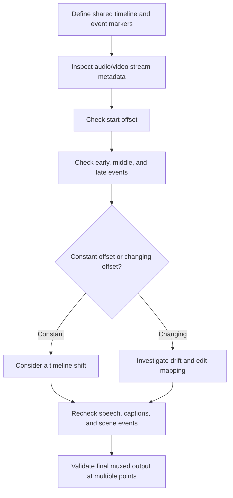

# Chapter 11: Audio-Video Synchronization Concepts

## Learning Objectives

By the end of this chapter, you should be able to:

- Represent audio and video events on a shared timeline.
- Explain offsets, timestamps, drift, and duration mismatch.
- Distinguish container-level multiplexing from semantic alignment, including lip synchronization.
- Plan narration, captions, speech boundaries, and generated scene events.
- Validate synchronization at multiple points across a clip.
- Align a short synthetic narration with a video clip or storyboard and document timing assumptions.

<br/>

## 1. Two Media Streams, One Presentation Timeline

A media experience often contains at least two separate streams:

- **Video stream:** frames displayed at particular presentation timestamps.
- **Audio stream:** samples or encoded audio packets played at particular timestamps.

To appear synchronized, these streams must be mapped onto a common presentation timeline. That does not mean they need identical frame rates, sample rates, or internal packet structures. It means that the intended audio and visual events must occur at compatible presentation times.

For example, when a character visibly claps, the audio transient should occur at approximately the same time as the visible contact. When a speaker says a word, the mouth movement, speech audio, and any word-level caption should agree within the tolerance required by the application.

<br/>

### Timeline concept

```mermaid
timeline
    title Example shared timeline
    00:00.0 : Video begins
            : Music bed begins
    00:01.2 : Speaker starts visible turn
            : Narration starts
    00:01.8 : First spoken word
    00:03.4 : Caption line changes
    00:05.0 : Visible action completes
    00:06.0 : Narration and video end
```

The timestamps above are illustrative, not measurements. A real project should record its own event times and define whether timestamps are relative to the clip, source file, or final edited timeline.

<br/>

## 2. Core Timing Terms

### Timestamp

A **timestamp** locates a frame, audio sample/packet, caption, or event on a timeline. A timestamp may be expressed in seconds, frames, samples, or a stream-specific time base.

A timestamp is meaningful only when its reference is known. For example, `2.5 s` could mean 2.5 seconds after the original recording began, after a trim, or after the final edit began.

<br/>

### Offset

An **offset** is a time displacement between two streams or events.

If a video event occurs at \(t_v\) and its corresponding audio event occurs at \(t_a\), define the signed offset as:

\[
\Delta t = t_a - t_v
\]

- \(\Delta t > 0\): the audio event occurs later than the video event.
- \(\Delta t < 0\): the audio event occurs earlier than the video event.
- \(\Delta t = 0\): their timestamps coincide, though perceptual synchronization can still depend on event definitions and encoding/playback behavior.

Always state the sign convention in a report. Some tools define offset in the opposite direction.

<br/>

### Drift

**Drift** is a change in relative alignment over time. A constant offset may be corrected by shifting a stream; drift generally requires investigating timing-rate mismatch, timestamp handling, dropped/duplicated content, or editing operations.

If the relative offset at the start is $\Delta t_0$ and later becomes $\Delta t_1$, the change in offset is:

$$
\text{offset change} = \Delta t_1 - \Delta t_0
$$

For a simple linear approximation over elapsed time \(T\):

$$
\text{drift rate} \approx \frac{\Delta t_1 - \Delta t_0}{T}
$$

This is a diagnostic approximation, not a universal model for all synchronization errors.

<br/>

### Duration mismatch

Audio and video durations can differ because of intentional fades, padding, leading/trailing silence, edits, different stream start times, codec delay, or incomplete output. A duration mismatch is a clue to inspect, not proof that the content is out of sync.

<br/>

## 3. Container Multiplexing vs. Semantic Alignment

These are different problems.

### Container multiplexing (muxing)

**Multiplexing** places audio and video streams into a single media container, such as MP4 or WebM, while retaining timing information for playback. A file can contain both streams and still have incorrect relative timing.

Muxing answers: **Can the streams be stored and presented together by a media player?**

<br/>

### Semantic alignment

**Semantic alignment** asks whether corresponding events actually match in meaning and time. Examples include:

- Spoken words matching visible lip movements.
- Narration describing an event as it appears.
- Captions appearing near the speech they transcribe.
- A sound effect coinciding with the action that causes it.
- Music changes matching a scene transition.

Semantic alignment answers: **Do the audio and visual events correspond at the intended moments?**

A technically valid MP4 may be semantically misaligned. Conversely, two separately stored streams may be semantically aligned when placed on the same timeline, even before they are muxed.

<br/>

## 4. A Shared Timeline for Audio, Video, Captions, and Events

Represent the edit as a list of timed events. Keep source timestamps distinct from final-timeline timestamps when clips are trimmed, retimed, or rearranged.

| Timeline time | Video event | Audio event | Caption/speech event | Expected relationship |
|---|---|---|---|---|
| 0.0 s | Establishing shot begins | Music starts | None | Music supports opening |
| 1.2 s | Speaker faces camera | Narration begins | Speech segment begins | Visible turn and voice onset are plausible |
| 1.8 s | Mouth begins first word | First word is audible | Word/line appears | Lip motion and text correspond |
| 3.4 s | Scene detail appears | Narration continues | Caption updates | Caption follows spoken content |
| 5.0 s | Object makes contact | Impact sound occurs | Optional caption | Sound coincides with visible contact |
| 6.0 s | Clip ends | Narration/music fades or ends | Caption clears | Ending behavior is intentional |

This table is a planning example. Real event boundaries depend on the clip, language, speaking style, and application.

<br/>

### Narration timing

Narration may be recorded or synthesized separately from the video. Before aligning it:

1. Determine the intended narration start and end.
2. Identify speech segments and pauses.
3. Decide whether narration should lead, coincide with, or follow each visual event.
4. Preserve meaningful pauses; do not stretch speech unnaturally merely to fill the clip.
5. If the narration is too long, revise the script, use a different edit, or deliberately adjust pacing within acceptable limits.

<br/>

### Captions and speech boundaries

Captions can be aligned at sentence, phrase, or word level. The required precision depends on the use case.

- **Sentence-level captions:** lower annotation effort; useful for general subtitles.
- **Phrase-level captions:** better timing for short narration segments.
- **Word-level timestamps:** useful for karaoke-style highlighting, detailed review, or speech-driven animation.

Speech start/end times can be estimated by an ASR or forced-alignment tool, but estimates should be checked where timing matters. A transcript alone does not provide reliable word-level timing.

<br/>

### Generated scene events

For a generated clip, write down intended visual events before producing narration or sound effects. If a character is meant to wave at 2.0 seconds, or an object lands at 4.5 seconds, record those intended event times and verify the actual generated video. Generated events may occur earlier or later than expected; do not assume the prompt's timing was followed exactly.

<br/>

## 5. Offsets, Drift, and Common Causes

### Constant offset

If narration is consistently 250 ms late throughout a clip, a constant shift may be an appropriate correction—provided the same offset applies across the timeline and the stream boundaries remain valid.

<br/>

### Accumulating drift

If alignment is correct near the start but increasingly wrong near the end, a single shift will not solve the issue. Possible causes include:

- Different effective timing rates or incorrect time-base assumptions.
- Resampling or retiming performed without updating timestamps consistently.
- Dropped, duplicated, or missing frames/samples.
- Incorrect edit mapping after trimming or concatenating clips.
- Stream timestamp discontinuities or source files with unusual timing metadata.

Investigate the source of drift before applying a time stretch. Time-stretching audio can alter speech quality; retiming video can alter motion. Choose a correction appropriate to the media and preserve pitch/visual quality where possible.

<br/>

### Duration mismatch

Examples:
- Narration ends before the video, leaving intentional or accidental silence.
- Audio continues after the final frame.
- A video trim is applied but the audio is not trimmed to the same timeline.
- A fade extends beyond the intended cut.
- A container reports a duration that differs slightly from the last decoded frame or audio sample.

Check stream start times, end times, and actual event positions rather than relying only on a single displayed duration.

<br/>

## 6. Lip Synchronization and Perceptual Alignment

**Lip synchronization (lip sync)** concerns whether visible mouth movements correspond to the phonetic and temporal structure of speech. It is more demanding than starting audio and video together.

Inspect:
- Speech onset relative to the first visible mouth movement.
- Open/closed mouth patterns around syllables and stressed sounds.
- Pauses: the mouth should not continue speaking visibly through a long silent gap unless the scene calls for it.
- Turn-taking: the correct speaker should appear to speak.
- Segment boundaries: mouth motion should not abruptly stop or restart at narration chunk boundaries.

Perfect phoneme-to-viseme mapping is not always visually observable, and acceptable tolerance depends on content, frame rate, language, and playback conditions. Use a consistent tolerance appropriate to the task instead of claiming one universal threshold.

For narration over unrelated visuals, lip sync may not be required. Semantic alignment still matters: the narration should refer to the correct scene or action at the intended time.

<br/>

## 7. Validate Alignment at Multiple Points

Checking only the first frame or the start of narration can miss accumulating drift and local timing errors.

At minimum, inspect:
- **Start:** initial offset and stream start behavior.
- **Early section:** first important speech or action event.
- **Middle:** a representative event after the clip has played for some time.
- **End:** final speech, action, fade, or transition.
- **Any suspected discontinuity:** cuts, scene changes, chunk boundaries, or edited sections.

For a short clip, three to five well-chosen checkpoints may be sufficient for a manual review. For longer or high-stakes work, sample more frequently and automate measurements where practical.

<br/>

### Validation workflow



<br/>

## 8. Practical Inspection Tools

### 8.1 Inspect container and stream metadata

Use FFprobe to inspect the file's format and stream properties:

```bash
ffprobe -v error \
  -show_entries format=duration:stream=index,codec_type,codec_name,start_time,duration,time_base,avg_frame_rate,sample_rate,channels \
  -of json input.mp4
```

This can reveal stream start-time or duration differences. It does not by itself prove semantic synchronization or accurate lip sync.

<br/>

### 8.2 Inspect audio/video event timing

For a manual review:
1. Open the clip in a player with frame stepping and audio scrubbing if available.
2. Mark the timestamp of a visible event (such as a clap or mouth movement).
3. Mark the timestamp of the corresponding audio transient or speech boundary.
4. Calculate the signed offset using the convention defined earlier.
5. Repeat at the middle and end of the clip.
6. Record both measurements and uncertainty; event boundaries may not be perfectly unambiguous.

For speech, use waveform peaks only as supporting evidence. Speech does not always begin with a sharp peak, and music or background noise can mask the onset.

<br/>

### 8.3 Compute offset changes

Given measured event pairs:

```python
events = [
    # (video_event_seconds, audio_event_seconds)
    (1.20, 1.28),
    (3.40, 3.52),
    (5.70, 5.90),
]

offsets = [audio_t - video_t for video_t, audio_t in events]

for (video_t, audio_t), offset in zip(events, offsets):
    print(
        f"video={video_t:.2f}s audio={audio_t:.2f}s "
        f"audio_minus_video={offset:+.3f}s"
    )

print("Offset change:", f"{offsets[-1] - offsets[0]:+.3f}s")
```

These values are illustrative. Replace them with actual observations. In this example, the increasing positive offset suggests that audio becomes later relative to the video, but a few points are not enough to identify the cause.

<br/>

## 9. Practice: Align Synthetic Narration with a Clip or Storyboard

Choose a short video clip you may use, or create a storyboard with planned event timestamps. Prepare a synthetic narration that describes the intended visual sequence.

### Procedure

1. Write down the clip's timeline and duration.
2. Mark at least three visual events: one near the beginning, one in the middle, and one near the end.
3. Draft a short narration script whose content corresponds to those events.
4. Generate or record the narration, noting the actual audio duration and any pauses.
5. Mark speech segment boundaries and caption timing at the required granularity.
6. Compare actual speech/audio event times with visual event times.
7. Calculate offsets and offset changes.
8. Decide whether the issue is a constant offset, drift, local mismatch, or intentional timing difference.
9. If you adjust timing, document the change and recheck all checkpoints.

<br/>

### Timing assumptions log

| Item | Assumption / measurement |
|---|---|
| Video duration and time origin | |
| Audio duration and time origin | |
| Stream start times | |
| Intended narration start | |
| Actual narration start | |
| Visual event timestamps | |
| Speech/caption timestamps | |
| Offset sign convention | \(\Delta t = t_a - t_v\) |
| Start offset | |
| Middle offset | |
| End offset | |
| Offset change | |
| Correction applied, if any | |
| Remaining mismatch / uncertainty | |

If you use only a storyboard, label values as **planned timestamps**. Do not report them as measured output from a generated clip.

<br/>

## 10. Checkpoint: Equal Durations Do Not Guarantee Synchronization

Two files can have equal reported duration but still be out of sync because:

- Their streams may have different start offsets.
- Audio and video events may occur at different positions within the files.
- A constant offset can persist from beginning to end.
- Local edits or timestamp discontinuities can misalign a section even if total durations match.
- Narration may describe a visual event before or after it occurs.
- Captions may be shifted or may not match the spoken words.
- Lip movements may not correspond to speech even when the streams begin together.

Duration is a single summary statistic; synchronization is a relationship between event times across the timeline.

<br/>

### Checkpoint answer

> Equal file durations only show that the reported timelines have the same length. They do not prove that corresponding events share the same timestamps. I would compare the start, middle, and end, measure the signed audio/video offset at each checkpoint, and inspect semantic events such as speech onset, lip movement, captions, and visible actions. A constant offset may be correctable with a shift; a changing offset suggests drift or a timing/editing issue that needs further investigation.

<br/>

## 11. Review Questions and Answers

**1. What is an offset?**  
A signed time difference between corresponding audio and video events, calculated using a declared convention.

**2. How does drift differ from a constant offset?**  
A constant offset remains approximately the same across time. Drift means the relative offset changes as the clip progresses.

**3. What does multiplexing guarantee?**  
It packages streams together with timing information. It does not guarantee that the content is semantically aligned or lip-synchronized.

**4. Why validate at the start, middle, and end?**  
The start reveals initial offset, later checkpoints reveal drift, and local checks can expose event-level mismatches that a duration comparison misses.

**5. Are captions synchronized just because they contain the correct transcript?**  
No. Correct text can still appear too early, too late, or across the wrong speech segment.

**6. Does matching the narration start to the video start guarantee lip sync?**  
No. Individual words, pauses, and mouth movements can still be misaligned throughout the clip.

**7. How should timing assumptions be documented?**  
Record the timeline origin, event definitions, sign convention, planned versus measured timestamps, uncertainty, offsets, and any correction applied.

<br/>

## 12. Further Reading

- [FFmpeg documentation](https://ffmpeg.org/documentation.html) — media processing and synchronization-related tools.
- [FFprobe documentation](https://ffmpeg.org/ffprobe.html) — container and stream metadata inspection.
- [WebVTT specification](https://www.w3.org/TR/webvtt1/) — timed text tracks for captions and subtitles.
- [W3C Media Timed Events](https://www.w3.org/TR/media-timed-events/) — concepts for associating timed events with media.
- [OpenAI API documentation](https://platform.openai.com/docs/overview) — consult current model/API documentation when audio or video is generated through a hosted service.

Tools and players may report time bases and durations differently. Verify results against the actual output and the relevant format or API documentation.


<br/>


## Chapter Summary

- Audio and video must be mapped to a shared presentation timeline, but they do not need identical sample rates or frame rates.
- Offset is a signed difference between event times; drift is a change in that offset over time.
- Multiplexing combines streams in a container; semantic alignment ensures that speech, captions, lip movements, and scene events correspond.
- Equal durations do not prove synchronization.
- Validate multiple points—start, early section, middle, end, and any suspected discontinuity.
- Record timeline origins, event definitions, planned versus measured timestamps, and timing corrections.
- Evaluate actual event alignment, not just metadata or file duration.
