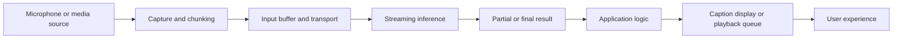

# Chapter 12: Real-Time and Streaming Media Workflows

## Learning Objectives

By the end of this chapter, you should be able to:

- Distinguish incremental output from a system that meets a defined real-time latency budget.
- Explain chunk size, buffering, jitter, backpressure, and playback queues.
- Separate provisional transcription updates from finalized transcript segments.
- Describe voice activity detection (VAD), turn-taking, and interruption handling conceptually.
- Design bounded cleanup and cancellation behavior for streaming workflows.
- Treat recognized speech as untrusted input when passing it to downstream model operations.
- Simulate a streaming pipeline with delayed chunks, partial results, and cancellation.

<br/>

## 1. What Makes a Media Workflow “Real-Time”?

A system can return data incrementally without being meaningfully real-time. **Streaming** describes how output is delivered; **real-time performance** describes whether useful output arrives within an acceptable time budget.

For example, a speech recognizer may emit partial words while a person is talking. That is incremental output. Whether it is real-time enough depends on the application's latency requirement, the delay between the speaker's utterance and the update, and whether the output remains useful under variable network and processing conditions.

<br/>

### Define the latency budget first

Different tasks tolerate different delays:

- Live captions may require frequent updates and low visible delay.
- Voice conversation needs responsive turn-taking and interruption handling.
- Background transcription can prioritize accuracy and completeness over immediate feedback.
- A media-generation job may stream progress or chunks but still take too long to qualify as interactive.

There is no universal real-time threshold. Define a measurable target for the specific user experience.

Useful measurements include:

- **Time to first output:** request or speech onset to first visible/audio result.
- **Chunk latency:** time from receiving a chunk to processing or emitting its result.
- **End-of-turn latency:** time from end of speech to a finalized transcript or response.
- **Playback buffer depth:** how much media is queued ahead of the playhead.
- **Deadline miss rate:** fraction of updates that arrive later than the application's target.
- **Cancellation latency:** time between a cancel request and stopping work/releasing resources.

A workflow that produces its first partial result quickly but finalizes much later may be useful for live feedback, but not necessarily for an application that requires immediate, reliable final text.

<br/>

## 2. Streaming Pipeline Overview

A streaming media pipeline may include capture, chunking, transport, inference, interpretation, and playback. Each stage can add delay.



A real deployment may use WebSockets, WebRTC, HTTP streaming, provider-managed sessions, or another transport. The correct choice depends on the API and application; this diagram is conceptual rather than a prescription for a particular protocol.

<br/>

## 3. Chunk Size and Buffering

### Chunk size

A chunk is a unit of media or work sent through the pipeline. For audio, it may contain a fixed number of samples or a time window of audio. For generated speech, it may contain an audio segment and associated text.

**Smaller chunks**
- Can reduce the time before processing starts.
- Can make partial results arrive more frequently.
- Increase per-chunk overhead and scheduling/transport activity.
- May provide too little context for stable recognition or synthesis.

**Larger chunks**
- Can improve processing efficiency and provide more context.
- Reduce the number of messages and per-chunk overhead.
- Increase waiting time before a chunk is available for processing.
- Can make cancellation and interactive response feel slower.

The optimal size is task- and system-dependent. Measure end-to-end behavior rather than assuming that the smallest chunk is always best.

<br/>

### Buffering

A buffer temporarily stores incoming or outgoing data to absorb variability. An input buffer can accommodate bursts in capture or network delivery; a playback buffer helps avoid interruptions when data arrives unevenly.

Too little buffering can cause underruns and broken playback. Too much buffering can add unnecessary delay.

<br/>

### Playback queues

A playback queue holds audio or media segments in the order they should be played. The application needs policies for:
- Ordering segments correctly.
- Avoiding duplicate playback.
- Handling a late or missing segment.
- Clearing queued output after cancellation or interruption.
- Keeping the queue bounded so that delay does not grow without limit.

For speech output, each segment should carry enough metadata to associate it with the correct turn and sequence. Late segments from an earlier turn should not be played after a newer turn has taken over.

<br/>

## 4. Jitter, Backpressure, and Queue Growth

### Jitter

**Jitter** is variation in arrival or processing intervals. Even if chunks are generated at a steady rate, network delay or inference time may vary. Playback buffering can absorb some jitter, but excessive buffering increases latency.

<br/>

### Backpressure

**Backpressure** occurs when a downstream stage cannot consume data as quickly as an upstream stage produces it. For example, incoming audio may arrive faster than an overloaded transcription service can process it.

Without a policy, queues may grow continuously. This increases memory use and causes results to become stale.

Possible strategies include:
- Apply flow control when the producer can slow down.
- Use bounded queues with explicit overflow behavior.
- Drop or coalesce obsolete intermediate updates when doing so is safe.
- Prioritize current-turn work over stale work.
- Reduce input rate or processing complexity where supported.
- Report degraded performance instead of silently accumulating delay.

Do not arbitrarily drop audio needed for an accurate final transcript. If chunks must be discarded, make the loss explicit and avoid claiming a complete transcription.

<br/>

### Queue depth as a latency signal

A growing queue is often a symptom that the pipeline is not keeping pace. Monitor queue depth, oldest-item age, processing time, and drop counts—not just average model latency.

<br/>

## 5. Partial Transcription vs. Finalized Segments

Streaming ASR systems may revise their interpretation as more audio arrives. A partial transcript is provisional; a finalized segment is expected to remain stable under the service's finalization rules.

Example:

| Update | Displayed text | Status |
|---|---|---|
| 1 | “Turn left at…” | Partial |
| 2 | “Turn left at the…” | Partial |
| 3 | “Turn left at the next street.” | Finalized segment |

These are illustrative updates, not output from a real recognizer.

<br/>

### Safe presentation rules

- Clearly distinguish provisional text from finalized text.
- Update the provisional region rather than appending every revision as if it were new content.
- Do not trigger irreversible downstream actions from a partial transcript without an explicit policy.
- Associate updates with a session, turn, and segment identifier.
- Handle duplicate, late, and out-of-order updates.
- Preserve finalized segments separately from the current mutable hypothesis.
- If a partial transcript is used to trigger an action, make the action reversible or require confirmation where appropriate.

A partial transcript can be useful for live captions or early UI feedback. It should not automatically be treated as the user's final instruction.

<br/>

## 6. Voice Activity Detection, Turn-Taking, and Interruptions

### Voice activity detection (VAD)

VAD estimates whether an audio interval contains speech or non-speech. It can help identify speech onset and pauses, but it is not a complete understanding of conversational intent.

Potential challenges include:
- Quiet speech or distant microphones.
- Background music and environmental noise.
- Short pauses inside a sentence.
- Breathing, laughter, and other vocal sounds.
- Speech from multiple people at once.

A VAD threshold that is too aggressive can cut off quiet words; one that is too permissive can treat noise as speech.

<br/>

### Turn-taking

A turn-taking policy determines when the application considers a person to have finished speaking and when it may respond. It may combine VAD, endpointing, pause duration, ASR finalization, and application-specific rules.

Waiting longer can reduce premature turn endings but increases response latency. Ending too quickly can split a sentence or interrupt a speaker.

<br/>

### Interruption handling and barge-in

In interactive voice systems, **barge-in** means the user begins speaking while the system is still speaking or playing output. A robust policy should define what happens next:

1. Detect likely user speech while output is playing.
2. Decide whether the current output should pause or stop.
3. Cancel or mark obsolete any in-flight work tied to the interrupted turn.
4. Clear or invalidate queued speech from that turn.
5. Start a new turn with fresh identifiers.
6. Prevent delayed output from the old turn from playing after the new turn begins.

These steps are conceptual. Actual behavior depends on the selected real-time API, audio routing, and application state machine.

<br/>

## 7. Cancellation, Disconnects, and Cleanup

Streaming work can outlive the UI or session that initiated it unless lifecycle handling is explicit.

### Cancellation cases

- The user presses Stop.
- A new turn interrupts the current response.
- The browser or client disconnects.
- A provider session expires.
- The request exceeds a deadline.
- The application shuts down.
- A downstream stage fails and makes upstream work unnecessary.

<br/>

### Cleanup checklist

- Stop capturing new media when the session is cancelled.
- Cancel provider operations when the API supports cancellation.
- Stop polling or reading streams.
- Close sockets and release media tracks, file handles, and buffers.
- Clear playback queues belonging to the cancelled turn.
- Prevent callbacks from updating a closed or replaced session.
- Apply bounded timeouts to cleanup.
- Record whether cancellation was acknowledged, timed out, or could not be confirmed.

A local cancellation flag does not prove that remote compute has stopped. If remote cancellation is unavailable or uncertain, record that limitation and avoid starting unbounded duplicate work.

<br/>

### Bounded resource use

Set limits for:
- Queue length and queued media duration.
- Session lifetime and idle timeout.
- Maximum concurrent sessions/jobs.
- Maximum input duration and payload size.
- Polling frequency and retry count.
- Buffer memory and retained transcript history.

Use explicit overflow and timeout policies. A queue that can grow forever is a latency and reliability problem even if no individual request fails.

<br/>

## 8. Recognized Speech Is Untrusted Input

Speech recognition converts audio into text; it does not prove that the text is safe, authorized, or intended as an instruction to the application.

A transcript can contain:
- Ordinary user requests.
- Misrecognitions caused by noise or accents.
- Quoted text that resembles an instruction.
- Background speech from another person.
- Adversarial or manipulative content.
- Instructions that should not be allowed to invoke sensitive tools or access private data.

<br/>

### Safe downstream handling

- Treat transcript content as **data**, not as a trusted system instruction.
- Keep application policy and tool authorization separate from recognized text.
- Apply the same permission checks to voice-originated requests as to typed requests.
- Confirm high-impact or irreversible actions.
- Use session and speaker context only when the application has a reliable, justified basis for doing so.
- Do not assume that speaker diarization or voice identity is authentication.
- Preserve provenance: record that a request originated from speech and whether it was partial or finalized.
- Avoid executing tool calls directly from unstable partial hypotheses.

For example, if a partial transcript says “delete the…” and later resolves to “delete the draft,” the application should not execute a destructive action from the partial prefix. Sensitive operations should be validated against policy and may require explicit confirmation.

<br/>

## 9. Practice: Simulate Delayed Chunks, Partial Results, and Cancellation

The goal is to reason about timing and state, not to build a production streaming stack. The following Python example simulates chunk arrivals, partial transcript updates, finalization, and cancellation using a bounded queue.

```python
from dataclasses import dataclass
from queue import Queue, Full, Empty
from time import monotonic, sleep

@dataclass
class Chunk:
    sequence: int
    payload: str
    arrives_after_seconds: float

def simulate_stream(chunks, cancel_after_seconds=1.0, processing_delay=0.25):
    queue = Queue(maxsize=3)
    start = monotonic()
    cancelled = False
    transcript = ""

    for chunk in chunks:
        if monotonic() - start >= cancel_after_seconds:
            cancelled = True
            print("Cancellation requested; stop accepting new chunks.")
            break

        sleep(chunk.arrives_after_seconds)

        try:
            queue.put_nowait(chunk)
            print(f"Received chunk {chunk.sequence}")
        except Full:
            print(f"Queue full: chunk {chunk.sequence} not accepted.")
            # A real system needs an explicit loss/recovery policy.
            continue

        # Simulate one processing step.
        try:
            current = queue.get_nowait()
        except Empty:
            continue

        sleep(processing_delay)
        transcript += current.payload
        print(f"Partial transcript: {transcript!r}")
        queue.task_done()

    if cancelled:
        # A production system must also cancel remote work if supported,
        # stop capture, close streams, and invalidate queued output.
        while not queue.empty():
            try:
                queue.get_nowait()
                queue.task_done()
            except Empty:
                break
        print("Local queue cleared; remote cancellation is not implied.")

    else:
        print(f"Finalized simulation transcript: {transcript!r}")

chunks = [
    Chunk(1, "Turn ", 0.10),
    Chunk(2, "left ", 0.35),
    Chunk(3, "at the ", 0.15),
    Chunk(4, "next street.", 0.45),
]

simulate_stream(chunks, cancel_after_seconds=1.2, processing_delay=0.20)
```

**Important:** This is a timing/state simulation, not a true real-time ASR client. It uses a local queue and text placeholders. In a production implementation, cancellation, transcript revisions, sequence identifiers, bounded buffers, and provider errors must follow the actual streaming API's contract. The sample's cancellation threshold depends on execution timing, so use recorded elapsed times in a formal experiment.

<br/>

### Practice procedure

1. Run the simulation or implement an equivalent state machine.
2. Increase processing delay to make the consumer fall behind.
3. Increase chunk arrival variability to simulate jitter.
4. Observe how queue limits affect accepted and dropped chunks.
5. Add provisional transcript updates that can be revised before finalization.
6. Trigger cancellation while work is queued or processing.
7. Confirm that late results from a cancelled turn cannot update the active UI or play after a new turn starts.
8. Record time to first partial result, finalization delay, queue depth, dropped chunks, and cancellation response.

<br/>

### Experiment log

| Measurement | Result |
|---|---|
| Chunk size / chunk interval | |
| Simulated arrival delays | |
| Processing delay per chunk | |
| Queue capacity | |
| Time to first partial result | |
| Time to final result | |
| Maximum queue depth | |
| Number of dropped/rejected chunks | |
| Cancellation request time | |
| Cancellation acknowledgement/cleanup time | |
| Late results after cancellation | |
| Observed limitation | |

Use actual measured values if you run the simulation. Otherwise, label entries as planned.

<br/>

## 10. Checkpoint: Where Latency Accumulates and How to Present Partial Results

Latency may accumulate at multiple stages:

1. **Capture and chunking:** waiting to fill the next input chunk.
2. **Transport:** network delay and jitter.
3. **Queueing:** waiting behind earlier work.
4. **Inference:** model processing time.
5. **Finalization:** waiting for enough context or an end-of-turn signal.
6. **Application logic:** validation, policy checks, or downstream model/tool calls.
7. **Playback/display:** output buffering, rendering, and device latency.

A low model-inference time does not guarantee low end-to-end latency if input chunks wait in a queue or the client buffers too much output.

Partial results should be visibly provisional, replaceable, and associated with the correct session/turn/segment. Avoid presenting them as final or allowing them to trigger irreversible operations without validation. When a turn is cancelled, invalidate queued output and ignore late results from that turn.

<br/>

### Checkpoint answer template

> The observed delay accumulates across [capture/chunking], [transport], [queueing], [inference], [finalization], and [display/playback]. I measured or estimated each stage separately and checked whether queue depth grew under load. Partial transcripts are shown as provisional and revised in place; finalized segments are stored separately. Cancellation invalidates stale work, clears relevant playback queues, and prevents late results from an old turn from affecting the current session. Recognized speech is treated as untrusted input and passes through authorization and confirmation rules before sensitive actions.

Adapt this answer to the stages and measurements in your simulation.

<br/>

## 11. Review Questions and Answers

**1. Is incremental output automatically real-time?**  
No. Streaming describes incremental delivery; real-time performance depends on whether useful results meet a defined latency budget.

**2. Why can smaller chunks improve responsiveness but reduce efficiency?**  
They can reduce waiting time before processing, but increase per-chunk overhead and may provide less context.

**3. What is jitter?**  
Variation in chunk arrival or processing intervals.

**4. What is backpressure?**  
A condition in which a downstream consumer cannot keep up with incoming data, causing queues to grow unless flow control or an explicit overflow policy is applied.

**5. How should partial transcripts differ from final segments in the UI?**  
Partials should be marked provisional and revised in place. Finalized segments should be stored as stable output according to the service's finalization rules.

**6. What is barge-in?**  
A user interruption that begins while the system is still speaking or playing output.

**7. Does local cancellation prove that remote inference stopped?**  
No. Remote work stops only if the provider supports and acknowledges cancellation; otherwise its state may remain uncertain.

**8. Why is recognized speech untrusted input?**  
ASR can misrecognize speech, capture background speakers, or produce text that resembles an instruction. Transcription does not establish authorization or intent.

<br/>

## 12. Further Reading

- [WebRTC specifications](https://www.w3.org/TR/webrtc/) — real-time audio/video transport concepts.
- [Web Audio API](https://www.w3.org/TR/webaudio/) — browser audio processing and playback.
- [WebSocket API](https://developer.mozilla.org/en-US/docs/Web/API/WebSocket) — persistent bidirectional communication in browser applications.
- [OpenAI API documentation](https://platform.openai.com/docs/overview) — consult current documentation for supported streaming interfaces, event schemas, and cancellation behavior.
- [OWASP Top 10 for LLM Applications](https://owasp.org/www-project-top-10-for-large-language-model-applications/) — security risks relevant to downstream model and tool use.

Provider-specific event names, streaming guarantees, cancellation semantics, and supported audio formats change. Verify the current endpoint documentation before implementation.


<br/>


## Chapter Summary

- Streaming means incremental delivery; real-time means meeting a defined latency budget.
- Chunk size, buffering, jitter, queue depth, inference, and finalization all affect end-to-end responsiveness.
- Backpressure needs an explicit policy; unbounded queues create stale results and excessive resource use.
- Partial transcripts are provisional and must be separated from finalized segments.
- VAD, endpointing, turn-taking, and barge-in need clear state and cancellation rules.
- Cancellation should invalidate stale output and release bounded resources; local cancellation does not guarantee remote cancellation.
- Recognized speech is untrusted input and must not bypass authorization or confirmation rules.
