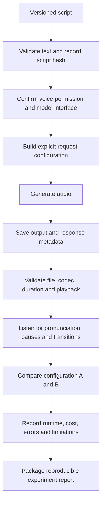

# Chapter 16 — Text-to-Speech Project

## 1. Project Objective

Build a small, reproducible text-to-speech (TTS) workflow that converts a versioned script into speech using a voice you are permitted to use. Compare two supported settings or delivery styles, validate the generated audio, and document quality, errors, runtime, cost where available, and consent/provenance details.

The objective is not simply to produce a playable audio file. It is to establish which configuration generated it, whether the speech follows the script, what failed, and which aspects can or cannot be reproduced exactly.

<br/>

### Learning outcomes

By the end of this project, you should be able to:

- Prepare and version a script for speech generation.
- Select a permitted voice and record the relevant authorization.
- Call a TTS interface using explicit, supported parameters.
- Validate the returned audio's encoding and playback compatibility.
- Compare two configurations under controlled conditions.
- Review pronunciation, pacing, pauses, script fidelity, and segment transitions.
- Record runtime, usage/cost where available, limitations, and provenance.
- Explain why repeating the same request may not yield bit-identical audio.

<br/>

## 2. Scope and Constraints

### In scope

- A short narration script, ideally around 30–90 seconds when spoken naturally.
- A built-in or otherwise authorized voice.
- Two supported settings, such as speaking rate, style, or a documented voice option.
- Saved configuration and outputs, plus a brief human quality review.

<br/>

### Out of scope

- Cloning or imitating a real person's voice without explicit authorization.
- Assuming an undocumented parameter is supported because it appears in a prompt.
- Treating a successful API response as proof that the audio is intelligible or faithful to the script.
- Claiming exact reproducibility without comparing actual output files.

<br/>

## 3. End-to-End Architecture



Keep script preparation, request construction, audio validation, listening review, and reporting as separate stages. That separation makes errors easier to locate.

<br/>

## 4. Project Structure

```text
text-to-speech-project/
├── scripts/
│   ├── narration_v1.txt
│   └── narration_v2.txt
├── configs/
│   ├── setting_a.yaml
│   └── setting_b.yaml
├── outputs/
│   ├── setting_a_audio.wav
│   ├── setting_b_audio.wav
│   └── metadata/
├── reports/
│   └── experiment_report.md
├── src/
│   ├── script_validation.py
│   ├── generate_speech.py
│   ├── validate_audio.py
│   └── compare_runs.py
├── tests/
├── requirements.txt
├── .env.example
└── README.md
```

Do not commit API keys, private scripts, restricted audio, or generated voice assets to a public repository. Keep local outputs and secrets in ignored files or an appropriate secret manager.

<br/>

## 5. Prepare and Version the Script

A script should be finalized before comparing settings. Otherwise, differences in output may come from text changes rather than TTS configuration.

Record:
- Script ID and version.
- Exact text submitted to the model.
- Text encoding, normally UTF-8.
- Language and pronunciation assumptions.
- Intended audience and delivery purpose.
- Any explicit pronunciation hints supported by the selected interface.
- Script hash and revision notes.

Example script:

> Photosynthesis allows plants to convert light energy into chemical energy. In this short explanation, we will review the role of sunlight, water, and carbon dioxide.

This short example is suitable for testing sentence boundaries, technical pronunciation, and pauses. Replace it with original text appropriate to your project.

<br/>

### Script preparation checklist

- Use correct spelling and punctuation.
- Expand abbreviations when ambiguity is likely.
- Check dates, numbers, units, acronyms, and technical vocabulary.
- Split long paragraphs into manageable sections if the API has input limits.
- Avoid silently rewriting the text between configuration runs.
- If you revise the script, increment the version and rerun both configurations.

A script hash can help identify the exact text used:

```python
import hashlib
from pathlib import Path

script_text = Path("scripts/narration_v1.txt").read_text(encoding="utf-8")
script_hash = hashlib.sha256(script_text.encode("utf-8")).hexdigest()
print(script_hash)
```

The hash identifies the bytes of the text file after reading and encoding as shown; it does not prove when the script was created or who authorized it.

<br/>

## 6. Voice Selection, Consent, and Provenance

Before generating speech, identify the selected voice and the basis for using it.

Record:
- Voice ID or documented voice name.
- Model/provider and version, if exposed.
- Whether the voice is built-in, licensed, or custom.
- Permission or consent basis and scope.
- Any restrictions on distribution, commercial use, or attribution.
- Whether the output needs to be disclosed as AI-generated.
- Retention and deletion requirements for scripts and generated audio.

Use a provider's built-in voice or a voice for which you have appropriate authorization. For custom voice creation, obtain explicit permission covering the intended use; do not infer consent from the existence of a public recording. A voice ID alone is not evidence of consent.

<br/>

## 7. Request Configuration

Use only parameters documented by the selected provider and model. Typical configuration dimensions may include:

- Model and version.
- Voice identifier.
- Input text.
- Output format or codec.
- Speaking rate or style controls, if supported.
- Language or locale, if supported.
- Chunking or streaming mode.
- Timeout and retry policy.

An illustrative configuration file:

```yaml
experiment_id: tts_demo_001
script_id: narration_v1
provider: replace_with_provider
model: replace_with_supported_model
voice_id: replace_with_permitted_voice
output_format: wav
setting_name: setting_a
parameters:
  # Add only parameters documented for the selected model.
  speaking_rate: default
```

This YAML is a template, not a provider-specific API contract. Some systems do not expose a speaking-rate parameter or may express it differently. Use the exact interface supported by the chosen model; do not assume `speaking_rate: default` is a valid literal API value.

<br/>

### Compare two settings fairly

Choose exactly one variable to change when possible. For example:

- Configuration A: default supported delivery.
- Configuration B: a documented slower speaking rate.

Keep the script, voice, model, output format, and other settings fixed. If you change voice and rate at once, you cannot tell which change caused the observed difference.

If the interface exposes no relevant control, compare two supported voices only when both are authorized, and record that the experiment changes voice identity rather than a single delivery parameter.

<br/>

## 8. Generate and Save the Audio

The exact request code depends on the chosen provider. Use a small adapter that accepts the internal configuration and returns:
1. Audio bytes or a saved audio file.
2. Provider response/request identifiers when available.
3. Usage metadata when available.
4. Timing and error information.

Provider-neutral pseudocode:

```python
def generate_tts(script_text, config, client):
    request = build_supported_request(
        text=script_text,
        model=config.model,
        voice=config.voice_id,
        output_format=config.output_format,
        parameters=config.parameters,
    )

    started_at = monotonic_time()
    response = client.generate_speech(request)
    elapsed_seconds = monotonic_time() - started_at

    audio_path = save_audio(response.audio, config.output_path)

    return {
        "audio_path": str(audio_path),
        "elapsed_seconds": elapsed_seconds,
        "request_id": response.request_id_if_available,
        "usage": response.usage_if_available,
        "model": config.model,
        "voice_id": config.voice_id,
    }
```

The function names above are placeholders; adapt them to the current SDK or HTTP API. Do not copy the pseudocode as if it were a runnable provider SDK example.

<br/>

### Operational considerations

- Store credentials in environment variables or a secret manager.
- Apply timeouts and bounded retries.
- Avoid duplicate billing by blindly retrying after an uncertain timeout.
- Save the exact request configuration and provider response metadata.
- Use separate output paths for each run; never overwrite the first result during comparison.
- Record failures instead of silently substituting an unrelated output.

<br/>

## 9. Validate Encoding and Playback Compatibility

A file extension is not proof of its actual encoding. Inspect the generated file and test it with the playback tools or application intended for the project.

Using FFprobe:

```bash
ffprobe -v error \
  -show_entries format=duration,format_name,size \
  -show_entries stream=codec_name,codec_type,sample_rate,channels,bits_per_sample \
  -of json outputs/setting_a_audio.wav
```

Check:
- The file exists and has nonzero size.
- The file decodes without errors.
- The reported container and codec match expectations.
- Sample rate and channel count are supported by the target playback environment.
- Duration is plausible for the script.
- The beginning and end are not unexpectedly truncated.
- There are no unexplained silent gaps or severe clipping.

If conversion is needed, preserve the original generated file and create a separate converted copy. Example:

```bash
ffmpeg -i outputs/setting_a_audio.wav \
  -c:a pcm_s16le outputs/setting_a_playback.wav
```

This example converts the audio stream to PCM signed 16-bit little-endian while retaining the container chosen by the output extension. Select a target format based on the actual player or downstream application. Avoid unnecessary transcoding because it can introduce loss or obscure the original provider output.

<br/>

## 10. Human Quality Review

Listen to each output at normal playback speed. Use headphones when appropriate, and replay uncertain regions rather than relying only on automated metrics.

<br/>

### Review dimensions

| Dimension | What to inspect |
|---|---|
| Script fidelity | Are all intended words present, in the right order, without additions or omissions? |
| Pronunciation | Are names, acronyms, technical terms, numbers, and units intelligible? |
| Pauses | Are sentence and paragraph pauses natural and appropriate? |
| Prosody | Is stress, intonation, and emphasis suitable for the explanation? |
| Pace | Is the delivery easy to follow without being unnecessarily slow or rushed? |
| Audio quality | Are there clicks, clipping, distortion, noise, or abrupt cutoffs? |
| Segment transitions | Are boundaries between chunks smooth, with no repeated, missing, or clipped words? |
| Voice suitability | Does the permitted voice fit the intended audience and context? |

Do not assume that natural-sounding audio exactly follows the submitted script. Verify script fidelity explicitly.

<br/>

### Optional text comparison

If a reference transcript is available, transcribe the generated audio and compare the result to the submitted script. This can help locate possible omissions or pronunciation issues, but ASR can itself make mistakes. Confirm disputed cases by listening.

<br/>

## 11. Chunking and Segment Transitions

Some TTS interfaces limit input length or generate audio in chunks. Chunking can make long scripts easier to process but may introduce discontinuities.

When using chunks:
- Split at sentence or paragraph boundaries when practical.
- Keep a manifest with chunk index, script span, output path, and generation configuration.
- Preserve chunk order.
- Check the first and last words of each chunk.
- Listen across every join, not only to each chunk independently.
- Check for unexpected silence, loudness changes, duplicated words, or abrupt changes in voice characteristics.
- Record any crossfade or post-processing separately from the original output.

Example chunk manifest:

| Chunk | Script version | Text span | Output file | Reviewed |
|---|---|---|---|---|
| 1 | narration_v1 | Opening paragraph | chunk_001.wav | No |
| 2 | narration_v1 | Second paragraph | chunk_002.wav | No |

The table is illustrative. Fill it with the actual spans and review results.

<br/>

## 12. Runtime, Usage, and Cost

Record measured values separately from estimates.

### Useful measurements

- Request latency: time from request start to completed response.
- Time to first audio: if the interface streams output and the metric is available.
- Total audio duration.
- Audio generation real-time factor (RTF), when meaningful:

$$
\mathrm{RTF} = \frac{\text{generation wall-clock time}}{\text{generated audio duration}}
$$

An RTF below 1 means generation completed faster than the generated audio's playback duration. For streaming systems, define the timing window precisely; time-to-first-audio and total completion time are different measurements.

- Input text size or billable units, as defined by the provider.
- Reported usage and cost, if available.
- Retry count, timeout count, and error category.

Do not infer exact billing from character count unless the provider's pricing rules and applicable rates are known. If usage or cost is unavailable, record `unavailable`; if you calculate an estimate, label it as an estimate and document the assumptions.

<br/>

## 13. Reproducibility and Its Limits

Reproducibility means preserving enough information to repeat the same intended experiment and explain differences. It does not necessarily mean regenerating identical audio bytes.

### Record to reproduce the request

- Exact script text and script hash.
- Provider, model identifier, and version or release information when available.
- Voice ID and permission basis.
- All explicit supported request parameters.
- Output encoding and streaming/chunking settings.
- SDK/API version.
- Request ID, timestamp, and response metadata where available.
- Any post-processing steps and tool versions.
- Audio file hash for each saved output.

<br/>

### Why exact audio reproducibility may be impossible

- A hosted model may be updated behind a stable model name.
- The generation system may use nondeterministic sampling or other nondeterministic computation.
- A seed may be unavailable, unsupported, or insufficient to guarantee identical output.
- Backend routing or infrastructure may change.
- Voice assets, normalization, or decoding behavior may change.
- Streaming boundaries and chunk assembly may affect the resulting file.
- Container metadata or encoding may differ even when the audible content is effectively the same.

Distinguish three levels:

1. **Request reproducibility:** the same script and documented configuration can be submitted again.
2. **Content similarity:** the regenerated speech is substantially similar in words and delivery.
3. **Bitwise reproducibility:** the output file has exactly the same bytes, confirmed by matching hashes.

Do not claim level 3 based solely on matching request parameters. A file hash proves whether two files are byte-identical; it does not prove that two different files sound different in a meaningful way.

<br/>

## 14. Consent, Privacy, and Provenance

For each run, record the voice and asset permissions needed for the intended use. Also consider:
- Whether the script contains personal, confidential, or regulated information.
- Whether the provider retains input text or generated audio.
- Whether outputs can be distributed or used commercially.
- Whether disclosure that the voice is synthetic is required by policy, law, or audience expectations.
- How long source text, outputs, and logs are retained.
- How deletion requests and access restrictions are handled.

Do not treat a generated voice as proof that a real person said the script. Do not imitate an identifiable person without the necessary authorization. Store only the metadata needed for traceability and protect private assets.

<br/>

## 15. Experiment Report Template

```text
# Text-to-Speech Experiment Report

## Run identity
- Experiment ID:
- Run date/time:
- Script ID/version:
- Script SHA-256:
- Provider / model / version:
- SDK/API version:
- Voice ID:
- Permission/consent basis:

## Request configuration
- Output format:
- Supported parameters:
- Chunking/streaming mode:
- Configuration A:
- Configuration B:
- Variables held constant:
- Variable changed:

## Output validation
- Output file(s):
- File hash(es):
- Container / codec:
- Sample rate / channels:
- Duration:
- Decoding/playback test:
- Conversion or post-processing:

## Quality review
| Dimension | Setting A | Setting B | Evidence/notes |
|---|---|---|---|
| Script fidelity | | | |
| Pronunciation | | | |
| Pauses and pacing | | | |
| Prosody | | | |
| Segment transitions | | | |
| Audio artifacts | | | |
| Overall suitability | | | |

## Performance and usage
- Request latency A/B:
- Time to first audio, if available:
- Generated duration A/B:
- RTF A/B, if calculated:
- Usage/cost:
- Retries/errors:
- Measured, estimated, or unavailable:

## Provenance and limitations
- Request IDs:
- Configuration files:
- Post-processing steps:
- Known reproducibility limits:
- Retention/deletion notes:
- Remaining issues:

## Conclusion
- Preferred configuration:
- Evidence supporting the choice:
- Largest remaining weakness:
- Next experiment:
```

<br/>

## 16. Practice: Produce a Short Narrated Explanation

1. Write a short original explanation with a clear beginning, middle, and conclusion.
2. Save it as a versioned UTF-8 text file and compute its hash.
3. Select a permitted voice and record the authorization basis.
4. Generate configuration A using a documented default or baseline.
5. Generate configuration B by changing one supported parameter or delivery style.
6. Save both audio files and request metadata separately.
7. Validate encoding, duration, and playback.
8. Listen to both outputs and annotate pronunciation, pauses, pacing, script fidelity, and transitions.
9. Record runtime, usage/cost if available, errors, and limitations.
10. Choose a preferred result based on observed evidence rather than preference alone.

<br/>

### Minimum deliverables

- Versioned script.
- Two configuration files.
- Two generated audio outputs.
- Metadata and output hashes.
- Completed quality comparison table.
- Experiment report.
- Short conclusion explaining the trade-off and the most important observed error.

<br/>

## 17. Checkpoint: Reproduce the Configuration

To pass the checkpoint, another person should be able to identify and reconstruct the intended request from your report.

Verify that you can:
- Recover the exact submitted script and its version.
- Identify the provider, model, permitted voice, and supported settings.
- Explain which variable changed between A and B.
- Validate the saved file's actual encoding and playback behavior.
- Distinguish measured latency and usage from estimates or unavailable values.
- Explain why the same request may not produce bit-identical audio.
- Avoid claiming exact reproducibility unless matching output hashes confirm it.

**Checkpoint standard:** Reproduce the request configuration and explain the difference between request reproducibility, audible/content similarity, and bitwise identity.

<br/>

## 18. Review Questions

1. Why should the script be versioned before comparing TTS settings?
2. What evidence shows that a voice is permitted for the intended use?
3. Why is a file extension insufficient to establish audio encoding?
4. What is the difference between request latency, time to first audio, and total generation time?
5. How can chunk boundaries affect perceived quality?
6. Why should only one setting be changed in a controlled comparison?
7. What can and cannot be concluded from a matching request configuration?
8. What does an output file hash establish?
9. Why should usage and cost be labeled unavailable or estimated when they are not directly reported?
10. Which quality issues require listening even when automated checks pass?

<br/>

## 19. Essential References

- FFmpeg documentation: https://ffmpeg.org/ffmpeg.html
- FFprobe documentation: https://ffmpeg.org/ffprobe.html
- OpenAI Text-to-Speech guide: https://platform.openai.com/docs/guides/text-to-speech
- OpenAI API documentation: https://platform.openai.com/docs/overview
- Hugging Face audio task documentation: https://huggingface.co/docs/transformers/tasks/text-to-speech

Consult the selected provider's current documentation for model-specific voice options, supported controls, output formats, usage reporting, privacy terms, and limitations. The examples in this chapter are provider-neutral unless explicitly labeled otherwise.
