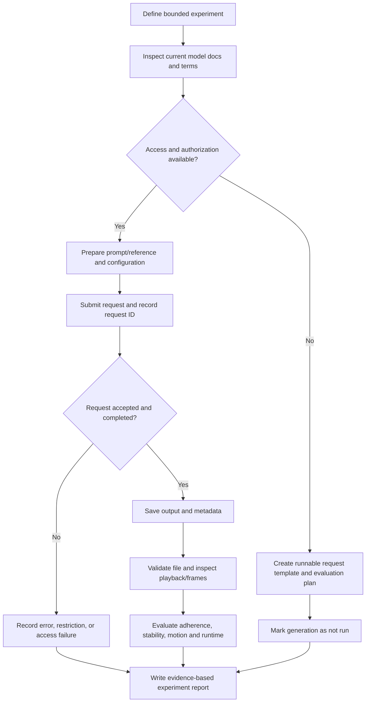

# Chapter 17 — Video-Generation API or Model Experiment

## 1. Project Objective

Run one bounded text-to-video (T2V) or image-to-video (I2V) experiment with a currently accessible model or service. Inspect the selected service's documented capabilities, access requirements, and terms before making a request. If access is unavailable, produce a runnable request template and a concrete evaluation plan without claiming that generation succeeded.

The project emphasizes experimental discipline: preserve the exact inputs and settings, validate the output, evaluate motion and temporal stability, and distinguish observed results from assumptions or unmeasured expectations.

<br/>

### Learning outcomes

By the end of this project, you should be able to:

- Select a video-generation model based on current documented capabilities and access.
- Identify supported parameters, limits, terms, and content restrictions.
- Run one small, bounded generation request when access permits.
- Preserve prompts, reference assets, configuration, model/version identifiers, and output metadata.
- Evaluate prompt adherence, temporal consistency, motion quality, and runtime.
- Record unsupported controls, failed requests, and access limitations.
- Prepare a valid request and evaluation plan when no live generation path is available.

<br/>

## 2. Scope and Experimental Boundary

Keep the experiment small enough to inspect carefully.

Suggested bounds:
- One prompt and one generation, or one input image and one generation.
- A short clip within the model's documented duration limit.
- One aspect ratio and resolution supported by the service.
- One configuration, unless a second run is explicitly needed for a controlled comparison.
- One permitted reference image for I2V, if used.

Do not submit repeated high-cost requests merely to search for a preferred output. Set a clear stopping rule before starting.

<br/>

## 3. End-to-End Workflow



The report must say which branch actually occurred. A template, dry run, or mocked test is not a generated video.

<br/>

## 4. Select a Model or Service

Choose a service that you can lawfully and practically access. Review its current documentation immediately before the experiment because model capabilities, availability, quotas, prices, and terms can change.

### Selection checklist

- Is the model currently accessible to your account or environment?
- Does it support T2V, I2V, or both?
- What duration, resolution, aspect ratios, and file formats are supported?
- Are seed, camera, motion, negative prompt, guidance, or other controls exposed?
- Are those controls API parameters, UI options, or merely prompt suggestions?
- Is generation synchronous or asynchronous?
- Are jobs queued, and how are completion and failure reported?
- What are the usage limits, rate limits, and costs?
- What input/output retention and data-use terms apply?
- Are the intended prompt, reference image, and output permitted under the service's terms?

Do not infer a capability from a demo, marketing description, or another model version. Record the exact model identifier and documentation date or link.

<br/>

### Candidate documentation

Use the provider's current pages as the source of truth for its API and account access:

- OpenAI API documentation: https://platform.openai.com/docs/overview
- OpenAI video generation guide, if available for your account/model: https://platform.openai.com/docs/guides/video-generation
- Google Cloud Vertex AI generative AI documentation: https://cloud.google.com/vertex-ai/generative-ai/docs
- Hugging Face Diffusers documentation: https://huggingface.co/docs/diffusers/index

These links are starting points, not a claim that every listed service exposes a currently available video-generation endpoint to every account. Confirm the exact model, region, access level, and terms in the current documentation.

<br/>

## 5. Define the Experiment Before Running It

Write a one-paragraph experiment plan before submitting the request.

### Example experiment question

“Can the selected model generate a short clip of a red paper kite moving across a grassy field while keeping the kite's shape and the scene visually stable?”

This is an illustrative test prompt. Replace it with a prompt appropriate for your chosen model and evaluation goal.

<br/>

### Prompt specification

For T2V, record:
- Main subject and its defining visual attributes.
- Setting and important background elements.
- One or two observable actions.
- Camera behavior, if relevant and supported.
- Desired visual style, if relevant.
- Duration and aspect ratio through documented controls, where available.

For I2V, also record:
- Reference image path or asset ID.
- File hash, dimensions, and format.
- Which properties should remain consistent.
- Which properties are intended to change.
- Any rights or permissions relevant to the reference image.

Keep the prompt focused. Several simultaneous actions, scene changes, and camera moves make failures harder to attribute.

<br/>

### Testable success criteria

Set criteria before generation, for example:
- The requested main subject is visible.
- The primary action is recognizable.
- The output decodes and plays.
- The subject's identity and major geometry remain reasonably stable.
- Motion is coherent rather than dominated by flicker or abrupt deformation.
- Runtime and output properties can be recorded.

Define the criteria in observable terms. Do not mark a criterion as passed simply because the clip looks attractive overall.

<br/>

## 6. Input Asset Preparation for I2V

If using image-to-video:

1. Use an image you own, are licensed to use, or are otherwise permitted to submit.
2. Record its source, permission basis, hash, dimensions, and format.
3. Inspect the image for corruption and unsupported color modes.
4. Check the provider's size, aspect-ratio, format, and safety requirements.
5. Preserve the original image; create a separate prepared copy if conversion is required.
6. Avoid submitting confidential or personal images unless the service terms and authorization allow it.

Example inspection with Pillow:

```python
from pathlib import Path
from PIL import Image
import hashlib

image_path = Path("assets/reference.png")
raw = image_path.read_bytes()
print("sha256:", hashlib.sha256(raw).hexdigest())

with Image.open(image_path) as image:
    print("format:", image.format)
    print("size:", image.size)
    print("mode:", image.mode)
    image.verify()
```

This checks basic image integrity and records a hash; it does not establish rights to use the image or guarantee compatibility with a specific service.

<br/>

## 7. Build a Request Using Documented Controls

The exact request format is provider-specific. Read the current API reference for authentication, endpoint, accepted fields, payload format, and response schema. Do not invent endpoint paths, model IDs, or parameter names.

### Provider-neutral request specification

```yaml
experiment_id: video_exp_001
task: text_to_video  # or image_to_video
provider: replace_with_selected_provider
model_id: replace_with_exact_documented_model_id
prompt_version: prompt_v1
prompt: "Describe one subject performing one clear action in a stable scene."
reference_asset:
  path: null
  sha256: null
parameters:
  duration_seconds: null  # fill only if documented and supported
  aspect_ratio: null      # fill only if documented and supported
  resolution: null        # fill only if documented and supported
  seed: null              # do not assume seed support
output_path: outputs/video_exp_001
```

This is an internal experiment manifest, not a ready-to-send API payload. Replace `null` only with values supported by the selected model. Do not send internal fields such as `prompt_version` unless the API explicitly accepts them.

<br/>

### Request handling

A robust client should:
- Load credentials from environment variables or a secret manager.
- Validate required fields before sending.
- Apply request timeouts and bounded retries.
- Save the exact request configuration with secrets removed.
- Capture request/job IDs and response metadata.
- Poll an asynchronous job according to documented intervals and limits.
- Distinguish queued, running, completed, failed, cancelled, and timed-out states when supported.
- Download the output only after a documented success state.
- Avoid duplicate submissions after an ambiguous timeout until job status is checked where possible.

<br/>

### Provider-neutral pseudocode

```python
def run_video_experiment(config, client):
    validate_local_config(config)

    # Adapter maps the internal manifest to documented provider fields.
    submission = client.submit_generation(
        model=config.model_id,
        prompt=config.prompt,
        reference_asset=config.reference_asset,
        parameters=config.supported_parameters,
    )
    save_json("outputs/submission_metadata.json", redact_secrets(submission))

    status = client.wait_for_completion(
        submission.job_id,
        timeout_seconds=config.timeout_seconds,
    )

    if status.state != "completed":
        save_json("outputs/failure_metadata.json", status.to_dict())
        return {"status": status.state, "output_path": None}

    video = client.download_result(status)
    output_path = save_bytes(config.output_path, video)
    return {
        "status": "completed",
        "output_path": str(output_path),
        "job_id": submission.job_id,
    }
```

The client methods above are placeholders. Adapt them to the chosen provider's current SDK/API. Do not present this pseudocode as runnable code until the adapter, authentication, response parsing, and download behavior are implemented and tested.

<br/>

## 8. Access Unavailable: Runnable Request Plan

If the model or service is not accessible, do not simulate a successful generation. Prepare a request plan containing:

- Exact provider and model ID from current documentation.
- Required account, API key, project, region, or approval.
- Official endpoint/SDK instructions.
- Required request fields and valid parameter values.
- A local manifest with the planned prompt and asset hashes.
- Expected success response fields, based on the documentation.
- Error handling and polling logic.
- An evaluation rubric ready for the eventual output.
- A clear status: `not_run_access_unavailable`, `not_run_no_credentials`, or another accurate reason.

A mock client can test your own control flow and schema validation, but its result must be labeled `mocked` and must not be treated as model evidence. A successful local config validation proves only that your local validation passed.

<br/>

## 9. Output Validation

After a successful generation, preserve the original downloaded file. Validate the actual file rather than trusting the extension or response label.

Using FFprobe:

```bash
ffprobe -v error \
  -show_entries format=duration,format_name,size \
  -show_entries stream=codec_name,codec_type,width,height,r_frame_rate,avg_frame_rate \
  -of json outputs/video_exp_001.mp4
```

Inspect:
- File exists and is non-empty.
- Container and video codec are recognized.
- Duration, width, height, and frame rate are plausible.
- The file decodes and plays through to the end.
- The beginning and ending frames are not unexpectedly blank or truncated.
- Audio presence or absence matches expectations.
- Output dimensions and duration match supported/requested values where those values were explicit.

If a tool reports missing metadata, record it as unavailable. Do not invent a frame rate or claim a setting was honored without evidence.

<br/>

## 10. Evaluate Prompt Adherence

Compare the output against each success criterion and the exact prompt. Separate observable evidence from subjective preference.

### Adherence rubric

| Dimension | Questions |
|---|---|
| Subject | Is the requested subject present and visually identifiable? |
| Attributes | Are key colors, shapes, clothing, or object properties maintained? |
| Action | Does the requested action occur in a recognizable way? |
| Setting | Are important scene/background elements present? |
| Camera | Does the camera behave as requested, if a supported control or clear prompt instruction was used? |
| Composition | Is the subject framed usefully through the clip? |
| Unrequested additions | Did the model add objects, text, or events that alter the intended result? |

Use a simple scale such as `0 = absent/failed`, `1 = partial`, `2 = mostly satisfied`, `3 = clearly satisfied`. Define the scale before evaluation and include evidence or timestamps for scores.

Do not interpret a prompt instruction as a guaranteed control. A requested camera movement may be an instruction to the generative model, not a deterministic camera parameter.

<br/>

## 11. Temporal Stability and Motion Quality

Inspect the clip both at normal playback speed and at selected frames or timestamps.

### Temporal stability

Check whether:
- Subject identity and major geometry remain consistent.
- Objects do not appear, disappear, or duplicate unexpectedly.
- Textures, colors, lighting, and background do not flicker excessively.
- Objects maintain plausible spatial relationships.
- Scene changes are intentional rather than accidental.

<br/>

### Motion quality

Check whether:
- The main action progresses in a coherent direction.
- Speed and acceleration look plausible for the intended scene.
- Limbs, wheels, tools, or other moving parts do not deform implausibly.
- Object interactions remain spatially coherent.
- Camera movement does not create unintended instability.
- The clip starts and ends in a usable state.

A single attractive frame is not evidence of temporal coherence. Likewise, a technically smooth clip may still fail the requested action.

<br/>

### Optional frame extraction

Use FFmpeg to extract a few frames for inspection:

```bash
ffmpeg -i outputs/video_exp_001.mp4 \
  -vf "fps=1" outputs/frame_%03d.png
```

This extracts approximately one frame per second; adjust the sampling rate to the clip duration and the motion you need to inspect. Sparse frame sampling can miss brief defects, so also watch the complete clip.

<br/>

## 12. Runtime and Resource Measurements

Record each timing separately:
- Submission latency.
- Queue wait time, if exposed.
- Generation time or job duration, if exposed.
- Download time.
- End-to-end wall-clock time.
- Number of polling requests and retries.
- Reported usage/cost, if available.

Define the timing start and end points. A UI wait time, server-reported generation duration, and end-to-end runtime are not interchangeable.

For asynchronous services, measure:
- `t_submit`: request submission time.
- `t_accepted`: acceptance time, if available.
- `t_completed`: completion time, if available.
- `t_downloaded`: local download completion time.

Then compute only supported durations, for example:

$$
T_{\text{end-to-end}} = t_{\text{downloaded}} - t_{\text{submit}}
$$

If queue time or generation time is not separately exposed, do not estimate it from end-to-end time unless you label the result clearly as an estimate. If usage or cost is unavailable, record `unavailable`.

<br/>

## 13. Unsupported Controls, Restrictions, and Failed Requests

Record failures as experiment results rather than deleting them from the report.

Useful categories:
- `access_denied`: credentials, account, project, or permission issue.
- `model_unavailable`: selected model cannot be used in the current environment.
- `unsupported_parameter`: request contains an unrecognized or unsupported field.
- `invalid_input`: malformed prompt, reference, or configuration.
- `content_restriction`: provider policy rejected the request.
- `rate_limited`: request was throttled.
- `timeout`: completion was not observed before the deadline.
- `generation_failed`: provider reported a failed job.
- `download_failed`: generation completed but output retrieval failed.
- `validation_failed`: output exists but cannot be decoded or does not meet basic checks.

These are suggested internal categories, not a promise that a provider will return those exact error codes. Save the provider's actual error code and message where appropriate, while redacting secrets and sensitive content.

Do not repeatedly alter prompts to evade safety restrictions. If a request is rejected, review the documented policy and revise the experiment only when a permitted alternative is clear.

<br/>

## 14. Experiment Metadata and Provenance

Store one manifest per run. Example:

```json
{
  "experiment_id": "video_exp_001",
  "status": "planned_not_run",
  "task": "text_to_video",
  "provider": "replace_with_provider",
  "model_id": "replace_with_documented_model_id",
  "documentation_checked_at": "YYYY-MM-DD",
  "prompt_version": "prompt_v1",
  "prompt": "Describe one subject performing one clear action in a stable scene.",
  "reference_asset": null,
  "parameters": {},
  "request_id": null,
  "output_path": null,
  "output_sha256": null,
  "submission_latency_seconds": null,
  "end_to_end_seconds": null,
  "usage_cost": "unavailable",
  "notes": [
    "Replace example values with observed values before reporting a live run."
  ]
}
```

The example explicitly uses `planned_not_run`; change the status only when evidence supports the new state. Use a real date for the actual documentation check. Never leave illustrative values in a report that claims to describe a completed experiment.

Record:
- Input prompt and version.
- Reference asset and hash, if applicable.
- Exact model identifier and version, if exposed.
- Supported settings and values.
- Request/job ID and state transitions.
- Output file hash and file metadata.
- Runtime and usage data.
- Errors, unsupported controls, and manual review notes.
- Permission and retention considerations.

<br/>

## 15. Experiment Report Template

```text
# Video-Generation Experiment Report

## Experiment status
- Status: planned / submitted / completed / failed / not run
- Run ID:
- Date/time:
- Reason not run, if applicable:

## Model and access
- Provider/service:
- Exact model ID/version:
- Documentation links and check date:
- Account/region/access prerequisites:
- Terms, usage restrictions, and relevant permissions:
- Supported task (T2V/I2V):
- Unsupported or unverified controls:

## Inputs
- Prompt version:
- Exact prompt:
- Reference image path/asset ID:
- Reference image SHA-256:
- Permission basis:
- Planned/actual duration, aspect ratio, resolution:
- Other supported settings:

## Request evidence
- Request/job ID:
- Request accepted?:
- Final job state:
- Response metadata location:
- Error code/message, if any:
- Secrets redacted?:

## Output validation
- Output path:
- Output SHA-256:
- Container/codec:
- Duration:
- Resolution/frame rate:
- Decode/playback check:
- Audio present?:
- Validation result:

## Quality evaluation
| Criterion | Score | Timestamp/evidence | Notes |
|---|---:|---|---|
| Subject and attributes | | | |
| Action adherence | | | |
| Setting/composition | | | |
| Temporal stability | | | |
| Motion coherence | | | |
| Start/end quality | | | |
| Overall usability | | | |

## Performance
- Submission latency:
- Queue time, if available:
- Generation time, if available:
- Download time:
- End-to-end time:
- Polls/retries:
- Usage/cost:
- Values measured, estimated, or unavailable:

## Findings
- What worked:
- What failed:
- Unsupported controls:
- Largest remaining weakness:
- Next controlled experiment:
```

<br/>

## 16. Practice: Create a Clip or Prepare the Experiment

### Path A — Live generation available

1. Choose a currently accessible model and inspect its official documentation and terms.
2. Record the exact model ID, supported task, duration limits, and accepted parameters.
3. Define one bounded prompt and measurable success criteria.
4. Prepare and hash a permitted reference image if using I2V.
5. Save the manifest before submission.
6. Submit one request and preserve its request ID and response metadata.
7. Wait for a documented terminal state and download the output only after success.
8. Validate the file using FFprobe and playback.
9. Evaluate adherence, temporal stability, motion, and runtime.
10. Complete the report, including all errors and limitations.

<br/>

### Path B — Access unavailable

1. Identify the service and model documented for the intended experiment.
2. Record the missing prerequisite: account access, API credentials, approval, region, quota, or other restriction.
3. Prepare a provider-specific request from the current documentation, leaving secrets out of the file.
4. Validate the local manifest and expected response handling.
5. Prepare the evaluation rubric and report template.
6. Mark the experiment `not_run` and state the reason.
7. Do not fabricate an output, request ID, runtime, cost, or quality score.

A mocked request can test local error-handling logic, but label it as a mock. A fixture check validates only the fixture or local code; it is not evidence about live model output.

<br/>

## 17. Evidence Classification: What Can You Claim?

Label each statement in the report as one of the following:

- **Observed live:** directly returned by the service or measured from the actual generated output.
- **Locally verified:** checked by local code or a media tool, such as file decoding or dimensions.
- **Fixture-tested:** validated using a fixed test file or mock response.
- **Planned:** intended for a future live run.
- **Documented:** stated in the official provider documentation, with the page and check date.
- **Estimated:** calculated using explicit assumptions.
- **Unmeasured/unavailable:** not observed or not exposed by the system.

Examples:
- “The downloaded MP4 decoded successfully with FFprobe” is a locally verified claim if that check was actually run.
- “The model supports a 5-second clip” is a documented claim only if the current model documentation confirms it.
- “The clip maintained object identity throughout” is an observation that requires inspection of the generated clip.
- “Generation should take 20 seconds” is a plan or estimate, not a measurement.
- “The request schema passed local validation” does not prove that the remote API accepts it.

Do not assign a quality score to a clip that was never generated. For a not-run experiment, quality fields should be `not evaluated`.

<br/>

## 18. Checkpoint: Separate Observation from Plan

Before submitting the report, audit every claim:

1. Did the request actually reach a live service?
2. Is there a real request/job ID or other response evidence?
3. Does the output file exist, and was it validated?
4. Were adherence, temporal stability, and motion assessed from the actual clip?
5. Are runtime and cost measured, documented, estimated, or unavailable?
6. Are unsupported controls and failed requests recorded accurately?
7. Are mock tests and fixtures clearly separated from live results?
8. Are planned settings distinguished from settings confirmed by the service?

**Checkpoint standard:** Clearly separate live observations, local/fixture checks, documentation-derived facts, plans, estimates, and unmeasured claims. Never report a planned generation as a completed experiment.

<br/>

## 19. Review Questions

1. Why should model capabilities and terms be checked immediately before the experiment?
2. What is the difference between a prompt instruction and a supported API parameter?
3. Why should the reference image and prompt be versioned?
4. What does a successful local configuration check prove—and what does it not prove?
5. Which media properties can FFprobe help validate?
6. Why must a clip be evaluated at normal playback speed as well as through sampled frames?
7. How do queue time, generation time, and end-to-end time differ?
8. How should unsupported parameters and access restrictions be reported?
9. Why is a mock response not evidence of model quality?
10. What evidence is needed before claiming temporal stability or prompt adherence?

<br/>

## 20. Essential References

- OpenAI API documentation: https://platform.openai.com/docs/overview
- OpenAI video generation guide, if available for the selected model/account: https://platform.openai.com/docs/guides/video-generation
- Google Cloud Vertex AI generative AI documentation: https://cloud.google.com/vertex-ai/generative-ai/docs
- Hugging Face Diffusers documentation: https://huggingface.co/docs/diffusers/index
- FFmpeg documentation: https://ffmpeg.org/ffmpeg.html
- FFprobe documentation: https://ffmpeg.org/ffprobe.html

Provider endpoints, model availability, parameter names, account eligibility, and terms can change. Use the current official documentation for the exact model and environment, and record when it was checked.
