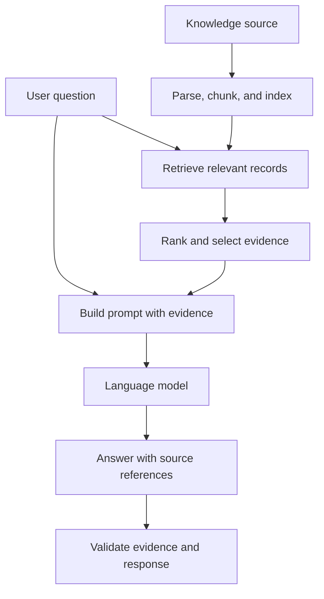
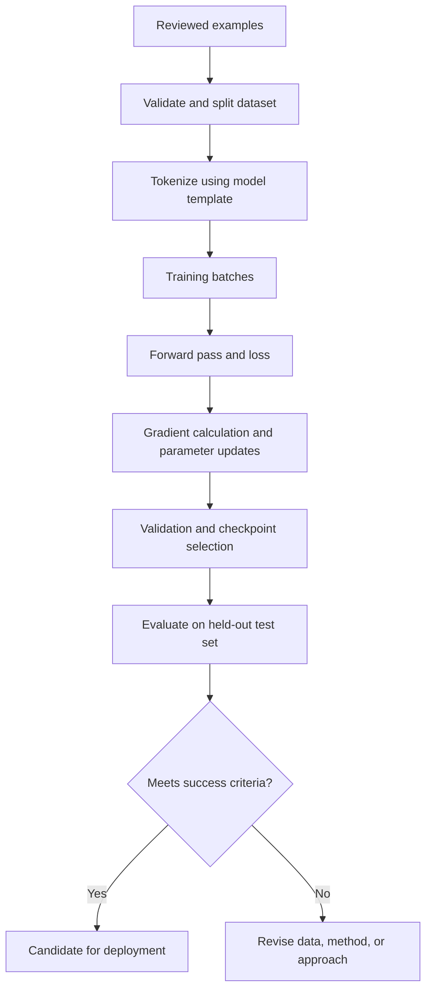
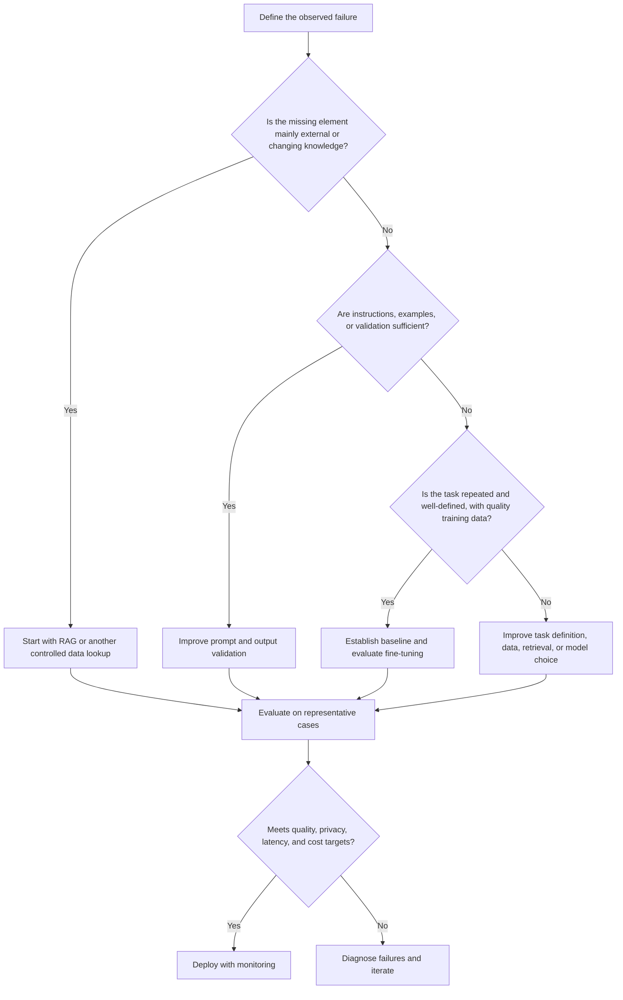
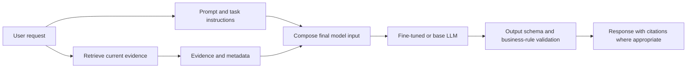

# 01. Prompt Engineering versus RAG versus Fine-Tuning

> **Level:** 12 — Fine-Tuning and Model Customization  
> **Purpose:** Choose the right customization strategy based on the problem being solved, available data, evaluation evidence, privacy, cost, and deployment constraints.

## Learning objectives

By the end of this chapter, you should be able to:

- Explain what prompt engineering, retrieval-augmented generation (RAG), and fine-tuning change.
- Distinguish behavioral guidance from access to external or changing knowledge.
- Identify when the approaches can be combined.
- Compare their data, maintenance, privacy, cost, and deployment implications.
- Explain why fine-tuning does not guarantee factual recall or eliminate hallucinations.
- Recommend an approach for consistent writing style, changing policy documents, and structured extraction.

<br/>

## 1. The core distinction

All three approaches can improve a model-backed application, but they intervene at different points in the system.

| Approach | What changes? | Main mechanism | Good initial fit |
|---|---|---|---|
| **Prompt engineering** | The instructions and context supplied for a particular inference request | Tells the model what to do and how to respond | Clearer instructions, tone, output format, task boundaries, examples |
| **RAG** | The evidence made available at inference time | Retrieves relevant content from an external knowledge source and places it in the model's context | Current policies, private knowledge bases, changing facts, source-grounded answers |
| **Fine-tuning** | The model's learned parameters, or a trainable subset/adapters associated with it | Trains on examples of desired behavior | Repeated task patterns, specialized response behavior, consistent formats or styles that prompting alone does not reliably achieve |

**Memory aid:**

- **Prompting:** Tell the model what to do.
- **RAG:** Give the model relevant evidence to use.
- **Fine-tuning:** Train the model to perform a task or respond in a desired way more consistently.

These are not mutually exclusive alternatives. A production system may use a fine-tuned model, a well-designed prompt, and RAG together.

<br/>

## 2. Prompt engineering

Prompt engineering is the process of designing and testing instructions and examples so that a model is more likely to produce the required output.

A prompt may specify:

- **Task:** classify, extract, summarize, explain, or transform.
- **Context:** the user, business process, or relevant constraints.
- **Rules:** what to include, avoid, or do when information is missing.
- **Output contract:** JSON, a table, a fixed set of labels, or a specified structure.
- **Style:** concise, formal, friendly, technical, or brand-aligned.
- **Examples:** representative input-output pairs (few-shot prompting).

<br/>

### Example: consistent support tone

Suppose a support team wants responses to be concise, respectful, and easy to understand. Start by making the requirements explicit:

```text
Role: Customer-support writing assistant.

Task: Rewrite the supplied draft without changing its factual meaning.

Style:
- Be respectful, clear, and concise.
- Use plain language.
- Do not promise refunds, delivery dates, or actions that are not
  stated in the supplied information.
- If a necessary fact is missing, flag it rather than inventing it.

Return:
1. Revised response
2. Any missing information that prevents a reliable answer

Draft:
{{customer_message}}
```

This changes the **instructions at inference time**. It does not update the model's weights.

<br/>

### Strengths

- Fast to test and iterate.
- Usually requires no training dataset or training job.
- Easy to version, review, and deploy as application configuration.
- Useful for changing task instructions and output requirements.

<br/>

### Limitations

- Results can vary across inputs and model versions.
- Complex instructions may be followed inconsistently.
- Long prompts consume context and can increase inference cost or latency.
- Prompting alone does not provide facts that are unavailable to the model or supplied context.
- A prompt cannot guarantee schema validity, authorization, or factual correctness; validate critical outputs in application code.

<br/>

## 3. Retrieval-Augmented Generation (RAG)

RAG combines retrieval from an external knowledge source with generation by a language model. Rather than relying only on information encoded during model training, the application searches a collection of documents or records and supplies relevant evidence with the question.

<br/>

### Typical RAG flow



The knowledge source might be a policy repository, product documentation, internal wiki, database, or a collection of PDFs. Retrieval may use keyword search, dense vector search, or a hybrid of both.

<br/>

### Example: a changing leave policy

An employee asks, “How many days of parental leave are available under the current policy?”

A RAG application can:

1. Search the approved policy repository.
2. Retrieve the relevant section and its version/effective date.
3. Place the retrieved text in the model's context.
4. Instruct the model to answer only from the supplied evidence.
5. Return the answer with a source citation, if supported by the application.

If the policy changes, the document index can be updated without retraining the language model. The system still needs reliable ingestion, indexing, retrieval, permissions, and source-version handling.

<br/>

### Strengths

- Can use current or private information without embedding every fact in model weights.
- Knowledge can often be updated independently of the model.
- Can support citations and auditability when source identifiers and evidence are preserved.
- Access controls can be applied during retrieval.

<br/>

### Limitations

- The answer can fail when the right evidence is not retrieved, is outdated, or is poorly parsed.
- Irrelevant or contradictory passages can confuse generation.
- Indexing, chunking, embeddings, search infrastructure, and permissions add engineering work.
- Retrieved content consumes context and may increase latency and token cost.
- RAG does not automatically prevent hallucinations: the model can misread evidence or make unsupported claims.

**Important:** RAG changes the evidence supplied to the model for a request; it does not, by itself, update the model's learned parameters.

<br/>

## 4. Fine-tuning

Fine-tuning continues training a pretrained model on examples selected for a target task. In supervised fine-tuning (SFT), the examples generally pair an input or instruction with a desired response. Training updates model parameters, or a subset of parameters when using parameter-efficient methods such as LoRA.

<br/>

### Simplified training flow



Fine-tuning is not simply adding information to a prompt. It uses examples to change how the model tends to map inputs to outputs.

<br/>

### Example: specialized structured extraction

Imagine an operations team processes thousands of similarly formatted service reports. The application must extract fields such as `incident_type`, `priority`, `asset_id`, and `summary` using a specific labeling convention.

A sensible progression is:

1. Start with a clear prompt and a strict output schema.
2. Validate outputs in application code and measure errors on representative examples.
3. Improve examples, instructions, and deterministic post-processing.
4. Consider fine-tuning if the same task-specific mistakes persist and enough high-quality, permitted examples are available.
5. Compare the customized model with the baseline on a held-out test set, including edge cases and unrelated-task regression checks.

Fine-tuning may improve consistency, but a schema validator is still needed. For example, the application should reject an unknown priority label rather than trusting the model's output.

<br/>

### Strengths

- Can improve repeated task behavior, response conventions, or specialized formatting.
- May reduce the need for long, repetitive few-shot examples in every request.
- Can be useful when a stable task has many high-quality demonstrations and prompt-only performance has plateaued.

<br/>

### Limitations

- Requires suitable training examples, data review, training infrastructure or a supported hosted service, and evaluation.
- Can overfit, memorize examples, or regress on other tasks.
- Training and serving costs depend on model, method, hardware, and provider.
- Model and adapter compatibility, licensing, artifact management, and deployment constraints matter.
- Updating facts by retraining is often less practical than updating a knowledge source.
- Fine-tuning does **not** guarantee that facts will be stored or recalled reliably, and it does **not** eliminate hallucinations.

Fine-tuning should be treated as an experiment with measurable success criteria, not as an automatic upgrade.

<br/>

## 5. What each approach changes

| Dimension | Prompt engineering | RAG | Fine-tuning |
|---|---|---|---|
| Primary change | Request instructions/context | Evidence retrieved for each request | Learned parameters or trainable adapter |
| When it acts | Inference time | Retrieval plus inference time | Training time; its effects are used at inference |
| Best at | Clarifying task, tone, rules, output | Supplying relevant external/current evidence | Learning repeated behavior from examples |
| Updating a policy | Edit prompt only if instructions changed; not ideal for policy content itself | Update the source/index | Usually requires another training cycle if relying on trained behavior/facts |
| Needs task examples? | Helpful, not always required | Not necessarily; needs a usable knowledge source | Typically needs quality training examples |
| Source citations | Must be designed into the workflow | Natural fit if evidence and metadata are retained | Not inherently provided |
| Main failure mode | Instruction not followed | Relevant evidence not retrieved or used correctly | Poor data, overfitting, or limited generalization |
| Typical maintenance | Prompt versioning and regression tests | Source refresh, indexing, retrieval evaluation | Dataset/version management, retraining, artifact and regression management |

<br/>

## 6. Choosing an approach: decision framework

Use the problem, not the popularity of a technique, to make the decision.



<br/>

### Practical selection rules

Choose **prompt engineering first** when:
- The task is understandable but the instructions are vague.
- Tone, response length, role, or output format needs clarification.
- You need a quick, low-cost baseline before adding infrastructure.

Choose **RAG first** when:
- Answers depend on current, private, frequently updated, or source-specific facts.
- Users need references to the source material.
- Knowledge should be updated without running a training job.

Consider **fine-tuning** when:
- The task pattern is stable and repeated.
- Prompting and application-side validation have been tested.
- A representative, permitted, high-quality dataset exists.
- Evaluation shows a specific behavior gap that training could plausibly improve.
- Expected gains justify training, serving, and maintenance costs.

Before fine-tuning, also consider whether a conventional classifier, deterministic rule, better retrieval configuration, or stronger base model would solve the problem more simply.

<br/>

## 7. Combining the approaches

The techniques solve different parts of a system and can complement each other.



Example: an internal policy assistant could use:
- **Fine-tuning** to improve a stable response convention, if evaluation justifies it.
- **RAG** to retrieve the current approved policy and its effective date.
- **Prompt engineering** to instruct the model to answer only from evidence and say when evidence is insufficient.
- **Application validation** to enforce access control and check the output contract.

The model must not be trusted to enforce authorization on its own. Permissions should be enforced by the application and retrieval layer.

<br/>

## 8. Maintenance, privacy, cost, and deployment

### Maintenance

- **Prompting:** version instructions, test prompt changes, and check behavior after model upgrades.
- **RAG:** maintain source documents, parsing, indexing, metadata, permissions, and retrieval quality.
- **Fine-tuning:** version the dataset, splits, base model, tokenizer/template, configuration, checkpoints/adapters, and evaluation results.

<br/>

### Data availability and quality

- Prompting needs a clear task definition and may benefit from examples.
- RAG needs accessible, relevant, permitted source material and a reliable retrieval path.
- Fine-tuning needs representative examples with correct targets. More data is not automatically better if labels are inconsistent or wrong.

<br/>

### Privacy and governance

Ask:
- Is the data permitted to be sent to the chosen provider or training environment?
- Does the workflow expose personal or confidential data in prompts, logs, retrieval stores, or training artifacts?
- Can users retrieve only documents they are authorized to access?
- What are the provider's retention, deletion, and training-use terms?
- Do dataset licenses permit the intended training and deployment?

Privacy is an implementation and governance property, not an automatic benefit of any one technique. Local fine-tuning can reduce some external data transfers, but it still requires access control and careful artifact handling.

<br/>

### Cost and latency

- Prompting has no training cost, but long prompts can increase input-token cost and latency.
- RAG adds retrieval and indexing costs, and the retrieved context adds inference tokens.
- Fine-tuning adds data preparation and training costs; serving costs may rise or fall depending on the model, adapter, prompt length, and deployment architecture.

Measure total application cost and end-to-end latency rather than comparing only model-training cost.

<br/>

## 9. Why fine-tuning is not a factual database

Fine-tuning optimizes model behavior against training examples. It does not create a reliable key-value database or guarantee exact recall of every training fact.

Risks include:
- A fact may not be learned consistently from a small or noisy dataset.
- The model may produce plausible but unsupported answers for unseen questions.
- New or changed facts can become stale.
- Repeated exposure to a source can create memorization or privacy risks.
- Improvements on the training-like task can come with regressions elsewhere.

For facts that change or need source-level auditability, use a controlled knowledge source and retrieval or database lookup. Fine-tuning can complement this by shaping how the model uses evidence, but factual correctness still needs evaluation.

<br/>

## 10. Practice: recommend an approach

### Scenario A — Consistent brand style

**Problem:** A company wants product explanations to use a stable, friendly tone and a consistent structure.

**Recommendation:** Start with prompt engineering and a few high-quality examples. Add a reusable template and evaluate outputs on representative cases. If the task is frequent, stable, and prompt-only behavior remains inconsistent, assess fine-tuning using approved examples. Use RAG only if the response also needs product facts from a changing source.

**Why:** The primary need is behavioral consistency, not a new knowledge source.

<br/>

### Scenario B — Changing policy documents

**Problem:** Employees ask questions about policy documents that are revised monthly.

**Recommendation:** Use RAG over the approved, versioned policy repository. Retrieve the applicable sections and effective dates, enforce document permissions, and cite sources. Add prompt instructions to abstain when evidence is insufficient.

**Why:** The main need is current, traceable evidence. Fine-tuning the model on each policy revision would create unnecessary maintenance and would not guarantee accurate factual recall.

<br/>

### Scenario C — Structured extraction

**Problem:** Extract a fixed set of fields from incoming service reports.

**Recommendation:** Start with a clear prompt and a schema validator. Establish a baseline on labeled examples. Use deterministic parsing or rules for reliably structured inputs. If repeated task-specific errors remain and enough representative, high-quality examples are available, evaluate supervised fine-tuning. Keep schema validation and business rules after generation.

**Why:** The main need is predictable task behavior and output format. Fine-tuning may help consistency, but it does not replace validation.

<br/>

### Summary of recommendations

| Scenario | Start with | Consider adding | Essential safeguard |
|---|---|---|---|
| Brand style | Prompt engineering | Fine-tuning if measured need remains | Style and factual regression tests |
| Changing policies | RAG | Prompt instructions; possibly fine-tuning for stable behavior | Permissions, source versions, citations, abstention |
| Structured extraction | Prompt + schema validation | Rules or fine-tuning after baseline evaluation | Strict validation and error handling |

<br/>

## 11. Mini experiment: make the decision evidence-based

For any candidate use case:

1. Collect representative inputs, including edge cases.
2. Define task-specific success criteria before changing the system.
3. Measure a prompt-only baseline.
4. If the problem is missing knowledge, test retrieval quality separately from answer quality.
5. If fine-tuning is justified, compare the base and customized models on the same held-out test cases with equivalent task instructions where possible.
6. Track correctness, format compliance, critical regressions, latency, resource use, and cost.
7. Adopt the added complexity only if the measured benefit justifies it.

Do not use the held-out test set repeatedly to tune the system. Keep it for final assessment; use training and validation data for iteration and model selection.

<br/>

## 12. Exercises with answers

### Q1. A model writes in an overly casual tone. Which approach should you try first?

**Answer:** Prompt engineering. State the desired tone, audience, constraints, and examples. Consider fine-tuning only if the need is repeated and measured prompt-only performance remains inadequate.

<br/>

### Q2. A policy changes every month. Should the new policy be fine-tuned into the model?

**Answer:** Usually not. Use RAG or a controlled database lookup so the source can be updated independently and answers can reference the applicable version.

<br/>

### Q3. Does fine-tuning guarantee valid JSON?

**Answer:** No. It may improve formatting consistency, but validate the output against a schema and handle invalid outputs safely.

<br/>

### Q4. Can RAG and fine-tuning be used together?

**Answer:** Yes. RAG supplies evidence at inference time; fine-tuning can shape response behavior. Prompt instructions can guide how the model uses the evidence.

<br/>

### Q5. Why can a fine-tuned model still hallucinate?

**Answer:** Training optimizes behavior on examples; it does not guarantee that every fact is represented or recalled correctly. The model can still generate unsupported content, especially when evidence is missing or ambiguous.

<br/>

### Q6. What must be established before a fine-tuning experiment?

**Answer:** A defined failure, measurable success criteria, a prompt-only or appropriate system baseline, permitted high-quality training data, leakage-resistant validation/test splits, and a bounded compute/cost budget.

<br/>

## 13. Checkpoint

You should be able to explain these three statements clearly:

1. **Prompt engineering changes the request:** it guides the model's behavior at inference time.
2. **RAG changes the available evidence:** it retrieves external information and supplies it to the model for a request.
3. **Fine-tuning changes learned parameters:** it uses training examples to encourage desired behavior, but does not guarantee factual storage or eliminate hallucinations.

For a practical decision, identify the primary failure first:
- unclear instructions or response conventions → improve the prompt;
- missing, private, or changing facts → use retrieval or a controlled data lookup;
- persistent behavior gaps on a stable, well-defined task → establish a baseline and evaluate whether fine-tuning is justified.

**Final checkpoint:** Explain what each approach changes and why that change addresses the selected problem. Include at least one limitation and one evaluation method in your explanation.

<br/>

## References

- [OpenAI API — Prompt engineering](https://developers.openai.com/api/docs/guides/prompt-engineering)
- [OpenAI API — Prompting](https://developers.openai.com/api/docs/guides/prompting)
- [OpenAI API — Supervised fine-tuning](https://developers.openai.com/api/docs/guides/supervised-fine-tuning)
- [Hugging Face — PEFT documentation](https://huggingface.co/docs/peft/index)
- [Hugging Face — TRL documentation](https://huggingface.co/docs/trl/index)
- [LangChain — Retrieval concepts](https://www.langchain.com/blog/retrieval)

> **Implementation note:** Hosted fine-tuning support, model availability, pricing, and provider terms change. Verify current documentation for the provider and model you intend to use before committing data or budget.
