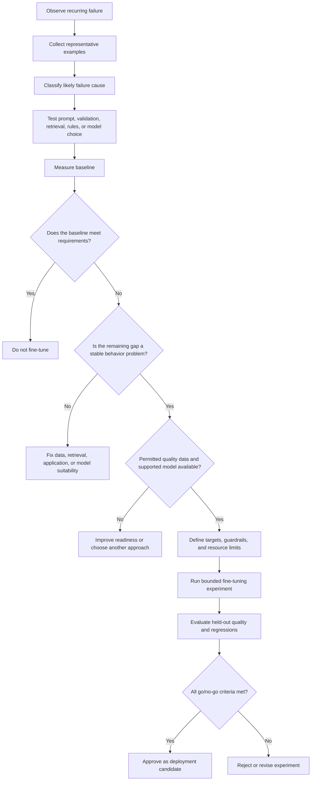

# 02. When Fine-Tuning Is and Is Not Appropriate

> **Level:** 12 — Fine-Tuning and Model Customization  
> **Purpose:** Determine whether fine-tuning is justified by a specific, recurring model failure—and define an experiment that can prove or disprove its value.

## Learning objectives

By the end of this chapter, you should be able to:

- Diagnose a recurring failure using representative examples.
- Establish a prompt-only or RAG baseline before training.
- Define measurable target improvements, acceptable regressions, and resource limits.
- Check base-model suitability, training support, licensing, and dataset readiness.
- Recognize when rules, validation, improved retrieval, or a stronger model is a better solution.
- Write an experiment proposal with an explicit go/no-go criterion.

<br/>

## 1. The central principle

**Fine-tuning is an option to test, not a mandatory upgrade.** It is justified only when a well-defined failure remains after simpler interventions have been evaluated and when training is likely to address the cause.

A model can perform poorly for several different reasons:

- The instructions are ambiguous or incomplete.
- Required evidence is missing or not retrieved.
- The selected model lacks the necessary capability.
- The output is correct but violates a strict application contract.
- The training examples are noisy, contradictory, or unrepresentative.
- The task is inherently better handled by deterministic code or a conventional ML model.

Training on examples will not automatically fix every category. First diagnose the failure, then choose an intervention that matches it.

<br/>

## 2. Diagnose the recurring failure

Do not start with “we need a fine-tuned model.” Start with observable failures.

### Step 1 — Define the task and expected behavior

Write down:

- **Input:** what the application receives.
- **Expected output:** what a correct response must contain.
- **Constraints:** allowed labels, required fields, source requirements, latency limits, and other contracts.
- **Failure definition:** the precise condition that makes a result unacceptable.
- **Impact:** how often the failure occurs and how costly it is.

For example, “extraction quality is poor” is too vague. A testable description is: “On service reports containing multiple asset identifiers, the model selects the wrong `asset_id` in 18% of reviewed cases.”

<br/>

### Step 2 — Collect representative examples

Create a small failure set containing:

- Common, ordinary inputs.
- Difficult and ambiguous inputs.
- Edge cases and missing-field cases.
- Different document layouts, sources, or user phrasing.
- Correct and incorrect outputs, with reviewer explanations.

Avoid selecting only dramatic failures or examples that favor a preferred solution. Include successful cases as well, so a proposed fix can be checked for regressions.

<br/>

### Step 3 — Categorize the failure

| Failure category | Example symptom | First intervention to test |
|---|---|---|
| Instruction ambiguity | Model ignores a poorly specified requirement | Rewrite and clarify the prompt |
| Output contract violation | Missing JSON field or invalid enum | Schema-constrained output and application validation |
| Missing or stale evidence | Answer uses an old policy | Improve retrieval or query a controlled source |
| Retrieval failure | Correct document exists but is not retrieved | Inspect indexing, filters, chunking, query formulation, and ranking |
| Capability gap | Model consistently fails complex reasoning or domain interpretation | Test a stronger or more suitable model |
| Repeated task-specific behavior | Model repeatedly misapplies a stable labeling convention | Improve examples and test whether fine-tuning helps |
| Deterministic business rule | Output must obey an exact threshold or calculation | Implement and test a rule or ordinary code |
| Poor source data | Inputs are incomplete or contradictory | Improve input validation and data quality |

<br/>

### Step 4 — Test the likely cause

Change one important variable at a time when feasible. For example, compare the original prompt with a clearer prompt on the same examples. If using RAG, inspect retrieval results separately from the final answer. This helps avoid paying for training to solve a retrieval or application bug.

<br/>

## 3. Establish a baseline before training

A **baseline** is a documented measure of how the current system performs before a proposed intervention. It provides the reference point for deciding whether fine-tuning creates meaningful value.

Depending on the application, the baseline may be:

- A prompt-only model.
- A prompt plus schema validation and deterministic post-processing.
- A RAG application with its current retrieval configuration.
- A conventional classifier or rule-based system.
- A stronger candidate base model without fine-tuning.

Use the simplest credible system that can solve the task. The baseline should represent a realistic production candidate, not an intentionally weak prompt.

<br/>

### Baseline procedure

1. Freeze a representative evaluation dataset and its labels or rubric.
2. Record the current model identifier/revision, prompt, decoding settings, output limits, and any retrieval configuration.
3. Run the baseline on the same inputs that will later be used to compare candidates.
4. Score outputs using pre-defined task metrics and human review where necessary.
5. Categorize failures and save representative examples.
6. Record latency, token usage, resource use, and cost where available.

For a RAG application, measure retrieval quality separately from answer quality. A fine-tuned generator cannot reliably answer from a document that the retriever never supplies.

<br/>

## 4. Define success before running the experiment

A useful experiment proposal states the target improvement, unacceptable regressions, and resource limits **before** training begins.

### Types of success criteria

- **Primary metric:** the measure directly tied to the failure, such as field-level F1, exact-match accuracy, or task rubric score.
- **Secondary metrics:** schema-valid rate, citation correctness, refusal/abstention quality, or human preference.
- **Regression guardrails:** critical tasks or general capabilities that must not degrade beyond a defined tolerance.
- **Operational guardrails:** latency, peak memory, artifact size, throughput, and cost.
- **Safety and privacy guardrails:** no unauthorized data exposure and no unacceptable handling of sensitive inputs.

Use metrics appropriate to the task. Exact match is useful when the output must be identical; it is not a universal measure of semantic quality.

<br/>

### Example of a measurable go/no-go criterion

Suppose a report-extraction baseline achieves 82% exact match on required fields.

An illustrative proposal might define:

- **Primary target:** reach at least 90% field-level exact match on the held-out test set.
- **Regression guardrail:** no more than a 2-percentage-point decrease on a separate set of critical cases.
- **Format requirement:** at least 99% schema-valid outputs after the complete application validation path.
- **Budget:** no more than 2 GPU-hours for the planned local experiment, with a fixed storage limit.
- **Decision:** adopt the customized candidate only if it meets the quality target and every critical guardrail within budget.

These values are examples, not universal recommendations. Set thresholds based on business impact, baseline performance, evaluation-set size, and available resources.

A candidate that improves average accuracy but breaks a critical safety or authorization requirement is a **no-go**.

<br/>

## 5. When fine-tuning is a reasonable candidate

Fine-tuning is worth evaluating when most of the following conditions hold:

- The task is stable, repeated, and clearly defined.
- A recurring failure remains after prompt and application improvements.
- The task involves a behavior or mapping that can be demonstrated through examples.
- A sufficient number of high-quality, representative, permitted examples is available.
- The selected base model can perform the task in principle.
- The training method and model are supported by the chosen framework or provider.
- Success and regression criteria can be measured on held-out cases.
- The expected improvement justifies training, deployment, and maintenance costs.

Potential use cases include specialized extraction conventions, consistent domain-specific response structures, and repeated classification-like behavior when simpler systems are insufficient.

These conditions make fine-tuning a candidate; they do not guarantee it will work.

<br/>

## 6. When fine-tuning is not the right first choice

### Case A — A prompt can solve the problem

If the model fails because the instruction is vague, contradictory, or missing examples, improve the prompt first. Fine-tuning may encode a recurring behavior, but it is unnecessary if a prompt reliably meets the target.

<br/>

### Case B — The required facts change frequently

If the system needs the latest policies, prices, product details, or account records, prefer RAG or a controlled database/API lookup. Fine-tuning can become stale and does not guarantee exact factual recall.

<br/>

### Case C — The problem is strict formatting or validation

If the main requirement is valid JSON, correct field types, or an allowed enum, use structured output features where available and validate in application code. Fine-tuning may improve compliance but cannot replace deterministic checks.

<br/>

### Case D — A rule or conventional model is sufficient

Use ordinary code for exact calculations and fixed business rules. Consider a conventional classifier when the problem is a well-defined classification task and a smaller, easier-to-evaluate model meets requirements.

<br/>

### Case E — Retrieval is the bottleneck

If the correct evidence exists but RAG fails to retrieve it, diagnose search quality, metadata filters, chunking, embeddings, or reranking. Fine-tuning the generator does not repair the retrieval pipeline by itself.

<br/>

### Case F — The base model is unsuitable

If the model lacks the language support, context capacity, reasoning ability, or modality required by the task, test a more appropriate base model. Fine-tuning a poor fit may not close the gap.

<br/>

### Case G — The data or deployment constraints are inadequate

Do not train when examples are unpermitted, contradictory, severely unrepresentative, or too limited to support meaningful evaluation. Likewise, stop if the model license, training support, privacy terms, or compute budget do not fit the intended deployment.

<br/>

## 7. Check base-model support, licensing, and task suitability

Before preparing a training run, verify the following.

### Model and method support

- Is the exact model supported for the intended fine-tuning method?
- Does the provider or training framework support the required data format and sequence length?
- Are the tokenizer and chat template available and compatible?
- Can the resulting checkpoint or adapter be loaded by the intended serving stack?
- Are the needed precision, quantization, and hardware options supported?

Do not assume that every open-weight model supports every adapter method or that every hosted provider offers the same fine-tuning features.

<br/>

### License and data permissions

- Does the model license allow the intended fine-tuning and commercial or non-commercial use?
- Are the dataset sources permitted for this use?
- Do privacy and contractual obligations allow the data to be uploaded to the selected service?
- Are there restrictions on redistributing model weights, adapters, or outputs?
- Are data retention and deletion requirements understood?

<br/>

### Task suitability

- Is the target behavior learnable from input-output examples?
- Is the failure caused by model behavior rather than missing external information?
- Can correctness be assessed with a reliable rubric or labels?
- Will the expected gain remain useful on unfamiliar examples?

If any critical compatibility or permission question is unresolved, pause before training.

<br/>

## 8. Data readiness is a go/no-go condition

Fine-tuning quality depends heavily on the examples used. A larger dataset does not compensate for systematically incorrect targets.

Check that the dataset is:

- **Correct:** responses reflect the intended behavior.
- **Consistent:** equivalent inputs are labeled using the same conventions.
- **Representative:** it covers typical inputs, edge cases, and relevant variation.
- **Permitted:** its sources and intended use are authorized.
- **Appropriately diverse:** it does not consist mostly of near-duplicates or one narrow input pattern.
- **Auditable:** provenance and important review decisions are recorded.
- **Leakage-resistant:** related records do not contaminate validation and test sets.

Keep the final test set separate from training and repeated configuration decisions. If the dataset is not ready, improve it before starting a costly experiment.

<br/>

## 9. A practical decision workflow



<br/>

## 10. Practice: write an experiment proposal

### Scenario

A service-report application extracts `incident_type`, `priority`, `asset_id`, and `summary`. After prompt improvements, the system still confuses two priority labels on reports with ambiguous wording. A reviewed dataset is available, but it contains multiple reports from the same underlying incidents.

The task is to decide whether to fine-tune a suitable small model.

<br/>

### Experiment proposal template

Use this template before any training run. Replace the example thresholds with values justified by your application.

```text
# Fine-Tuning Experiment Proposal

## 1. Problem
- Task:
- User/business impact:
- Recurring failure:
- Representative examples reviewed:

## 2. Baseline
- Base model and revision:
- Prompt/version:
- Output validation:
- Evaluation dataset/version:
- Baseline metric and result:
- Latency and cost:

## 3. Alternatives already tested
- Prompt changes:
- Rules or conventional classifier:
- Stronger base model:
- RAG/retrieval changes, if relevant:
- Why the remaining failure is a candidate for fine-tuning:

## 4. Data readiness
- Dataset provenance and permission:
- Number and diversity of examples:
- Label quality and review:
- Duplicate/related-record handling:
- Train/validation/test split rule:

## 5. Proposed experiment
- Fine-tuning method:
- Base model support and license:
- Training configuration:
- Compute/runtime/storage budget:

## 6. Go/no-go criteria
- Primary target:
- Regression guardrails:
- Format/safety requirements:
- Maximum resource cost:
- Decision rule:

## 7. Final decision
- Adopt, revise, or reject:
- Evidence:
- Remaining risks:
```

<br/>

### Example decision criteria

The following numbers are illustrative only:

- Baseline priority-label accuracy: 84% on a reviewed evaluation set.
- Target: at least 92% accuracy on a leakage-resistant held-out test set.
- Guardrail: extraction accuracy for `asset_id` must not fall by more than 2 percentage points.
- Output validity: at least 99% valid outputs through the full validation path.
- Resource budget: fixed training time, memory, storage, and monetary limits recorded before training.
- Go: every critical guardrail passes and the primary target is met.
- No-go: the target is missed, a critical regression appears, permissions are unclear, or the resource budget is exceeded.

Because multiple reports derive from the same incident, split by incident or source group—not by random row—so near-identical examples cannot appear in both training and test sets.

<br/>

## 11. Evaluation and interpretation

A good experiment distinguishes between:

1. **Task improvement:** Did the target failure decrease?
2. **Generalization:** Does the gain persist on unseen examples and edge cases?
3. **Regression:** Did other important fields or capabilities get worse?
4. **Operational feasibility:** Can the candidate be served within latency, memory, and cost limits?
5. **Reproducibility:** Can the results be traced to the data, model revision, configuration, and selected artifact?

Compare the base and customized model using the same held-out cases and an equivalent evaluation rubric. Where templates or serving paths must differ, document those differences. Report uncertainty and test-set size; a small test set can make a few examples disproportionately influential.

Lower training loss alone is not sufficient evidence of application improvement.

<br/>

## 12. Common mistakes

- **Fine-tuning before diagnosis:** The intervention may not address the actual failure.
- **No baseline:** There is no defensible way to attribute improvement to training.
- **Vague success criteria:** “Better answers” cannot support a clear decision.
- **Testing on training examples:** Results can reflect memorization rather than generalization.
- **Random row splitting across related records:** Leakage inflates performance estimates.
- **Ignoring regressions:** A gain on one field can damage another important behavior.
- **Ignoring license and data permissions:** A technically successful run may still be unusable.
- **Treating training loss as the final metric:** Optimization metrics do not directly establish task quality.
- **Unbounded experiments:** Uncontrolled steps, checkpoints, and retries can exceed budgets.
- **Assuming fine-tuning fixes factuality:** Learned behavior is not a guarantee of factual recall.

<br/>

## 13. Exercises with answers

### Q1. A model gives invalid JSON in 3% of requests. Should you fine-tune it immediately?

**Answer:** No. First test structured output support, schema validation, retries or repair where appropriate, and a clearer prompt. Consider fine-tuning only if a measured behavior gap remains and the expected benefit justifies the added complexity.

<br/>

### Q2. A RAG system misses the correct policy passage. Is fine-tuning the generator the best fix?

**Answer:** Usually not. Inspect retrieval, filters, indexing, chunking, and ranking. A generator cannot reliably use evidence it never receives.

<br/>

### Q3. The model applies a stable labeling convention inconsistently despite prompt improvements. When might fine-tuning be appropriate?

**Answer:** When the remaining failure is repeatable, high-quality permitted examples exist, the base model and method are supported, and a held-out evaluation can measure improvement and regression risk.

<br/>

### Q4. Why should related reports be grouped during splitting?

**Answer:** Reports from the same incident may share nearly identical content. If related records cross split boundaries, test results can overstate performance on genuinely unseen cases.

<br/>

### Q5. What is a go/no-go criterion?

**Answer:** A pre-defined decision rule specifying the required improvement, regression limits, and operational constraints. The experiment is accepted only if the criteria are met.

<br/>

### Q6. What if fine-tuning improves the primary metric but exceeds the cost budget?

**Answer:** Under the stated proposal, it is a no-go. Revise the method or serving plan and rerun evaluation, or retain the baseline if the improvement cannot be delivered within constraints.

<br/>

## 14. Checkpoint

You should be able to defend a fine-tuning decision using this chain of evidence:

1. A specific recurring failure is documented with representative examples.
2. A credible prompt-only or RAG/application baseline has been measured.
3. Simpler alternatives have been tested where relevant.
4. The remaining failure is plausibly addressable through training.
5. Data permissions, quality, split design, base-model support, and licensing are verified.
6. Success, regression, and resource thresholds are written before training.
7. A bounded experiment is evaluated on held-out cases.
8. The decision to adopt, revise, or reject is tied to measured evidence.

**Final checkpoint:** Fine-tuning is justified only when the evidence indicates that it addresses a persistent problem better than simpler alternatives and the measured gains satisfy pre-defined quality, regression, and resource constraints.

<br/>

## References

- [Hugging Face — TRL documentation](https://huggingface.co/docs/trl/index)
- [Hugging Face — PEFT documentation](https://huggingface.co/docs/peft/index)
- [Hugging Face — Datasets documentation](https://huggingface.co/docs/datasets/index)
- [OpenAI API — Supervised fine-tuning](https://developers.openai.com/api/docs/guides/supervised-fine-tuning)
- [OpenAI API — Evaluation best practices](https://platform.openai.com/docs/guides/evaluation-best-practices)

> **Implementation note:** Model availability, fine-tuning support, licenses, pricing, and provider data terms can change. Verify current documentation for the exact model and service before starting an experiment.
