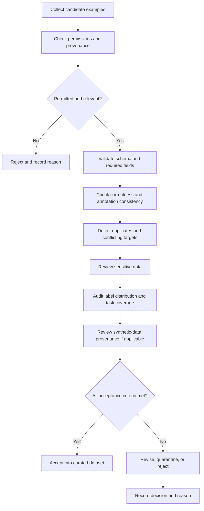

# 03. Dataset Curation and Quality Checks

> **Level:** 12 — Fine-Tuning and Model Customization  
> **Purpose:** Build a permitted, representative, consistent, and auditable instruction dataset before spending resources on fine-tuning.

## Learning objectives

By the end of this chapter, you should be able to:

- Collect instruction-response examples that are relevant and permitted for the intended use.
- Audit correctness, consistency, diversity, and task coverage.
- Identify duplicates, contradictory targets, sensitive data, and irrelevant records.
- Inspect label distributions and gaps in edge-case coverage.
- Record data provenance, annotation rules, and review decisions.
- Explain the limitations of synthetic training data and why independent review matters.
- Produce an accepted/rejected-example report for a small dataset.

<br/>

## 1. Why dataset curation matters

Fine-tuning teaches a model patterns from examples. If examples contain incorrect answers, inconsistent labels, irrelevant content, or accidental leakage, training can reinforce those defects.

A larger dataset is not automatically a better dataset. If the target responses are systematically wrong, adding more examples can strengthen the wrong behavior rather than correct it.

Dataset curation is the process of selecting, reviewing, transforming, documenting, and validating examples before they enter a training run. It is both a data-quality task and a governance task.

A useful instruction example generally contains:

- **Input:** the instruction, question, conversation, or source content.
- **Target response:** the response the model should learn to produce.
- **Metadata:** source, task type, language, review status, version, and any relevant permissions.
- **Review outcome:** accepted, rejected, or needs revision, with a reason.

The exact schema depends on the chosen model and fine-tuning framework.

<br/>

## 2. Collect permitted, representative examples

### 2.1 Data sources

Potential sources include:

- Human-written instruction-response pairs.
- Reviewed application interactions, where collection and reuse are permitted.
- Expert-authored examples.
- Public datasets whose licenses and terms allow the intended use.
- Synthetic examples generated from approved source material and independently reviewed.

Do not assume that data being publicly accessible means it is automatically permitted for training. Check copyright, license, contractual restrictions, privacy obligations, consent where applicable, and the intended deployment context.

<br/>

### 2.2 Represent the real task

A dataset should reflect the inputs the deployed system is likely to receive. For an incident-report extraction model, examples might cover:

- Standard reports with all fields present.
- Reports with missing identifiers.
- Multiple identifiers in one report.
- Ambiguous priority descriptions.
- Unusual but valid phrasing.
- Noisy or malformed inputs.
- Inputs outside the task scope.

If the dataset contains only clean, repetitive examples, a model may appear successful during training but fail on real-world variation.

<br/>

### 2.3 Coverage matrix

Before collecting large numbers of examples, define the dimensions that matter.

| Dimension | Example values for report extraction | Why it matters |
|---|---|---|
| Task type | Extract, classify, summarize | Prevents accidental narrowing to one subtask |
| Input quality | Clean, noisy, incomplete | Tests robustness |
| Field availability | All fields, missing field, ambiguous field | Teaches appropriate handling of missing data |
| Label/class | Low, medium, high priority | Reveals class imbalance |
| Language/style | Standard phrasing, abbreviations, regional wording | Improves coverage of expected variation |
| Source | Different systems, teams, or document templates | Reduces dependence on one source pattern |
| Difficulty | Routine, ambiguous, edge case | Covers more than easy examples |

Only include dimensions relevant to the application. The goal is not to maximize variety indiscriminately; it is to cover meaningful production conditions.

<br/>

## 3. Quality dimensions

### 3.1 Correctness

Each target response must match the intended task definition and source evidence.

Check:
- Are extracted values present in the input or supported by an approved source?
- Are labels consistent with the annotation rubric?
- Are summaries faithful to the source?
- Does the response avoid inventing missing values?
- Are calculations and identifiers correct?

Incorrect targets should be corrected or rejected before training.

<br/>

### 3.2 Consistency

Equivalent inputs should receive equivalent targets unless the task definition explicitly requires different treatment.

For example, if “urgent” maps to `high` priority in the annotation guide, equivalent descriptions should not sometimes map to `medium` without a documented reason.

Consistency requires:
- A written annotation guide.
- Clear label definitions and examples.
- Explicit handling of ambiguous and missing values.
- Review of disagreements between annotators.
- Versioned changes to the rubric.

<br/>

### 3.3 Diversity and representativeness

Diversity means meaningful variation across relevant inputs, not merely different wording. Review source systems, user phrasing, document layouts, languages, classes, and edge cases where they affect performance.

Avoid a dataset dominated by near-identical templates or one easy class. Such a dataset can produce misleading training metrics.

<br/>

### 3.4 Task coverage

Every important production behavior should be represented, including what the model should do when it cannot complete the task.

Examples:
- Return `null` for a genuinely missing optional field if that is the contract.
- Mark an input as ambiguous when the evidence is insufficient.
- Reject or route out-of-scope inputs according to the application design.
- Avoid guessing identifiers or labels not supported by the input.

Do not invent a target behavior that has not been defined by the task owner.

<br/>

## 4. Duplicates and near-duplicates

Duplicate examples can distort the effective data distribution, waste training time, and create leakage risks across dataset splits.

### Types of duplication

- **Exact duplicate:** the same input and target appear more than once.
- **Input duplicate with conflicting targets:** the same or equivalent input has different targets.
- **Near-duplicate:** only superficial details differ, while the underlying content is almost identical.
- **Legitimate repeated pattern:** examples share a template but represent genuinely different cases.

Do not automatically delete every repeated pattern. First determine whether it is a duplicate, a valid recurring production case, or a conflict that requires review.

<br/>

### Practical checks

```python
import pandas as pd

df = pd.read_csv("instruction_dataset.csv")

required_columns = {"instruction", "input", "output"}
missing = required_columns - set(df.columns)
if missing:
    raise ValueError(f"Missing required columns: {sorted(missing)}")

# Normalize whitespace for a basic duplicate audit.
for column in ["instruction", "input", "output"]:
    df[f"{column}_normalized"] = (
        df[column].fillna("").astype(str).str.strip().str.replace(r"\s+", " ", regex=True)
    )

# Exact duplicates across all three text fields.
exact_duplicate_mask = df.duplicated(
    subset=["instruction_normalized", "input_normalized", "output_normalized"],
    keep="first",
)

# Same normalized instruction and input, but potentially different targets.
conflicting_targets = (
    df.groupby(["instruction_normalized", "input_normalized"])["output_normalized"]
      .nunique()
      .reset_index(name="unique_target_count")
      .query("unique_target_count > 1")
)

print("Exact duplicate rows:", int(exact_duplicate_mask.sum()))
print("Inputs with multiple targets:", len(conflicting_targets))
```

This code detects basic exact duplicates and repeated inputs with differing outputs. It does **not** reliably detect semantic near-duplicates, and different targets are not always wrong: they may be valid if context or annotation rules differ. Inspect flagged groups before making decisions.

<br/>

## 5. Contradictory targets and annotation disputes

Contradictions are especially harmful when identical or equivalent inputs have incompatible targets and there is no valid contextual explanation.

Examples:
- The same incident is labeled both `low` and `high` priority without a rubric-based reason.
- An absent asset identifier is guessed in one target and marked missing in another.
- A summary claims an event occurred even though the source does not support it.

Recommended handling:

1. Flag the examples and preserve their source identifiers.
2. Check whether hidden context explains the difference.
3. Consult the annotation guide and source evidence.
4. Resolve the disagreement with a qualified reviewer.
5. Correct the target, exclude the record, or revise the task definition.
6. Record the decision and update the dataset version.

Do not silently select one label just to make the dataset uniform. Consistency must reflect the correct task definition, not arbitrary agreement.

<br/>

## 6. Sensitive data, privacy, and permissions

Review both inputs and targets for:
- Personal identifiers and contact information.
- Credentials, API keys, tokens, and secrets.
- Confidential business information.
- Health, financial, or other sensitive records.
- Information that should not be retained or transferred to the selected training environment.

Use data minimization: keep only what the task requires. Apply approved redaction or de-identification procedures when appropriate, and verify that redaction has not removed information essential to the task.

Before using a hosted service, verify its current data handling, retention, deletion, and training-use terms. Local training does not remove the need for access controls, secure storage, and careful artifact handling.

A dataset should not be accepted merely because sensitive content is absent from the visible prompt; the target response and metadata must be checked too.

<br/>

## 7. Label distributions and missing edge cases

For classification-like tasks, inspect how often each label appears. A highly imbalanced dataset may cause the model to overproduce common labels and perform poorly on rare but important cases.

```python
import pandas as pd

df = pd.read_csv("instruction_dataset.csv")

print("Rows:", len(df))
print("\nPriority distribution:")
print(df["priority"].value_counts(dropna=False))

print("\nPriority proportions:")
print(df["priority"].value_counts(normalize=True, dropna=False).round(3))
```

Interpret the distribution in context. A real production population may genuinely be imbalanced; do not force a balanced dataset without considering deployment prevalence and evaluation goals.

Also audit **coverage gaps**, not only counts. A rare class might have many examples of one easy pattern but none of the ambiguous cases that cause real failures.

Possible actions include:
- Collecting more examples for underrepresented but important cases.
- Improving annotation guidance.
- Using sampling or weighting only when appropriate to the training method and deployment objective.
- Reporting per-class metrics during evaluation.
- Keeping a representative test distribution or maintaining a separate stress-test set.

Any resampling or synthetic augmentation should be documented and should not contaminate held-out evaluation.

<br/>

## 8. Provenance and review records

Provenance records explain where examples came from and how they were transformed and approved. They make the dataset auditable and support reproducibility.

Useful metadata fields include:

| Field | Purpose |
|---|---|
| `example_id` | Stable identifier for the record |
| `source_id` | Source document, record, or approved dataset identifier |
| `source_type` | Human-authored, application data, public dataset, synthetic, etc. |
| `license_or_permission` | Permission status or reference to the applicable approval |
| `task_version` | Version of the task definition |
| `annotation_guide_version` | Rules used to create the target |
| `review_status` | Accepted, rejected, or needs revision |
| `review_reason` | Explanation for the decision |
| `sensitive_data_check` | Outcome of the approved privacy review |
| `dataset_version` | Version of the curated collection |

Do not put raw secrets or unnecessary sensitive content into metadata. Keep access-controlled provenance references where detailed source information must be protected.

<br/>

### Review states

- **Accepted:** correct, permitted, relevant, and sufficiently clear.
- **Rejected:** incorrect, unpermitted, irrelevant, irrecoverably ambiguous, or unsafe to use.
- **Needs revision:** potentially useful but requires correction, clarification, redaction, or further review.

A rejected example should retain a reason code where feasible. This helps reveal systemic problems in data collection or annotation.

<br/>

## 9. Synthetic data: useful but not automatically trustworthy

Synthetic data is generated by a model or program rather than collected directly from the target production process. It can help expand coverage, create controlled edge cases, or produce examples when expert-labeled data is scarce.

However, synthetic examples can inherit:
- Factual errors and unsupported assumptions from the generating model.
- Repetitive phrasing and narrow patterns.
- Systematic label bias.
- Incorrect edge-case behavior.
- Distribution mismatch with real production inputs.
- Hidden dependence on the generating model's own style or weaknesses.

<br/>

### Recommended safeguards

1. Define the intended task and target behavior before generation.
2. Generate from permitted, trusted source material where possible.
3. Keep provenance identifying the synthetic source and generation procedure.
4. Validate factual claims and labels against source evidence or a trusted rubric.
5. Have qualified reviewers inspect high-impact or ambiguous examples.
6. Deduplicate generated examples and inspect diversity.
7. Evaluate on an independently collected, representative held-out set that was not generated by the same process.
8. Document which records are synthetic and how they were accepted.

A model grading examples from the same model family can be useful for triage, but it is not independent proof of correctness. Use human review, deterministic checks, trusted source verification, or an independently calibrated evaluator where appropriate.

<br/>

## 10. Dataset audit workflow



The audit should be repeatable. Store the checks and decisions, rather than relying on memory or a one-time manual review.

<br/>

## 11. Practice: audit a small dataset

Consider this illustrative dataset for a service-report extraction task. The task contract says:
- `priority` must be one of `low`, `medium`, or `high`.
- If the asset identifier is absent, `asset_id` must be `null`.
- Targets must be supported by the report.
- The data source must be permitted for training.

| ID | Input summary | Target | Audit finding | Initial decision |
|---|---|---|---|---|
| E01 | “Pump P-17 stopped; production halted.” | `asset_id=P-17`, `priority=high` | Supported and consistent with the example rubric | Accept, subject to permission check |
| E02 | Same report as E01 | `asset_id=P-17`, `priority=high` | Exact duplicate of E01 | Reject as redundant or deduplicate |
| E03 | “Pump P-17 stopped; production halted.” | `asset_id=P-17`, `priority=low` | Conflicting target for the same input | Needs review; quarantine pending resolution |
| E04 | “Machine stopped; no identifier recorded.” | `asset_id=M-22`, `priority=medium` | Invented identifier; violates target contract | Reject or correct from source |
| E05 | “Minor cosmetic scratch; no operational impact.” | `asset_id=null`, `priority=low` | Supported if source confirms no identifier | Accept, subject to permission check |
| E06 | “System down; API key is sk_live_EXAMPLESECRET” | `asset_id=null`, `priority=high` | Contains a secret-like value | Quarantine, redact securely, and review |
| E07 | “System down; no further details.” | `asset_id=null`, `priority=high` | May be ambiguous without a defined rubric | Needs review or an explicit ambiguity target |
| E08 | “What is the capital of France?” | `asset_id=null`, `priority=low` | Irrelevant to service-report extraction | Reject as out of scope |
| E09 | Synthetic report generated by a model | `asset_id=P-99`, `priority=high` | Plausible but not independently verified | Needs source/rubric verification |
| E10 | “Sensor S-4 warning; no shutdown.” | `asset_id=S-4`, `priority=medium` | Potentially valid, but verify priority rule and provenance | Accept only after review |

**Important:** These are illustrative audit decisions, not a universal priority-labeling policy. The dataset's actual annotation guide and source evidence must determine correctness.

<br/>

### Accepted/rejected-example report

An audit report should include:
- Total candidate examples reviewed.
- Accepted, rejected, and needs-revision counts.
- Reason counts (duplicates, conflicting targets, privacy, irrelevance, incorrect labels, and so on).
- Unresolved issues and owners.
- Distribution and coverage gaps.
- Dataset version and reviewer/date information.
- Follow-up actions before training.

Example report for the ten illustrative records above, assuming the initial decisions are applied as written:

| Status | Count | Notes |
|---|---:|---|
| Accepted or conditionally accepted | 3 | E01, E05, E10; permission and rubric checks still apply |
| Rejected or to be removed | 4 | E02, E04, E06 pending secure remediation policy, E08; E06 may instead be recoverable after approved redaction |
| Needs review/revision | 3 | E03, E07, E09 |

This is a triage summary, not a final approved training manifest. In particular, E06 should not be used as-is; whether a redacted version can be retained depends on policy and the sensitivity of the source.

<br/>

### Simple audit implementation

The following small script demonstrates basic structural checks and exact duplicate detection. It does not decide semantic correctness, permission, privacy compliance, or near-duplicate similarity; those require additional checks and review.

```python
import pandas as pd

REQUIRED = ["example_id", "instruction", "input", "output"]

df = pd.read_csv("instruction_dataset.csv")

missing_columns = sorted(set(REQUIRED) - set(df.columns))
if missing_columns:
    raise ValueError(f"Missing columns: {missing_columns}")

audit = df.copy()
audit["audit_status"] = "needs_review"
audit["audit_reason"] = ""

# Structural checks
missing_text = (
    audit["instruction"].isna()
    | audit["output"].isna()
    | audit["instruction"].astype(str).str.strip().eq("")
    | audit["output"].astype(str).str.strip().eq("")
)
audit.loc[missing_text, "audit_reason"] = "missing_instruction_or_output"

# Exact duplicate check after simple whitespace normalization
for col in ["instruction", "input", "output"]:
    audit[f"{col}_norm"] = (
        audit[col].fillna("").astype(str).str.strip().str.replace(r"\s+", " ", regex=True)
    )

duplicate = audit.duplicated(
    subset=["instruction_norm", "input_norm", "output_norm"],
    keep="first",
)
audit.loc[duplicate, "audit_reason"] = "exact_duplicate"

# This is only a triage aid; human/rule-based review must complete decisions.
audit.loc[~missing_text & ~duplicate, "audit_reason"] = "requires_semantic_permission_privacy_review"

audit.to_csv("dataset_audit_report.csv", index=False)
print(audit["audit_reason"].value_counts(dropna=False))
```

Before using this code, adapt the columns to the actual dataset schema. The script deliberately does not automatically accept records just because they pass structural checks.

<br/>

## 12. Common mistakes

- **Maximizing row count:** more examples can amplify systematic labeling errors.
- **Accepting all public data:** accessibility does not establish training permission.
- **Deleting duplicates without inspection:** repeated templates may be legitimate cases, while near-duplicates may still cause leakage.
- **Ignoring conflicting labels:** inconsistent targets make the intended behavior unclear.
- **Reviewing only inputs:** target responses and metadata can contain errors or sensitive data too.
- **Using only aggregate label counts:** counts do not reveal missing edge cases or poor class coverage.
- **Trusting synthetic outputs automatically:** generated examples require independent quality checks.
- **Losing provenance:** undocumented sources and transformations make audits and reproducibility difficult.
- **Treating a script as a complete auditor:** automated checks can flag issues, but semantic correctness and permission often require external evidence or human review.

<br/>

## 13. Exercises with answers

### Q1. Why can 50,000 incorrect examples be worse than 5,000 high-quality examples?

**Answer:** Fine-tuning optimizes against the targets it receives. A large volume of systematically incorrect targets can reinforce the wrong mapping, while fewer well-curated examples may provide a clearer learning signal. The right dataset size depends on task complexity, coverage, model, and evaluation—not row count alone.

<br/>

### Q2. Two identical inputs have different targets. Should one be deleted automatically?

**Answer:** No. Flag the conflict and inspect the source, context, and annotation guide. If no valid explanation exists, correct or reject the affected examples and record the decision.

<br/>

### Q3. Is an exact duplicate always harmful?

**Answer:** It can overweight a pattern and waste capacity, but repeated patterns may reflect real production frequency. Deduplicate or reweight based on the intended training distribution and document the choice.

<br/>

### Q4. A synthetic example is fluent and plausible. Is it ready for training?

**Answer:** Not necessarily. Verify its facts and target against trusted evidence or the annotation rubric, review its relevance, and record its provenance.

<br/>

### Q5. What should happen when a record contains an API key?

**Answer:** Do not use it as-is. Quarantine the record, follow the approved secret-handling and remediation process, and only consider a safely redacted version if policy permits and the example remains useful.

<br/>

### Q6. What does provenance add?

**Answer:** It records where examples came from, which permissions and annotation rules apply, what transformations occurred, and why a record was accepted or rejected. This supports auditability, reproducibility, and remediation.

<br/>

## 14. Checkpoint

Before a record enters a fine-tuning dataset, ask:

1. Is its use permitted?
2. Is it relevant to the intended task?
3. Is the target correct and supported by evidence?
4. Is the target consistent with the annotation guide?
5. Is it a duplicate or in conflict with another example?
6. Does it contain sensitive data that needs remediation?
7. Does it contribute to meaningful task and edge-case coverage?
8. Is its provenance and review decision recorded?

**Final checkpoint:** Increasing example count cannot compensate for systematically incorrect targets because training learns from the supplied supervision. Curation must establish correctness, consistency, permission, and coverage before scale becomes useful.

<br/>

## References

- [Hugging Face — Datasets documentation](https://huggingface.co/docs/datasets/index)
- [Hugging Face — TRL documentation](https://huggingface.co/docs/trl/index)
- [Hugging Face — PEFT documentation](https://huggingface.co/docs/peft/index)
- [Google — Rules of Machine Learning](https://developers.google.com/machine-learning/guides/rules-of-ml)
- [NIST — AI Risk Management Framework](https://www.nist.gov/itl/ai-risk-management-framework)

> **Implementation note:** Dataset licenses, privacy obligations, and provider terms depend on the source, jurisdiction, and use case. Verify the applicable requirements before collecting, uploading, or training on data.
