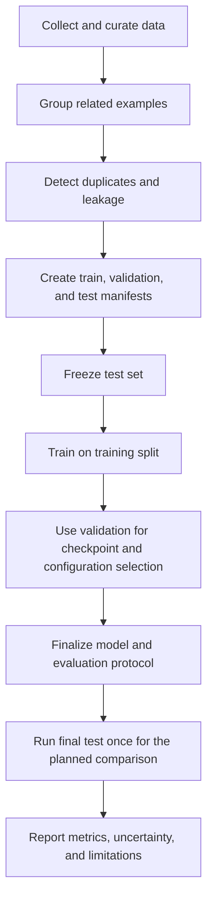

# 04. Training, Validation, and Test Splits

> **Level:** 12 — Fine-Tuning and Model Customization  
> **Purpose:** Design leakage-resistant dataset splits so model selection and final evaluation provide credible evidence of generalization.

## Learning objectives

By the end of this chapter, you should be able to:

- Explain the distinct roles of training, validation, and test data.
- Choose split rules based on documents, users, entities, time, or source.
- Identify exact and near-duplicate leakage.
- Prevent few-shot examples and synthetic-data sources from contaminating held-out evaluation.
- Reserve a test set before prompt or hyperparameter iteration.
- Design a split plan for examples derived from the same source documents.

<br/>

## 1. Why dataset splitting matters

A model should be evaluated on examples that represent inputs it has not learned from directly or indirectly. If very similar examples appear in both training and evaluation data, performance can look excellent even when the model struggles on genuinely new cases.

This is called **data leakage**: information that should be unavailable during training or model selection influences the evaluation process. Leakage can occur through duplicate records, shared source documents, users, entities, time periods, synthetic-data generation, or repeated use of the test set.

The objective is not simply to divide rows into three groups. It is to create evaluation boundaries that match the way the model will be used.

<br/>

## 2. The three splits and their roles

| Split | Main purpose | Used for | Should it guide model selection? |
|---|---|---|---|
| **Training set** | Teach the model from examples | Parameter updates and training-loss calculation | Yes, as part of learning |
| **Validation set** | Select among candidate configurations | Early stopping, hyperparameters, checkpoints, prompt or method decisions | Yes |
| **Test set** | Estimate final performance after decisions are complete | Final comparison and reporting | No; reserve it for final assessment |

<br/>

### Training set

The training set supplies the examples used to optimize the model. It can be revisited throughout training because learning directly depends on it.

<br/>

### Validation set

The validation set helps decide which configuration or checkpoint to keep. It may be used repeatedly during development, so it is no longer an unbiased final test of the complete selection process.

<br/>

### Test set

The test set is held out from training and model-selection decisions. It should be used after the approach, prompts, hyperparameters, and checkpoint-selection rules have been fixed. Repeatedly tuning against test results turns the test set into another validation set.

<br/>

### Typical split proportions

A split such as 80% training, 10% validation, and 10% test is a possible starting point, not a universal rule. The right proportions depend on dataset size, task diversity, grouping constraints, and how much evaluation evidence is needed. For small datasets, a fixed test set may be statistically uncertain; document this limitation rather than implying that a particular ratio guarantees validity.

<br/>

## 3. Random row splitting: when it works and when it fails

A random row split assigns individual records to groups without necessarily considering their relationships.

It may be reasonable when examples are genuinely independent and identically distributed for the intended evaluation. It can be misleading when multiple rows share an underlying source, user, entity, event, or template.

<br/>

### Example: reports from the same incident

Suppose a source report is converted into five training examples:

- one extracts the asset ID;
- one extracts the priority;
- one summarizes the incident;
- one classifies the incident type;
- one produces a structured JSON record.

If rows are split independently, the training set might contain the asset ID and priority examples while the test set contains the summary and JSON examples from the same source report. The model has already seen much of the source content during training. The test score may measure familiarity with that report rather than generalization to a new report.

**Rule:** If records derived from one source are related enough that seeing one could help solve another, keep the related records in the same split.

<br/>

## 4. Choose the split unit to match deployment

The appropriate grouping boundary depends on what “unseen” means for the intended application.

| Split strategy | Keep together | Appropriate when evaluating | Example |
|---|---|---|---|
| **Document-level** | All examples derived from the same document | Generalization to new documents | Multiple QA pairs from one policy PDF |
| **User-level** | All records from a given user | Generalization to new users | Support messages from the same customer |
| **Entity-level** | Records associated with the same entity | Generalization to unseen entities | Reports for the same machine or patient identifier |
| **Time-based** | Records from specified time periods | Future-period performance | Train on earlier months, test on a later month |
| **Source-level** | Records from the same source system, organization, or collection | Generalization to new sources | Train on one document repository and test on another |
| **Group-level** | All related records under a stable group ID | Generalization beyond a known group | Several transformations of one incident report |

These strategies answer different questions. A model may generalize to new documents from known users but fail on entirely new users or source systems. Choose the split design based on the deployment claim you want to make.

<br/>

### Grouped split versus time split

- Use a **grouped split** when related records must not cross boundaries.
- Use a **time split** when future performance is the main concern.
- Use both when needed—for example, respecting chronology while preventing one entity's related records from crossing splits.

For temporal evaluation, do not train on information that would only become available after the evaluation timestamp. This includes future document revisions or labels derived from future outcomes.

<br/>

## 5. Detect exact and near-duplicate leakage

### Exact duplicates

Exact duplicates may share identical input text, targets, or complete records. Basic normalized text comparison can identify many of them.

```python
import pandas as pd

df = pd.read_csv("examples.csv")

# Normalize whitespace before exact text comparison.
for column in ["source_text", "instruction", "input", "output"]:
    if column in df.columns:
        df[f"{column}_norm"] = (
            df[column]
            .fillna("")
            .astype(str)
            .str.strip()
            .str.replace(r"\s+", " ", regex=True)
        )

# Flag exact duplicates across the normalized input/output representation.
key_columns = [
    col for col in
    ["source_text_norm", "instruction_norm", "input_norm", "output_norm"]
    if col in df.columns
]

if not key_columns:
    raise ValueError("No usable columns found for duplicate detection.")

duplicate_mask = df.duplicated(subset=key_columns, keep=False)
print(df.loc[duplicate_mask, key_columns])
```

This is a starting point, not a complete leakage detector. Normalize carefully: aggressive normalization can collapse distinct examples, and identical inputs with different outputs may indicate a labeling conflict rather than ordinary duplication.

<br/>

### Near-duplicates

Near-duplicates differ in superficial ways while preserving much of the same content. Examples include:
- The same report with different whitespace or punctuation.
- A paragraph with a changed identifier or date.
- Slightly rewritten prompts based on the same source.
- Synthetic paraphrases of a held-out example.

Potential detection methods include:
- Normalized hashes for simple formatting variants.
- Character or word n-gram similarity.
- MinHash or locality-sensitive hashing for large collections.
- Embedding similarity to flag semantically similar examples.
- Source IDs and lineage metadata, which are often more reliable than text similarity alone.

Similarity thresholds require review. Two legitimate examples can be semantically similar without being duplicates, while a small identifier change may be critical to the task.

<br/>

## 6. Build a leakage-resistant split plan

Before splitting:

1. Identify the independent unit that represents a genuinely new case at deployment.
2. Assign a stable `group_id` to related examples, such as source document, incident, user, or entity.
3. Find exact duplicates and investigate near-duplicates.
4. Group related records before assigning groups to splits.
5. Choose the split strategy and record its rationale.
6. Check label distribution and important task categories across the splits.
7. Freeze the split manifest and version it.
8. Keep the test set out of prompt, hyperparameter, and checkpoint iteration.

<br/>

### Example using scikit-learn GroupShuffleSplit

This example keeps all rows with the same `group_id` in one split. The data should contain one row per example and a group ID that identifies related source records.

```python
import pandas as pd
from sklearn.model_selection import GroupShuffleSplit

df = pd.read_csv("examples.csv")

if df["group_id"].isna().any():
    raise ValueError("Every row must have a group_id before splitting.")

# First reserve 20% of groups for a temporary holdout.
outer = GroupShuffleSplit(n_splits=1, test_size=0.20, random_state=42)
train_val_idx, test_idx = next(
    outer.split(df, groups=df["group_id"])
)

train_val = df.iloc[train_val_idx].copy()
test = df.iloc[test_idx].copy()

# Split the remaining groups into train and validation.
# 0.125 of the 80% remainder is 10% of the original data.
inner = GroupShuffleSplit(n_splits=1, test_size=0.125, random_state=43)
train_idx, val_idx = next(
    inner.split(train_val, groups=train_val["group_id"])
)

train = train_val.iloc[train_idx].copy()
validation = train_val.iloc[val_idx].copy()

# Verify group separation.
train_groups = set(train["group_id"])
val_groups = set(validation["group_id"])
test_groups = set(test["group_id"])

assert train_groups.isdisjoint(val_groups)
assert train_groups.isdisjoint(test_groups)
assert val_groups.isdisjoint(test_groups)

train.to_csv("train.csv", index=False)
validation.to_csv("validation.csv", index=False)
test.to_csv("test.csv", index=False)

print(
    f"Rows — train: {len(train)}, validation: {len(validation)}, "
    f"test: {len(test)}"
)
print(
    f"Groups — train: {len(train_groups)}, validation: {len(val_groups)}, "
    f"test: {len(test_groups)}"
)
```

**Important limitations:**
- This is an illustrative grouped-split example, not a universal recipe.
- GroupShuffleSplit targets proportions of groups, not exact row counts; groups can differ in size.
- It does not guarantee balanced labels. Inspect class and task coverage in each split.
- If groups are too few or a rare label occurs in very few groups, the split may be unstable. Consider a carefully designed grouped or stratified-group strategy where supported.
- Choose `group_id` based on the evaluation objective. A random ID assigned independently to every row does not prevent leakage.

<br/>

## 7. Few-shot demonstrations and prompt contamination

A test set can be contaminated even when its records are absent from the training file.

Few-shot prompting supplies example input-output pairs in the prompt. If test examples—or close paraphrases of them—are used as demonstrations during development, the model has effectively been shown evaluation answers.

Controls:
- Keep a record of all few-shot demonstrations and their source IDs.
- Exclude test examples and close derivatives from demonstration pools.
- Build demonstrations from training data or another explicitly permitted development pool.
- Version prompts and example sets together.
- Check that prompt templates do not accidentally include evaluation labels or expected outputs.
- If examples are dynamically selected, log their IDs so contamination can be audited.

Few-shot examples are part of the system configuration, even though they do not update model weights.

<br/>

## 8. Synthetic data and source contamination

Synthetic data can create leakage when a model generates paraphrases or transformations of examples later placed in the test set.

For example, if a test report is paraphrased into training examples, the test is no longer independent. This can occur even if the text is not an exact duplicate.

Recommended controls:
- Split source documents or groups before generating derived examples.
- Record the source IDs, generation model, prompt/version, and seed where available.
- Generate training examples only from training-eligible sources.
- Do not use held-out labels or test outputs to generate training targets.
- Keep a separate, independently sourced test set where feasible.
- Run duplicate and similarity checks after augmentation, not only before it.

A random seed makes a generation process easier to document; it does not guarantee independence or correctness.

<br/>

## 9. Reserve the test set before iteration

The test set must not become a development tool.

A disciplined sequence is:



If test results reveal a problem and you modify the prompt, training data, or hyperparameters in response, the test has influenced development. You should treat it as development data and obtain a new untouched test set for a genuinely final assessment when feasible.

This does not mean test results can never be inspected or reported. It means they should not be repeatedly used to choose among configurations while still being described as an untouched final test.

<br/>

## 10. Practice: split examples derived from source documents

### Scenario

A dataset contains 120 source documents. Each document generates 10 instruction-response examples, giving 1,200 rows. Some documents are policy revisions; some belong to the same incident family. The target deployment is an assistant that must answer questions about **new documents**, not merely new questions from documents already seen.

<br/>

### Recommended design

1. Assign every row a `source_document_id`.
2. If multiple revisions or copies of the same underlying document could leak content across splits, create a higher-level `document_family_id`.
3. Group all examples from one document family together.
4. Split document families into train, validation, and test groups.
5. Check label/task coverage at the group level.
6. Remove or resolve duplicates and contradictory targets before freezing manifests.
7. Generate synthetic examples only from training-eligible document families.
8. Ensure few-shot demonstrations use training or approved development sources, never test-family examples.
9. Freeze the test manifest before prompt and hyperparameter iteration.
10. Report both row counts and group counts.

A possible starting target is 80% of groups for training, 10% for validation, and 10% for test. These are not guaranteed proportions of rows because document families can produce different numbers of examples. If the dataset has too few independent groups, acknowledge that the final estimate may be uncertain and collect more independent sources if possible.

<br/>

### What if the deployment question differs?

- **New documents from known sources:** document-family grouping may be appropriate.
- **New customers:** group by customer/user, possibly in addition to document.
- **Future policy revisions:** consider a chronological split and prevent related revisions from leaking across boundaries.
- **New organizations or repositories:** hold out source organizations or repositories.

The split must reflect the claim you want to make about generalization.

<br/>

## 11. Split audit checklist

Before training, verify:

- [ ] Every example has a stable ID and required grouping metadata.
- [ ] Related source examples are assigned to one split.
- [ ] Exact duplicates have been removed or intentionally handled.
- [ ] Near-duplicate and source-lineage checks have been reviewed.
- [ ] Train, validation, and test group IDs are disjoint.
- [ ] Important labels and task categories have reasonable coverage.
- [ ] Test examples and labels are absent from few-shot demonstrations.
- [ ] Synthetic examples do not derive from held-out sources.
- [ ] The test manifest was frozen before iterative development.
- [ ] Split code, random seeds, group rules, and manifest versions are recorded.

<br/>

## 12. Common mistakes

- **Randomly splitting related rows:** lets near-identical source content cross boundaries.
- **Using the test set for prompt tuning:** turns final evaluation into model selection.
- **Grouping only exact duplicates:** misses related examples derived from one document or incident.
- **Checking only row counts:** a split can have enough rows but too few independent groups.
- **Ignoring class coverage:** a split may omit rare labels or difficult cases.
- **Generating synthetic data before defining split boundaries:** can spread derivatives of held-out sources into training.
- **Using test examples as few-shot demonstrations:** leaks expected behavior into the evaluation prompt.
- **Assuming a fixed random seed prevents leakage:** reproducibility and independence are different properties.
- **Reporting a precise score from a tiny test set without caveats:** overstates the strength of the evidence.

<br/>

## 13. Exercises with answers

### Q1. Why can a random row split overstate generalization?

**Answer:** Related examples from the same document, user, incident, or entity may appear in both training and test data. The model can exploit repeated content or patterns, so the test score may reflect familiarity with the source rather than performance on genuinely new cases.

<br/>

### Q2. You have 500 question-answer pairs from 25 PDFs. What should you split on if deployment requires answering questions about unseen PDFs?

**Answer:** Split by PDF or, where related revisions/copies exist, by document family. Keep all derived pairs from a held-out PDF family in the same split.

<br/>

### Q3. Is a test set still untouched if its examples were used as few-shot demonstrations?

**Answer:** No. The model was shown the test examples through the prompt, so the evaluation is contaminated for that setup.

<br/>

### Q4. A synthetic paraphrase of a test example appears in training. Is the test independent?

**Answer:** Not reliably. The paraphrase may transfer the same source information into training. Track lineage and generate training derivatives only from training-eligible sources.

<br/>

### Q5. Why might a grouped split have different row proportions than requested?

**Answer:** Grouped splitters keep entire groups together, and groups may contain different numbers of rows. Preserving group boundaries can be more important than hitting an exact row percentage.

<br/>

### Q6. What should happen if you tune a model after seeing its test failures?

**Answer:** The test has now influenced development. Treat those results as development feedback and use a new untouched test set for a final assessment when feasible.

<br/>

## 14. Checkpoint

A credible split plan should document:

1. The deployment generalization question.
2. The independent unit: document, user, entity, time period, source, or a justified combination.
3. Duplicate and near-duplicate detection procedures.
4. How few-shot demonstrations and synthetic data are kept separate from test sources.
5. Train/validation/test manifests and group-disjointness checks.
6. When the test set was frozen and how it was used.
7. Limitations from group counts, label coverage, and test-set size.

**Final checkpoint:** A random row split may overstate generalization when rows are correlated. Group related records before splitting, choose boundaries that reflect deployment, and preserve the test set for final assessment rather than iterative tuning.

<br/>

## References

- [scikit-learn — GroupShuffleSplit](https://scikit-learn.org/stable/modules/generated/sklearn.model_selection.GroupShuffleSplit.html)
- [scikit-learn — Cross-validation iterators for grouped data](https://scikit-learn.org/stable/modules/cross_validation.html#cross-validation-iterators-for-grouped-data)
- [scikit-learn — Common pitfalls and data leakage](https://scikit-learn.org/stable/common_pitfalls.html#data-leakage)
- [Hugging Face — Datasets documentation](https://huggingface.co/docs/datasets/index)
- [Google — Rules of Machine Learning](https://developers.google.com/machine-learning/guides/rules-of-ml)

> **Implementation note:** The correct split design depends on the intended deployment and relationships in the data. A fixed percentage or random seed cannot by itself guarantee a valid evaluation.
