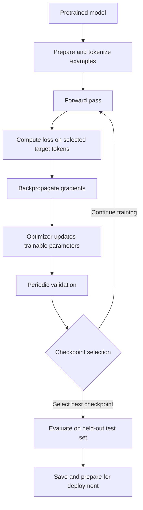

# Chapter 06: Supervised Fine-Tuning (SFT)

## Learning Objectives

By the end of this chapter, you should be able to:

- Trace a supervised fine-tuning (SFT) example from tokenization through forward computation, loss, gradients, parameter updates, and evaluation.
- Distinguish SFT from pretraining, preference optimization, and inference.
- Explain full-parameter fine-tuning versus restricted or parameter-efficient updates.
- Describe training mode, evaluation mode, and checkpoint selection.
- Explain why the exact loss function and target masking depend on the task and implementation.

<br/>

## 1. What Is Supervised Fine-Tuning?

**Supervised fine-tuning (SFT)** continues training an already-pretrained model on curated examples that specify what the model should do. Each example contains an input or conversation context and a target response. During training, the model is optimized to assign higher probability to the target tokens under the chosen objective.

SFT does not usually teach language from scratch. It adapts the model's existing representations and capabilities toward a target behavior, such as following instructions, producing a required format, or responding in a domain-specific style.

<br/>

### Typical SFT example

**Input / context**

> Explain photosynthesis in two sentences for a middle-school student.

**Target response**

> Photosynthesis is the process plants use to turn light, water, and carbon dioxide into sugar. It also releases oxygen, which many living things need to breathe.

The target response provides the supervision signal. The model generates token-level predictions conditioned on the context and is trained to reduce the discrepancy between its predictions and the target tokens.

<br/>

### Core idea

SFT is not simply storing example answers. It changes model parameters so that the model becomes more likely to produce target-like responses for similar contexts.


<br/>


## 2. Where SFT Fits in the Model Lifecycle



The diagram is a conceptual workflow. Actual training frameworks may combine, reorder, or automate steps such as gradient accumulation, checkpoint saving, and evaluation.


<br/>


## 3. The Training Lifecycle, Step by Step

### 3.1 Prepare examples

Examples are curated and formatted into the model's expected structure. For a chat model, a record may contain system, user, and assistant messages. The framework applies the model's chat template when appropriate.

Before training, validate:
- The input and target are correct and consistently formatted.
- The tokenizer and chat template match the base model.
- Sequence lengths fit the chosen context limit.
- Padding and truncation do not silently remove important target content.
- Training, validation, and test examples are separated without leakage.

<br/>

### 3.2 Tokenize the examples

A tokenizer converts text into token IDs. The model operates on IDs, not raw strings.

For example, the text:

```text
User: What is 2 + 2?
Assistant: 4
```

might become a sequence of token IDs such as:

```text
[1512, 42, 318, 17, 9, 17, 30, 882, 42, 19]
```

**These numbers are illustrative only.** Real token IDs depend on the tokenizer and its vocabulary.

For causal language models, the token sequence is typically arranged so that each position predicts a subsequent token. Frameworks may shift labels internally or expect labels already aligned according to their API.

<br/>

### 3.3 Forward computation

The token IDs are passed through the model. The model produces **logits**—unnormalized scores over the vocabulary—at each prediction position. Applying softmax conceptually converts logits into a probability distribution over possible next tokens.

For a causal language model, the prediction at a position can use the permitted preceding context, not future target tokens. Attention masks and model architecture enforce the relevant visibility rules.

<br/>

### 3.4 Compute the loss

The loss quantifies how poorly the model predicts the supervised target. A common objective for causal-language-model SFT is token-level cross-entropy over selected target tokens.

For target token $y_t$, with predicted probability $p_\theta(y_t \mid x, y_{<t})$, the negative log-likelihood contribution is:

$$
\ell_t = -\log p_\theta(y_t \mid x, y_{<t})
$$

A typical masked token-average objective is:

$$
\mathcal{L}(\theta) =
-\frac{\sum_t m_t \log p_\theta(y_t \mid x, y_{<t})}
{\sum_t m_t}
$$

where:
- $\theta$ denotes the trainable model parameters.
- $m_t$ is 1 for a token included in the loss and 0 for a token excluded from it.
- $x$ is the conditioning input and $y_{<t}$ represents earlier target tokens.

This is a common formulation, not a universal implementation contract. Some tasks use other objectives, weighting, normalization, or label structures.

<br/>

### 3.5 Target masking: what receives supervision?

In many instruction-tuning setups, the prompt or user message is context, while the assistant response is the target. The loss may be computed only on assistant tokens. In other setups, loss can include a wider part of the sequence.

A label value such as `-100` is commonly used by PyTorch/Hugging Face loss implementations to mark positions ignored by cross-entropy. The exact convention is framework-specific.

Conceptual example:

| Sequence part | Visible to model? | Included in loss? |
|---|---:|---:|
| System instructions | Usually yes | Often no |
| User prompt | Yes | Often no |
| Assistant target | Yes, with causal visibility rules | Often yes |
| Padding tokens | Masked or otherwise handled | No, in typical setups |

The table describes a common chat-SFT pattern. It is not a universal rule: completion-only training, full-sequence language modeling, multimodal training, and custom objectives can differ.

<br/>

### 3.6 Backpropagation

After calculating loss, automatic differentiation computes gradients of the loss with respect to trainable parameters:

$$
\nabla_\theta \mathcal{L}(\theta)
$$

Gradients indicate how parameter changes would locally affect the loss. Backpropagation calculates them; it does not itself choose the final parameter update.

### 3.7 Optimizer update

An optimizer such as AdamW uses the gradients and its internal state to update the parameters that are marked trainable. A simplified gradient-descent update is:

$$
\theta \leftarrow \theta - \eta \nabla_\theta \mathcal{L}(\theta)
$$

where $\eta$ is the learning rate. This equation illustrates the idea; AdamW and other optimizers use more detailed update rules.

A training step may involve gradient accumulation, gradient clipping, mixed precision, distributed computation, or a learning-rate schedule. These affect execution and optimization but do not change the core sequence of prediction, loss, gradients, and updates.

<br/>

### 3.8 Repeat and monitor

Training repeats over batches and epochs or a specified number of steps. The run may log:
- Training loss.
- Validation loss and task-specific metrics.
- Learning rate and gradient statistics.
- Throughput, memory use, and elapsed time.
- Checkpoint and optimizer state information.

Training loss alone is insufficient: it can fall even while generalization worsens.


<br/>


## 4. SFT Compared with Related Stages

| Process | Main purpose | Typical supervision or signal | Does it update parameters? |
|---|---|---|---|
| **Pretraining** | Learn broad language or multimodal patterns from large corpora | Often next-token prediction or a modality-specific objective | Yes |
| **Supervised fine-tuning (SFT)** | Adapt a pretrained model to examples of desired behavior | Input/context paired with target outputs | Yes |
| **Preference optimization** | Align outputs with preferences between alternatives | Preference comparisons or a derived preference signal, depending on method | Usually yes |
| **Inference** | Generate predictions or responses using a trained model | User input and decoding configuration; no training target required | No, in ordinary inference |

SFT and preference optimization are not interchangeable. SFT teaches from demonstrated target responses; preference methods use preference signals to encourage one response over another. Some pipelines use SFT first and preference optimization afterward, but the sequence depends on the project.


<br/>


## 5. Which Parameters Change?

### 5.1 Full-parameter fine-tuning

In **full-parameter fine-tuning**, gradients and optimizer updates can affect the model's full set of intended trainable parameters. This can offer broad adaptation capacity, but it generally requires more optimizer memory and compute than restricted-update approaches.

<br/>

### 5.2 Restricted or parameter-efficient fine-tuning

In **parameter-efficient fine-tuning (PEFT)**, the base model is often frozen while a smaller set of added or selected parameters is trained. LoRA is one example: it adds trainable low-rank matrices to selected weight transformations. Adapters are another approach that inserts small trainable modules.

| Aspect | Full-parameter updates | Restricted / PEFT updates |
|---|---|---|
| Trainable parameters | Broad model parameter set | Selected parameters or added modules |
| Optimizer state and gradient memory | Typically higher | Typically lower |
| Adaptation capacity | Broad | Depends on method, target modules, rank, and data |
| Artifact management | Often a full updated model checkpoint | May store adapter weights separately from the base model |
| Base model needed at serving time | Depends on packaging | Often required alongside adapter weights |

“Frozen” means an intended parameter is not updated by the optimizer. The base model can still participate in forward computation, and gradients may need to pass through its operations to reach trainable components. Exact behavior depends on the training framework and architecture.

**Important distinction:** the target response supplies the learning signal, but it is not itself a parameter. Parameters change only through the training process applied to the computed loss.


<br/>


## 6. Training Mode and Evaluation Mode

In PyTorch, `model.train()` and `model.eval()` control module behavior for layers that behave differently between training and evaluation, such as dropout and batch normalization.

- **Training mode:** use during training steps. Dropout, where present, is generally active.
- **Evaluation mode:** use when evaluating a checkpoint. Dropout, where present, is generally disabled.
- **Gradient tracking:** controlled separately. `model.eval()` does **not** disable autograd by itself. Evaluation often uses `torch.no_grad()` or `torch.inference_mode()` to avoid storing gradients.

A simplified PyTorch pattern:

```python
# Training
model.train()
optimizer.zero_grad(set_to_none=True)

outputs = model(**batch)
loss = outputs.loss
loss.backward()
optimizer.step()

# Evaluation
model.eval()
with torch.inference_mode():
    outputs = model(**validation_batch)
    validation_loss = outputs.loss
```

This is illustrative code. The batch structure, label masking, optimizer setup, device placement, gradient accumulation, and evaluation metrics depend on the chosen model and framework.

For a Hugging Face `Trainer` or an SFT framework, the framework typically manages many of these details. Inspect its configuration and data collator rather than assuming defaults.


<br/>


## 7. Validation and Checkpoint Selection

A **checkpoint** is a saved training state or model snapshot. Depending on the framework and save options, it may include model weights, optimizer state, scheduler state, training progress, and configuration.

A practical selection process:

1. Define the evaluation criteria before training.
2. Evaluate periodically on a validation set that is separate from training data.
3. Track validation loss and task-relevant metrics, not only training loss.
4. Select a checkpoint using a predeclared criterion, such as lowest validation loss or best task metric.
5. Use the held-out test set for a final evaluation after model/configuration selection.
6. Record the selected checkpoint, tokenizer, chat template, training configuration, dataset version, and random seed where applicable.

The “best” checkpoint depends on the objective. Lowest validation loss may not correspond to the best structured-output accuracy, factuality, safety behavior, or human preference. For important applications, use multiple complementary measures.

<br/>

### Common warning signs

- Training loss decreases while validation loss rises: possible overfitting.
- Validation results vary sharply across checkpoints: training may be unstable or the validation set may be small.
- Loss is unexpectedly zero or invalid: inspect labels, masking, label shifting, and batch construction.
- Output quality degrades despite falling loss: check target formatting, data quality, truncation, evaluation design, and decoding configuration.


<br/>


## 8. Inspecting a Framework-Managed SFT Run

When using a framework such as Hugging Face TRL, inspect these configuration areas before launching a run:

- **Base model:** model identifier/revision and supported architecture.
- **Dataset:** source, schema, split names, and preprocessing.
- **Tokenizer/chat template:** exact formatting and special-token handling.
- **Objective:** completion-only or full-sequence loss; label masking behavior.
- **Trainable parameters:** full fine-tuning or a PEFT configuration such as LoRA.
- **Optimization:** learning rate, batch size, gradient accumulation, epochs/steps, scheduler, warmup, weight decay, and gradient clipping.
- **Sequence handling:** maximum sequence length, truncation, padding, packing, and loss treatment across packed examples.
- **Precision and hardware:** FP32, BF16, FP16, quantization, device placement, and memory limits.
- **Evaluation and saving:** evaluation interval, metric, checkpoint interval, retention policy, and best-checkpoint selection.
- **Reproducibility:** seeds, package versions, code revision, dataset version, and model revision.

Do not assume a parameter name or default is identical across library versions. Read the documentation for the installed version and inspect the effective configuration printed by the run.


<br/>


## 9. Practice: Annotate a Small SFT Lifecycle

For each stage, state what enters the stage, what it produces, and whether model parameters change.

| Stage | Input | Output | Parameter update? |
|---|---|---|---|
| Tokenization | Text examples and tokenizer | Token IDs and related masks/labels | No |
| Forward pass | Model inputs and current weights | Logits and possibly loss | No |
| Loss calculation | Predictions and target labels | Scalar or aggregated loss | No |
| Backpropagation | Loss graph | Gradients for trainable parameters | No |
| Optimizer step | Gradients and optimizer state | Updated trainable parameters | **Yes** |
| Validation | Validation batches and checkpoint | Metrics/loss | No |
| Checkpoint selection | Validation results and saved snapshots | Chosen checkpoint | No |

<br/>

### Practice questions

1. In an assistant-only loss setup, why might user prompt tokens be visible to the model but excluded from the loss?
2. If all model parameters are frozen and no trainable adapters or other parameters exist, what happens to ordinary optimizer updates?
3. Why is `model.eval()` not a substitute for `torch.inference_mode()`?
4. What can happen if the tokenizer or chat template differs between training and inference?
5. Why should checkpoint selection use validation data rather than repeatedly selecting on the test set?

<br/>

### Suggested answer guide

1. The prompt conditions the answer, while the target assistant tokens provide the supervised prediction targets. Other loss conventions are possible.
2. There are no intended trainable model parameters to update; a valid optimization setup must have trainable parameters for learning to occur.
3. Evaluation mode changes certain layer behaviors; inference mode controls autograd/tracking overhead. They serve different purposes.
4. Token boundaries, special tokens, and conversation structure can change, creating a train–serve mismatch.
5. Repeated test-set selection leaks information from the test set into model choice and makes final test performance less independent.


<br/>


## 10. Checkpoint: Explain the Learning Signal

A strong explanation should include all of the following:

- **What supervises the model?** Target tokens from curated examples, paired with their conditioning context.
- **What is computed?** The model produces logits; the implementation computes loss over selected target positions.
- **What creates gradients?** Backpropagation differentiates the loss with respect to trainable parameters.
- **What changes parameters?** The optimizer step applies updates to parameters marked trainable.
- **Which parameters change?** Full fine-tuning can update the intended full parameter set; PEFT updates only selected or added parameters.
- **How is progress judged?** Validation and held-out evaluation, followed by a documented checkpoint-selection rule.
- **What is implementation-dependent?** The exact objective, label shift, target mask, packing behavior, optimizer, precision, and evaluation metrics.

<br/>

### Mini-assignment

Write a five-to-eight-line explanation of a single SFT update. Identify the context tokens, target tokens, loss positions, trainable parameters, and the point at which weights actually change. Then inspect one framework-managed SFT configuration and record its objective, masking strategy, trainable-parameter strategy, evaluation interval, and checkpoint-selection rule.


<br/>


## 11. Essential References

- [Hugging Face TRL — Supervised Fine-Tuning Trainer](https://huggingface.co/docs/trl/sft_trainer)
- [Hugging Face Transformers — Trainer](https://huggingface.co/docs/transformers/main_classes/trainer)
- [Hugging Face Transformers — Causal language modeling](https://huggingface.co/docs/transformers/tasks/language_modeling)
- [PyTorch — Autograd mechanics](https://pytorch.org/docs/stable/notes/autograd.html)
- [PyTorch — `Module.train()` and `Module.eval()`](https://pytorch.org/docs/stable/generated/torch.nn.Module.html)
- [Hugging Face PEFT documentation](https://huggingface.co/docs/peft/index)

> Documentation and APIs evolve. Confirm the version-specific behavior of your selected framework, particularly label masking, sequence packing, loss calculation, and checkpoint selection.


<br/>


## Summary

SFT uses examples of desired outputs to adjust a pretrained model. The model processes tokenized context, predicts tokens, computes loss on the positions selected by the task implementation, backpropagates gradients, and updates trainable parameters. Full fine-tuning updates a broad parameter set; PEFT restricts updates to selected or added parameters. Validation helps choose a checkpoint, while the test set is reserved for final, less-biased evaluation. The precise objective and masking rules must always be verified for the task and framework.
