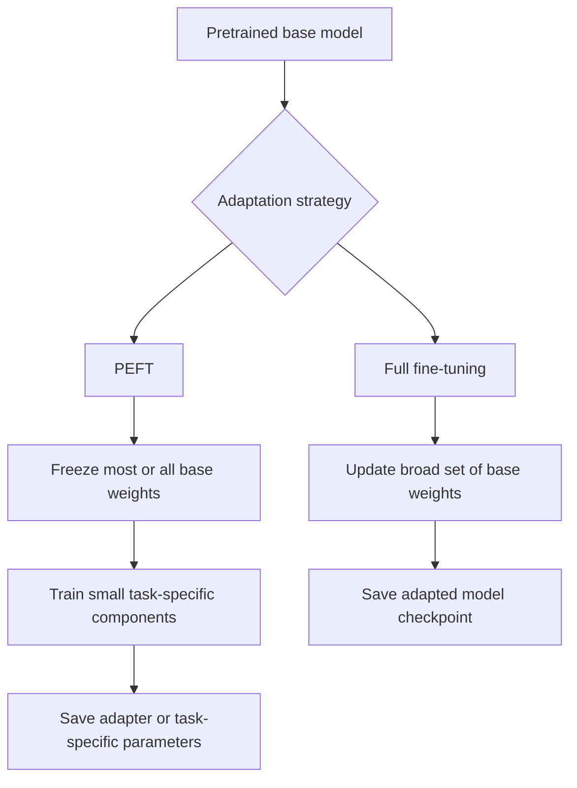
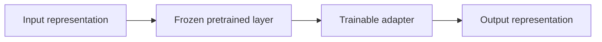
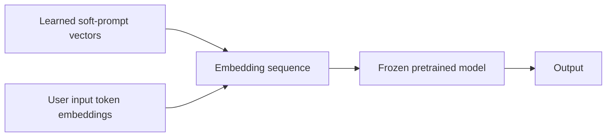

# Chapter 07: Parameter-Efficient Fine-Tuning (PEFT)

## Learning Objectives

By the end of this chapter, you should be able to:

- Define frozen base-model parameters and trainable task-specific components.
- Explain adapters, low-rank adaptation (LoRA), prompt tuning, and prefix tuning at a conceptual level.
- Distinguish trainable parameter count from total runtime memory requirements.
- Compare PEFT methods in terms of storage, portability, serving support, and quality trade-offs.
- Explain the difference between learned soft prompts and ordinary text prompts.
- Inspect trainable and total parameter counts in a small example.

<br/>

## 1. What Is Parameter-Efficient Fine-Tuning?

**Parameter-efficient fine-tuning (PEFT)** adapts a pretrained model by updating only a relatively small set of parameters rather than updating all model weights. Depending on the method, the base model may remain frozen while training adds or selects task-specific parameters.

The purpose is to reduce the cost of adaptation—especially gradient and optimizer-state memory—and make it easier to maintain multiple task-specific variants. PEFT does **not** mean that the model has become small or that inference is free: the base model still usually has to be loaded and executed.

<br/>

### Full fine-tuning vs. PEFT



This is a conceptual comparison. Some PEFT methods selectively train existing parameters; others introduce new parameters.


<br/>


## 2. Frozen and Trainable Parameters

### Frozen parameters

A parameter is **frozen** when it is excluded from gradient-based updates. Its stored value remains unchanged during that training run.

A frozen layer can still participate in the forward computation. In some architectures, gradients must flow through frozen operations to reach trainable components earlier in the computational graph. Freezing a parameter does not mean that its output is ignored.

<br/>

### Trainable task-specific parameters

These are the parameters allowed to change during adaptation. Depending on the method, they may be:
- Small modules inserted between or alongside existing layers.
- Low-rank matrices added to selected weight transformations.
- Learned embedding vectors representing virtual prompt tokens.
- Learned prefix representations used to condition attention layers.
- A selected subset of existing model parameters.

The exact trainable set is defined by the method and configuration. Always inspect it rather than relying on a method name alone.

<br/>

### The essential distinction

- **Total parameters:** all model parameters, including frozen weights and trainable task-specific parameters.
- **Trainable parameters:** only the parameters updated by the optimizer.
- **Runtime memory:** memory needed to load and execute the model, plus activations, temporary tensors, cache, and other serving or training state.

These are related but different quantities.


<br/>


## 3. Major PEFT Approaches

### 3.1 Adapters

**Adapters** are small trainable modules inserted into or alongside a pretrained network. The original model weights are often frozen, and training updates the adapter parameters.

Conceptually:



The diagram simplifies a range of adapter designs. In practice, adapters can be placed at different locations and may use residual connections or other structures.

**Strengths**
- Can store a compact task-specific artifact.
- Multiple task adapters can be maintained for a shared base model.
- The base weights need not be rewritten for every task.

**Trade-offs**
- Extra modules can add inference latency or memory.
- Adapter architecture and serving framework must be compatible.
- Adapter placement and capacity affect task quality.

<br/>

### 3.2 Low-Rank Adaptation (LoRA)

**LoRA** represents a weight update using the product of two smaller trainable matrices rather than directly training the entire original weight matrix. The base weight matrix is commonly frozen.

For a base weight matrix $W$, a conceptual adapted transformation is:

$$
W' = W + \Delta W
$$

with a low-rank update such as:

$$
\Delta W = \frac{\alpha}{r}BA
$$

where:
- $A$ and $B$ are trainable low-rank matrices.
- $r$ is the rank, typically much smaller than the dimensions of $W$.
- $\alpha$ is a scaling hyperparameter in a common LoRA formulation.

For an $m \times n$ weight matrix, the original matrix contains $mn$ values. If $A$ and $B$ have rank dimension $r$, the two low-rank matrices require approximately $r(m+n)$ trainable values, ignoring biases and implementation-specific details. This can be far fewer than $mn$ when $r$ is small.

LoRA can target selected projections or other supported modules. The exact target modules matter: LoRA configuration is not automatically equivalent across model architectures.

**Strengths**
- Often much smaller adaptation artifacts than full checkpoints.
- Supports multiple task-specific adapters for one base model.
- Some serving systems can merge compatible LoRA updates into the base weights for inference.

**Trade-offs**
- Adapter rank and target-module selection affect quality, memory, and latency.
- The base model and adapter must be compatible.
- If the adapter is not merged, serving requires an implementation that can apply it correctly.

<br/>

### 3.3 Prompt tuning

**Prompt tuning** learns a sequence of continuous embedding vectors, sometimes called **soft prompt tokens**, which are prepended to or otherwise used with the model input. The pretrained model weights are typically frozen.

These learned vectors are not ordinary words. They are optimized as numerical representations and need not correspond to readable text tokens.



The diagram shows a common input-embedding-based pattern. Implementations differ in how virtual prompt vectors are introduced.

**Strengths**
- Can use a small trainable parameter set.
- The base model may be shared across many learned prompts.
- Task-specific prompt artifacts can be compact.

**Trade-offs**
- Results depend on model architecture, prompt length, data, and task.
- A learned prompt is not directly human-readable.
- Serving must support the expected soft-prompt mechanism.

<br/>

### 3.4 Prefix tuning

**Prefix tuning** learns continuous task-specific prefix representations that condition the model, commonly by supplying learned prefix states to attention layers. The pretrained model weights are generally frozen.

Prompt tuning often focuses on learned input embedding vectors, whereas prefix tuning commonly conditions internal attention computations with learned prefix representations. Terminology and implementation details can vary between papers and libraries, so inspect the method actually implemented.

**Strengths**
- Avoids updating the full base model.
- Can provide a compact task-specific conditioning artifact.

**Trade-offs**
- Additional prefix states can increase runtime computation or cache use.
- It requires compatible implementation support.
- Quality and memory use depend on prefix length and architecture.

<br/>

### 3.5 Selective fine-tuning

Some workflows train a subset of existing parameters—for example, selected layers or biases—without introducing a large new module. This is still parameter-efficient when the trainable subset is substantially smaller than the full parameter set, but the exact approach and trade-offs depend on what is unfrozen.


<br/>


## 4. Learned Soft Prompts vs. Ordinary Text Prompts

| Property | Ordinary text prompt | Learned soft prompt |
|---|---|---|
| Representation | Readable text converted by a tokenizer into token IDs/embeddings | Trainable continuous vectors |
| Created by | User or application prompt design | Optimization on training examples |
| Requires training? | Not necessarily | Yes, to learn the vectors |
| Readability | Human-readable | Usually not human-readable |
| Parameter updates | No model update is required to change the prompt | Soft-prompt parameters are updated during training |
| Serving requirement | Standard model input interface | A compatible soft-prompt mechanism |
| Best understood as | Instructions or context supplied at inference | A learned conditioning component |

An ordinary text prompt can be changed without training the model. A learned soft prompt is a task-specific learned artifact. Both can condition model behavior, but they are not the same mechanism.


<br/>


## 5. Trainable Parameter Count Is Not Runtime Memory

A common misconception is: “Only 1% of parameters are trainable, so the model needs only 1% of its memory.” This is incorrect.

### Training memory

Training memory may include:
- The full base-model weights, even if frozen.
- Trainable parameters.
- Gradients for trainable parameters.
- Optimizer state for trainable parameters.
- Forward activations needed for gradient computation.
- Temporary workspaces, attention buffers, and framework overhead.
- Extra state introduced by distributed training, mixed precision, or quantization methods.

PEFT can reduce gradient and optimizer-state requirements substantially, but it does not automatically eliminate base-weight memory or activation memory.

<br/>

### Inference memory

Inference memory may include:
- Base-model weights.
- Adapter, prompt, prefix, or other task-specific parameters.
- Activations and temporary tensors.
- A key-value (KV) cache for autoregressive generation.
- Runtime overhead and memory fragmentation.

For long contexts or concurrent requests, the KV cache can be a significant part of serving memory. Its size depends on the model, sequence length, batch/concurrency, and cache implementation.

<br/>

### Example: parameter count versus storage

Suppose a hypothetical base model has 7 billion parameters, and a PEFT configuration trains 10 million additional parameters.

- Trainable task-specific parameters: 10 million.
- Base parameters still needed: approximately 7 billion, unless a compatible deployment arrangement provides them another way.
- The adapter artifact can be much smaller than a full model checkpoint, but serving still typically requires the base model.

Parameter counts are not exact memory estimates. Bytes per parameter, quantization, optimizer state, gradients, activations, and runtime caches all affect actual memory use.


<br/>


## 6. A Small Parameter-Count Example

Consider LoRA applied to one linear layer with a weight matrix of shape $m \times n$. The full matrix has $mn$ parameters. A rank-$r$ LoRA update uses approximately $r(m+n)$ parameters.

For example, if $m = 4096$, $n = 4096$, and $r = 8$:

- Full matrix: $4096 \times 4096 = 16,777,216$ parameters.
- LoRA matrices: $8 \times (4096 + 4096) = 65,536$ trainable parameters.
- The LoRA parameter count is about 0.39% of the full matrix size.

This compares parameter counts for one matrix only. A complete model may apply LoRA to multiple modules, and additional parameters may exist. It does not mean total runtime memory falls to 0.39%.


<br/>


## 7. Practice: Inspect Trainable vs. Total Parameters

The following PyTorch example illustrates the counting logic with a toy model. It does not implement a complete LoRA or adapter method; it shows how freezing and trainability affect parameter counts.

```python
import torch
from torch import nn

class ToyModel(nn.Module):
    def __init__(self):
        super().__init__()
        self.base = nn.Sequential(
            nn.Linear(128, 256),
            nn.ReLU(),
            nn.Linear(256, 64),
        )
        self.task_head = nn.Linear(64, 10)

    def forward(self, x):
        return self.task_head(self.base(x))

model = ToyModel()

# Freeze the base; train only the task-specific head.
for parameter in model.base.parameters():
    parameter.requires_grad = False

total_params = sum(p.numel() for p in model.parameters())
trainable_params = sum(
    p.numel() for p in model.parameters() if p.requires_grad
)

percentage = 100 * trainable_params / total_params

print(f"Total parameters: {total_params:,}")
print(f"Trainable parameters: {trainable_params:,}")
print(f"Trainable percentage: {percentage:.2f}%")
```

<br/>

### What to observe

- `requires_grad = False` marks base parameters as frozen for gradient updates.
- The forward pass still calls `self.base(x)`.
- The task head remains trainable.
- The total parameter count includes both frozen and trainable parameters.
- This toy model is small; in a real PEFT setup, the base model may contain billions of parameters.

To inspect a Hugging Face PEFT model, the model or PEFT wrapper often provides a `print_trainable_parameters()` helper. Confirm the API for the installed PEFT version and ensure the method reports the wrapped model you intend to inspect.


<br/>


## 8. Storage, Portability, and Serving

### Storage

A PEFT artifact usually stores task-specific parameters rather than a complete copy of the base model. This can make it practical to maintain several adapters for one base model. Some workflows save merged weights or export a complete model for deployment, increasing artifact size.

<br/>

### Portability

An adapter is not necessarily a standalone model. It generally depends on:
- The exact base model and compatible revision.
- The architecture and module names expected by the adapter.
- The PEFT method and configuration.
- The tokenizer and chat template when applicable.
- A runtime capable of loading or applying the adapter.

Record the base model identifier and revision alongside the adapter. An adapter trained for one base-model revision should not be assumed to work correctly with another.

<br/>

### Serving support

Before choosing a method, verify that the intended serving stack supports it. Questions to check:
- Can it load the selected adapter format?
- Can it serve multiple adapters, and how are they selected per request?
- Does it support merging or unmerging adapter weights?
- Does it support the required quantization and precision?
- What latency and concurrency effects occur?
- How are adapter versions, permissions, and rollback handled?

<br/>

### Quality trade-offs

PEFT is not guaranteed to match full fine-tuning. Quality depends on the task, base model, data quality and quantity, trainable capacity, optimization, and evaluation protocol. Compare methods on the same held-out cases and under realistic serving constraints.


<br/>


## 9. Choosing a PEFT Approach

| Approach | What is commonly trained? | Typical artifact | Main consideration |
|---|---|---|---|
| Adapters | Small inserted modules | Adapter weights/config | Added modules and serving compatibility |
| LoRA | Low-rank matrices on selected modules | LoRA weights/config | Rank, target modules, merge/runtime support |
| Prompt tuning | Learned input embedding vectors | Soft-prompt vectors/config | Prompt length and support for virtual tokens |
| Prefix tuning | Learned prefix representations | Prefix parameters/config | Attention/cache behavior and architecture support |
| Selective fine-tuning | Selected existing model parameters | Updated selected weights or checkpoint | Which layers are unfrozen and how artifacts are packaged |

These are broad patterns, not universal specifications. Implementations can differ.

A practical decision sequence:
1. Confirm that the base model can already perform the task reasonably well.
2. Establish a baseline and a representative evaluation set.
3. Identify compute and memory constraints for training and serving separately.
4. Choose one or two supported PEFT methods.
5. Compare quality, trainable parameter count, artifact size, training cost, latency, and serving memory.
6. Record the base model revision and all configuration details.
7. Keep a fallback or rollback path.


<br/>


## 10. Checkpoint: Why Base-Model Loading Still Matters

A correct explanation should make these points:

1. **Frozen is not absent.** Frozen base weights remain part of the forward computation.
2. **Trainable count is not total count.** PEFT reduces the number of parameters being optimized, not necessarily the number of model parameters needed for inference.
3. **Training and serving memory differ.** PEFT often saves gradients and optimizer state, while inference still needs model weights, intermediate computation, and potentially a KV cache.
4. **Adapters usually depend on a base model.** The adapter artifact is compact, but it commonly cannot run by itself.
5. **Deployment can change the trade-off.** Quantization, offloading, merging, and specialized serving engines can alter memory and latency, but their compatibility and quality impact must be tested.

<br/>

### Mini-assignment

For a selected base model and PEFT method, record:
- Total base-model parameter count.
- Trainable parameter count and percentage.
- Approximate adapter artifact size.
- Base-model weight precision or quantization.
- Training GPU memory use, if available.
- Serving memory at a specified context length and concurrency.
- Evaluation score and generation latency.
- Base-model revision and adapter configuration.

Do not estimate runtime memory from trainable parameter percentage alone. Measure it or calculate it using explicit assumptions.


<br/>


## 11. Essential References

- [Hugging Face PEFT documentation](https://huggingface.co/docs/peft/index)
- [Hugging Face PEFT — LoRA](https://huggingface.co/docs/peft/developer_guides/lora)
- [Hugging Face PEFT — Prompt-based methods](https://huggingface.co/docs/peft/conceptual_guides/prompting)
- [Hugging Face TRL — Supervised Fine-Tuning Trainer](https://huggingface.co/docs/trl/sft_trainer)
- [LoRA paper: Low-Rank Adaptation of Large Language Models](https://arxiv.org/abs/2106.09685)
- [Prefix-Tuning: Optimizing Continuous Prompts for Generation](https://arxiv.org/abs/2101.00190)
- [The Power of Scale for Parameter-Efficient Prompt Tuning](https://arxiv.org/abs/2104.08691)

Check current library documentation before implementing a method, as supported architectures, configuration names, and serving capabilities evolve.


<br/>


## Summary

PEFT adapts a pretrained model by updating a small subset of parameters or adding compact task-specific components. Adapters, LoRA, prompt tuning, and prefix tuning use different mechanisms and have different quality, memory, storage, and serving trade-offs. Learned soft prompts are optimized vectors, unlike ordinary readable text prompts. Most importantly, a low trainable-parameter count does not remove the need to load and execute the base model: total runtime memory also depends on base weights, activations, caches, precision, and serving configuration.
