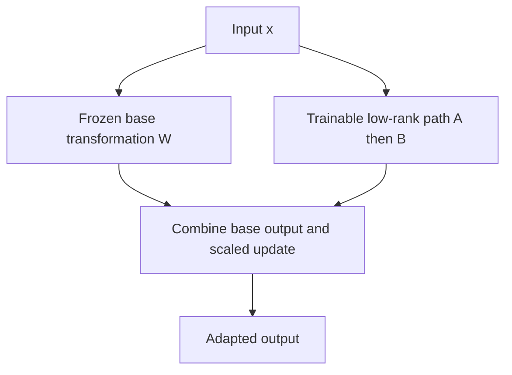
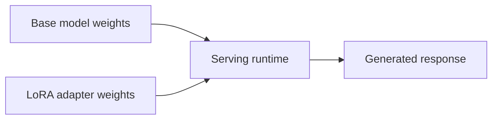

# Chapter 08: LoRA and Adapter Concepts

## Learning Objectives

By the end of this chapter, you should be able to:

- Explain low-rank updates to selected weight matrices.
- Describe LoRA rank, scaling, dropout, and target modules.
- Record the exact base model and revision needed to use an adapter reliably.
- Compare loading a separate adapter with merging its update into base weights where supported.
- Identify compatibility risks, multi-adapter considerations, and common configuration mistakes.
- Distinguish a LoRA adapter artifact from a complete standalone model.

<br/>

## 1. What Is LoRA?

**Low-Rank Adaptation (LoRA)** is a parameter-efficient fine-tuning method that learns a low-rank update for selected weight matrices in a pretrained model. In a common configuration, the original weights are frozen while the added low-rank matrices are trainable.

Let a pretrained linear transformation use a weight matrix $W$. LoRA expresses the adapted transformation as:

$$
W' = W + \Delta W
$$

A common LoRA parameterization is:

$$
\Delta W = \frac{\alpha}{r}BA
$$

where:
- $W$ is the pretrained weight matrix.
- $A$ and $B$ are trainable low-rank matrices.
- $r$ is the LoRA rank.
- $\alpha$ is a scaling hyperparameter.
- The factor $\alpha/r$ is a common scaling convention; implementations may support other scaling variants.

The original matrix $W$ is usually kept frozen during LoRA training. The update $\Delta W$ is learned from supervised examples or another training objective.

<br/>

### Conceptual diagram



The diagram represents a common linear-layer implementation. Actual module wiring, tensor orientation, scaling, and dropout placement depend on the library and model architecture.


<br/>


## 2. Why Use a Low-Rank Update?

A full $m \times n$ weight matrix contains $mn$ values. A rank-$r$ LoRA update uses two smaller matrices and typically requires approximately:

$$
r(m+n)
$$

trainable values, ignoring optional biases and implementation details.

For a square matrix with $m=n=4096$ and $r=8$:

- Full matrix: $4096^2 = 16{,}777{,}216$ values.
- LoRA matrices: $8(4096+4096)=65{,}536$ values.
- LoRA parameter count: about 0.39% of the original matrix's parameter count.

This example applies to one matrix only. Real configurations may attach LoRA to many layers and projections, so the total adapter parameter count will be higher.

The main benefit is that fewer parameters require gradients and optimizer state. The base model weights still generally need to be loaded and used during training and inference.


<br/>


## 3. Key LoRA Configuration Concepts

### 3.1 Rank (`r`)

**Rank** controls the size of the low-rank update matrices and therefore the capacity of the adaptation path.

- Lower rank: fewer trainable parameters and a smaller adapter, but potentially less adaptation capacity.
- Higher rank: more trainable parameters and potentially greater capacity, but more memory and compute for the adapter.

Higher rank does not guarantee better quality. Choose it through controlled experiments on a representative validation set.

<br/>

### 3.2 Scaling (`lora_alpha`)

The scaling value controls the contribution of the low-rank update relative to the base transformation. In the common formulation, the update is multiplied by $\alpha/r$.

Some implementations offer variants such as rank-stabilized LoRA with a different scaling rule. Do not assume all configurations use the same formula; consult the installed library's documentation.

<br/>

### 3.3 Dropout (`lora_dropout`)

LoRA dropout applies dropout to the LoRA branch's input or another method-specific location during training, depending on the implementation. It can act as regularization and may help reduce overfitting.

- `0.0` disables LoRA dropout in common implementations.
- A nonzero value randomly drops selected activations during training.
- Dropout behavior is normally disabled in evaluation mode.

The precise placement and behavior are implementation-dependent. Dropout is not a substitute for high-quality data or sound evaluation.

<br/>

### 3.4 Target modules (`target_modules`)

**Target modules** specify which base-model layers or projections receive LoRA updates. In transformer architectures, common candidates include attention projections such as query, key, value, and output projections. Some configurations also target feed-forward projections.

Module names are architecture-specific. A name used by one model family may not exist in another. Never copy a target-module list blindly.

Before choosing targets:
1. Identify the exact base model and architecture.
2. Inspect its module names.
3. Read the PEFT guidance for that architecture.
4. Confirm that the chosen modules are actually wrapped by the LoRA configuration.
5. Inspect trainable parameter counts after attaching the adapter.

<br/>

### 3.5 Bias and saved modules

Some implementations let you train selected biases or preserve additional modules alongside LoRA weights. These choices can change the set of trainable parameters and what the adapter artifact contains. Document them as part of the configuration.


<br/>


## 4. A Minimal LoRA Configuration

The following is an illustrative Hugging Face PEFT configuration. It is not guaranteed to work unchanged for every model; replace the target-module names with values supported by the selected architecture and library version.

```python
from peft import LoraConfig, TaskType

lora_config = LoraConfig(
    task_type=TaskType.CAUSAL_LM,
    r=8,
    lora_alpha=16,
    lora_dropout=0.05,
    target_modules=["q_proj", "v_proj"],
    bias="none",
)
```

Interpretation:

- `task_type`: identifies the broad model task.
- `r=8`: sets the low-rank dimension.
- `lora_alpha=16`: sets the scaling parameter under the library's selected scaling convention.
- `lora_dropout=0.05`: requests 5% dropout for the LoRA path where supported.
- `target_modules`: requests LoRA insertion in the named modules.
- `bias="none"`: does not request additional bias training through this setting.

**Important:** `q_proj` and `v_proj` are common names in some transformer implementations, not universal names. A model may use different names, fused projections, or an architecture-specific configuration. Inspect the actual model before running training.

A basic workflow using a loaded Transformers model might look like this:

```python
from peft import get_peft_model

# `model` must already be loaded from the intended base model.
peft_model = get_peft_model(model, lora_config)
peft_model.print_trainable_parameters()
```

This illustrates attaching a PEFT configuration and inspecting parameter counts. Loading the model, preparing the dataset, training, saving, and evaluating require additional steps.


<br/>


## 5. Adapter Identity: Record the Exact Base Model and Revision

A LoRA adapter is generally an update intended for a particular base model. Record enough information to reconstruct the intended pairing.

Recommended metadata:

| Field | What to record |
|---|---|
| Base model ID | Exact repository or internal model identifier |
| Base revision | Immutable commit hash or exact version, when available |
| Tokenizer ID/revision | Exact tokenizer and revision if separate from the model |
| Chat template | Template identifier or version/hash where relevant |
| Adapter method | LoRA and any variant used |
| PEFT/library version | Exact package version |
| Configuration | Rank, alpha/scaling, dropout, target modules, bias settings, and other options |
| Training data version | Dataset snapshot, preprocessing code, and split information |
| Training run | Code revision, seed, optimizer settings, and checkpoint selection rule |
| Artifact format | Adapter-only, merged model, or another export format |

A mutable name such as `main` can point to a different revision over time. For reproducibility, prefer an immutable revision identifier where the model hosting system supports it.

<br/>

### Example metadata record

```yaml
base_model:
  id: organization/model-name
  revision: "immutable-commit-or-version"
tokenizer:
  id: organization/model-name
  revision: "immutable-commit-or-version"
adapter:
  method: lora
  r: 8
  alpha: 16
  dropout: 0.05
  target_modules:
    - q_proj
    - v_proj
  bias: none
runtime:
  peft_version: "record-installed-version"
  transformers_version: "record-installed-version"
```

The identifiers above are placeholders, not a recommendation for a specific model. Replace them with the actual values used in your run.


<br/>


## 6. Separate Adapter Loading vs. Merging

### 6.1 Separate adapter loading

In this arrangement, the runtime loads the base model and then applies the adapter. The adapter stays a separate artifact.



**Advantages**
- The base model can be shared across multiple adapters.
- Adapter artifacts can remain small.
- Switching or versioning task-specific adapters may be easier when the serving system supports it.

**Trade-offs**
- The runtime must support the adapter format and configuration.
- Applying the adapter can add some overhead, depending on implementation.
- The correct base model and revision must be available.

<br/>

### 6.2 Merging where supported

Some supported workflows can merge the learned update into the base weights:

$$
W' = W + \Delta W
$$

The resulting model can then be saved or served as updated weights, subject to the framework and model's supported operations.

**Advantages**
- Can simplify inference in runtimes that do not support separate adapters.
- May avoid separate adapter application during each forward pass.
- Can simplify packaging when one fixed adapted model is needed.

**Trade-offs**
- The merged checkpoint is typically larger than the adapter-only artifact.
- Merging can reduce the convenience of switching among many adapters.
- Quantized weights, specialized modules, or certain LoRA variants may restrict or complicate merging.
- Numerical behavior may change slightly due to precision and conversion.
- The original base weights and adapter should be preserved for traceability and rollback.

Do not assume merging is supported for every model, quantization method, or adapter type. Test the exact export and serving path.


<br/>


## 7. Compatibility and Common Failure Modes

A LoRA adapter may fail to load or produce degraded outputs when components do not match.

### Compatibility checklist

- [ ] Base model architecture matches the adapter's intended architecture.
- [ ] Exact base model ID and revision are recorded.
- [ ] Target module names exist in the loaded model.
- [ ] Tensor dimensions and module layout match.
- [ ] PEFT and Transformers versions support the saved configuration.
- [ ] Tokenizer and chat template are consistent with the training setup.
- [ ] Quantization and precision choices are compatible with the loading path.
- [ ] Required extra modules or saved embeddings are included.
- [ ] The adapter artifact is not being mistaken for a complete model.
- [ ] The output is evaluated after loading, not merely accepted because loading succeeded.

<br/>

### Common problems

**1. Target modules do not exist.**  
The adapter configuration names projections that the selected model does not use. Inspect module names and choose supported targets.

**2. Adapter loads but quality drops.**  
Possible causes include a mismatched base revision, tokenizer or chat-template mismatch, wrong adapter selection, or incorrect training data formatting.

**3. Incompatible tensor shapes.**  
The architecture or module dimensions differ from the expected base model. Confirm the exact model and configuration used to train the adapter.

**4. Missing adapter configuration or weights.**  
An adapter package usually needs its configuration as well as its learned weights. Verify that the full artifact directory was saved and transferred.

**5. Confusion between merged and unmerged artifacts.**  
An adapter-only package normally requires a base model. A merged checkpoint may contain the updated model weights. Check the artifact's documented format.

**6. Quantization-related issues.**  
Some quantized training and inference paths require specific preparation or supported combinations. Validate the exact model, quantization configuration, PEFT version, and runtime.


<br/>


## 8. Multiple Adapters

A shared base model may be used with different task-specific adapters—for example, one for structured extraction and another for a particular writing style—when the runtime supports this setup.

Potential advantages:
- Shared base-model storage.
- Smaller per-task artifacts.
- Separate versioning and rollback for each task.
- Easier experimentation across task-specific variants.

Important limitations:
- All adapters must be compatible with the intended base model and runtime.
- Loading or switching adapters may have latency or memory implications.
- Combining adapters is not always supported or equivalent to training a single adapter.
- Adapter selection must be controlled and tested; applying the wrong adapter can silently change behavior.
- Access control and task isolation still matter in a multi-tenant service.

Treat adapter identity as part of model identity. Record both the base revision and adapter version in evaluation and deployment logs.


<br/>


## 9. Practice: Identify Targets and Record a Configuration

Choose the base model you intend to use for a small experiment. Before training, fill in this record:

| Item | Your recorded value |
|---|---|
| Base model ID | |
| Immutable base revision | |
| Architecture/model family | |
| Tokenizer ID and revision | |
| Available attention/MLP module names | |
| Selected target modules | |
| LoRA rank (`r`) | |
| Scaling (`lora_alpha` or method-specific setting) | |
| Dropout | |
| Bias/additional trainable modules | |
| PEFT and Transformers versions | |
| Expected adapter artifact format | |
| Supported serving path | |

<br/>

### Inspection snippet

For a PyTorch module, print named modules to discover the actual module paths:

```python
for name, module in model.named_modules():
    if name:
        print(name, type(module).__name__)
```

This can produce a long listing. Filter the output for relevant attention or feed-forward projections and compare it with the model's documentation. Module names alone do not prove that a particular target is appropriate; confirm architecture support and inspect the resulting trainable parameter count.

<br/>

### Practice questions

1. Why does increasing rank generally increase the number of trainable LoRA parameters?
2. What does `target_modules` control?
3. Why is a model name alone weaker provenance than a model name plus immutable revision?
4. When might merging be useful? When might keeping an adapter separate be preferable?
5. Why is successful adapter loading not sufficient evidence of compatibility?


<br/>


## 10. Checkpoint: Is a LoRA Adapter a Standalone Model?

A strong answer should distinguish the artifacts clearly:

- **LoRA adapter artifact:** usually contains learned low-rank weights and configuration describing how to apply them. It generally depends on the matching base model.
- **Base model:** contains the pretrained weights used for the original forward computation.
- **Merged model:** contains base weights updated with the LoRA update, where merging is supported and performed. It may be packaged as a full model checkpoint.
- **Serving package:** may include model weights, tokenizer, chat template, configuration, runtime dependencies, and deployment metadata; it is broader than an adapter alone.

An adapter is compact because it stores the task-specific update rather than a full copy of the base weights. It usually cannot generate outputs on its own without a compatible base model and adapter-aware runtime.

<br/>

### Mini-assignment

Create a small `adapter_card.md` for your experiment. Include the exact base model ID and revision, tokenizer/template details, LoRA configuration, library versions, dataset version, evaluation results, known limitations, and whether the artifact is adapter-only or merged. Do not publish restricted training examples or sensitive data in the card.


<br/>


## 11. Essential References

- [Hugging Face PEFT documentation](https://huggingface.co/docs/peft/index)
- [Hugging Face PEFT — LoRA developer guide](https://huggingface.co/docs/peft/developer_guides/lora)
- [Hugging Face PEFT — LoRA configuration reference](https://huggingface.co/docs/peft/package_reference/lora)
- [LoRA paper: Low-Rank Adaptation of Large Language Models](https://arxiv.org/abs/2106.09685)
- [Hugging Face Transformers documentation](https://huggingface.co/docs/transformers/index)

Library APIs and support evolve. Confirm the behavior of the installed versions, especially for target-module discovery, rank/scaling variants, quantized loading, merging, and adapter composition.


<br/>


## Summary

LoRA learns low-rank updates to selected base-model weight matrices, commonly while keeping the original weights frozen. Rank controls update capacity and parameter count; scaling controls the update's contribution; dropout can regularize training; and target modules determine where adaptation is applied. A reliable adapter record includes the exact base model and revision, configuration, tokenizer/template, and library versions. Separate adapters are compact and reusable when supported, while merging can simplify some serving paths but changes packaging and flexibility. A LoRA adapter is normally a task-specific update—not a complete standalone model.
