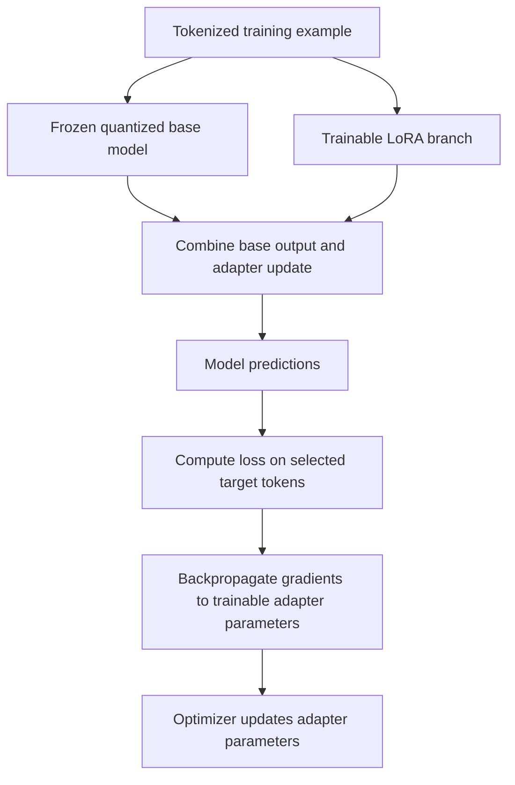

# Chapter 09: Quantization and QLoRA at a High Level

## Learning Objectives

By the end of this chapter, you should be able to:

- Explain reduced-precision representations and quantization error.
- Describe QLoRA as training low-rank adapters while keeping a quantized base model frozen.
- Distinguish quantized weight storage, computation precision, and optimizer-state memory.
- Identify activation memory, sequence length, and hardware/library compatibility as major constraints.
- Explain why quantization is not itself instruction tuning.
- Draw the frozen-base/trainable-adapter path and list the major memory contributors.

<br/>

## 1. Quantization: The Basic Idea

**Quantization** represents numerical values using a lower-precision format than the original representation. In neural networks, it is often applied to model weights and may also be applied to activations or other tensors, depending on the inference or training method.

For example, a model stored with 16-bit values generally needs less weight storage than the same number of values stored with 32-bit values. Lower-bit formats can reduce memory requirements further, but they represent numbers with fewer available levels or a different numerical scheme.

Quantization is a representation and numerical-computation technique. It does not, by itself, teach a model to follow instructions, adopt a new response style, or learn a task-specific behavior.

<br/>

### Approximate weight-storage illustration

For $N$ values stored at $b$ bits per value, the idealized raw storage is:

$$
\text{Storage in bytes} \approx \frac{N b}{8}
$$

For 7 billion values, ignoring metadata, padding, scales, and other overhead:

| Representation | Bits per value | Idealized raw storage |
|---|---:|---:|
| FP32 | 32 | 28 GB |
| FP16 or BF16 | 16 | 14 GB |
| 8-bit representation | 8 | 7 GB |
| 4-bit representation | 4 | 3.5 GB |

These are decimal gigabytes (GB) and theoretical storage calculations, not guaranteed GPU-memory requirements. Real model files and runtime allocations can differ due to quantization metadata, non-quantized tensors, alignment, temporary buffers, and implementation details.


<br/>


## 2. Quantization Error and Quality Trade-Offs

Quantization maps a higher-precision value to a representable lower-precision value. The mapped value may differ from the original; this difference is commonly called **quantization error**.

Conceptually:

$$
\hat{w} = Q(w), \qquad e = \hat{w} - w
$$

where:
- $w$ is the original value.
- $Q$ is the quantization procedure.
- $\hat{w}$ is the represented or reconstructed value.
- $e$ is the representation error under this definition.

Quantization methods may use scaling factors, zero points, blockwise statistics, or other techniques to represent values efficiently. The precise format and quantization scheme determine how values are mapped and how metadata is stored.

<br/>

### Why quality can change

- Values are represented with finite precision.
- Outliers can affect how a group or tensor is quantized.
- Different layers may have different sensitivity to quantization.
- Calibration, scaling, group size, and quantization scheme can affect the result.
- Kernel implementation and hardware can affect numerical behavior and performance.

Lower-bit quantization often reduces weight storage, but it does not guarantee a particular quality loss—or no quality loss. Evaluate the quantized model on the actual task.


<br/>


## 3. What Is QLoRA?

**QLoRA** combines a quantized base model with trainable low-rank adapters. In the commonly described setup, the pretrained base weights are stored in a low-bit quantized form and kept frozen, while LoRA parameters are trained.

The key distinction is that QLoRA does not ordinarily update all quantized base weights. Instead, it uses the quantized base model for forward computation and trains the added low-rank adapter parameters.



This is a conceptual view. The exact computational graph, quantization format, precision conversions, and supported trainable components depend on the implementation.

<br/>

### QLoRA versus ordinary LoRA

| Aspect | Common LoRA setup | Common QLoRA setup |
|---|---|---|
| Base weights | Often loaded in FP16, BF16, or another supported representation | Loaded in a low-bit quantized representation |
| Base weights updated? | Usually frozen for LoRA training | Usually frozen for QLoRA training |
| Trainable component | LoRA parameters | LoRA parameters |
| Main memory motivation | Reduce trainable parameters and optimizer state | Also reduce base-weight storage |
| Numerical and compatibility constraints | Depend on model, precision, and runtime | Include quantization format, compute dtype, kernels, and PEFT integration |

This table describes common patterns, not every possible implementation. LoRA can be combined with quantization in more than one way, and the labels used by frameworks may have specific meanings.


<br/>


## 4. Keep Three Concepts Separate

A common source of confusion is treating weight storage, computation precision, and optimizer-state memory as if they were one setting. They are separate concerns.

### 4.1 Quantized storage

This describes how model weights are represented in memory or on disk—for example, using a 4-bit quantized format. A quantized tensor may require additional metadata such as scales or block-level parameters.

<br/>

### 4.2 Computation precision

This describes the numerical format used by supported operations during computation. A workflow can store the base weights in a low-bit representation while using a higher-precision compute dtype for certain operations. Quantized values may be dequantized or handled by specialized kernels as required.

The exact behavior is implementation-dependent. Do not infer the precision of every operation from the storage format alone.

<br/>

### 4.3 Optimizer-state memory

Optimizers such as Adam maintain state for trainable parameters, often including running estimates of gradients and squared gradients. With PEFT/QLoRA, optimizer state is typically needed for the trainable adapter parameters, not for frozen base weights that are excluded from optimization.

The optimizer's actual state representation and memory cost depend on the optimizer, precision, framework, and configuration.

<br/>

### Quick comparison

| Concept | Main question | Typical example |
|---|---|---|
| Weight storage | How are weights represented in memory? | Quantized base weights |
| Compute precision | What numerical format do operations use? | BF16 compute where supported |
| Optimizer state | What state is kept to update trainable parameters? | Adam moments for LoRA parameters |

A configuration may specify all three independently. Always inspect the effective runtime configuration and logs.


<br/>


## 5. Major Memory Contributors

QLoRA can reduce the memory needed to store base weights and optimize task-specific parameters, but it does not eliminate other memory costs.

### Training memory

Major contributors include:

1. **Base-model weights:** the frozen model must still be available for forward computation.
2. **Quantization metadata:** scales, zero points, block metadata, or other format-specific data.
3. **Trainable adapter parameters:** LoRA matrices and any other trainable components.
4. **Gradients:** gradients for trainable parameters.
5. **Optimizer state:** state for trainable parameters, depending on the optimizer.
6. **Activations:** intermediate tensors retained for backpropagation.
7. **Temporary workspaces and buffers:** attention kernels, matrix operations, quantization/dequantization, and framework allocations.
8. **Other runtime allocations:** CUDA context, memory fragmentation, distributed-training state, and logging or data-transfer buffers.

<br/>

### Inference memory

Major contributors include:

1. Base-model weights and quantization metadata.
2. Adapter parameters, if the adapter is loaded separately.
3. Activations and temporary operation buffers.
4. **Key-value (KV) cache** for autoregressive generation.
5. Batch and concurrency overhead.
6. Runtime and memory allocator overhead.

The KV cache stores attention keys and values for tokens already processed, allowing many autoregressive models to avoid recomputing all earlier attention projections at each generation step. Cache size generally increases with sequence length and batch/concurrency, with exact scaling determined by architecture and cache design.


<br/>


## 6. Why Sequence Length Matters

A quantized base model can fit in memory while a long training sequence still causes an out-of-memory error.

For transformer training, longer sequences can increase activation memory and attention computation. The precise memory scaling depends on the architecture, attention implementation, checkpointing, batch size, and framework. During inference, longer contexts also generally increase KV-cache requirements for architectures that use a KV cache.

Memory planning should therefore consider more than parameter count:

- Maximum sequence length.
- Per-device batch size.
- Gradient accumulation steps.
- Gradient checkpointing.
- Attention implementation.
- Number of concurrent inference requests.
- Generated-token limit and KV-cache strategy.
- Quantization and compute dtype.
- Available GPU memory and runtime overhead.

Reducing the batch size or sequence length may address an out-of-memory issue, but the correct choice depends on the training objective and quality requirements. Record the chosen values so experiments remain comparable.


<br/>


## 7. Hardware and Library Compatibility

Low-bit training paths depend on more than the model file. Compatibility can involve:
- GPU architecture and supported numerical operations.
- CUDA or other accelerator runtime versions.
- PyTorch version.
- Transformers and PEFT versions.
- Quantization library and supported quantization formats.
- Attention and matrix-multiplication kernels.
- Model architecture and custom code.
- Training framework integration and adapter configuration.

A configuration that works on one GPU or software stack may fail or behave differently on another. Before a long run:

1. Confirm the model architecture and license permit the intended use.
2. Check current library documentation for the selected quantization path.
3. Verify GPU and runtime compatibility.
4. Load the base model with the intended quantization configuration.
5. Attach the adapter and inspect trainable parameter counts.
6. Run a small forward/backward test on a tiny batch.
7. Measure peak memory and confirm that gradients reach the intended trainable parameters.
8. Save the exact package versions and configuration.

Do not assume that a model loading successfully proves that the training path is correct. Verify loss, gradients, adapter updates, and output behavior.


<br/>


## 8. Illustrative Hugging Face Configuration

The following code shows the shape of a common QLoRA-style configuration using Transformers and PEFT. It is a template, not a universal script. The model identifier, revision, target modules, supported hardware, library versions, and task-specific dataset setup must be selected and verified.

```python
import torch
from transformers import AutoModelForCausalLM, BitsAndBytesConfig
from peft import LoraConfig, get_peft_model, prepare_model_for_kbit_training

model_id = "YOUR_BASE_MODEL_ID"
model_revision = "YOUR_IMMUTABLE_MODEL_REVISION"

quant_config = BitsAndBytesConfig(
    load_in_4bit=True,
    bnb_4bit_quant_type="nf4",
    bnb_4bit_compute_dtype=torch.bfloat16,  # Use only if supported
    bnb_4bit_use_double_quant=True,
)

model = AutoModelForCausalLM.from_pretrained(
    model_id,
    revision=model_revision,
    quantization_config=quant_config,
    # Device placement and other loading settings depend on the environment.
)

# Preparation details depend on the selected model and library versions.
model = prepare_model_for_kbit_training(model)

lora_config = LoraConfig(
    task_type="CAUSAL_LM",
    r=8,
    lora_alpha=16,
    lora_dropout=0.05,
    target_modules=["q_proj", "v_proj"],  # Verify these names for the model.
    bias="none",
)

model = get_peft_model(model, lora_config)
model.print_trainable_parameters()
```

<br/>

### Configuration cautions

- `YOUR_BASE_MODEL_ID` and `YOUR_IMMUTABLE_MODEL_REVISION` are placeholders.
- `nf4` and double quantization are options used in common QLoRA configurations; confirm their availability in the installed quantization library.
- `torch.bfloat16` is not supported efficiently by every device. Choose a supported compute dtype based on hardware and the library's guidance.
- `q_proj` and `v_proj` are not universal target names.
- This snippet configures loading and adapter attachment; it does not include dataset preparation, loss masking, an optimizer, or a complete training loop.
- Exact preparation steps and argument support can change across library versions.


<br/>


## 9. Quantization Is Not Instruction Tuning

**Quantization changes numerical representation. Instruction tuning changes learned behavior through training examples or another optimization objective.**

| Operation | Primary purpose | Does it provide target-response supervision by itself? |
|---|---|---|
| Quantization | Reduce numerical precision/storage for supported tensors | No |
| SFT | Train the model to imitate target responses | Yes |
| LoRA | Provide a parameter-efficient way to learn weight updates | It supplies trainable parameters; the training dataset/objective supplies the supervision |
| QLoRA | Train LoRA adapters while using a quantized, commonly frozen, base model | The dataset/objective supplies supervision; quantization alone does not |

A quantized model may be used without any additional training. QLoRA uses quantization to make a fine-tuning setup more memory-efficient, while the adapter is optimized from the training objective.


<br/>


## 10. Practice: Draw the Path and List Memory Contributors

Draw or annotate a workflow with these components:

- Tokenized example and labels.
- Frozen quantized base weights.
- Trainable LoRA branch.
- Forward computation and combined output.
- Loss on selected target positions.
- Gradients for trainable parameters.
- Optimizer state and adapter update.
- Validation and checkpoint selection.

Then create a memory inventory:

| Memory contributor | Training | Inference |
|---|---:|---:|
| Base-model weights | Yes | Yes |
| Quantization metadata | Often | Often |
| Adapter parameters | Yes | Yes, if adapter is used |
| Adapter gradients | Yes | No |
| Optimizer state | Yes | No |
| Saved activations for backward | Usually | No backward activations in ordinary inference |
| Temporary computation buffers | Yes | Yes |
| KV cache | Depends on training setup and implementation | Common for autoregressive generation |
| Runtime/framework overhead | Yes | Yes |

This is a conceptual inventory. Exact allocations vary by framework and configuration.

<br/>

### Practice questions

1. Why can 4-bit base-weight storage coexist with BF16 computation?
2. Which parameters are typically updated in a QLoRA run?
3. Why can long sequences cause an out-of-memory error even when the quantized base weights fit?
4. Why does optimizer-state memory usually depend more directly on trainable parameters than on frozen parameters?
5. Why should a QLoRA experiment record both quantization settings and compute dtype?


<br/>


## 11. Checkpoint: Explain the Precision Distinction

A complete answer should explain that:

- **Quantized storage** describes how base weights are represented.
- **Compute precision** describes the formats used by operations; it can differ from the stored weight format.
- Quantized operations may use specialized kernels, conversions, or higher-precision accumulations depending on the implementation.
- **Optimizer state** is separate from base-weight storage and is usually associated with trainable adapter parameters in a typical QLoRA setup.
- Activations, temporary buffers, sequence length, and runtime overhead still contribute to memory.
- Quantization is not instruction tuning; QLoRA training updates adapter parameters using a training objective while commonly keeping the quantized base weights frozen.

<br/>

### Mini-assignment

Write a short experiment note containing:
- Base model ID and immutable revision.
- Quantization type and settings.
- Compute dtype.
- LoRA rank, scaling, dropout, and target modules.
- Hardware and software versions.
- Maximum sequence length and per-device batch size.
- Trainable parameter count.
- Peak training memory, if measured.
- Validation result and selected checkpoint.

State which values were measured and which are estimates. Do not infer total memory from the quantized parameter storage alone.


<br/>


## 12. Essential References

- [QLoRA paper: Efficient Finetuning of Quantized LLMs](https://arxiv.org/abs/2305.14314)
- [Hugging Face Transformers — Bitsandbytes quantization](https://huggingface.co/docs/transformers/quantization/bitsandbytes)
- [Hugging Face PEFT — LoRA developer guide](https://huggingface.co/docs/peft/developer_guides/lora)
- [Hugging Face PEFT — Quantization guides](https://huggingface.co/docs/peft/developer_guides/quantization)
- [Hugging Face TRL — Supervised Fine-Tuning Trainer](https://huggingface.co/docs/trl/sft_trainer)
- [PyTorch — CUDA semantics and memory notes](https://pytorch.org/docs/stable/notes/cuda.html)

Documentation and APIs evolve. Check the installed versions and hardware requirements before selecting a quantization format or starting a training run.


<br/>


## Summary

Quantization reduces the precision used to represent supported values, which can lower base-weight storage but introduces numerical trade-offs and compatibility requirements. QLoRA commonly keeps a quantized pretrained base model frozen while training LoRA adapters. Weight storage precision, operation compute precision, and optimizer-state memory are separate concerns. Activations, sequence length, temporary buffers, and runtime caches can remain substantial memory costs. Quantization is a technique for representation and efficiency—not an instruction-tuning objective.
