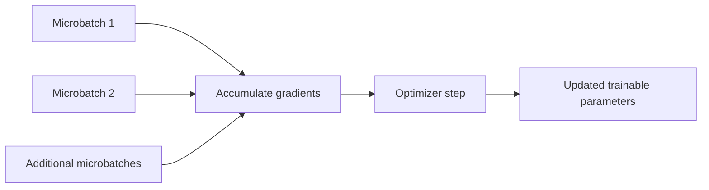

# Chapter 10: Training Configuration and Hyperparameters

## Learning Objectives

By the end of this chapter, you should be able to:

- Configure learning rate, scheduler, epochs or steps, batch size, and gradient accumulation.
- Record maximum sequence length, numerical precision, optimizer, and evaluation/checkpoint intervals.
- Explain gradient clipping and common memory-saving options.
- Run a small smoke test to detect invalid batches, non-finite loss, and memory problems.
- Bound training runtime, storage, checkpoint count, and hosted-job cost.
- Change configurations systematically and interpret the effect of each change.
- Distinguish microbatch size, effective batch size, and total optimizer steps.

<br/>

## 1. Why Training Configuration Matters

A training configuration defines how a model is optimized and how the run uses compute, memory, time, and storage. A configuration that is too aggressive may produce unstable loss or run out of memory. One that is too conservative may train slowly or underfit within the available budget.

The goal is not to search blindly for the “best” values. Start with a defensible small configuration, verify that the pipeline works, then change a small number of variables at a time and evaluate each change.

<br/>

### The main configuration groups

| Group | Examples | Main concern |
|---|---|---|
| Optimization | Learning rate, optimizer, scheduler, warmup, weight decay | Stability and convergence |
| Workload | Epochs, max steps, batch size, gradient accumulation | Number of updates and training duration |
| Sequence handling | Maximum sequence length, padding, truncation, packing | Memory, throughput, and retained context |
| Numerical settings | FP32, FP16, BF16, quantization settings | Memory, speed, numerical stability, compatibility |
| Memory controls | Gradient checkpointing, gradient clipping, attention implementation | Feasibility and stability |
| Evaluation | Evaluation interval, validation metrics, best-checkpoint rule | Generalization and model selection |
| Saving | Checkpoint interval, retention limit, output directory | Storage, recovery, and reproducibility |
| Budget | Runtime limit, GPU hours, hosted-job cap | Cost control |

Exact option names and defaults vary between libraries and versions. Record the effective configuration emitted by the framework, not just the values you intended to set.


<br/>


## 2. Learning Rate and Scheduler

### 2.1 Learning rate

The **learning rate** controls the scale of optimizer updates. If it is too high, loss may oscillate, become non-finite, or degrade model behavior. If it is too low, learning may be slow or ineffective within the allotted steps.

Fine-tuning a pretrained model often uses a lower learning rate than training a model from scratch, but there is no universally correct value. The appropriate range depends on the base model, method (full fine-tuning vs. LoRA/PEFT), dataset, batch size, optimizer, and schedule.

Start with a conservative, documented value from the selected framework's example or method-specific guidance, then run a short experiment.

<br/>

### 2.2 Learning-rate scheduler

A scheduler changes the learning rate during training. Common patterns include:

- **Constant:** keep the learning rate fixed.
- **Linear decay:** decrease it over the scheduled training duration.
- **Cosine decay:** reduce it following a cosine-shaped curve.
- **Warmup:** begin with a lower rate and increase toward the configured rate during an initial portion of training.

Warmup is often combined with a decay schedule. Scheduler behavior depends on whether it advances per optimizer step, per epoch, or through another framework-specific mechanism.

Record:
- Scheduler name.
- Warmup steps or ratio.
- Total planned training steps.
- Whether scheduler steps align with optimizer steps.
- Minimum or final learning-rate settings, if supported.

A scheduler configured for the wrong total number of steps can decay too quickly or fail to reach its intended endpoint.


<br/>


## 3. Epochs, Maximum Steps, and Dataset Size

An **epoch** is one pass through the training dataset, subject to the framework's sampling and batching behavior. **Maximum steps** usually limits the number of optimizer updates. If both are specified, the framework defines which setting takes precedence; inspect its documentation and logs.

For a simple finite dataset, with:
- $N$ training examples,
- per-device microbatch size $B$,
- $G$ gradient-accumulation steps,
- $D$ data-parallel devices,

the approximate effective batch size is:

$$
B_{\text{effective}} = B \times G \times D
$$

This assumes every device uses the same microbatch size and accumulation count, and that there are no special batching effects. It may differ for incomplete final batches, sequence packing, token-based batching, or other data-loader behavior.

The approximate number of optimizer steps in one epoch is:

$$
S_{\text{epoch}} \approx
\left\lceil \frac{N}{B \times D} \right\rceil \div G
$$

This is a planning approximation, not a universal exact formula. Some frameworks drop incomplete batches, use different rounding rules, or define accumulation around the data-loader's batch count. Use the framework's reported step count for the final plan.

<br/>

### Example workload estimate

Assume:
- 1,200 training examples.
- Microbatch size $B=2$ per device.
- Gradient accumulation $G=8$.
- One data-parallel device ($D=1$).
- One epoch, no dropped batches, and conventional batch-based accumulation.

Then:
- Effective batch size is approximately $2 \times 8 \times 1 = 16$ examples per optimizer update.
- There are about $1,200 / 2 = 600$ microbatches per epoch.
- There are about $600 / 8 = 75$ optimizer steps per epoch.

This estimate assumes each example is treated as one batch item. Packing or token-based batching can change the interpretation and workload.


<br/>


## 4. Microbatch Size vs. Effective Batch Size vs. Training Steps

These terms are related but not interchangeable.

- **Microbatch size:** examples processed together in one forward/backward pass on a device.
- **Gradient accumulation:** number of microbatches whose gradients are accumulated before an optimizer update.
- **Effective batch size:** approximate number of examples contributing to one optimizer update across devices and accumulated microbatches.
- **Optimizer step:** one update applied by the optimizer to trainable parameters.
- **Training steps:** usually the number of optimizer updates, but verify the framework's exact logging terminology.



Gradient accumulation can increase the effective batch size without requiring all examples to fit in memory at once. It does not necessarily make training faster: it performs multiple forward/backward passes for each optimizer update.

<br/>

### Important caveats

- Effective batch size is measured in examples only when example-based batching is meaningful. With variable-length sequences, token counts can vary substantially between batches.
- Gradient accumulation is not always numerically identical to a single large batch, especially when dropout, batch-dependent operations, loss normalization, or incomplete batches are involved.
- Distributed training adds devices to the effective batch only when the devices participate in data-parallel training as assumed by the formula.
- Some framework logs count data-loader iterations; others report optimizer updates. Confirm the meaning of “step” before estimating a run.


<br/>


## 5. Maximum Sequence Length

**Maximum sequence length** limits the number of tokens processed in a training example or sequence window, subject to the model and framework.

Longer sequences can:
- Preserve more context.
- Increase activation memory and compute.
- Increase training time.
- Increase the chance that batches exceed available memory.

Shorter sequences can reduce resource use but may truncate important instructions or target responses.

Record:
- Model-supported context limit.
- Configured maximum sequence length.
- Truncation side and behavior.
- Whether examples are packed.
- How loss is handled for packed examples and boundary tokens.
- Whether long target responses can be truncated.

Do not set a sequence length only because it fits the GPU. Inspect real examples and quantify how often prompts or target responses are truncated.


<br/>


## 6. Numerical Precision and Optimizer

### 6.1 Precision

Common training options include FP32, FP16, and BF16, where supported. Mixed-precision training can improve throughput or reduce memory, but hardware support and numerical behavior vary.

- FP32 uses 32-bit floating-point values and is often a robust reference setting, though it can require more memory.
- FP16 uses 16-bit floating-point values and may require loss scaling in some training paths.
- BF16 uses 16-bit values with a wider exponent range than FP16, but support depends on hardware and kernels.
- Quantized storage is a separate concern from the compute dtype, as discussed in Chapter 09.

Record the actual compute dtype and any mixed-precision or quantization settings. Do not infer all operation precision from a single configuration flag.

<br/>

### 6.2 Optimizer

The optimizer determines how gradients are used to update trainable parameters. AdamW is a common choice in transformer fine-tuning, but the appropriate optimizer depends on the training method and framework.

Record:
- Optimizer name and implementation.
- Learning rate and weight decay.
- Betas or other optimizer-specific settings where relevant.
- Precision of optimizer state if configurable.
- Any memory-optimized optimizer options.

For PEFT, optimizer state is generally associated with trainable parameters. For full fine-tuning, the trainable set is much larger, so optimizer-state memory can be substantially higher.


<br/>


## 7. Gradient Accumulation and Gradient Clipping

### Gradient accumulation

Instead of updating parameters after every microbatch, a training loop can accumulate gradients over several microbatches and then perform one optimizer step. This is useful when the desired effective batch would otherwise exceed device memory.

Inspect how the framework scales or normalizes accumulated loss. Correct implementations account for accumulation so that gradient magnitude is not unintentionally multiplied by the number of microbatches.

<br/>

### Gradient clipping

Gradient clipping limits gradient magnitude according to a selected rule, commonly by clipping the global norm. It can help reduce extreme updates, but it does not fix incorrect labels, invalid data, an unsuitable learning rate, or a broken loss computation.

A typical conceptual operation is:

```python
torch.nn.utils.clip_grad_norm_(model.parameters(), max_norm=1.0)
```

This line is illustrative. In a real PEFT run, verify that clipping is applied at the correct point in the training loop and to the intended trainable parameters. Framework-managed trainers may handle it through configuration.


<br/>


## 8. Memory-Saving Options

Options depend on the architecture and framework. Common techniques include:

| Technique | What it can reduce or change | Trade-off or caveat |
|---|---|---|
| Smaller microbatch | Per-step activation demand | More microbatches may be needed |
| Gradient accumulation | Required per-pass batch size | More passes per optimizer update |
| Shorter sequence length | Activation, attention, and cache demands | Less context; possible truncation |
| Gradient checkpointing | Stored activation memory | Extra computation during backward |
| PEFT/LoRA | Trainable parameters, gradients, optimizer state | Base weights still required |
| Quantized base / QLoRA | Base-weight storage in supported workflows | Compatibility and numerical trade-offs |
| Mixed precision | Memory and sometimes throughput | Hardware and numerical constraints |
| Efficient attention kernels | Temporary memory and/or attention compute | Kernel/model support requirements |
| Optimizer memory optimizations | Optimizer-state storage | Implementation and quality/performance trade-offs |

No single option solves every memory problem. Diagnose whether the bottleneck is base weights, optimizer state, activations, sequence length, KV cache, or runtime overhead before changing settings.


<br/>


## 9. Evaluation and Checkpoint Intervals

**Evaluation interval** determines how often validation runs. **Checkpoint interval** determines how often training state or model snapshots are saved.

If evaluation is too infrequent, a useful checkpoint or early sign of overfitting may be missed. If it is too frequent, validation overhead can consume a substantial fraction of runtime. Frequent checkpointing increases storage use and can slow training.

Record:
- Evaluation strategy and interval (steps or epochs).
- Validation dataset and metrics.
- Best-checkpoint selection metric and direction.
- Save strategy and interval.
- Maximum retained checkpoints.
- Whether the final checkpoint is always saved.
- Whether optimizer/scheduler state is included for resumption.

Keep the test set separate from repeated checkpoint selection. Use validation data to choose a checkpoint, then evaluate the selected model on the held-out test set.

<br/>

### Storage planning

If each checkpoint occupies approximately $C$ GB and the run retains at most $K$ checkpoints, a first-order storage estimate is:

$$
\text{Checkpoint storage} \approx C \times K
$$

This excludes logs, optimizer state if saved separately, datasets, temporary files, and duplicate exports. Actual storage depends on checkpoint contents and file formats.


<br/>


## 10. Bound Runtime, Storage, and Hosted-Job Cost

Before launching training, define explicit limits:

- Maximum optimizer steps or epochs.
- Wall-clock time limit.
- GPU type/count and expected availability.
- Maximum checkpoint count and output size.
- Evaluation frequency.
- Hosted-job budget or spending cap.
- A stopping condition if loss is non-finite or memory use is consistently unsafe.

A simple cost estimate is:

$$
\text{Estimated cost} =
\text{expected billable hours} \times
\text{hourly rate}
$$

Add any relevant storage, network, or platform charges. Treat the estimate as approximate: startup time, data preparation, validation, checkpointing, retries, and idle allocation may be billed depending on the provider.

A practical run plan should specify a stop condition and a way to recover from interruption. Use a small smoke run before committing to a longer paid job.


<br/>


## 11. Smoke Run: Catch Problems Early

A **smoke run** is a short end-to-end test designed to verify that the training pipeline functions. It is not evidence that the model has converged or that the selected configuration is optimal.

### Recommended checks

1. Load the intended base model and tokenizer at the recorded revisions.
2. Prepare a tiny batch with the exact production preprocessing path.
3. Confirm input IDs, attention masks, labels, and shapes are valid.
4. Confirm target tokens are not accidentally all masked.
5. Run a forward pass and verify the loss is finite.
6. Run backward and confirm gradients exist for intended trainable parameters.
7. Perform an optimizer update and confirm trainable parameters can change.
8. Run one validation batch and verify metric calculation.
9. Save and reload a checkpoint or adapter if the workflow depends on resuming or exporting.
10. Record peak memory, elapsed time, warnings, and output artifacts.

<br/>

### Illustrative checks in PyTorch

```python
import math
import torch

model.train()
optimizer.zero_grad(set_to_none=True)

outputs = model(**batch)
loss = outputs.loss

if not torch.isfinite(loss):
    raise RuntimeError(f"Non-finite training loss: {loss.item()}")

loss.backward()

trainable_with_grad = [
    name for name, parameter in model.named_parameters()
    if parameter.requires_grad and parameter.grad is not None
]

if not trainable_with_grad:
    raise RuntimeError("No trainable parameters received gradients.")

optimizer.step()
```

This is a diagnostic sketch, not a complete training loop. The `batch` format, loss availability, gradient accumulation, clipping, mixed precision, and optimizer setup depend on the framework. A smoke run should also check that the intended trainable parameters—not merely any parameters—receive gradients.

<br/>

### What the smoke run does not prove

- That the model generalizes.
- That a learning rate is optimal.
- That all data records are valid.
- That long sequences will fit in memory.
- That the final serving/export path is compatible.
- That training will stay within budget at full scale.


<br/>


## 12. Change Configurations Systematically

Avoid changing many settings at once. Otherwise, it becomes difficult to identify what caused an improvement or regression.

A disciplined experiment loop:

1. **Establish a baseline:** record a working configuration and validation metrics.
2. **State a hypothesis:** for example, “Reducing sequence length will lower peak memory.”
3. **Change one main variable or a clearly defined small group.**
4. **Hold other conditions stable:** dataset split, evaluation cases, base-model revision, and relevant random seeds.
5. **Measure:** validation quality, loss behavior, peak memory, runtime, and artifact size.
6. **Compare against the baseline:** include both quality and operational constraints.
7. **Keep or revert:** document the decision and configuration diff.

A useful experiment log:

| Run | Hypothesis / change | Quality metric | Peak memory | Runtime | Decision |
|---|---|---:|---:|---:|---|
| Baseline | Initial validated configuration | | | | |
| Run B | Lower learning rate | | | | |
| Run C | Shorter sequence length | | | | |
| Run D | Gradient checkpointing enabled | | | | |

The table is a template; fill it with measured results rather than assumed outcomes.


<br/>


## 13. Practice: Prepare a Small-Run Configuration

Use this as a planning template. The values are placeholders to be selected for your model, dataset, and hardware—not universal recommended settings.

```yaml
model:
  id: "YOUR_BASE_MODEL_ID"
  revision: "YOUR_IMMUTABLE_REVISION"
  method: "lora"  # or full fine-tuning / supported alternative

data:
  dataset_version: "YOUR_DATASET_VERSION"
  train_split: "train"
  validation_split: "validation"
  max_sequence_length: 1024
  truncation: true

training:
  learning_rate: "CHOOSE_AND_RECORD"
  scheduler: "linear"
  warmup_ratio: 0.03
  num_train_epochs: 1
  max_steps: -1
  per_device_train_batch_size: 1
  gradient_accumulation_steps: 8
  gradient_checkpointing: true
  max_grad_norm: 1.0
  optimizer: "RECORD_IMPLEMENTATION"
  bf16: "SET_ONLY_IF_SUPPORTED"
  fp16: false

evaluation:
  strategy: "steps"
  eval_steps: 20
  metric_for_best_model: "RECORD_METRIC"
  greater_is_better: false  # change for metrics where higher is better

checkpointing:
  save_strategy: "steps"
  save_steps: 20
  save_total_limit: 2
  output_dir: "./outputs/sft-smoke-run"

budget:
  max_runtime_minutes: 30
  max_checkpoint_count: 2
```

This is a conceptual planning YAML, not a drop-in configuration for every training library. Some frameworks use different field names or types; for example, boolean and strategy settings may differ. Validate the configuration against the exact installed library version before running it.

<br/>

### Estimate the workload

Record your assumptions:
- Number of training examples $N$.
- Microbatch size $B$ per device.
- Accumulation steps $G$.
- Number of data-parallel devices $D$.
- Number of epochs $E$ or optimizer-step cap.
- Mean and maximum sequence length.
- Approximate time per optimizer step, measured from a smoke run.
- Checkpoint size and save frequency.

For a simple example-based estimate:

$$
B_{\text{effective}} = BGD
$$

$$
S_{\text{epoch}} \approx \left\lceil\frac{N}{BD}\right\rceil/G
$$

$$
T_{\text{training}} \approx S_{\text{total}} \times t_{\text{step}} + T_{\text{evaluation}} + T_{\text{saving}}
$$

Use a measured step time from the intended hardware and sequence-length distribution. Add a safety margin for startup, validation, checkpointing, and variance. This estimate becomes unreliable if the data loader, packing strategy, sequence lengths, or device count differ materially from the smoke run.


<br/>


## 14. Checkpoint: Distinguish Batch Size and Training Steps

A complete answer should distinguish:

- **Microbatch size:** examples processed in one forward/backward pass on each device.
- **Gradient accumulation steps:** number of microbatches combined before one optimizer update.
- **Effective batch size:** approximate examples contributing to one optimizer update across data-parallel devices.
- **Total training steps:** number of optimizer updates planned or completed, according to the framework's definition.
- **Epochs:** passes over the dataset; the relationship between epochs and steps depends on batching, accumulation, and data-loader behavior.

<br/>

### Mini-assignment

Using your planned $N$, $B$, $G$, $D$, and epoch count:
1. Estimate the effective batch size.
2. Estimate optimizer steps per epoch and total optimizer steps.
3. Estimate runtime using a measured smoke-run step time.
4. Estimate checkpoint storage using checkpoint size and retention limit.
5. Write explicit stop conditions for non-finite loss, memory failure, and budget overruns.
6. State which assumptions are approximate and which values were measured.


<br/>


## 15. Essential References

- [Hugging Face Transformers — Trainer](https://huggingface.co/docs/transformers/main_classes/trainer)
- [Hugging Face TRL — Supervised Fine-Tuning Trainer](https://huggingface.co/docs/trl/sft_trainer)
- [Hugging Face Accelerate — Gradient accumulation](https://huggingface.co/docs/accelerate/usage_guides/gradient_accumulation)
- [PyTorch — Automatic mixed precision](https://pytorch.org/docs/stable/amp.html)
- [PyTorch — Gradient clipping utilities](https://pytorch.org/docs/stable/generated/torch.nn.utils.clip_grad_norm_.html)
- [PyTorch — CUDA memory notes](https://pytorch.org/docs/stable/notes/cuda.html)

Documentation and APIs change. Verify exact configuration names, step semantics, scheduler behavior, precision support, and checkpoint options against your installed versions.


<br/>


## Summary

Training configuration governs optimization, workload, sequence handling, precision, evaluation, checkpointing, and cost. Microbatch size describes one forward/backward pass; gradient accumulation combines microbatches before an optimizer update; effective batch size also accounts for data-parallel devices. Total training steps depend on dataset size, batching, accumulation, epochs or step caps, and framework behavior. Run a short end-to-end smoke test, measure memory and step time, bound the job, and change configurations systematically.
