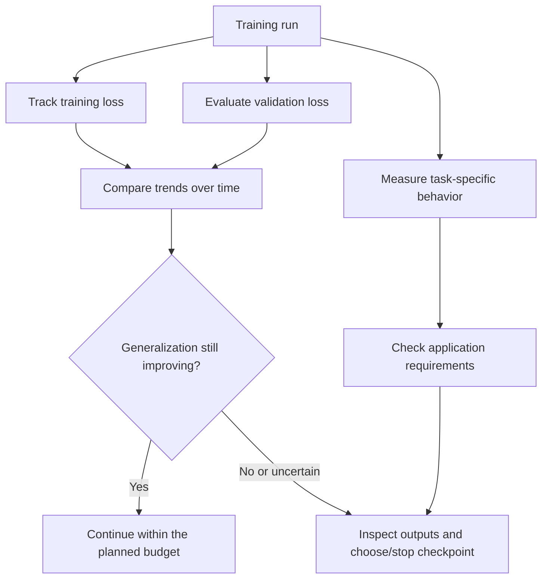

# Chapter 11: Overfitting and Generalization

## Learning Objectives

By the end of this chapter, you should be able to:

- Compare training loss, validation loss, and task-specific evaluation results.
- Identify signs of memorization, template dependence, and regressions on narrow or unfamiliar domains.
- Use early stopping and validation-based checkpoint selection appropriately.
- Improve generalization through data quality, coverage, and evaluation design.
- Check whether fine-tuning preserves important capabilities of the base model.
- Explain why lower training loss alone does not establish that an application has improved.

 

## 1. What Are Overfitting and Generalization?

**Generalization** is a model's ability to perform well on inputs beyond the exact examples used to train it. **Overfitting** occurs when training improves but performance on unseen or representative data stops improving or becomes worse.

Fine-tuning can make a model more consistent with the training examples while making it less robust to unfamiliar inputs. This can happen with full-parameter fine-tuning and with PEFT methods; parameter efficiency does not guarantee generalization.

 

### The central distinction

- **Training performance** measures behavior on examples used to optimize the model.
- **Validation performance** estimates behavior on a separate dataset used to compare configurations and checkpoints.
- **Test performance** provides a final estimate on a held-out set after selection decisions have been made.

Use the validation set to guide training decisions. Avoid repeatedly inspecting the final test set and changing the experiment in response, because this leaks information from the test set into model selection.

 

## 2. Read Training and Validation Loss Together

For many supervised fine-tuning setups, training and validation loss are useful signals, but neither tells the entire story.

 

### Common learning-curve patterns

The patterns below are diagnostic clues, not definitive proofs. Small validation sets, noisy metrics, distribution differences, and evaluation bugs can produce misleading curves.

| Training loss | Validation loss | Possible interpretation | What to inspect |
|---|---|---|---|
| Decreasing | Decreasing | Learning may be progressing | Task metrics, output quality, and remaining budget |
| Decreasing | Flat | Generalization may have plateaued | Data coverage, learning rate, task metrics, validation noise |
| Decreasing | Increasing | Possible overfitting or train/validation mismatch | Memorization, leakage, split design, data quality |
| High or not improving | High or not improving | Possible underfitting, optimization problems, or data/objective issues | Labels, masks, learning rate, trainable parameters, training duration |
| Unstable or non-finite | Unstable or non-finite | Possible numerical or pipeline failure | Learning rate, precision, invalid batches, loss masking, gradients |
| Decreasing | Decreasing, but task metrics worsen | Loss may not reflect the application goal or evaluation may be inconsistent | Metric implementation, decoding, task-specific examples |

Do not diagnose a run from a single value. Inspect trends across multiple evaluations and verify that the metrics are computed consistently.

 

## 3. Loss Is Not the Same as Application Quality

For causal-language-model SFT, loss often measures how well the model predicts the selected target tokens. Application quality may require much more:

- Correctness of the answer.
- Compliance with a required output schema.
- Robustness to varied phrasings.
- Appropriate refusal or abstention behavior.
- Factual grounding and avoidance of unsupported claims.
- Safety and policy compliance.
- Latency and resource limits.
- Stability across relevant user populations and input types.

A lower validation loss is useful evidence for the token-prediction objective, but it does not automatically mean better structured extraction, fewer hallucinations, better tool use, or safer behavior. Select metrics based on the intended application.

 

### Example

Suppose two checkpoints produce the following results on a held-out validation set:

| Metric | Checkpoint A | Checkpoint B |
|---|---:|---:|
| Validation loss | 0.82 | 0.76 |
| Valid JSON output rate | 94% | 89% |
| Task accuracy | 91% | 90% |

These are **illustrative numbers**, not experimental results. Checkpoint B has lower validation loss but worse JSON validity and slightly lower task accuracy. If valid JSON is a hard requirement, choosing solely by validation loss could select the less suitable checkpoint.

Define the primary selection metric and any hard constraints before comparing checkpoints.

 

## 4. Memorization and Data Leakage

**Memorization** occurs when a model reproduces details from training examples rather than learning a pattern that transfers reliably. Some memorization is an expected consequence of learning, but exact reproduction can be undesirable when it exposes sensitive information or fails on small variations.

Potential warning signs:
- Reproducing unusual training phrases or exact answers on slightly changed inputs.
- Performing well on near-duplicates of training examples but poorly on fresh examples.
- Repeating a narrow set of response templates even when the prompt changes.
- Emitting private or restricted training content.
- Very high training performance paired with substantially weaker validation performance.

These signals need investigation; none alone proves memorization.

 

### Leakage can imitate good generalization

Train and validation sets may share:
- Exact duplicate records.
- Near-duplicate prompts or responses.
- Multiple records from the same source document or user.
- Template variants that reveal the target answer.
- Time-adjacent records that should have been separated chronologically.
- Synthetic examples derived from held-out examples.

Use split strategies appropriate to the data's structure. For example, group related records by source document or user, or use chronological splits for time-dependent data. Deduplication and leakage checks should happen before interpreting metrics.

 

## 5. Template Dependence and Narrow-Domain Regression

A model may learn to imitate a narrow training format without learning the intended behavior robustly.

### Template dependence

Symptoms may include:
- Success only when prompts use the exact training wording.
- Failure when the same request is phrased differently.
- Repeatedly emitting a memorized heading or response structure.
- Inability to handle missing fields, extra context, or reordered information.

 

### Narrow-domain regression

Fine-tuning may improve one target task while degrading behavior on adjacent or general tasks. This is sometimes described as **catastrophic forgetting** when previously learned capabilities are substantially lost.

Examples of regression checks:
- A general instruction-following prompt that the base model handled well.
- A paraphrased version of the target task.
- An input with missing or conflicting information.
- An out-of-domain but benign question.
- A structured-output case with optional fields or an unexpected value.
- A task that tests an important base-model capability that must be retained.

Build a small, fixed **regression suite** before training. Evaluate the base model and fine-tuned checkpoints on the same cases, using the same prompt format and decoding settings.

 

## 6. Design a Generalization Evaluation Set

A useful validation set should represent the expected application rather than merely resemble the training data.

Include cases that vary along meaningful dimensions:

1. **Paraphrases:** same intent, different wording.
2. **Input length:** short, typical, and long inputs.
3. **Boundary cases:** missing values, ambiguous requests, unusual but valid inputs.
4. **Domain coverage:** common cases and less frequent relevant subdomains.
5. **Format variation:** alternative but valid input structures, where supported.
6. **Negative or out-of-scope cases:** requests the model should reject, clarify, or abstain from.
7. **Base-capability regression cases:** important tasks that fine-tuning must not damage.

Use a documented rubric and consistent evaluation procedure. If an LLM-as-a-judge is used, validate its rubric and outputs with human-reviewed examples; judge scores can themselves be biased or inconsistent.

Keep the final test set separate from repeated development decisions. If a failure discovered on the test set leads to a new training or configuration change, treat the resulting test performance as no longer a fully untouched final estimate.

 

## 7. Early Stopping and Checkpoint Selection

**Early stopping** halts training when a chosen validation criterion fails to improve according to a defined rule. It can save compute and limit overfitting, but it depends on a meaningful validation set and an appropriate metric.

A practical procedure:

1. Choose the primary validation metric and its direction before training.
2. Set an evaluation interval appropriate to the expected run length.
3. Define a patience rule, such as a number of evaluations without meaningful improvement.
4. Optionally define a minimum improvement threshold (`min_delta`) to avoid reacting to tiny fluctuations.
5. Save checkpoints at suitable intervals.
6. Select the best checkpoint according to the predefined rule.
7. Evaluate the selected checkpoint on the held-out test set once the selection process is complete.

Do not stop solely because one validation value is worse than the previous one. Metrics can fluctuate. Consider trends, sample size, variance, and task-specific quality.

 

### Checkpoint selection is a decision rule

Possible rules include:
- Lowest validation loss.
- Highest task accuracy or F1.
- Highest schema-validity rate subject to a minimum task-accuracy threshold.
- Best composite score defined before running the experiment.

If multiple metrics matter, state how they are prioritized. Avoid changing the selection rule after seeing which checkpoint benefits.

 

## 8. Improve Generalization Through Data and Objective Quality

When overfitting or weak generalization appears, do not immediately increase model capacity or run more hyperparameter searches. Inspect the data and objective first.

### Data improvements

- Correct incorrect or inconsistent targets.
- Remove exact and near duplicates where they distort evaluation.
- Add diverse examples of the intended behavior.
- Include paraphrases and realistic edge cases.
- Balance important subdomains and output patterns.
- Verify that rare but important cases are represented.
- Remove or protect sensitive information as required.
- Revisit train/validation/test split design.
- Check that synthetic data does not leak test examples or amplify artifacts.

 

### Training and configuration improvements

Depending on the evidence, consider:
- Fewer training steps or earlier checkpoint selection.
- A more appropriate learning rate or schedule.
- A different LoRA rank or target-module choice.
- Regularization such as supported dropout or weight decay.
- More representative data rather than simply more data.
- Revising loss masking, truncation, or formatting.
- Reducing reliance on a narrow response template.

Each change should be tested against a baseline with a stable evaluation protocol.

 

## 9. Underfitting vs. Overfitting

| Dimension | Possible underfitting | Possible overfitting |
|---|---|---|
| Training loss | Remains high or fails to improve meaningfully | Often continues decreasing |
| Validation loss | Also poor or fails to improve | May plateau or increase while training loss decreases |
| Training examples | Model struggles even on training patterns | Model handles training examples unusually well |
| Unseen examples | Weak performance | Performance notably weaker than training or less robust |
| Likely investigations | Data/labels, trainable parameters, objective/masking, learning rate, insufficient updates | Data leakage, duplicates, too many updates, narrow data coverage, checkpoint choice |
| Potential response | Fix pipeline/objective; improve optimization or capacity if justified | Improve data/splits, stop earlier, select a better checkpoint, reduce over-specialization |

These are common patterns rather than strict definitions. A model can be underfit for one part of the task and overfit to a narrow subset at the same time.

 

### A disciplined diagnosis

1. Check that the loss and labels are valid.
2. Compare training and validation trends.
3. Inspect task-specific examples, including failures.
4. Check for leakage and split mismatch.
5. Compare the base model with the fine-tuned model on a fixed regression suite.
6. Choose the next change based on evidence.

 

## 10. Practice: Analyze Learning Curves and Validation Outputs

Consider the following **illustrative** results from four checkpoints:

| Checkpoint | Training loss | Validation loss | Task accuracy | JSON validity |
|---|---:|---:|---:|---:|
| A | 1.20 | 1.25 | 82% | 95% |
| B | 0.92 | 0.98 | 88% | 96% |
| C | 0.68 | 1.03 | 86% | 91% |
| D | 0.55 | 1.18 | 83% | 87% |

Interpretation:
- Training loss decreases throughout.
- Validation loss is lowest at checkpoint B, then worsens.
- Task accuracy and JSON validity peak at B in this example.
- Checkpoints C and D may be overfitting or otherwise degrading on validation behavior.

**Tentative decision:** Checkpoint B is the strongest candidate among these four if task accuracy and JSON validity are the predefined priorities. Confirm with broader validation cases and the stated selection rule before finalizing. These figures are illustrative, not observed experimental evidence.

 

### Practice questions

1. What evidence suggests that C and D may be overfitting?
2. If D has the lowest training loss, why might it still be the wrong checkpoint?
3. What additional tests would reveal template dependence?
4. What should you check before concluding that overfitting is caused by too many training steps?
5. Why should you not keep selecting checkpoints by repeatedly checking the final test set?

 

### Suggested answer guide

1. Training loss falls while validation loss rises and task-specific metrics decline.
2. The training objective measures fit to training targets; it does not guarantee better performance on unseen inputs or application constraints.
3. Test paraphrases, varied lengths, missing fields, and realistic edge cases with a fixed evaluation protocol.
4. Verify data quality, labels, masking, leakage, split design, metric implementation, and validation-set representativeness.
5. Repeated test-driven choices leak information from the test set into model selection and bias the final estimate.

 

## 11. Checkpoint: Diagnose Without Reusing the Test Set

A complete response should explain:

- **Underperforming training:** training loss may remain high or fail to improve, and training examples themselves may be handled poorly. Inspect the objective, labels, data, trainable parameters, and optimization.
- **Possible overfitting:** training metrics continue to improve while validation or task-specific behavior plateaus or worsens.
- **Validation role:** compare configurations and checkpoints on validation data.
- **Test-set role:** reserve it for a final assessment after the choices are made.
- **Evidence beyond loss:** inspect task accuracy, format validity, robustness, safety, and retained base-model capabilities.
- **Data-first diagnosis:** verify duplicates, leakage, split quality, and coverage before assuming the optimizer is the problem.

 

### Mini-assignment

Create a checkpoint comparison report with:
- Base model and fine-tuned checkpoint IDs.
- Training and validation loss curves.
- At least two task-specific metrics.
- A fixed set of paraphrase, edge-case, and regression tests.
- A record of failures and possible causes.
- The predefined checkpoint-selection rule.
- The selected checkpoint and the rationale.
- A statement confirming that the final test set was not repeatedly used for selection.

 

## 12. Essential References

- [Hugging Face Transformers — Trainer and evaluation strategies](https://huggingface.co/docs/transformers/main_classes/trainer)
- [Hugging Face TRL — Supervised Fine-Tuning Trainer](https://huggingface.co/docs/trl/sft_trainer)
- [Google Machine Learning Crash Course — Generalization and overfitting](https://developers.google.com/machine-learning/crash-course/overfitting)
- [Scikit-learn — Cross-validation and model selection](https://scikit-learn.org/stable/modules/cross_validation.html)
- [Scikit-learn — Classification metrics](https://scikit-learn.org/stable/modules/model_evaluation.html)

Use the evaluation strategy and terminology supported by your selected framework. The exact early-stopping API and checkpoint behavior vary by version.

 

## Summary

Overfitting is not diagnosed from training loss alone. Compare training trends with validation loss and application-specific metrics, then inspect actual outputs on paraphrases, edge cases, unfamiliar inputs, and base-capability regression tests. Use validation data for checkpoint selection and reserve the final test set for an independent final evaluation. When generalization is weak, investigate data quality, leakage, coverage, objective configuration, and optimization before making changes.
