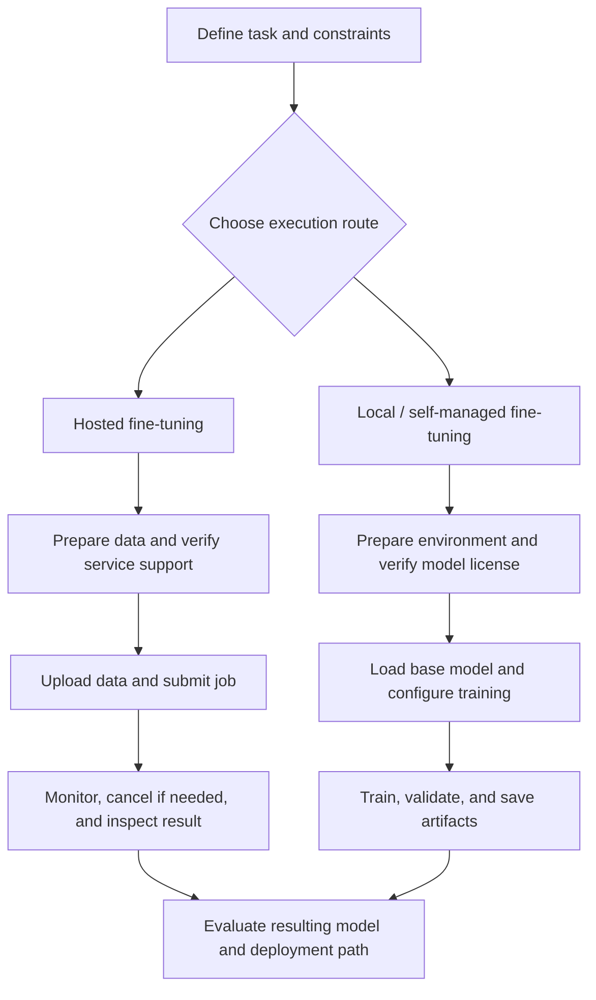
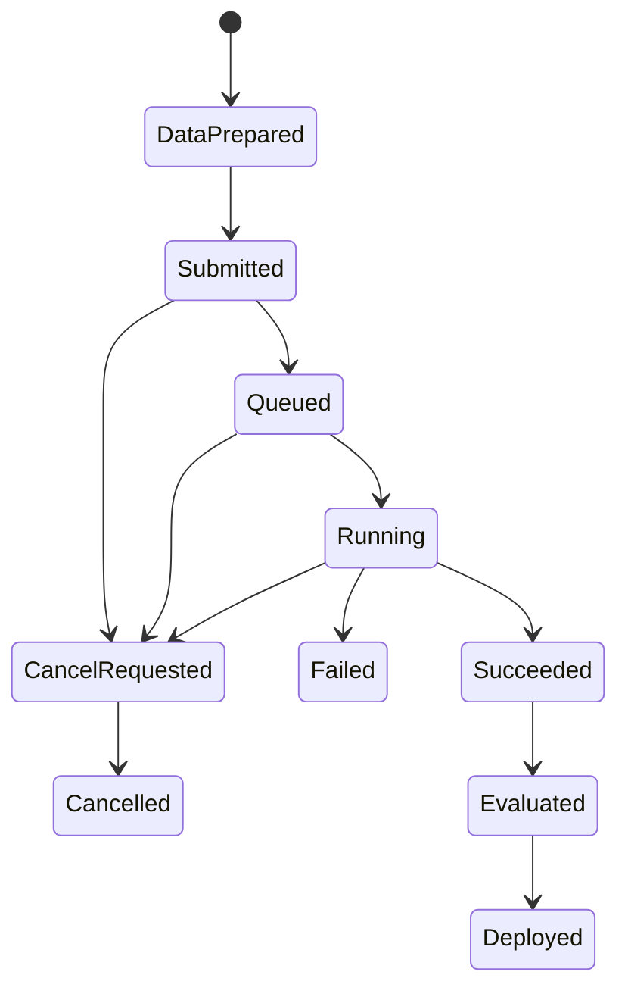
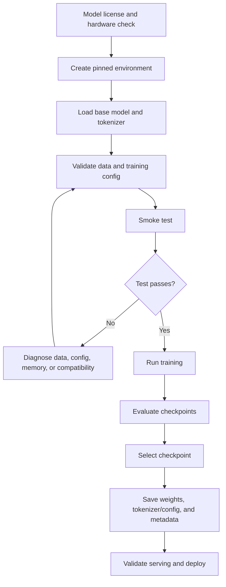

# Chapter 12: Hosted Fine-Tuning versus Local Fine-Tuning

## Learning Objectives

By the end of this chapter, you should be able to:

- Compare hosted and local fine-tuning across supported models, methods, data formats, controls, and artifact access.
- Trace a hosted workflow from data preparation and upload through job submission, status checks, cancellation, and resulting model identifiers.
- Trace a local workflow from environment setup through model loading, training, evaluation, and artifact saving.
- Compare hardware, cost, privacy, retention, licensing, and operational effort.
- Verify current service and framework capabilities instead of assuming that hosted and local platforms offer the same features.
- Explain which parts of training and deployment remain under application control.

 

## 1. Two Execution Routes

Fine-tuning can run on a managed hosted service or in an environment controlled by the developer or organization. The right choice depends on the supported base model and training method, data-handling requirements, available hardware, operational expertise, budget, and desired control over the resulting artifacts.

**Hosted fine-tuning** means a provider manages some or much of the training infrastructure and exposes a job-based interface or API. **Local fine-tuning** means the team runs training in its own environment—such as a workstation, private server, or organization-managed cloud GPU instance—using a compatible training stack.

“Local” does not necessarily mean a laptop or an offline computer. A self-managed cloud VM may count as local in the sense that the team controls the environment and training workflow.

This is a conceptual workflow. Actual steps, job states, APIs, model formats, and available controls vary by provider and framework.

 

## 2. Hosted Fine-Tuning

A hosted provider may manage GPU allocation, job scheduling, training infrastructure, and some artifact storage. The application team still needs to define the task, prepare and validate data, choose supported settings, monitor the job, evaluate the resulting model, and integrate it into an application.

### Typical hosted workflow

1. **Check current support.** Confirm the provider supports the intended base model, fine-tuning method, dataset format, region, and use case.
2. **Prepare data.** Validate examples, remove duplicates and disallowed sensitive data, define splits as supported, and conform to the provider's current schema.
3. **Upload or register data.** Use the provider's documented file or dataset mechanism. Confirm access permissions, retention behavior, and deletion controls.
4. **Submit the job.** Specify the base model, training data, supported hyperparameters, and other required configuration.
5. **Record the job identifier.** Store the identifier, configuration, dataset version, submission time, and any returned metadata.
6. **Monitor status.** Poll the documented job-status endpoint or inspect the service dashboard. Record failures and warnings.
7. **Cancel when appropriate.** Use the documented cancellation operation if the job exceeds the budget, is misconfigured, or is no longer needed. Cancellation behavior and billing cutoffs are provider-specific.
8. **Inspect the result.** Record the resulting model identifier or artifact reference, status, metrics, and available logs.
9. **Evaluate independently.** Test the resulting model on a held-out evaluation set and compare it with the base model.
10. **Deploy deliberately.** Configure access, monitoring, rollback, and application-level evaluation.

 

### Hosted workflow state diagram

This is a generic state model, not a guarantee that a specific provider uses these exact state names or transitions. Consult the current API documentation.

 

### What to record

- Provider and service/API version.
- Base-model identifier and supported revision, if exposed.
- Dataset/file identifiers and dataset version.
- Training configuration and any provider defaults.
- Job identifier and timestamps.
- Status history, errors, and cancellation result if relevant.
- Resulting model identifier or artifact reference.
- Evaluation results and deployment configuration.
- Retention and deletion settings.

Do not assume that hosted training exposes raw checkpoints, optimizer state, training logs, or every hyperparameter. Some services return a model identifier while hiding most infrastructure details; others expose more artifacts and controls.

 

## 3. Local or Self-Managed Fine-Tuning

A self-managed workflow gives the team more direct control over environment, training loop, files, checkpoints, and diagnostics. That control also creates responsibility for hardware provisioning, package compatibility, security, monitoring, storage, recovery, and reproducibility.

 

### Typical local workflow

1. **Check the model license and usage terms.** Confirm that training, redistribution, commercial use, and deployment are permitted for the intended use.
2. **Select hardware.** Estimate memory for base weights, activations, gradients, optimizer state, and runtime overhead.
3. **Create a reproducible environment.** Pin Python and relevant library versions; record CUDA/runtime and driver versions where applicable.
4. **Load the base model and tokenizer.** Record exact model and tokenizer revisions, and confirm the chat template.
5. **Prepare the dataset.** Validate schema, quality, splits, target masking, sequence length, and sensitive-data handling.
6. **Choose the method.** Select full fine-tuning, LoRA/PEFT, or a compatible quantized route such as QLoRA.
7. **Run a smoke test.** Verify that the forward pass, loss, gradients, optimizer update, checkpoint saving, and evaluation work.
8. **Train within resource limits.** Monitor loss, validation metrics, memory, runtime, and storage.
9. **Select a checkpoint.** Use a predefined validation-based rule; keep the final test set for final evaluation.
10. **Save artifacts and metadata.** Save adapter or model weights, configuration, tokenizer/template as required, and the exact training provenance.
11. **Evaluate and package.** Check task performance, regression cases, loading behavior, and serving compatibility.
12. **Deploy and maintain.** Handle serving infrastructure, monitoring, access control, rollback, and model updates.

 

### Local workflow diagram

The saved artifacts differ by training method. An adapter-only output normally depends on a compatible base model; a full or merged checkpoint may contain the adapted model weights. Save enough metadata to reconstruct the intended model.

 

## 4. Hosted vs. Local: Practical Comparison

| Dimension | Hosted fine-tuning | Local / self-managed fine-tuning |
|---|---|---|
| Supported models | Limited to provider's current catalog and eligibility rules | Depends on model architecture, license, hardware, and software support |
| Training methods | Only methods and controls exposed by the service | Potentially broader choice, subject to framework support and engineering effort |
| Data format | Provider-specific schema and validation rules | Chosen framework's schema and preprocessing pipeline |
| Infrastructure | Provider manages much of the training infrastructure | Team provisions and operates the environment |
| Hyperparameter control | May expose only a subset of settings | Often more direct control over the training loop and configuration |
| Logs and checkpoints | Visibility and artifact access vary by service | Usually greater control over logs and files, subject to framework configuration |
| Model artifact | May return a provider model ID or restricted artifact access | Can save adapters, checkpoints, and metadata directly |
| Up-front hardware work | Usually lower | Higher unless a suitable environment already exists |
| Cost model | May charge per job, token, training unit, or other provider-specific metric | Compute rental/purchase, storage, engineering time, and operations |
| Privacy and data handling | Depends on provider terms, retention, access controls, region, and configuration | More direct control, but the team must secure the infrastructure and data |
| Licensing | Must comply with provider terms and any base-model restrictions | Must comply with base-model license and all applicable obligations |
| Reproducibility | Depends on exposed configuration, logs, revisions, and artifact retention | Can be strong if environment, data, code, and model revisions are pinned |
| Operational effort | Lower infrastructure burden; service integration still required | Greater responsibility for setup, failures, security, serving, and maintenance |
| Portability | May depend on provider-specific model IDs or APIs | Depends on artifact format, framework, model license, and runtime compatibility |

Neither route is universally cheaper, safer, or more reproducible. Compare the full workflow, including data preparation, evaluation, deployment, monitoring, and ongoing maintenance—not just the training-job price.

 

## 5. Cost, Hardware, and Operational Feasibility

### Hosted cost

Potential cost factors include:
- Training-job pricing and minimum job duration.
- Data upload or storage.
- Evaluation and inference after training.
- Repeated experiments and failed jobs.
- Model hosting or endpoint charges.
- Egress, retention, or other provider-specific fees.

Verify the current pricing page and billing behavior before submission. A service's fine-tuning price may not include ongoing inference or dedicated endpoint costs.

 

### Local cost

Potential cost factors include:
- GPU rental or hardware purchase and depreciation.
- GPU hours for smoke tests, experiments, and final training.
- Persistent storage and backups.
- Data transfer and artifact retention.
- Engineering and operations time.
- Deployment hardware and serving infrastructure.

A local GPU can be inexpensive for repeated experiments if already available, but underpowered hardware may increase training time or prevent the chosen method from running. A cloud GPU that the team manages can still incur significant costs if it remains idle.

 

### Feasibility checklist

Before choosing a route, answer:
1. Is the intended base model supported and legally usable?
2. Does the route support the required method and dataset schema?
3. Can the data be transferred or stored under the applicable privacy and retention rules?
4. Are the required artifacts and logs available?
5. Can the expected workload finish within the budget?
6. Can the resulting model be evaluated and deployed in the intended runtime?
7. Is there a recovery and rollback path?

 

## 6. Privacy, Retention, and Licensing

These are distinct questions; do not collapse them into a single “private” or “open” label.

### Data privacy and retention

For hosted training, check:
- What data is uploaded and who can access it.
- Whether data is retained after job completion.
- Available deletion controls and timing.
- Whether provider terms allow the intended processing.
- Applicable region, organizational policy, and contractual requirements.
- Whether logs or outputs can contain sensitive training content.

For local training, check:
- Access control for datasets and artifacts.
- Encryption and secure storage.
- Logs, crash dumps, and temporary files.
- Backups and deletion procedures.
- Access to shared GPUs, notebooks, and model directories.

Self-managed training can provide more control over where data is processed, but it does not automatically make a workflow secure or compliant.

 

### Model licensing and use rights

Check the license and terms for the base model, any training data, and any resulting artifact. Verify whether the intended fine-tuning, commercial deployment, redistribution, or publication is permitted. A hosted service accepting a model or dataset does not by itself prove that all intended uses are authorized.

 

## 7. Current Capabilities Must Be Verified

Hosted services and local frameworks evolve independently. A feature available in a local training library may not be exposed by a hosted service. A hosted service may also offer managed workflows or supported model families that are difficult to reproduce in a self-managed setup.

Before making a decision, consult current documentation for:
- Supported base models and regions.
- Supported fine-tuning methods and hyperparameters.
- Input data formats and validation rules.
- Job submission, status, cancellation, and failure handling.
- Resulting model identifiers and artifact access.
- Checkpoint, log, and metrics availability.
- Retention, deletion, privacy, and pricing terms.
- Inference API compatibility and deployment restrictions.

 

### Example verification sources

- OpenAI's current fine-tuning documentation: [Fine-tuning guide](https://platform.openai.com/docs/guides/fine-tuning)
- OpenAI API reference for fine-tuning jobs: [Fine-tuning jobs](https://platform.openai.com/docs/api-reference/fine-tuning)
- Hugging Face TRL SFT Trainer: [SFTTrainer documentation](https://huggingface.co/docs/trl/sft_trainer)
- Hugging Face PEFT: [PEFT documentation](https://huggingface.co/docs/peft/index)
- Hugging Face Transformers: [Transformers documentation](https://huggingface.co/docs/transformers/index)

These are starting points for verification, not a claim that every listed service or framework supports the same models, formats, controls, or workflows. Check the current pages for the exact provider, account, model, and software versions you plan to use.

 

## 8. What Remains Under Application Control?

A managed service can operate the training infrastructure, but the application team still owns the decisions and responsibilities that determine whether the model is appropriate for use.

### Typically application-controlled or application-owned

- Task definition and acceptance criteria.
- Data rights, data quality, data splits, and preprocessing decisions.
- Choice among currently supported models and training options.
- Validation design and held-out test-set discipline.
- Selection of the resulting model or checkpoint.
- Application prompts, retrieval, tools, orchestration, and business logic.
- Safety checks, output validation, authorization, and fallback behavior.
- Deployment integration, access control, monitoring, and rollback.
- Cost limits and decisions to continue or cancel experiments.
- Documentation of model provenance, limitations, and intended use.

 

### Often provider-managed in a hosted route

- GPU provisioning and job scheduling.
- Training infrastructure and some orchestration.
- Some low-level implementation details and service operations.
- Artifact hosting or model-ID management, according to service design.

 

### Often team-managed in a local route

- Runtime and dependency versions.
- Hardware and memory configuration.
- Training loop and low-level optimization choices.
- Checkpoint files, logs, artifact storage, and backups.
- Serving infrastructure and operations.

The boundary is not absolute. A provider may expose more or fewer controls, and a local team may use managed cloud infrastructure. Document the actual division of responsibility for the selected route.

 

## 9. Practice: Choose a Route and Document an Alternative

Use the following decision worksheet.

| Decision factor | Your requirement |
|---|---|
| Intended task and success metric | |
| Candidate base model and license | |
| Required training method | |
| Dataset size and sensitivity | |
| Required data location/retention | |
| Required checkpoint/log access | |
| Available hardware or hosted budget | |
| Serving environment | |
| Operational expertise available | |
| Primary route and rationale | |
| Feasible alternative route | |
| Main risk and mitigation | |

 

### Example decision patterns

These are conditional examples, not universal recommendations:

- A hosted route may be attractive when the provider supports the intended model and method, the data-handling terms are acceptable, and infrastructure setup needs to be minimized.
- A local or self-managed route may be attractive when the required model/method is not available in a hosted service, detailed artifact control is needed, or data-handling rules require a particular environment—provided the team can operate it securely.
- A hybrid approach may use local data preparation and evaluation with hosted training, or local training with a managed inference service, if the interfaces, terms, and deployment requirements allow it.

 

### Practice questions

1. What should be checked before uploading a dataset to a hosted fine-tuning service?
2. Why is a resulting model identifier not the same thing as a complete reproducibility record?
3. What additional responsibilities come with local fine-tuning?
4. Why can hosted training still require application-side evaluation and safety controls?
5. Which features must be re-verified when a provider or framework changes its service?

 

## 10. Checkpoint: Explain the Lifecycle Boundary

A strong answer should explain that:

- The provider or self-managed environment performs the training computation according to the selected configuration.
- The application team remains responsible for defining the task, preparing authorized and representative data, and setting success criteria.
- Job submission and status monitoring do not replace validation or final testing.
- The resulting model ID or adapter artifact must be recorded with its provenance and evaluated before deployment.
- Deployment integration, access control, output validation, monitoring, fallback, rollback, and application-specific safety remain responsibilities that must be explicitly assigned.
- Hosted and local routes differ in operational control and artifact access; neither should be assumed to provide feature parity with the other.

 

### Mini-assignment

Write a one-page execution plan for your chosen route. Include:
- Base model and current support/license evidence.
- Data format and handling requirements.
- Training configuration and estimated budget.
- Submission or local-run procedure.
- Monitoring, cancellation, and failure-recovery procedure.
- Artifact and provenance records.
- Validation and final test plan.
- Deployment owner, rollback plan, and ongoing operational responsibilities.
- One feasible alternative route and the conditions that would trigger switching.

 

## 11. Essential References

- [OpenAI — Fine-tuning guide](https://platform.openai.com/docs/guides/fine-tuning)
- [OpenAI API — Fine-tuning jobs reference](https://platform.openai.com/docs/api-reference/fine-tuning)
- [Hugging Face TRL — Supervised Fine-Tuning Trainer](https://huggingface.co/docs/trl/sft_trainer)
- [Hugging Face PEFT documentation](https://huggingface.co/docs/peft/index)
- [Hugging Face Transformers documentation](https://huggingface.co/docs/transformers/index)

Always verify current supported models, methods, formats, controls, retention, pricing, and artifact access for the specific service and versions you plan to use.

 

## Summary

Hosted fine-tuning reduces infrastructure work but may constrain model choice, training controls, and artifact access. Local or self-managed fine-tuning offers more direct control over the environment and artifacts, while requiring more engineering and operational responsibility. Both routes require authorized data, careful configuration, validation, final testing, provenance records, and deliberate deployment. The exact feature set must be verified against current provider and framework documentation rather than assumed.
