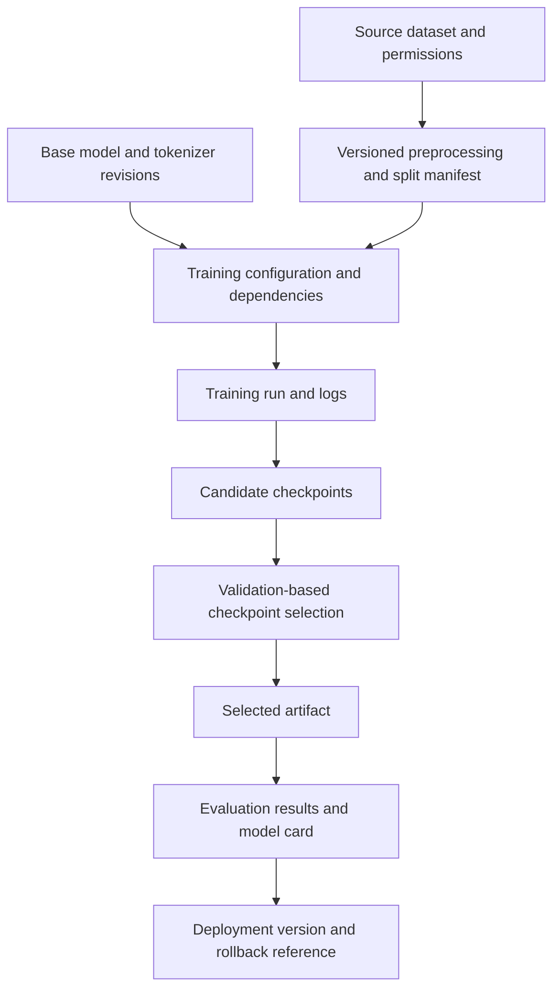

# Chapter 13: Model Checkpoints, Versioning, and Reproducibility

## Learning Objectives

By the end of this chapter, you should be able to:

- Version datasets, split manifests, prompts/templates, configurations, and dependencies.
- Record base-model revisions, tokenizer versions, adapters, seeds, and hardware.
- Distinguish a resumable training checkpoint from an inference-ready artifact.
- Identify when optimizer and scheduler state must be preserved.
- Store evaluation results alongside artifact identifiers while protecting sensitive data.
- Explain sources of nondeterminism and avoid promising exact reproducibility across all environments.
- Create an experiment manifest that links source data to a selected checkpoint and its evaluation results.

<br/>

## 1. Why Versioning and Reproducibility Matter

Fine-tuning produces more than a set of weights. The result depends on the base model, tokenizer, data, splits, prompt or chat template, training configuration, software stack, hardware, random seeds, and evaluation procedure.

If one of these components changes, the resulting model or reported metrics may change. Versioning makes it possible to answer questions such as:

- Which dataset and split produced this model?
- Which base-model revision was used?
- Which training configuration and dependencies were active?
- Which checkpoint was selected, and why?
- Which evaluation run produced the reported metrics?
- Can the training process be resumed, or can the artifact only be loaded for inference?

**Reproducibility is a documented chain of evidence**, not just a random seed or a filename. A useful record links source inputs, processing steps, training run, selected artifact, and evaluation outputs.



The diagram is a conceptual provenance chain. Store identifiers or immutable references at each stage so that the relationship can be audited later.


<br/>


## 2. What Should Be Versioned?

### 2.1 Data and split manifests

Record:
- Dataset identifier, version, source, and permission/provenance information.
- Data extraction and preprocessing code revision.
- Deduplication and filtering rules.
- Train/validation/test split assignments or a reproducible split manifest.
- Dataset schema and data-format version.
- Any transformations, synthetic-data generation, or label corrections.
- Checksums or stable record identifiers where appropriate.

A random seed alone is not always enough to recreate a split. Changes in row order, filtering, dataset versions, library behavior, or grouping logic can produce different partitions. For sensitive datasets, store only the minimum metadata needed and protect record-level identifiers.

<br/>

### 2.2 Base model and tokenizer

Record:
- Exact base-model ID.
- Immutable revision, commit hash, or provider version where available.
- Tokenizer ID and revision if separate.
- Chat template or prompt template, including version or hash.
- Special-token configuration and relevant tokenizer settings.
- Model configuration and any custom model code required to load it.

A mutable reference such as `main` can point to a different revision later. Prefer immutable revision identifiers when supported.

<br/>

### 2.3 Training configuration

Record the effective values, not only the intended settings:
- Fine-tuning method: full fine-tuning, LoRA, QLoRA, or another supported method.
- Trainable parameter strategy and target modules.
- Learning rate, optimizer, scheduler, warmup, epochs, maximum steps.
- Microbatch size, gradient accumulation, and distributed device count.
- Maximum sequence length, truncation, padding, packing, and loss masking.
- Precision, quantization, gradient checkpointing, and gradient clipping.
- Evaluation strategy, metrics, checkpoint interval, and selection rule.
- Output format and save options.

Save the resolved configuration printed by the framework when possible. Defaults can change across versions, and a configuration file may omit values that were filled in automatically.

<br/>

### 2.4 Dependencies and hardware

Record:
- Python version and key package versions.
- Training framework and version.
- PyTorch or other tensor framework version.
- CUDA/runtime and driver versions where applicable.
- Quantization, attention, and accelerator libraries.
- Operating system and relevant environment settings.
- GPU model/count and distributed-training configuration.
- Code repository commit and any uncommitted changes.

A hardware record helps explain performance differences and compatibility constraints. It does not guarantee that the same result will be reproduced on different hardware.


<br/>


## 3. A Checkpoint Is Not Necessarily a Deployment Artifact

The word **checkpoint** can refer to different saved states. Always inspect the framework's save format and contents.

### 3.1 Resumable training checkpoint

A resumable checkpoint is designed to continue a training run. Depending on the framework and save settings, it may contain:
- Model or adapter weights.
- Optimizer state.
- Learning-rate scheduler state.
- Trainer progress, including global step and epoch position.
- Mixed-precision gradient-scaler state, if used.
- Random-number generator states, where saved.
- Distributed-training or other framework-specific state.

Not every checkpoint contains every item. Confirm the framework's resume requirements and the files actually saved.

<br/>

### 3.2 Inference-ready artifact

An inference-ready artifact is packaged to load the trained model for generation or prediction. Depending on the method, it may contain:
- Full updated model weights, or an adapter artifact plus a compatible base model.
- Model and adapter configuration.
- Tokenizer files and chat template, when required.
- Generation defaults or serving metadata.
- Any other files required by the chosen runtime.

An inference-ready artifact may omit optimizer state, scheduler state, and training progress because they are not normally required to generate predictions.

<br/>

### 3.3 Comparison

| Component | Resumable training checkpoint | Inference-ready artifact |
|---|---|---|
| Model/adapter weights | Usually required | Required in a loadable form |
| Optimizer state | Needed for faithful continuation when supported | Normally not needed |
| Scheduler state and global step | Needed to continue the planned schedule correctly | Normally not needed |
| RNG state | Helpful for continuation; availability varies | Not normally needed |
| Tokenizer/chat template | Needed if training resumes through the same input pipeline; may be stored separately | Needed for many model-serving workflows |
| Training data and split manifest | Must remain available to reproduce the run; not necessarily embedded in checkpoint | Not normally bundled, but provenance should reference them |
| Evaluation report | Useful for checkpoint selection and audit | Useful for deployment decisions and monitoring |
| Base model dependency | May be required for adapter-based training | May be required for adapter-only inference |

The categories can overlap: one directory may contain both training and inference artifacts. The distinction is about purpose and completeness, not a universal file layout.


<br/>


## 4. Resuming Training Correctly

Saving only model weights is not always sufficient to resume training in a way that follows the original optimization trajectory.

For example, Adam-like optimizers maintain internal state such as moving averages of gradients. A learning-rate scheduler may depend on the current global step. Mixed-precision training may maintain a gradient-scaler state. A training framework may also save RNG states or sampler progress.

If those states are missing, a framework may still let you load the weights and start a new training phase, but that is not necessarily equivalent to resuming the original run.

<br/>

### Before resuming, verify:

1. The model or adapter checkpoint matches the intended base model and architecture.
2. Optimizer and scheduler states are present if the run is meant to continue them.
3. The global step, epoch position, and scheduler progress are restored correctly.
4. The data and split manifest are unchanged, or changes are documented.
5. Tokenizer, chat template, preprocessing, and label masking match the intended setup.
6. Package versions and relevant hardware/runtime settings are recorded.
7. The resume command actually loads training state rather than only model weights.

Some frameworks do not guarantee exact continuation even when state is saved. Distributed data loading, nondeterministic kernels, worker states, or version changes may prevent bit-for-bit replay.


<br/>


## 5. Experiment Manifest: Link Inputs to Results

An **experiment manifest** is a structured record of the components used to produce a model artifact. It should link the data and code versions to the training run, selected checkpoint, and evaluation results.

A practical manifest can be stored as YAML or JSON in version control, subject to data-security rules.

<br/>

### Example YAML manifest

The values below are placeholders. Replace them with the actual immutable identifiers and measured results from your experiment.

```yaml
experiment:
  id: "sft-2026-001"
  purpose: "Instruction-following fine-tuning"
  created_at: "YYYY-MM-DD"
  code:
    repository: "YOUR_REPOSITORY"
    commit: "YOUR_GIT_COMMIT"
    working_tree_clean: true

data:
  source_id: "YOUR_DATASET_ID"
  version_or_hash: "YOUR_DATASET_VERSION_OR_HASH"
  preprocessing_commit: "YOUR_PREPROCESSING_COMMIT"
  schema_version: "v1"
  split_manifest: "splits/sft-2026-001.json"
  train_count: 0
  validation_count: 0
  test_count: 0
  permissions_reviewed: true

base_model:
  id: "YOUR_BASE_MODEL_ID"
  revision: "IMMUTABLE_REVISION"
  tokenizer_id: "YOUR_TOKENIZER_ID"
  tokenizer_revision: "IMMUTABLE_REVISION"
  chat_template_version: "TEMPLATE_VERSION_OR_HASH"

training:
  method: "lora"
  config_file: "configs/sft.yaml"
  config_hash: "CONFIG_HASH"
  seed: 42
  max_sequence_length: 1024
  precision: "RECORD_ACTUAL_PRECISION"
  optimizer: "RECORD_OPTIMIZER"
  learning_rate: "RECORD_VALUE"
  epochs: 1
  max_steps: "RECORD_VALUE"
  microbatch_size: 1
  gradient_accumulation_steps: 8
  target_modules:
    - "RECORD_ACTUAL_MODULE"
  lora_rank: 8
  lora_alpha: 16

environment:
  python: "RECORD_VERSION"
  torch: "RECORD_VERSION"
  transformers: "RECORD_VERSION"
  peft: "RECORD_VERSION"
  cuda_runtime: "RECORD_VERSION_OR_NA"
  gpu: "RECORD_GPU_MODEL"
  gpu_count: 1

artifacts:
  run_id: "YOUR_RUN_ID"
  selected_checkpoint: "PATH_OR_ARTIFACT_ID"
  artifact_type: "adapter-only"
  base_model_dependency: "YOUR_BASE_MODEL_ID@IMMUTABLE_REVISION"
  checkpoint_hash: "CHECKSUM_IF_AVAILABLE"

evaluation:
  dataset_version: "YOUR_EVALUATION_SET_VERSION"
  selection_metric: "YOUR_PREDEFINED_METRIC"
  selected_checkpoint_metric: "RECORD_MEASURED_VALUE"
  test_metrics:
    task_accuracy: null
    schema_validity: null
  report_path: "reports/sft-2026-001-evaluation.json"

reproducibility:
  deterministic_settings: "RECORD_ENABLED_SETTINGS"
  known_nondeterminism: "RECORD_KNOWN_LIMITATIONS"
  notes: "RECORD_DEVIATIONS_AND_ASSUMPTIONS"
```

This is a template, not a validated schema for a specific training framework. Choose explicit data types and schema validation for your project. Do not include API keys, credentials, raw sensitive examples, or other secrets in the manifest.


<br/>


## 6. Link the Manifest to Real Artifacts

A manifest is only useful if its references resolve to actual files or immutable service identifiers.

Recommended practices:
- Store configuration files and training code in version control.
- Store split manifests and dataset version identifiers in a controlled location.
- Use immutable base-model and tokenizer revisions where possible.
- Give each training run a unique ID.
- Save logs and metrics with the run ID.
- Record the selected checkpoint path or hosted model identifier.
- Calculate file checksums for artifacts where useful.
- Link the evaluation report to the exact artifact evaluated.
- Record whether the artifact is adapter-only, merged, or full-model.
- Preserve a known-good prior model for rollback.

For large model files, version control systems may be unsuitable for storing the actual weights. Use an artifact registry or versioned object storage and put immutable references and checksums in the manifest.

<br/>

### Example provenance chain

```text
dataset version + split manifest
            |
            v
preprocessing code commit
            |
            v
base model revision + tokenizer/template
            |
            v
resolved training configuration + environment
            |
            v
training run ID + logs + checkpoints
            |
            v
selected artifact ID + checksum
            |
            v
evaluation report + deployment version
```

Every arrow should be supported by a record or immutable reference rather than relying on memory or a filename alone.


<br/>

## 7. Evaluation Results and Artifact Identity

Evaluation reports should identify exactly what was evaluated. At minimum, record:
- Model artifact ID or checkpoint path.
- Base-model ID and revision.
- Adapter ID/configuration if applicable.
- Evaluation dataset version and split.
- Prompt/chat template and decoding settings.
- Metric names, values, and implementation versions where relevant.
- Run date and code revision.
- Known limitations and failure examples.
- Whether metrics came from validation, test, or production monitoring.

Do not report a metric without identifying the evaluation data and artifact that produced it. Two reports with the same model name may refer to different revisions, adapters, or prompts.

<br/>

### Protect sensitive data

- Avoid storing raw private examples in public manifests or model cards.
- Use access-controlled locations for datasets, logs, and checkpoints.
- Review whether generated logs can expose training examples.
- Keep credentials and access tokens outside configuration files.
- Apply retention and deletion rules to temporary artifacts and backups.
- Use aggregate metrics or stable opaque identifiers when record-level details are unnecessary.

Model weights and adapters can themselves retain or reveal information from training data in some circumstances. Treat them according to the sensitivity and risk of the source data and your applicable policies.


<br/>

## 8. Reproducibility Is Not Always Bit-for-Bit

Setting a random seed is useful, but it does not guarantee identical results in every environment.

Sources of variation can include:
- Nondeterministic GPU kernels or parallel reductions.
- Different GPU architectures or numerical precision.
- Different versions of PyTorch, CUDA, Transformers, PEFT, or quantization libraries.
- Distributed training order and communication behavior.
- Data-loader shuffling, worker state, or changed dataset ordering.
- Changes to tokenizer, chat template, preprocessing, or defaults.
- Floating-point rounding and kernel implementation differences.
- Different checkpoint-save/resume behavior.

<br/>

### Three useful reproducibility goals

1. **Artifact reproducibility:** the exact saved artifact can be identified and loaded again.
2. **Procedural reproducibility:** the documented code, data, configuration, and environment can be used to rerun the process.
3. **Result reproducibility:** reruns produce results sufficiently close for the intended scientific or engineering purpose.

These goals are related but distinct. An artifact can be loadable even if the original training run cannot be exactly recreated. A rerun can be procedurally faithful without producing bit-identical weights.

Document nondeterminism and compare outcomes using meaningful tolerances and task-level metrics. Avoid claiming exact reproducibility unless it has been established under the stated conditions.


<br/>

## 9. Practice: Create an Experiment Manifest

For your fine-tuning experiment, create a manifest and link it to:
- Source dataset and permission/provenance record.
- Dataset version or checksum.
- Train/validation/test split manifest.
- Preprocessing code revision.
- Base-model and tokenizer revisions.
- Prompt/chat template version.
- Resolved training configuration.
- Dependency and hardware record.
- Training run ID and logs.
- Resumable checkpoint, if retained.
- Selected inference artifact.
- Evaluation report and metric definitions.
- Deployment version and rollback reference.

<br/>

### Suggested directory structure

```text
fine-tuning-experiment/
├── README.md
├── manifest.yaml
├── configs/
│   └── sft.yaml
├── data/
│   └── README.md
├── splits/
│   └── split-manifest.json
├── src/
│   └── train.py
├── reports/
│   ├── training-metrics.json
│   └── evaluation-report.json
├── artifacts/
│   └── README.md
└── environment/
    ├── requirements-lock.txt
    └── hardware-and-runtime.md
```

This layout is illustrative. Large datasets and model weights can live in protected artifact storage; the repository can contain references, manifests, and checksums rather than copies.

<br/>

### Practice questions

1. Why is a random seed alone insufficient to reproduce a dataset split?
2. Which state is needed to resume an optimizer and learning-rate schedule correctly?
3. Why might an inference-ready adapter not be sufficient to resume training?
4. What metadata should accompany a metric in an evaluation report?
5. Why can two runs with the same seed differ across hardware or library versions?


<br/>


## 10. Checkpoint: Load vs. Resume

### To load an artifact for inference, you generally need

- The model weights in a supported full-model or adapter format.
- The exact compatible base model and revision if the artifact is adapter-only.
- Model/adapter configuration.
- Tokenizer and chat template where required.
- A compatible runtime and necessary dependency versions.
- Any serving configuration required to reproduce expected behavior.

<br/>

### To resume training, you additionally need

Depending on the framework and desired fidelity:
- Optimizer state.
- Scheduler state and current step.
- Trainer progress and epoch position.
- Gradient-scaler state if applicable.
- RNG and sampler state where saved and supported.
- The same or explicitly versioned training data and split.
- Preprocessing, tokenizer/template, and loss-mask behavior.
- Training configuration and compatible software environment.
- Distributed-training state where relevant.

A model-weight file can be enough to start a new fine-tuning phase, but that is not necessarily a faithful resumption of the prior run.

<br/>

### Mini-assignment

Pick one saved artifact and answer:
1. Can it be loaded for inference on its own?
2. If not, which exact base model and revision does it require?
3. Which tokenizer/template and runtime dependencies are needed?
4. Is optimizer/scheduler state present?
5. Can training resume from the saved global step?
6. Which data, split, and configuration versions produced it?
7. Which evaluation report belongs to this exact artifact?
8. What known nondeterminism or missing metadata limits reproduction?


<br/>


## 11. Essential References

- [Hugging Face Transformers — Trainer checkpoints and training arguments](https://huggingface.co/docs/transformers/main_classes/trainer)
- [Hugging Face Accelerate — Checkpointing](https://huggingface.co/docs/accelerate/usage_guides/checkpoint)
- [Hugging Face PEFT documentation](https://huggingface.co/docs/peft/index)
- [MLflow Tracking](https://mlflow.org/docs/latest/ml/tracking/)
- [DVC documentation](https://dvc.org/doc)
- [PyTorch — Reproducibility](https://pytorch.org/docs/stable/notes/randomness.html)

Check the current version-specific documentation for checkpoint contents, resume semantics, deterministic settings, and artifact formats.


<br/>


## Summary

Reliable fine-tuning requires a versioned chain from source data and split manifest to model revisions, configuration, environment, training run, selected artifact, and evaluation report. A resumable checkpoint may include optimizer, scheduler, progress, and random-state information that an inference-ready artifact does not need. Preserve sensitive data appropriately, record known nondeterminism, and avoid claiming bit-for-bit reproducibility across different environments without evidence.
