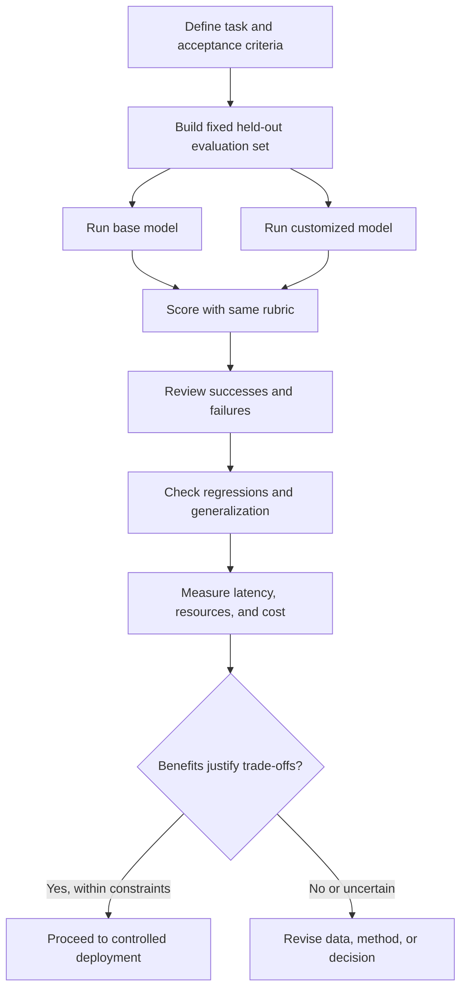

# Chapter 14: Evaluation Before and After Fine-Tuning

## Learning Objectives

By the end of this chapter, you should be able to:

- Compare a base model and a customized model on the same held-out cases and rubric.
- Keep prompts, decoding settings, and token budgets matched where appropriate, documenting necessary template differences.
- Measure correctness, format compliance, task quality, and critical regressions.
- Test unrelated/generalization cases and unsupported requests.
- Report latency, resource usage, and cost separately from output quality.
- Explain uncertainty caused by a small evaluation set and avoid overstating results.
- Produce a side-by-side results table with reviewed successes and failures.
- Decide whether measured improvement justifies training and serving costs.

 

## 1. Why Evaluate Before and After Fine-Tuning?

Fine-tuning introduces cost, complexity, and potential regression risk. To determine whether it helped, compare the original **base model** with the **customized model** using a consistent evaluation protocol.

A before-and-after evaluation should answer four questions:

1. **Did the target task improve?** Measure the behavior fine-tuning was intended to change.
2. **Did critical behavior regress?** Check important capabilities that must remain intact.
3. **Does the improvement generalize?** Test paraphrases, boundary cases, unfamiliar inputs, and unsupported requests.
4. **Is the improvement worth the cost?** Consider training cost, inference cost, latency, operational complexity, and maintenance.

Do not infer success from a lower training loss, a few appealing examples, or a model's self-assessment. Use a documented set of held-out cases and inspect actual outputs.

 

## 2. Establish a Fair Comparison

### 2.1 Use the same held-out cases

The base and customized models should be evaluated on the same cases, with the same expected answers or scoring rubric. Keep this set separate from the training examples and avoid using the final test set repeatedly to guide training decisions.

The evaluation set should reflect the intended use:
- Common target-task examples.
- Paraphrases and varied input lengths.
- Boundary cases and missing or ambiguous information.
- Relevant subdomains and less frequent cases.
- Required output formats.
- Unsupported or out-of-scope requests.
- Regression cases for important capabilities that fine-tuning must preserve.

For high-impact decisions, use enough examples and coverage to support the claims you want to make. A tiny set can reveal obvious failures but cannot establish broad reliability.

 

### 2.2 Match the evaluation conditions

Keep the following aligned when possible:
- User input and task instructions.
- System prompt and other application context.
- Decoding parameters, such as temperature, top-p, and maximum output tokens.
- Tool availability and tool definitions.
- Retrieval context and external data, if used.
- Evaluation code, rubric, and scoring procedure.
- Hardware/runtime conditions for performance comparisons.

 

### 2.3 Document required template differences

A customized model may require a particular chat template, special tokens, or provider-specific request format. If the base and customized models cannot use exactly the same template, document the difference and use the correct supported format for each.

The goal is a fair application-level comparison, not forcing incompatible models into an invalid input format. Separate model effects from template effects as far as practical.

 

### 2.4 Avoid accidental advantages

A comparison can be misleading if one model receives more context, a larger token budget, different tools, or a more carefully written prompt. Record all such differences and explain why they were necessary.

 

## 3. Define the Evaluation Rubric Before Running Models

A rubric states what counts as success. Define it before inspecting the results to reduce the temptation to change criteria in favor of one model.

### Example rubric dimensions

| Dimension | What it measures | Example scoring approach |
|---|---|---|
| Correctness | Whether the answer is factually or logically correct for the task | Exact match, task-specific metric, or reviewed score |
| Task completion | Whether the response satisfies the request | Pass/fail or anchored rating |
| Format compliance | Whether output follows a required schema or structure | JSON/schema validation, required-field checks |
| Grounding | Whether claims are supported by supplied evidence when required | Evidence check or citation review |
| Robustness | Whether performance holds across paraphrases and edge cases | Grouped metrics by case type |
| Unsupported-request behavior | Whether the model abstains, clarifies, or refuses when appropriate | Policy/task-specific rubric |
| Critical regression | Whether important unrelated behavior has degraded | Fixed regression suite and severity review |

Not every task needs every dimension. Select measures that correspond to application requirements and state the scoring rules precisely.

 

### Define pass/fail thresholds

Examples of acceptance criteria might include:
- Task accuracy improves by at least a predefined amount.
- Structured output validity stays above a required threshold.
- No critical regression appears in a must-pass suite.
- Latency remains under the application service-level objective.
- Inference cost stays within a specified budget.

These thresholds must come from the application's needs; they are not universal defaults.

 

## 4. Measure Quality Separately from Operational Cost

Quality and operational performance answer different questions. Report them in separate sections so a faster model is not mistaken for a more accurate model, or vice versa.

### Quality measures

Depending on the task, consider:
- Exact match or accuracy.
- Precision, recall, and F1 for classification/extraction.
- Valid JSON or schema-compliance rate.
- Task-specific success rate.
- Human-reviewed rubric scores.
- Groundedness or evidence-support rate.
- Failure rate on critical or unsupported cases.
- Performance by subgroup, domain, input length, or difficulty.

For generative tasks, exact match may be too strict or too weak. Choose task-appropriate metrics and review representative examples manually.

 

### Operational measures

Record separately:
- End-to-end latency, including relevant network or provider overhead.
- Time to first token and generation throughput when applicable.
- Input/output tokens or other billable units.
- Estimated or measured inference cost per request.
- Peak memory and accelerator use for local serving.
- Training duration and training cost.
- Model load time, artifact size, and operational complexity.

Use the same workload and measurement conditions when comparing latency and resource use. Report whether values are measured, estimated, or derived from provider pricing.

 

## 5. Side-by-Side Evaluation Table

Use one row per evaluation case or one row per metric, and retain enough detail to inspect failures.

### Case-level results template

| Case ID | Case category | Expected behavior | Base model result | Customized model result | Base score | Customized score | Reviewer notes |
|---|---|---|---|---|---:|---:|---|
| E-001 | Common target task | | | | | | |
| E-002 | Paraphrase | | | | | | |
| E-003 | Edge case | | | | | | |
| E-004 | Required format | | | | | | |
| E-005 | Unsupported request | | | | | | |
| E-006 | Regression test | | | | | | |

Do not put sensitive raw user data in an unsecured report. Use approved examples, redacted content, or controlled references where needed.

 

### Aggregate results template

| Metric | Base model | Customized model | Difference | Acceptance threshold | Pass? |
|---|---:|---:|---:|---:|---|
| Primary task metric | | | | | |
| Format compliance | | | | | |
| Robustness cases | | | | | |
| Unsupported-request behavior | | | | | |
| Critical regression suite | | | | | |
| Median latency | | | | | |
| High-percentile latency | | | | | |
| Estimated inference cost/request | | | | | |
| Artifact size / serving memory | | | | | |

Define the sign of “Difference” for each metric. For metrics where lower is better, a negative difference may represent improvement; for metrics where higher is better, a positive difference may represent improvement.

 

## 6. Review Successes and Failures, Not Just Scores

Aggregate metrics can hide important failure patterns. Review a representative sample of:
- Cases where both models succeed.
- Cases where both models fail.
- Cases where the customized model succeeds and the base model fails.
- Cases where the base model succeeds and the customized model fails.
- Critical failures, regardless of average score.
- Cases with disagreement between automatic and human evaluation.

 

### Failure categories to record

- Incorrect answer or unsupported claim.
- Instruction not followed.
- Invalid or incomplete structured output.
- Missing clarification or inappropriate abstention.
- Over-refusal or under-refusal relative to the task requirements.
- Template dependence or sensitivity to paraphrasing.
- Regression on an unrelated capability.
- Truncation or token-budget failure.
- Tool, retrieval, or integration failure.

When possible, classify the failure by likely stage—data, prompt/template, training objective, decoding, evaluation, or serving integration—rather than assuming every failure is a model-weight problem.

 

## 7. Test Generalization and Unsupported Requests

Fine-tuning may improve a target task while narrowing the model's behavior. Include tests that challenge the learned pattern without merely repeating training examples.

### Generalization checks

- Rephrase the same request using different wording.
- Vary the order and amount of context.
- Include uncommon but valid values.
- Test long inputs near the configured sequence limit.
- Include missing, conflicting, or ambiguous information.
- Test related tasks the base model handled well.
- Check whether the customized model overuses a training-specific response template.

 

### Unsupported or out-of-scope requests

Define what the application should do when the model lacks sufficient information or the request falls outside its scope. Depending on the application, desired behavior may be to:
- Ask a clarifying question.
- State uncertainty.
- Abstain.
- Refuse a disallowed request.
- Escalate to a human or a trusted system.

Evaluate these cases using explicit expected behavior. Do not assume that a fluent answer is correct or that every refusal is appropriate.

 

## 8. Small Test Sets and Uncertainty

A small evaluation set can produce unstable estimates. A change from 8 successes out of 10 to 9 out of 10 is not, by itself, strong evidence of a broad improvement. The uncertainty depends on sample size, case selection, metric properties, and dependence among examples.

 

### Practical precautions

- Report the numerator and denominator for rates, not only percentages.
- Break results down by important case categories.
- Use paired comparisons: the same cases are evaluated by both models.
- Review individual disagreements and critical failures.
- If the evaluation set is small, label results as preliminary.
- Expand the set before making broad reliability claims.
- Where appropriate, use confidence intervals or bootstrap methods, taking care that related examples are not treated as independent observations.

A large number of near-duplicate examples does not necessarily provide broad coverage. Diversity and relevance matter as much as raw count.

 

### Example

Suppose a base model passes 18 of 25 cases and a customized model passes 20 of 25. This is a two-case difference on a small set. It may justify further investigation, but it does not by itself establish a reliable improvement across all real-world use.

The figures are illustrative only. Avoid claiming statistical significance unless an appropriate analysis supports it.

 

## 9. Cost-Benefit Decision

Fine-tuning is justified when the measured gains solve a real application problem and outweigh the added costs and risks.

### Benefit categories

- Higher target-task success.
- More consistent output formatting.
- Reduced manual correction or downstream validation work.
- Lower reliance on long prompts or repeated examples, where demonstrated.
- Improved latency or cost only if measured in the actual serving path.
- Better fit to a stable style or task pattern.

 

### Cost and risk categories

- Data preparation and annotation.
- Training compute and repeated experiments.
- Model hosting or inference cost.
- Evaluation and monitoring.
- Artifact/version management.
- New failure modes or lost base-model capabilities.
- Vendor dependency or serving constraints.
- Privacy, licensing, and governance work.

 

### A decision framework

1. **Reject** if a critical safety, correctness, or format requirement fails.
2. **Investigate further** if improvements are small, uncertain, or limited to a narrow subset.
3. **Proceed to a controlled pilot** if predefined quality thresholds are met and no critical regressions appear.
4. **Deploy more broadly only after** integration, load, monitoring, rollback, and ongoing evaluation requirements are satisfied.

A fine-tuned model does not need to win every metric. It does need to meet the application's required constraints, and trade-offs should be explicit.

 

## 10. Practice: Produce a Before-and-After Report

Create a report containing:

### Experiment metadata
- Base-model identifier and revision.
- Customized model or adapter identifier.
- Dataset and evaluation-set versions.
- Prompt/chat templates and decoding settings.
- Training configuration and selected checkpoint rule.
- Evaluation code and scoring rubric versions.

 

### Results
- Case-level side-by-side output table.
- Aggregate quality metrics with counts/denominators.
- Operational measurements in a separate table.
- Reviewed successes, failures, and critical regressions.
- Results for paraphrases, edge cases, and unsupported requests.
- Limitations and uncertainty.

 

### Decision
- Which predefined thresholds passed or failed?
- Does the customized model improve the target task?
- Are any regressions unacceptable?
- Is the sample large and diverse enough for the proposed claim?
- Do training and serving costs fit the expected benefit?
- Should the next step be rejection, another experiment, a pilot, or deployment?

 

### Practice questions

1. Why should the base and customized models use the same held-out cases?
2. When might different chat templates be necessary, and how should that difference be handled?
3. Why should latency and cost be reported separately from correctness?
4. How can a model with a higher average score still be unacceptable?
5. What can and cannot be concluded from a small evaluation set?

 

## 11. Checkpoint: Does Improvement Justify the Cost?

A complete decision should include:

- **Measured improvement:** a defined target metric improves on the same held-out cases.
- **Quality constraints:** format compliance, critical correctness, unsupported-request behavior, and important regression tests meet thresholds.
- **Generalization:** gains hold across representative paraphrases, edge cases, and relevant subdomains.
- **Uncertainty:** sample size, coverage, paired differences, and limitations are stated honestly.
- **Operational trade-offs:** latency, resource usage, training cost, and inference cost are reported separately.
- **Deployment readiness:** integration, monitoring, rollback, and safety controls are in place.
- **Decision rationale:** benefits justify costs under the application’s stated requirements—not merely because the customized model has lower training loss.

 

### Mini-assignment

Write a one-page recommendation using the side-by-side table. Choose one: reject, run another experiment, begin a controlled pilot, or prepare for deployment. Cite the measured results, list critical failures, explain uncertainty, and state the largest remaining risk.

 

## 12. Essential References

- [Hugging Face Transformers — Trainer and evaluation](https://huggingface.co/docs/transformers/main_classes/trainer)
- [Hugging Face TRL — Supervised Fine-Tuning Trainer](https://huggingface.co/docs/trl/sft_trainer)
- [OpenAI — Fine-tuning guide](https://platform.openai.com/docs/guides/fine-tuning)
- [Scikit-learn — Model evaluation](https://scikit-learn.org/stable/modules/model_evaluation.html)
- [Scikit-learn — Model selection and cross-validation](https://scikit-learn.org/stable/modules/cross_validation.html)

Use the metrics and evaluation tooling that match your task. Check current documentation for the exact model and framework version.

 

## Summary

A meaningful before-and-after evaluation compares the base and customized models on the same held-out cases with a predefined rubric and appropriately matched conditions. Measure target-task quality, format compliance, generalization, unsupported-request behavior, and critical regressions. Track latency, resource use, training cost, and inference cost separately. Review actual successes and failures, report uncertainty honestly, and proceed only when measured benefits satisfy the application's requirements and justify the additional training and serving costs.
