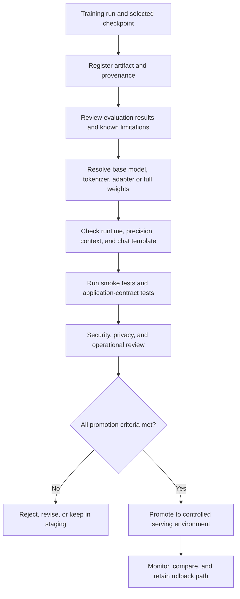

# Chapter 15: Deployment Considerations for Customized Models

## Learning Objectives

By the end of this chapter, you should be able to:

- Load the intended base-model revision, tokenizer, and adapter or full checkpoint.
- Verify serving-library support, precision, context settings, and chat formatting.
- Validate outputs against the same application contracts used for the baseline.
- Run smoke tests and compatibility checks before promoting a candidate.
- Plan artifact access control, rollback, model versioning, and monitoring.
- Discuss privacy, retention, deletion, and possible training-data memorization in model artifacts.
- Prepare an inference script and deployment checklist for a selected artifact.
- Explain why a training result is a candidate for review—not automatic approval for production.

<br/>

## 1. From Training Result to Serving Candidate

A successful training run does not automatically produce a production-ready model. Training metrics describe behavior under a training or evaluation setup; deployment adds constraints involving loading, runtime compatibility, application interfaces, security, latency, cost, privacy, and operational reliability.

A customized model should pass a controlled promotion process:



The goal is to make the candidate **reviewable, reproducible, testable, and reversible** before it receives production traffic.


<br/>


## 2. Identify the Exact Artifact to Load

Before serving, establish precisely which files and revisions constitute the model.

### 2.1 Full checkpoint versus adapter

A **full fine-tuned checkpoint** contains the model weights required for inference, along with configuration and potentially tokenizer files.

An **adapter checkpoint** contains parameter-efficient fine-tuning weights, such as LoRA weights, that must be loaded with the compatible base model. The adapter alone is generally not a complete standalone model.

For an adapter-based artifact, record:
- Exact base-model identifier and revision.
- Adapter identifier and immutable revision or checksum.
- Tokenizer identifier and revision.
- Model configuration and any required special tokens.
- Adapter configuration, including target modules and rank where relevant.
- Required library versions and supported loading procedure.

For a full checkpoint, record its weight files, model configuration, tokenizer assets, and any required custom code or dependencies.

<br/>

### 2.2 Pin revisions rather than relying on a moving default

A model repository may change over time. Pin an immutable commit or revision where the hosting platform supports it. Record artifact checksums when appropriate. Avoid assuming that the repository's latest version is the same version used in training or evaluation.

<br/>

### 2.3 Example: load a full checkpoint

The following example uses Hugging Face Transformers. Replace the placeholder model ID and revision with the reviewed artifact values.

```python
import torch
from transformers import AutoModelForCausalLM, AutoTokenizer

MODEL_ID = "your-org/your-reviewed-model"
MODEL_REVISION = "your-immutable-commit-or-revision"

tokenizer = AutoTokenizer.from_pretrained(
    MODEL_ID,
    revision=MODEL_REVISION,
)

model = AutoModelForCausalLM.from_pretrained(
    MODEL_ID,
    revision=MODEL_REVISION,
    torch_dtype=torch.float16,  # Use only if supported by the hardware/model.
    device_map="auto",
)

model.eval()
```

Precision and device placement must match the model, runtime, and hardware. `float16` is an example, not a universal recommendation; `bfloat16`, `float32`, or quantized loading may be more appropriate in a particular environment.

<br/>

### 2.4 Example: load a LoRA adapter

```python
import torch
from transformers import AutoModelForCausalLM, AutoTokenizer
from peft import PeftModel

BASE_MODEL_ID = "your-org/your-base-model"
BASE_REVISION = "your-pinned-base-revision"
ADAPTER_ID = "your-org/your-reviewed-adapter"
ADAPTER_REVISION = "your-pinned-adapter-revision"

tokenizer = AutoTokenizer.from_pretrained(
    BASE_MODEL_ID,
    revision=BASE_REVISION,
)

base_model = AutoModelForCausalLM.from_pretrained(
    BASE_MODEL_ID,
    revision=BASE_REVISION,
    torch_dtype=torch.float16,
    device_map="auto",
)

model = PeftModel.from_pretrained(
    base_model,
    ADAPTER_ID,
    revision=ADAPTER_REVISION,
)

model.eval()
```

**Important:** The base model must be compatible with the adapter. An adapter trained against a different base revision or architecture may fail to load or produce incorrect behavior. Follow the artifact's documented requirements and verify the result with known test cases.


<br/>


## 3. Verify Serving Compatibility

Deployment compatibility is more than whether the model file can be opened.

### Compatibility checklist

| Area | What to verify | Typical failure |
|---|---|---|
| Architecture | Serving runtime supports the model architecture and required operations | Unsupported model class or operator |
| Base revision | Correct base weights are used for an adapter | Adapter mismatch |
| Tokenizer | Correct tokenizer revision, vocabulary, and special tokens | Token IDs or output decoding differ |
| Chat template | The expected message roles, delimiters, and end-of-turn tokens are used | Poor instruction following or malformed turns |
| Precision | Chosen dtype or quantization is supported and validated | Runtime errors, memory problems, quality loss |
| Context length | Configured context limit is compatible with the model and serving engine | Truncation or rejected requests |
| Generation limits | Output-token limit and stopping behavior are correct | Incomplete or excessively long output |
| Dependencies | Framework, CUDA/runtime, and adapter-library versions are compatible | Import, kernel, or loading errors |
| Device placement | Model fits available CPU/GPU memory | Out-of-memory failure |
| API contract | Inputs, outputs, errors, and timeouts match application expectations | Integration failures |

Use the serving engine's documented support matrix rather than assuming every Transformers model or adapter works in every runtime.


<br/>


## 4. Chat Formatting and Tokenization

A model can load successfully and still behave incorrectly if messages are serialized in the wrong format.

### 4.1 Prefer the tokenizer's supported chat template

For chat models, use the tokenizer's configured template when available:

```python
messages = [
    {"role": "system", "content": "Answer clearly and accurately."},
    {"role": "user", "content": "Explain what fine-tuning changes."},
]

inputs = tokenizer.apply_chat_template(
    messages,
    tokenize=True,
    add_generation_prompt=True,
    return_tensors="pt",
)
```

The exact arguments and returned structure can vary by Transformers version and model. Inspect the model's documentation and test the template used during training and evaluation.

If using `tokenize=False`, ensure the later tokenization step does not add duplicated special tokens. Incorrectly duplicated delimiters can alter behavior.

<br/>

### 4.2 Preserve application-level message contracts

The application should specify:
- Allowed roles and required fields.
- How conversation history is assembled.
- Whether tool calls are supported and how they are represented.
- How the prompt is terminated and generation begins.
- How output tokens are decoded and validated.
- How empty, truncated, or malformed outputs are handled.

Do not silently change the system prompt or message format during deployment without evaluating the resulting behavior.


<br/>


## 5. Inference Smoke Test

A **smoke test** is a small, fast check that confirms the artifact loads and can perform a basic inference. It does not prove quality, safety, or production readiness.

Example for a compatible causal language model:

```python
import torch

messages = [
    {"role": "user", "content": "Return a one-sentence definition of fine-tuning."}
]

inputs = tokenizer.apply_chat_template(
    messages,
    tokenize=True,
    add_generation_prompt=True,
    return_tensors="pt",
)

# For device_map='auto', use the model's input device where appropriate.
inputs = inputs.to(model.device)

with torch.inference_mode():
    output_ids = model.generate(
        inputs,
        max_new_tokens=100,
        do_sample=False,
    )

new_tokens = output_ids[0, inputs.shape[-1]:]
print(tokenizer.decode(new_tokens, skip_special_tokens=True))
```

This is an illustrative pattern. With sharded models, custom device maps, encoder-decoder architectures, or other serving runtimes, input placement and output slicing may need adjustment. Test the exact serving path, not just an isolated notebook.

<br/>

### Minimum smoke-test cases

1. A common target-task request.
2. A request requiring the expected output format.
3. An edge case or ambiguous input.
4. An unsupported request with defined expected behavior.
5. A sufficiently long input to test truncation/context handling.
6. A regression case that the base model previously handled correctly.

Confirm that the process exits cleanly, produces non-empty output, stays within resource limits, and emits no unexpected errors.


<br/>


## 6. Validate the Application Contract

A model response is not valid merely because it is fluent. The output must satisfy the contract expected by downstream software.

For structured output, validate against a schema:

```python
import json
from jsonschema import validate

schema = {
    "type": "object",
    "properties": {
        "label": {"type": "string"},
        "confidence": {"type": "number"},
    },
    "required": ["label", "confidence"],
    "additionalProperties": False,
}

raw_output = '{"label": "positive", "confidence": 0.91}'

parsed = json.loads(raw_output)
validate(instance=parsed, schema=schema)
```

This example validates a JSON string. In a real application, handle parse errors and schema-validation errors explicitly. If the model may emit explanatory text around JSON, define a reliable extraction or constrained-decoding strategy instead of assuming the output is valid.

Contract tests should check:
- Required keys and types.
- Valid enum values and ranges.
- Missing, extra, or malformed fields.
- Error and timeout handling.
- Output length and truncation.
- Any required citations, identifiers, or tool-call structures.
- Compatibility with downstream components.

Run the same application-contract tests for the baseline and customized model, then compare results.


<br/>


## 7. Access Control and Artifact Security

Model artifacts and their supporting files may be sensitive or operationally important.

### Recommended controls

- Store artifacts in an approved registry or object store.
- Restrict write access to authorized training and release processes.
- Restrict read access to teams and workloads that need the artifacts.
- Use least-privilege identities for training and serving.
- Protect credentials and avoid embedding secrets in configuration files.
- Record artifact provenance, checksums, approvals, and deployment history.
- Scan dependencies and any custom loading code.
- Treat downloaded model files and custom code as untrusted until reviewed.
- Keep audit logs for access and promotion actions.
- Separate development, staging, and production permissions.

Do not enable unsafe deserialization or execute repository-provided custom code without reviewing the trust implications and following the serving platform's security guidance.


<br/>


## 8. Versioning, Promotion, and Rollback

A deployment should identify an exact serving bundle rather than a vague label such as `latest`.

### Version the complete bundle

Record:
- Model or adapter ID and immutable revision.
- Base-model revision when using an adapter.
- Tokenizer and chat-template revision.
- Runtime and dependency versions.
- Precision/quantization settings.
- Context and generation configuration.
- Application code and API-contract version.
- Evaluation report and approval record.
- Artifact checksums and deployment timestamp.

<br/>

### Promotion stages

A practical progression is:

1. **Candidate:** training artifact registered; evaluation report attached.
2. **Validated:** loading, compatibility, and contract tests pass.
3. **Staging:** tested in an environment resembling production.
4. **Canary or limited rollout:** small, controlled traffic exposure where appropriate.
5. **Production:** approved for the intended scope, with monitoring and rollback available.

Passing one stage does not automatically authorize the next. Promotion criteria should be explicit and owned by the appropriate reviewers.

<br/>

### Rollback plan

Before rollout, identify:
- The last known-good model bundle.
- How to switch traffic or restore the previous revision.
- Whether application code and schema changes are backward compatible.
- How to detect a regression quickly.
- Who can trigger rollback and how the event is recorded.

A rollback should restore a complete compatible bundle—not only the weight files.


<br/>


## 9. Monitoring After Deployment

Offline evaluation cannot represent every production input. Monitor behavior after promotion, within applicable privacy and retention constraints.

### Useful monitoring signals

| Category | Examples |
|---|---|
| Availability | Error rate, failed loads, timeout rate |
| Latency | Median and high-percentile response time |
| Resource use | GPU/CPU memory, utilization, queue depth |
| Usage and cost | Request volume, token usage, cost per request |
| Contract quality | Invalid schema rate, empty outputs, truncation rate |
| Task quality | Audited success rate, user corrections, human-review outcomes |
| Regression | Changes in predefined evaluation cases or sampled outputs |
| Safety and privacy | Policy violations, sensitive-data exposure, inappropriate retention |

Define alerts around application-specific thresholds. Compare monitoring results against a baseline and account for changes in traffic mix, prompts, retrieval data, and application code.

Do not log all prompts and outputs by default. Use data minimization, redaction, access controls, retention limits, and an approved sampling policy.


<br/>


## 10. Training Data, Privacy, Retention, and Deletion

Fine-tuning can encode information from training examples into model parameters. It is not safe to assume that removing a row from the training dataset automatically removes its influence from a trained artifact.

<br/>

### Key considerations

- **Data minimization:** avoid training on sensitive data unless there is a justified, authorized need.
- **Authorization and licensing:** verify that the data may be used for the intended training and deployment purpose.
- **Retention:** define how long source datasets, intermediate files, logs, checkpoints, and final artifacts are kept.
- **Access:** restrict who can inspect raw data, training logs, and artifacts.
- **Deletion:** document which copies must be deleted and how deletion is verified.
- **Memorization risk:** evaluate whether the model reproduces sensitive or distinctive training content.
- **Incident response:** define actions if sensitive information is exposed in model outputs.
- **Unlearning/retraining:** when deletion obligations apply to learned information, determine whether retraining, targeted unlearning, or another reviewed process is necessary; do not assume a simple data-file deletion is sufficient.

Privacy obligations depend on the data, jurisdiction, contract, and deployment context. Involve the appropriate privacy, legal, and security reviewers rather than treating a technical cleanup as proof of compliance.

<br/>


## 11. Deployment Checklist

Use this checklist before promoting a customized model.

### Artifact identity
- [ ] Exact model/adapter revision is pinned.
- [ ] Correct base model is selected for an adapter.
- [ ] Tokenizer and special-token configuration match the reviewed artifact.
- [ ] Artifact integrity and provenance are recorded.
- [ ] Required configuration and dependencies are versioned.

<br/>

### Runtime compatibility
- [ ] Serving library supports the architecture and adapter method.
- [ ] Precision/quantization is supported and tested.
- [ ] Context and output-token limits are configured.
- [ ] Chat template and stopping behavior are validated.
- [ ] Memory and device placement fit the target environment.

<br/>

### Quality and contract
- [ ] Smoke test completes successfully.
- [ ] Baseline application-contract tests pass.
- [ ] Target-task and regression cases have been evaluated.
- [ ] Structured outputs are validated, not merely printed.
- [ ] Unsupported and ambiguous inputs have expected behavior.
- [ ] Known limitations are documented.

<br/>

### Security and operations
- [ ] Artifact access follows least privilege.
- [ ] Secrets are not embedded in model files or source control.
- [ ] Privacy, licensing, retention, and deletion requirements are reviewed.
- [ ] Monitoring and alert thresholds are defined.
- [ ] A known-good rollback bundle is available.
- [ ] Promotion owner and approval criteria are documented.


<br/>


## 12. Practice: Prepare an Inference Script and Release Record

For your selected artifact, prepare:

1. A minimal inference script using the pinned model or base-plus-adapter revisions.
2. A configuration record containing tokenizer, template, precision, context, and generation settings.
3. Smoke tests for common, structured, edge, unsupported, and regression cases.
4. Automated validation for the application output contract.
5. A deployment checklist with pass/fail evidence.
6. A rollback record identifying the previous known-good bundle.
7. A privacy note describing data retention, deletion, access, and memorization risks.

<br/>

### Suggested release record

| Field | Value |
|---|---|
| Candidate ID | |
| Base-model revision | |
| Full checkpoint or adapter revision | |
| Tokenizer/template revision | |
| Runtime and dependency versions | |
| Precision and context configuration | |
| Evaluation report reference | |
| Smoke/contract test result | |
| Known limitations | |
| Privacy/security review | |
| Rollback bundle | |
| Decision and reviewer | |


<br/>


## 13. Checkpoint: Why Is a Training Result Not Automatically Production-Ready?

A training result becomes a reviewable serving candidate when its identity, provenance, evaluation evidence, runtime requirements, and limitations are documented. It becomes eligible for promotion only after the required checks pass.

A strong explanation should cover:

- **Identity:** the exact base revision, tokenizer, adapter or full checkpoint, and configuration are known.
- **Compatibility:** the target serving library, precision, context length, and chat format work together.
- **Behavior:** smoke tests, application-contract tests, task evaluations, and regression checks pass.
- **Security:** access, dependencies, credentials, and artifact provenance are controlled.
- **Privacy:** training-data retention, deletion, and memorization implications have been reviewed.
- **Operations:** monitoring, versioning, approval, and rollback are ready.
- **Governance:** a responsible reviewer makes the promotion decision against explicit criteria.

<br/>

### Mini-assignment

Write a short release recommendation for your selected artifact. State which checks passed, which remain unresolved, what evidence supports promotion, and what would trigger rejection or rollback. Do not label the model production-ready solely because training completed or offline scores improved.


<br/>


## 14. Essential References

- [Hugging Face Transformers — Loading models](https://huggingface.co/docs/transformers/models)
- [Hugging Face Transformers — Chat templates](https://huggingface.co/docs/transformers/chat_templating)
- [Hugging Face PEFT — Loading adapters](https://huggingface.co/docs/peft/main/en/package_reference/peft_model)
- [Hugging Face Transformers — Generation strategies](https://huggingface.co/docs/transformers/generation_strategies)
- [OpenAI — Production best practices](https://platform.openai.com/docs/guides/production-best-practices)
- [NIST — AI Risk Management Framework](https://www.nist.gov/itl/ai-risk-management-framework)

Framework interfaces and hosting capabilities change over time. Consult the current documentation for the selected model, serving engine, and library versions.


<br/>


## Summary

Deployment requires more than loading trained weights. Identify the exact base revision, tokenizer, adapter or full checkpoint; verify runtime, precision, context, and chat formatting; test inference and application contracts; and establish artifact access controls, versioning, monitoring, and rollback. Review privacy, retention, deletion, and memorization risks. A training result is a **candidate for controlled review**, not automatic approval for production.
