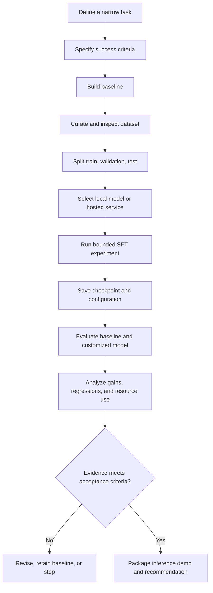
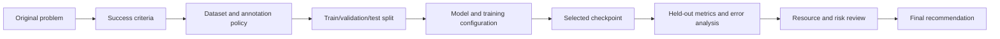

# Chapter 16: Guided Fine-Tuning Project

## Learning Objectives

By the end of this chapter, you should be able to:

- Select a narrow task and define a measurable baseline.
- Build a small, reviewed instruction dataset with isolated train, validation, and test sets.
- Choose a suitable small local model or supported hosted fine-tuning service.
- Run a bounded supervised fine-tuning (SFT) experiment, using LoRA or QLoRA only when appropriate and supported.
- Compare the customized artifact with the baseline using held-out evidence.
- Record regressions, resource use, and limitations.
- Save reproducible artifacts and create an inference demonstration.
- Trace a final recommendation back to the original problem, dataset, configuration, and evaluation evidence.

<br/>

## 1. Project Overview

This chapter brings together the customization workflow from earlier chapters. The goal is not to train a foundation model from scratch. It is to customize an existing model for one narrowly scoped task, then determine whether the evidence justifies using the resulting artifact.

<br/>

### Project workflow



The sequence matters: define the problem and success criteria before choosing training settings. Otherwise, it is easy to optimize a metric that does not represent the actual application need.


<br/>


## 2. Choose One Narrow Task

Select a task that can be demonstrated with a small dataset and evaluated consistently.

Possible project tasks include:
- Classifying short support messages into a fixed set of categories.
- Converting unstructured notes into a fixed JSON schema.
- Rewriting short text into a specified style.
- Extracting a few fields from short, non-sensitive records.
- Answering questions using information explicitly supplied in each prompt.

For this guided project, use a small **support-message classification task**. The model receives a message and returns one label from a fixed set:

- `billing`
- `technical`
- `account`
- `other`

This task is suitable for demonstrating data preparation, instruction formatting, SFT, structured output validation, and baseline comparison. It is illustrative: replace the labels and examples with a task that is relevant to your own project.

<br/>

### Define the task contract

**Input:** One short support message.

**Output:** Exactly one permitted label, with no additional explanation.

**Success criteria:** The output is a valid label, and held-out classification performance improves over the baseline without unacceptable regressions or resource costs.

<br/>

### Write down the scope

Before training, document:
- Intended user and use case.
- Input assumptions and maximum input length.
- Permitted output labels and format.
- Out-of-scope inputs and expected fallback behavior.
- Primary metric and minimum acceptable result.
- Latency, memory, time, and cost limits.
- Risks that require human review.

A narrow contract makes it easier to identify whether the model actually learned the intended behavior.


<br/>

## 3. Establish a Baseline

A baseline is the reference system against which customization is measured. It may be the original model with a carefully designed prompt, a rule-based classifier, or an existing application model.

For this project, use the selected base model with an instruction prompt but **without fine-tuning**. Keep the same label definitions, test cases, and output-validation logic when comparing the baseline and customized model.

<br/>

### Example baseline prompt

```text
Classify the support message into exactly one label:
billing, technical, account, other.

Return only the label.

Message: I was charged twice for the same order.
Label:
```

Do not use test examples to repeatedly tune the prompt or training settings. Make decisions on the training and validation data, and reserve the test set for final comparison.

<br/>

### Baseline measurements

Record:
- Exact base-model revision and tokenizer.
- Prompt and generation configuration.
- Accuracy and per-class precision/recall/F1 where appropriate.
- Invalid-output rate.
- Latency and resource use.
- Representative successes and failures.

For imbalanced classes, accuracy alone can be misleading. Report per-class metrics and macro-F1 when each category matters comparably.


<br/>


## 4. Curate the Instruction Dataset

A fine-tuning dataset should encode the task contract consistently. Each example should contain a realistic input and a correct target response.

### Example records

| Input message | Target label |
|---|---|
| I was charged twice for my order. | `billing` |
| The application crashes when I open settings. | `technical` |
| I cannot reset my password. | `account` |
| Do you offer support on public holidays? | `other` |

These examples demonstrate the format only. They are not enough to train a useful model. A real experiment needs a broader, representative set of reviewed examples.

<br/>

### Data-quality checks

- Remove duplicates and near-duplicates where they would distort evaluation.
- Check labels against a written annotation policy.
- Include representative examples for every label.
- Include difficult but realistic examples, not only obvious cases.
- Remove or protect personal and confidential information.
- Check for contradictory labels and malformed records.
- Verify that training examples do not reveal the held-out test answers.
- Record the source, permitted use, and any transformations applied.

<br/>

### Avoid leakage

Do not split near-identical messages across training and test sets if that would make the test unrealistically easy. When examples come from the same customer, conversation, document, or source record, consider grouping by that source before splitting.


<br/>


## 5. Create Train, Validation, and Test Splits

The three splits serve different purposes:

- **Training set:** used to update model parameters.
- **Validation set:** used to compare configurations and select a checkpoint.
- **Test set:** held back for the final estimate of generalization.

An example split is 80% training, 10% validation, and 10% test, but the right split depends on dataset size, class distribution, source grouping, and the evaluation objective.

For classification, stratification may help preserve class proportions when it is compatible with the data structure. For grouped or time-dependent data, respect group or temporal boundaries instead of blindly applying a random split.

<br/>

### Split procedure

1. Define duplicate and grouping rules.
2. Split the examples once using a recorded seed.
3. Inspect label distribution in each split.
4. Confirm that related records do not leak across splits.
5. Freeze the test set before experimentation.
6. Use validation results to select settings or checkpoints.
7. Run final evaluation on the test set after choices are complete.

**Important:** A tiny test set produces a noisy estimate. Report the number of examples and interpret small metric differences cautiously.


<br/>


## 6. Select a Model and Training Route

Choose the simplest route that meets the task, privacy, and resource requirements.

### Decision guide

| Constraint | Possible route | Checks to perform |
|---|---|---|
| Need local control and suitable hardware | Small local model with SFT | Memory, license, architecture, runtime |
| Limited GPU memory and supported architecture | LoRA or QLoRA | Library support, quantization compatibility, quality |
| No suitable local hardware | Supported hosted fine-tuning service | Data policy, supported model, cost, retention, API limits |
| Baseline already meets requirements | No fine-tuning | Prefer the simpler baseline |
| Task depends on frequently changing facts | Retrieval or external data may be more suitable | Freshness, source quality, permissions |
| Need only deterministic label mapping | Rules or a small classifier may be sufficient | Maintenance and error profile |

Do not select LoRA or QLoRA merely because they are popular. Use them only when supported by the chosen model and runtime, and when their memory or training trade-offs are justified.

<br/>

### Record the model choice

Document:
- Model identifier and immutable revision.
- License and permitted use.
- Parameter count and expected memory requirements.
- Tokenizer and chat template.
- Local hardware or hosted service.
- Fine-tuning method and why it is appropriate.
- Estimated and actual cost/time budget.


<br/>


## 7. Format Examples for Supervised Fine-Tuning

Many chat fine-tuning workflows use conversation-style examples. The precise format depends on the training library or hosted provider.

An illustrative JSONL record may look like this:

```json
{"messages":[{"role":"system","content":"Classify each support message as billing, technical, account, or other. Return only one label."},{"role":"user","content":"I was charged twice for my order."},{"role":"assistant","content":"billing"}]}
```

Each line in a JSONL file is a separate JSON object. Validate the format against the selected training tool's current requirements before uploading or training.

<br/>

### Formatting principles

- Keep the task instruction consistent across examples unless instruction variation is intentional.
- Ensure targets follow the exact required output contract.
- Use the model's expected chat template and special tokens.
- Avoid adding explanations when the task requires a single label.
- Check that labels use consistent spelling and capitalization.
- Do not assume a provider's training schema is interchangeable with another provider's schema.


<br/>


## 8. Run a Bounded SFT Experiment

Set a resource budget before training. The experiment should be small enough to finish and inspect without uncontrolled iteration.

### Example experiment plan

The following values are illustrative starting points, not universal defaults.

| Setting | Example plan | Why it matters |
|---|---|---|
| Dataset | Reviewed, small instruction dataset | Limits scope and makes inspection manageable |
| Epochs | 1–3, subject to validation | More epochs can overfit small datasets |
| Learning rate | Start from a library/model-recommended range | Strongly affects stability and adaptation |
| Batch size | Fit within memory; use gradient accumulation if needed | Controls throughput and effective batch size |
| Max sequence length | Fit the actual task examples | Affects truncation, memory, and compute |
| Checkpoint selection | Select using validation evidence | Avoid selecting by training loss alone |
| Compute/time budget | Set a firm cap before launch | Prevents uncontrolled experimentation |
| Seed and versions | Record them | Improves reproducibility |

For local SFT, use a compatible training stack such as Transformers with the appropriate training utilities. For LoRA or QLoRA, verify the exact supported combination of model architecture, quantization library, PEFT version, and hardware before running the job.

For a hosted service, follow the provider's current data schema, model eligibility, training limits, billing, and data-handling terms. The same conceptual workflow applies, but APIs and configuration fields differ by provider.

<br/>

### Stop conditions

Stop or revise the experiment if:
- Training loss is unstable or the run repeatedly fails.
- Validation performance degrades consistently.
- Invalid outputs increase.
- The resource budget is exceeded.
- The selected checkpoint shows no meaningful improvement.
- A critical regression or privacy concern appears.

A completed run is not, by itself, evidence of a successful customization.


<br/>


## 9. Evaluate the Customized Artifact

Evaluate the selected checkpoint—not an arbitrary last checkpoint—against the same held-out cases and output contract used for the baseline.

### Core measurements

For the classification example, record:

- Accuracy.
- Per-class precision, recall, and F1.
- Macro-F1.
- Invalid-output rate.
- Latency.
- Peak memory or hosted resource usage.
- Training duration and cost.

Also inspect representative errors. Aggregate metrics may conceal a serious failure for one class.

<br/>

### Comparison table

Fill in actual measured values; do not use the illustrative placeholders as results.

| Measure | Baseline | Customized model | Difference |
|---|---:|---:|---:|
| Test accuracy | — | — | — |
| Macro-F1 | — | — | — |
| Invalid-output rate | — | — | — |
| Median latency | — | — | — |
| Peak memory / resource use | — | — | — |
| Training cost or duration | Not applicable | — | Not applicable |

A difference is meaningful only in relation to test-set size, uncertainty, task requirements, and operational costs. Small improvements on a tiny test set may not be reliable.

<br/>

### Error analysis

Classify failures into categories such as:
- Incorrect label.
- Invalid output format.
- Confusion between similar categories.
- Failure on ambiguous or out-of-scope inputs.
- Regression on a case previously handled correctly.
- Latency or resource-budget violation.

Use the analysis to determine whether the issue is data quality, task definition, prompt format, model capacity, training configuration, or a mismatch between fine-tuning and the real problem.


<br/>


## 10. Reproducibility and Artifact Packaging

Save enough information for another person to understand and reproduce the experiment.

### Suggested project structure

```text
guided-finetuning-project/
├── README.md
├── configs/
│   ├── experiment.yaml
│   └── inference.yaml
├── data/
│   ├── README.md
│   └── splits/
│       ├── train.jsonl
│       ├── validation.jsonl
│       └── test.jsonl
├── src/
│   ├── prepare_data.py
│   ├── train.py
│   ├── evaluate.py
│   └── inference.py
├── tests/
│   ├── test_output_contract.py
│   └── test_regression_cases.py
├── reports/
│   ├── baseline_metrics.json
│   ├── customized_metrics.json
│   ├── error_analysis.md
│   └── experiment_report.md
└── artifacts/
    └── model-or-adapter-reference.txt
```

This is a suggested structure, not a requirement to store every file locally. Keep large checkpoints in an approved artifact registry or model repository when appropriate. Avoid committing private datasets, credentials, or large weight files to source control.

<br/>

### Record the experiment configuration

At minimum, capture:
- Dataset version or fingerprint and split seed.
- Model and tokenizer revisions.
- Training library and dependency versions.
- Fine-tuning method and hyperparameters.
- Hardware, runtime, and precision/quantization.
- Training duration, resource usage, and cost.
- Checkpoint-selection rule.
- Evaluation code version and results.
- Known limitations and decision rationale.

A reproducible record does not guarantee bit-for-bit identical training across all hardware and software stacks, but it makes the experiment traceable and substantially easier to investigate.

<br/>


## 11. Create an Inference Demonstration

The demonstration should load the exact selected artifact and use the same input/output contract as evaluation.

For a Transformers-compatible causal model, the inference path generally includes:
1. Load the pinned model or base model plus adapter.
2. Load the compatible tokenizer.
3. Apply the correct chat template.
4. Generate with a recorded configuration.
5. Decode only the newly generated tokens.
6. Validate the output contract.
7. Report latency and errors.

The deployment chapter's loading examples can serve as a starting point. Adapt device placement, adapter loading, quantization, and chat formatting to the chosen model and runtime rather than copying code without compatibility checks.

<br/>

### Demonstration requirements

- Include at least one normal example and one edge case.
- Display the model/adapter revision used.
- Validate the output, not just print it.
- Report errors clearly without exposing secrets or sensitive data.
- Avoid presenting a few successful examples as proof of general quality.
- Make it easy to compare baseline and customized outputs on the same inputs.


<br/>


## 12. Resource Budget and Experiment Log

Define the budget before training. A resource budget can include GPU/CPU memory, wall-clock duration, number of runs, hosted training/inference cost, and evaluation effort.

### Experiment log template

| Item | Record |
|---|---|
| Experiment ID | |
| Task and success criterion | |
| Model/base revision | |
| Dataset version and split seed | |
| Fine-tuning method | |
| Configuration reference | |
| Hardware/runtime | |
| Training duration | |
| Peak memory | |
| Training cost | |
| Validation result and selected checkpoint | |
| Held-out test result | |
| Regression/error notes | |
| Final decision | |

Do not keep launching experiments simply because compute remains available. Each additional run should test a specific hypothesis, and the final test set should remain protected from iterative tuning.


<br/>


## 13. Final Recommendation: Keep, Revise, or Reject

Use evidence to make a decision.

### Keep the customized model when
- It improves the target task on held-out data by a meaningful amount.
- It meets output-contract and reliability requirements.
- It does not introduce unacceptable regressions.
- Its latency, memory, cost, and operational complexity fit the budget.
- Data rights, privacy, and artifact security requirements are satisfied.

<br/>

### Revise the experiment when
- Errors suggest fixable label inconsistency or data gaps.
- Validation evidence points to a configuration issue.
- Output formatting is the main failure mode.
- The model improves some classes but needs targeted investigation.

<br/>

### Keep the baseline or reject the candidate when
- Improvements are negligible or unsupported by the held-out evidence.
- Regressions outweigh the gains.
- Resource or serving requirements are impractical.
- The task is better handled by prompting, rules, retrieval, or a smaller task-specific model.
- A critical privacy, licensing, or security issue remains unresolved.

A decision may be “insufficient evidence” rather than a forced yes/no. Record what additional evidence would change the recommendation.


<br/>


## 14. Practice: Complete One End-to-End Experiment

Complete the following deliverables within your predefined resource budget:

- [ ] Define one narrow task and its output contract.
- [ ] Write success criteria and a baseline evaluation plan.
- [ ] Build and review a small instruction dataset.
- [ ] Create isolated train, validation, and test splits.
- [ ] Select a supported model and justify local or hosted execution.
- [ ] Run one bounded SFT experiment; use LoRA/QLoRA only if appropriate and supported.
- [ ] Select a checkpoint using validation evidence.
- [ ] Evaluate the selected artifact on the held-out test set.
- [ ] Compare quality, regressions, latency, memory, and cost with the baseline.
- [ ] Save configuration, versions, metrics, and error analysis.
- [ ] Create an inference demonstration that loads the exact selected artifact.
- [ ] Write a keep/revise/reject recommendation and state its limitations.


<br/>

## 15. Checkpoint: Trace the Recommendation to Evidence

Your final recommendation must be traceable through the complete chain:



Answer these questions in your report:

1. What specific problem was customization intended to solve?
2. How was success defined before training?
3. How were examples sourced, reviewed, and split?
4. Which model revision and training configuration were used, and why?
5. How was the checkpoint selected without using test results for tuning?
6. What changed compared with the baseline on held-out data?
7. Which regressions or limitations remain?
8. What compute, latency, memory, and cost did the experiment require?
9. Can another person identify the exact artifact and reproduce the evaluation?
10. What evidence would cause you to change the final recommendation?

<br/>

### Acceptance criterion

The project is complete when another reviewer can trace the recommendation to the original task, inspect the dataset and configuration, reproduce or verify the evaluation, see the inference demonstration, and understand both the benefits and the remaining risks.


<br/>


## 16. Essential References

- [Hugging Face Transformers — Fine-tuning](https://huggingface.co/docs/transformers/training)
- [Hugging Face Transformers — Chat templates](https://huggingface.co/docs/transformers/chat_templating)
- [Hugging Face PEFT — Quicktour](https://huggingface.co/docs/peft/quicktour)
- [Hugging Face TRL — Supervised fine-tuning trainer](https://huggingface.co/docs/trl/sft_trainer)
- [scikit-learn — Model evaluation](https://scikit-learn.org/stable/modules/model_evaluation.html)
- [scikit-learn — Train/test split](https://scikit-learn.org/stable/modules/generated/sklearn.model_selection.train_test_split.html)
- [NIST — AI Risk Management Framework](https://www.nist.gov/itl/ai-risk-management-framework)

Check the current documentation for the specific model, library versions, and hosted service you choose. Supported architectures, training interfaces, and data-handling terms can change.


<br/>


## Summary

This guided project turns the fine-tuning concepts from earlier chapters into one controlled experiment. Start with a narrow task and a measured baseline; curate and split data carefully; select a compatible model and bounded SFT method; evaluate the selected checkpoint on held-out data; record quality, regressions, and compute needs; and package the exact artifact with a reproducible inference demo. The final recommendation must follow from the original problem and evidence—not from the fact that training completed.
