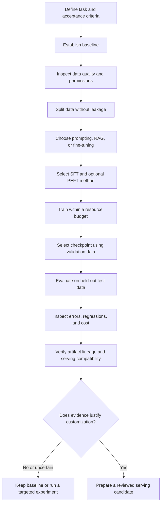

# Chapter 17: Practice and Revision

## Learning Objectives

By the end of this chapter, you should be able to:

- Compare prompting, retrieval-augmented generation (RAG), supervised fine-tuning (SFT), and parameter-efficient fine-tuning (PEFT).
- Explain how LoRA and QLoRA differ and when each may be appropriate.
- Review dataset quality, leakage prevention, training controls, and overfitting risks.
- Trace model and adapter artifacts through their lineage and verify serving compatibility.
- Compare a base model with a customized model using held-out evidence.
- Decide whether to retain, revise, or reject a customization.
- Recommend the next experiment based on observed failure modes rather than guesswork.

 

## 1. The Full Customization Workflow

This level covered the process of adapting an existing model to a defined task. The purpose of revision is to connect each technical decision to the problem it was intended to solve.

A reliable workflow begins with the task and baseline, not with a preferred fine-tuning technique. The chosen method should address a demonstrated limitation.

 

## 2. Compare the Main Adaptation Options

Prompting, RAG, and fine-tuning solve different problems. They can also be combined, but each additional component adds complexity that should be justified by evidence.

| Approach | What changes? | Best fit | Main limitations |
|---|---|---|---|
| Prompting | Instructions, examples, and input context | Task can be improved through clear instructions or a few examples | Limited control over persistent behavior; prompt length and sensitivity |
| RAG | Retrieved external information is added to the model's context | Answers depend on changing, private, or source-grounded knowledge | Retrieval quality, indexing, access control, and added latency |
| SFT | Model weights are updated using input-target examples | Repeated task behavior, response structure, style, or instruction following | Data and compute requirements; possible regressions or overfitting |
| PEFT | Only a small subset of parameters, or added parameters, is trained | Adaptation under tighter memory/storage budgets | Depends on architecture and implementation support; not always equal to full fine-tuning |
| LoRA | Trainable low-rank adapter updates are added to selected weight matrices | Parameter-efficient adaptation when supported by the model and training stack | Adapter/base compatibility and target-module choices matter |
| QLoRA | A quantized base model is used while training LoRA adapters | Reducing training memory for supported models and hardware | Quantization/runtime compatibility, quality trade-offs, and additional setup complexity |

 

### Key distinctions

- **SFT is a training objective/workflow:** supervised examples teach the model to produce target responses.
- **PEFT is a family of parameter-efficient methods:** LoRA is one prominent example.
- **LoRA** trains low-rank update matrices rather than directly updating all original model weights in the usual setup.
- **QLoRA** combines a quantized base model with trainable LoRA adapters to reduce memory requirements in supported configurations.
- **RAG changes the information supplied at inference time; fine-tuning changes model parameters.** RAG is often preferable when knowledge must be updated frequently or tied to retrievable sources.
- **Prompting is the simplest starting point.** If it meets the acceptance criteria, fine-tuning may not be necessary.

 

### Selection rule

Choose the least complex approach that satisfies the task's quality, privacy, latency, maintenance, and cost requirements. Do not fine-tune merely because a training workflow is available.

 

## 3. Data Quality and Leakage Prevention

The model learns from the examples and patterns represented in its training data. A larger dataset is not automatically better if its labels are inconsistent, its examples are unrepresentative, or its contents are unauthorized.

 

### Data-quality review

Check:
- Correctness and consistency of labels or target responses.
- Coverage of expected inputs, edge cases, and output formats.
- Duplicates, near-duplicates, malformed examples, and contradictory targets.
- Data provenance, licensing, and permitted use.
- Sensitive or confidential content and whether it is necessary.
- Consistency between training examples and the actual application contract.

 

### Split discipline

| Split | Purpose | Permitted use |
|---|---|---|
| Training | Update model parameters | Fit the model |
| Validation | Select settings and checkpoints | Compare experiments and decide when to stop |
| Test | Estimate final generalization | Final evaluation after decisions are fixed |

Leakage can occur when duplicate or near-duplicate records cross splits, when related records from one source are separated improperly, or when test outcomes influence repeated tuning. Choose splitting rules appropriate to the data—for example, by customer, conversation, document, or time period when those groupings matter.

**Revision question:** If the test score improves after you repeatedly change the prompt and hyperparameters in response to test errors, is it still an unbiased final estimate? Explain why the test set should remain held out.

 

## 4. Training Controls and Overfitting

A fine-tuning experiment needs controlled settings and a documented stopping/selection rule.

### Review these controls

- Learning rate and optimizer.
- Batch size and gradient accumulation.
- Number of epochs and training steps.
- Maximum sequence length and truncation behavior.
- Precision or quantization configuration.
- Random seed and dependency versions.
- Checkpoint frequency and validation schedule.
- Resource budget and stopping conditions.

 

### Recognize overfitting

Possible signals include:
- Training loss keeps decreasing while validation performance stalls or worsens.
- Validation performance improves and then degrades with further training.
- The model memorizes narrow examples but fails on new inputs.
- Output quality improves on familiar formats while robustness declines.
- The customized model regresses on capabilities outside the target task.

Training loss alone is not enough to select a checkpoint. Use validation evidence and inspect errors. Preserve the test set for the final comparison.

 

### Practical response to suspected overfitting

1. Check for leakage and duplicates first.
2. Inspect label quality and coverage.
3. Compare training and validation curves.
4. Try fewer epochs or a lower learning rate where justified.
5. Improve representative training examples rather than blindly increasing dataset size.
6. Re-evaluate on the untouched test set after the experiment is finalized.

A small metric change on a small test set may reflect sampling noise. Report test-set size and avoid overstating the certainty of the result.

 

## 5. Artifact Lineage and Deployment Compatibility

A result is not reproducible if the team cannot identify exactly what was trained and what must be loaded for inference.

### Artifact lineage

For every candidate, record:

- Original task and acceptance criteria.
- Dataset version/fingerprint and split procedure.
- Base-model ID and immutable revision.
- Tokenizer and chat-template revision.
- Full checkpoint or adapter ID and revision.
- Training configuration and dependency versions.
- Hardware, precision, quantization, duration, and cost.
- Checkpoint-selection rule and evaluation report.
- Known limitations, approvals, and intended serving environment.

 

### Compatibility review

Verify:
- The adapter is paired with the correct base-model revision.
- The tokenizer and special tokens match the expected format.
- The serving library supports the model architecture and adapter method.
- Precision/quantization and device placement are supported.
- Context length, stopping behavior, and generation configuration are correct.
- The model obeys the same application input/output contract as the baseline.
- A smoke test, regression tests, monitoring plan, and rollback path are ready.

An adapter checkpoint is not normally a complete standalone model. Its base-model dependency must be captured in the artifact record.

 

## 6. Base Versus Customized: Evidence-Based Comparison

The key question is not whether the customized model is different. It is whether the change solves the original problem better enough to justify its costs and risks.

### Compare on the same evaluation set

Record:
- Primary task metric and relevant per-class or per-category metrics.
- Output-contract validity.
- Important regression cases.
- Latency and resource use.
- Training and serving costs.
- Privacy, security, and licensing constraints.
- Test-set size and known evaluation limitations.

Use the same inputs, output validation, and evaluation procedure for the baseline and customized model. Avoid comparing a baseline measured on one dataset with a customized model measured on another.

 

### Results table

Fill this table with observed results from your own experiment.

| Measure | Base/baseline | Customized artifact | Interpretation |
|---|---:|---:|---|
| Primary task metric | | | Did the target task improve? |
| Secondary/per-class metrics | | | Were gains balanced? |
| Invalid-output rate | | | Does the contract still hold? |
| Regression cases | | | What capability was lost or weakened? |
| Latency | | | Does serving remain acceptable? |
| Memory/resource use | | | Does it fit the target environment? |
| Training cost/time | Not applicable | | Is the gain worth the effort? |

 

### Decision options

**Retain the customization** when held-out improvements are meaningful, regressions are acceptable, the artifact is compatible, and operational constraints are met.

**Revise the experiment** when a specific, diagnosable issue—such as label inconsistency, inadequate coverage, or a training-control problem—could plausibly explain the result.

**Keep the baseline or reject the candidate** when gains are negligible, uncertain, or outweighed by regressions, cost, privacy concerns, or deployment complexity.

**Declare insufficient evidence** when the test set is too small, the evaluation is noisy, or the experiment was not properly controlled. This is a valid outcome, not a failure to make a decision.

 

## 7. Diagnose the Failure Before Choosing the Next Experiment

The next experiment should test a specific hypothesis. Avoid changing the dataset, prompt, model, and training configuration all at once because the cause of any change becomes difficult to identify.

| Observed issue | First checks | Possible next experiment |
|---|---|---|
| Baseline already meets requirements | Confirm acceptance criteria and operational constraints | Skip fine-tuning; validate baseline in the intended environment |
| Poor results on both baseline and customized model | Task definition, prompt, label policy, evaluation design | Improve the task contract or compare a simpler classifier |
| Training improves but validation worsens | Leakage, duplicates, learning rate, epochs, data size | Shorter run or adjusted training controls |
| Strong aggregate score but one class fails | Class distribution and annotation quality | Add reviewed examples for the weak class; evaluate per-class effects |
| Correct answer but invalid format | Chat template, target formatting, stopping behavior | Standardize examples and add contract validation |
| Good offline result but slow inference | Model size, precision, sequence length, serving engine | Benchmark a smaller model or supported quantized configuration |
| Adapter fails to load or behaves unexpectedly | Base revision, tokenizer, PEFT/runtime versions | Rebuild a clean environment and verify the exact artifact bundle |
| Little improvement after SFT | Whether the task is actually a knowledge/retrieval problem; data quality; baseline strength | Compare prompting, RAG, or a better task-specific model |
| Regression on unrelated tasks | Narrow training distribution, excessive epochs, broad side effects | Reduce training intensity, expand evaluation, or reject the candidate |
| Results are unstable across runs | Dataset size, seeds, configuration, metric variance | Repeat a bounded experiment and report uncertainty |

The table suggests diagnostic directions, not guaranteed fixes. Each next experiment should be documented with a hypothesis, one or a small number of controlled changes, an evaluation plan, and a stop condition.

 

## 8. Practice: Complete the Final Experiment Report

Use the following template for the experiment from Chapter 16. Replace all blank fields with evidence. Do not invent metrics or treat example values as actual results.

### A. Problem and success criteria

- **Task:**
- **Intended use:**
- **Input/output contract:**
- **Baseline system:**
- **Primary metric:**
- **Acceptance threshold:**
- **Latency/resource/cost limits:**

 

### B. Dataset and controls

- **Data source and permitted use:**
- **Number of reviewed examples:**
- **Annotation policy:**
- **Train/validation/test sizes:**
- **Leakage-prevention method:**
- **Sensitive-data handling:**
- **Known dataset limitations:**

 

### C. Model and configuration

- **Base-model ID and revision:**
- **Tokenizer/chat-template revision:**
- **Method:** prompting, RAG, SFT, PEFT, LoRA, QLoRA, or combination.
- **Reason for selecting the method:**
- **Training configuration:**
- **Hardware/runtime and dependency versions:**
- **Resource budget and actual usage:**
- **Checkpoint-selection rule:**

 

### D. Results

| Evidence | Baseline | Customized model |
|---|---|---|
| Primary held-out metric | | |
| Important secondary metrics | | |
| Output-contract validity | | |
| Known regression cases | | |
| Latency/resource use | | |

- **Largest improvement:**
- **Largest regression:**
- **Error categories observed:**
- **Confidence and limitations of the evaluation:**

 

### E. Decision and next experiment

- **Decision:** retain / revise / reject / insufficient evidence.
- **Evidence supporting the decision:**
- **Unresolved risks or limitations:**
- **Next experiment hypothesis:**
- **Single main variable to change:**
- **Evaluation and stopping criteria:**
- **What result would change the recommendation?**

 

## 9. Checkpoint: Explain Why Customization Helped or Failed

A complete checkpoint response should connect five elements:

1. **Original problem:** What measurable limitation motivated customization?
2. **Intervention:** What changed—data, prompt, retrieval, weights, adapter, or configuration?
3. **Evidence:** What did the same held-out evaluation show compared with the baseline?
4. **Trade-offs:** What regressions, compute needs, latency, costs, privacy risks, or compatibility constraints appeared?
5. **Next experiment:** Which hypothesis best explains the remaining error, and how will the next controlled experiment test it?

 

### Example reasoning pattern

> The customized model was retained because it improved the predefined held-out task metric while preserving the required output contract. The improvement was traced to the selected training examples and recorded SFT configuration. Evaluation also identified a remaining weakness on ambiguous inputs, so the next experiment will add a small, reviewed set of ambiguous training examples while keeping the validation and test sets unchanged. The result will be accepted only if the weak-case performance improves without a material regression in the overall metric or resource budget.

This is a reasoning template, not a claim about results from your own project. Replace it with conclusions supported by your measurements. If the evidence does not show improvement, state that clearly and recommend keeping the baseline or testing a different approach.

 

## 10. Final Revision Questions

Answer these without relying only on memorized definitions:

1. When is prompting preferable to fine-tuning?
2. When is RAG a better fit than updating model weights?
3. How does SFT differ from PEFT?
4. How do LoRA and QLoRA differ in their handling of the base model and memory?
5. Why should the test set not be used repeatedly to select hyperparameters?
6. What evidence suggests overfitting?
7. Why must an adapter's base-model revision be recorded?
8. Why are output-contract tests needed even if a model's answers appear correct?
9. Which metrics reveal regressions that accuracy alone can hide?
10. What evidence would justify retaining the baseline instead of a customized model?
11. How should the next experiment be selected from observed errors?
12. What makes a fine-tuning result reproducible and reviewable?

 

## 11. Essential References

- [Hugging Face Transformers — Training](https://huggingface.co/docs/transformers/training)
- [Hugging Face PEFT — Quicktour](https://huggingface.co/docs/peft/quicktour)
- [Hugging Face TRL — SFT Trainer](https://huggingface.co/docs/trl/sft_trainer)
- [Hugging Face Transformers — Chat templates](https://huggingface.co/docs/transformers/chat_templating)
- [scikit-learn — Model evaluation](https://scikit-learn.org/stable/modules/model_evaluation.html)
- [scikit-learn — Data leakage and common pitfalls](https://scikit-learn.org/stable/common_pitfalls.html)
- [NIST — AI Risk Management Framework](https://www.nist.gov/itl/ai-risk-management-framework)

Consult the current documentation for the exact model, training stack, and serving runtime used in your experiment.

 

## Summary

Customization is justified only when it improves the defined task under controlled evaluation and its benefits outweigh regressions, cost, complexity, and risk. Start with the simplest viable approach, protect data splits, use validation for experiment selection, evaluate the selected artifact on held-out data, and preserve exact artifact lineage. The next experiment should be a testable response to a specific observed failure—not an unstructured round of more training.
